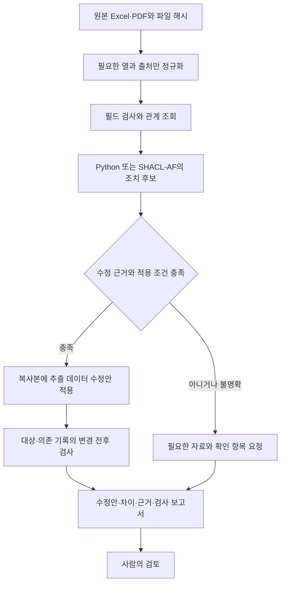

# 제조 기록의 확인 요청과 근거 기반 수정안

실제 자료 243개 주석 행을 점검하고 별도로 작성한 합성 개발 사례 32개에서 조치 후보 생성과 수정 후 검사를 실행했습니다. 같은 정책의 Python과 SHACL-AF는 같은 결과를 냈습니다. 제조 현장의 개선 효과를 측정한 결과는 아니며 기존 `source-grounded-1`의 합성 개발 사례 144개와도 구분합니다.

## 실제 용접 자료의 점검 범위

[PENELOPE 공개 용접 자료](https://zenodo.org/records/15083865)의 PP3–PP7 작업 주석을 확인했습니다. 다섯 Excel 파일에는 결함 코드, 용접 설정 코드, 비드 번호, 위치 구간, 샘플 구간이 있습니다. 총 243개는 주석 행 수이며 독립적인 물리적 결함 수가 아닙니다.

| 시편 | 주석 행 | 이번 점검에서 남긴 확인 사항 |
|---|---:|---|
| PP3 | 68 | 검사한 참조와 구간 조건에서 추가 확인 사항 없음 |
| PP4 | 1 | 설계 PDF 다운로드가 잘려 문서 대조는 미완료 |
| PP5 | 50 | 25행의 위치·샘플 구간이 역순 |
| PP6 | 112 | 저장된 수식 결과 27개와 단순 정수 덧셈을 대조 |
| PP7 | 12 | 10행의 설정 번호와 해당 설계 문서의 비드 설정이 다름 |

모든 행의 결함·설정 코드 참조는 해결됐습니다. 그렇더라도 다른 문서와의 의미나 값이 일치한다는 보장은 없습니다. 원본 전체 ZIP은 내려받지 않았으며 필요한 파일만 HTTP Range로 취득하고 완전한 파일의 ZIP CRC와 SHA-256을 기록했습니다. PP4 설계 파일의 불완전한 응답은 실패로 보존했고 재시도하지 않았습니다. 전체 ZIP의 해시는 검증하지 않았습니다.

PP5·PP6·PP7 설계 PDF는 PP3의 설계 PDF와 SHA-256이 같습니다. PP4는 목록의 CRC·크기가 같다는 정보만 있으므로 같은 파일로 확정하지 않습니다. 코드의 의미는 시편과 코드북의 범위를 함께 유지합니다. 예를 들어 Excel의 코드 번호를 다른 검사 보고서의 범례와 바로 합치지 않습니다.

## 두 가지 확인 요청 사례

| 근거 위치 | 실제 기록 | 요청할 내용 | 현재 확정할 수 없는 수정 |
|---|---|---|---|
| `PP5!D25:G25` | 위치 177→160 mm, 샘플 73717→66637 | 구간 방향과 원래 주석의 확인 | 두 끝점을 바꾸면 맞는지 |
| `PP7!A10:G10` 및 설계 PDF 2쪽 | 비드 2의 주석은 설정 1, 설계는 설정 2에 대응 | 실제 적용 설정·예외 기록·설계 버전 확인 | 주석과 설계 중 어느 쪽을 고칠지 |

첫 사례는 시작점이 끝점 이하라는 명시적 계약을 적용하면 확인 대상으로 나옵니다. 역순이라는 사실만으로 오타를 증명하지는 못합니다. 두 번째 사례에서 주석의 설정 1은 450 A, 설계와 대응하는 설정 2는 550 A입니다. 이는 자료 대조 결과이며 전류를 바꾸라는 공정 권고가 아닙니다.

비드에 해당하는 공정 파일 이름도 ZIP 목록에서 찾았습니다. 파일 이름의 대응은 실제 센서 신호와 주석 구간의 정렬을 검증한 결과와 다릅니다. 이번에는 해당 HDF5 신호를 읽어 샘플 인덱스를 대조하지 않았습니다.

## 역량질문과 조치의 범위

관계와 적용 조건을 확인하고 수정 전후를 검사하면 근거 없는 데이터 변경을 줄이면서 근거가 충분한 수정안을 얼마나 유지할 수 있을까요?

1. 어느 기록을 추가 확인해야 하며 어떤 필드와 원본 위치가 그 요청을 뒷받침합니까?
2. 수정할 값을 뒷받침하는 자료가 같은 대상·속성 의미·단위·버전에 해당합니까?
3. 복사본에 수정안을 적용하면 목표 위반이 해결되고 다른 관련 위반은 생기지 않습니까?

실제 자료에는 검증된 수정 정답이나 공식 조치 절차가 없습니다. 실제 행에서는 확인 요청과 근거 경로를 기술하고 자동 수정의 효과는 별도로 작성한 합성 개발 사례에서 검사합니다. 연구자가 만든 조치 목록을 데이터 제공기관이 승인한 규칙으로 소개하지 않습니다.

## 하이브리드 처리 구조



원본, 계산으로 얻은 관계, 제안한 수정은 구분해서 저장합니다. 원본 파일을 직접 수정하거나 설비에 명령하지 않습니다. SQL·파일·Python을 유지하면서 작은 의미 계층을 연결하는 구조이며 모든 데이터를 온톨로지로 옮길 필요는 없습니다.

SHACL은 선언한 데이터 조건을 검사하고 SHACL-AF 규칙은 조치 후보에 필요한 관계를 도출합니다. 복사본의 수정과 변경 이력은 Python이 담당합니다. 이번에는 pySHACL 0.40.1과 RDFLib 7.6.0으로 구현했습니다. 참조하는 [SHACL-AF 문서](https://www.w3.org/TR/shacl-af/)는 Working Group Note이므로 SHACL Core Recommendation과 지위를 구분하고 [pySHACL](https://github.com/RDFLib/pySHACL)의 실제 규칙 실행을 작은 예제로 먼저 확인했습니다. SWRL은 필요한 추론을 현재 구성으로 표현하기 어려운 경우에 별도로 검토합니다.

## 비교 조건과 평가 기준

새 합성 개발 사례는 필드 역할 2개, 관계 깊이 2개, 근거 상태 8개를 조합한 32개입니다. 이전 144개를 새로운 평가 자료로 다시 쓰지 않습니다. 식별자와 값은 연구자가 만들고 합성임을 표시합니다.

| 비교 요소 | 조건 |
|---|---|
| 조치 후보 생성 | 직접 필드만 보는 조건, 관계를 확인하는 Python, 같은 정책의 SHACL-AF |
| 수정 후 검사 | 없음, 복사본에 적용한 뒤 재검사 |
| 근거 상태 | 유일한 현재 근거, 원천 누락, 검색 누락, 오래된 근거, 잘못된 대상·속성, 충돌 근거, 형식은 맞지만 사실이 틀린 근거, 변경 후 의존 제약 위반 |

총 192개 출력 행을 얻었지만 독립 표본 192개는 아닙니다. 같은 32개 사례를 여섯 조건으로 반복 비교합니다. 직접 필드 조건은 한 단계 참조만 허용하고 두 번째 관계 탐색을 제거한 비교 조건이며 키워드 검색이나 벡터 RAG를 대표하지 않습니다.

근거 없는 수정안과 근거가 충분한데도 불필요하게 보류한 수정안을 함께 셉니다. 조치 정책과의 일치, 변경 후 제약 위반, 합성 정답에 따른 사실 오류도 분리합니다. Python과 SHACL-AF는 결과 수뿐 아니라 대상·행동·근거 경로까지 비교합니다.

원천 누락과 검색 누락은 보이는 입력이 같으면 실행기가 구분할 수 없습니다. 원인을 평가기에만 두고 실행 중에는 정답으로 보완하지 않습니다. 형식에 맞는 잘못된 참조가 제공되면 검사를 통과한 수정안도 사실과 어긋날 수 있습니다. 이 실패를 남겨야 검증의 범위를 평가할 수 있습니다.

## 산출물과 남은 검증

설계 원본은 저장소의 `research/actionable-evidence-1/protocol.json`입니다. 실제 행의 추출본에는 원본 셀, 수식과 저장된 값, 코드북, 파일 해시, 라이선스와 변경 내역을 보존했습니다. 개인정보와 검사 보고서 이미지는 포함하지 않습니다. 자료는 CC BY 4.0이며 출처는 Tapia Suárez 외의 [Submerged Arc Welding Open Repository](https://doi.org/10.5281/zenodo.15083865)입니다.

입력·평가 파일과 코드 해시를 실행 전에 고정하고 출력 저장이 끝난 뒤 별도 평가기를 실행했습니다. 직접·두 단계 사례의 사전 점검 12행은 본 실행과 같은 개발 사례의 일부이며 새로운 독립 표본으로 더하지 않습니다. 실행별 입력·코드 사본, 표준 출력·오류 로그, 수정 전후 보고서를 보존했습니다. LLM의 원문 해석, 실제 현장의 수정 정확도, 유지보수 인건비, 검색 성능, 물리적 품질 개선은 아직 측정하지 않았습니다.


## 첫 실행 결과와 해석

아래 각 행의 분모는 같은 합성 사례 32개입니다. 선언 조건 위반은 참조의 적용 조건이나 변경 후 의존 조건을 만족하지 못한 수정안입니다. 사실 오류는 그와 별도로 합성 정답과 대조합니다. 두 오류 범주가 서로 같지는 않습니다.

| 후보 생성 | 재검사에 따른 보류 | 최종 제안 | 선언 조건 위반 제안 | 올바르고 허용된 수정의 불필요한 보류 | 사실과 다른 제안 |
|---|---|---:|---:|---:|---:|
| 한 단계 참조 | 없음 | 6/32 | 2/32 | 2/4 | 2/32 |
| 한 단계 참조 | 있음 | 4/32 | 0/32 | 2/4 | 2/32 |
| 관계 조회 Python | 없음 | 12/32 | 4/32 | 0/4 | 4/32 |
| 관계 조회 Python | 있음 | 8/32 | 0/32 | 0/4 | 4/32 |
| SHACL-AF | 없음 | 12/32 | 4/32 | 0/4 | 4/32 |
| SHACL-AF | 있음 | 8/32 | 0/32 | 0/4 | 4/32 |

불필요한 보류의 분모 4개는 근거가 현재 조건에 맞고 수정값도 합성 정답과 일치하며 의존 조건까지 통과하는 사례입니다. 값은 맞더라도 다른 조건을 위반하는 수정안은 이 분모에서 제외했습니다. 선언 조건을 만족하는 사례는 8개이며 여기에는 형식에 맞는 거짓 근거 4개도 포함됩니다. 따라서 선언 조건과 모두 일치한다는 결과를 사실 정확도 100%로 해석하면 안 됩니다.

Python과 SHACL-AF는 각 재검사 조건에서 32/32 사례의 후보 식별자, 출처, 수정안, 전후 보고서와 최종 처리가 일치했습니다. 전체 192행에서 실행 오류는 없었고 원본 보존과 Python·SHACL 검사 결과의 일치도 확인했습니다. 이 숫자는 이 입력 문법과 사례 범위의 구현 일치이며 일반적인 엔진 동등성이나 성능 우위를 뜻하지 않습니다.

한 단계 조건의 보류 2건은 두 번째 관계를 따라가지 못하도록 설계한 결과입니다. Python도 같은 관계를 따라가면 해결하므로 RDF 고유의 장점으로 볼 수 없습니다. 재검사가 막은 4건은 미리 작성한 의존 조건을 위반하는 수정안입니다. 반면 거짓 근거의 값이 모든 조건을 만족하면 재검사 뒤에도 제안이 남습니다.

두 재검사 조건 모두 변경 전후 진단을 계산하고 결과를 저장했습니다. 차이는 그 진단을 제안 보류에 사용했는지입니다. 따라서 이번 비교로 검사 실행 시간이나 비용 차이를 말할 수는 없습니다. 근거를 제공하는 합성 자료와 평가 정답은 모두 연구자가 작성했으며 독립적인 현실 관측은 아닙니다. 실행기는 정답 파일을 읽지 않습니다.

## 코드와 실행 산출물

```bash
# 이미 고정된 입력으로 새로운 이름의 실행 폴더를 만듭니다.
uv run --locked python -m scripts.actionable_evidence.run --run-id reproduction-001
# 출력이 모두 저장된 다음 평가 정답과 대조합니다.
uv run --locked python -m scripts.actionable_evidence.evaluate --run-id reproduction-001
# 잘못된 입력·관계 조건·보류·원본 보존을 확인합니다.
uv run --locked python -m unittest tests.test_actionable_evidence -v
```

같은 이름의 실행 폴더와 평가 결과는 덮어쓰지 않습니다. 이번 실행은 `research/actionable-evidence-1/runs/run-001/`이며 [집계와 사례별 평가 기록](records/20261029-actionable-evidence.json)을 함께 남겼습니다. 사전 점검은 `smoke-001`에 보존했습니다. 테스트 5개는 소프트웨어 경계 검사이며 연구의 독립 표본 수에 포함하지 않습니다.

[오프라인 데모](actionable-evidence-demo/index.html)에서는 실제 PP5·PP7의 확인 요청과 합성 수정안을 출처와 함께 비교합니다. [화면의 자료 구분과 재생 방식](../journal/2026-10-29-actionable-evidence-demo.md)을 따로 설명했습니다. 현실의 오류 확정이나 공정 변경 승인은 이 화면의 범위에 포함하지 않습니다.
