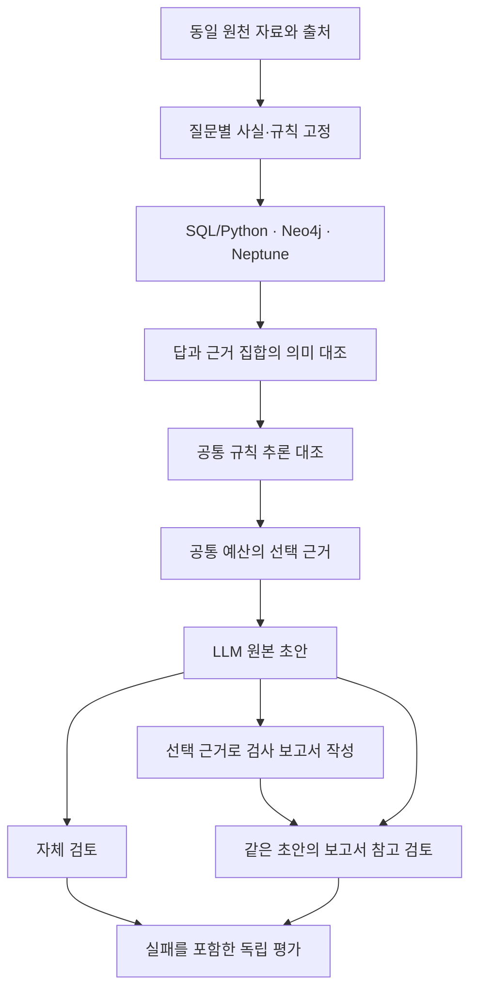

# 관계 검색·추론·최종 검토의 연결 실험

프로토콜 `backend-reasoning-review-1`, 설계 초안 2026-11-06. 기존 개발 자료와 결과를 보존하면서 Neo4j·Neptune 비교를 추가한다. 현재 완료 범위는 연구 이력 대조, 질문 매핑, 원천 자료 부분집합 준비다. 새 DB 비교·추론·LLM 평가는 아직 실행하지 않았다.

## 기존 연구와의 연결

| 기존 연구 | 이어받는 내용 | 이번에 추가할 검증 |
|---|---|---|
| 개선된 hybrid RAG와 관계 검색 | 동일 원천 정보, 검색 예산, SQL/Python 대조군 | 백엔드를 바꿔도 같은 근거를 반환하는지 |
| `ontology-reasoning-offline-1` | 동일 규칙을 적용한 JSON/Python과 OWL-RL, 명시 사실 조회 대조군 | 실제 기록에 연결한 스키마 가설과 백엔드별 지원 범위 |
| `post-answer-review-1` 질문 확장 | Q1–Q9, 선언된 적용 정책과 세부 평가 항목 | 관계·추론 결과를 답변 검토에 연결하는 조건 |
| 6개 모델의 짝지은 검토 | 같은 초안에서 자체 검토와 보고서 검토를 분기 | 새 질문의 재현성과 검증용 선언 누락 |

이전 유료 실험은 예정 162건 중 154회 호출, 145개 정상 답변, 출력 실패 9건, 의존성 미실행 8건으로 종료됐다. 세 조건이 모두 완료된 47개 묶음에서 요청 항목 전체 일치는 초안 46개·자체 검토 46개·보고서 검토 47개였다. 한 사례의 수정이며 답변 전체의 사실성이나 일반적인 SHACL 효과를 뜻하지 않는다. 이전 원장과 결과를 다시 쓰거나 남은 예산을 새 호출에 사용하지 않는다. 자세한 분모와 한계는 [기존 결과 보고서](../journal/2026-11-04-paired-six-model-review.md)에 남아 있다.

## 연구 질문과 개입

동일한 원천 정보와 선언된 정책을 제공할 때, 관계 검색·추론·검토 보고서가 어떤 오류를 줄이며 어떤 비용을 추가하는가? 이를 Neo4j와 Neptune에서 구현할 때 의미 보존과 운영 방식은 어떻게 달라지는가?

관계 검색은 필요한 코드북 근거의 누락을 다룬다. 추론은 명시된 계층·규칙에서 도출되는 관계를 다룬다. 최종 검토는 초안의 값·출처·적용 범위와 근거 사이의 불일치를 다룬다. 세 개입을 한 번에 바꾼 결과로 개별 효과를 주장하지 않는다.

도식은 계획이다. 추론 결과는 주장별 원천 근거와 규칙 ID를 연결한다. 보고서 조건은 자체 검토 결과를 받지 않으며 추가 원천 검색도 하지 않는다. SHACL 위반은 참고 정보로 제공하고 강제 거부나 정답 교체에 사용하지 않는다.

## 질문 유형의 유지와 확장

기존 Q1–Q9를 유지한다. 직접 조회·관계 탐색·추론·검토·변경 영향은 질문을 대체하는 새 번호가 아니라 필요한 기능을 나타낸다.

| 유형 | 기존 질문의 핵심 | 이번 비교에서 확인할 경계 |
|---|---|---|
| Q1 직접 조회 | PP6 2행의 위치 값과 셀 | 숫자·단위·원래 표기 보존 |
| Q2 사전 연결 | 결함 코드와 같은 파일의 이름 | 관계 조회와 추론의 구별 |
| Q3 복수 기록 비교 | 두 설정의 명목 전류와 차이 | 조회·산술·차이 방향을 분리 |
| Q4 조건 검색·집계 | 지정한 두 행에서 조건에 맞는 행과 개수 | 주어진 모집단 안의 완전성 |
| Q5 값의 의미 | 위치와 표본 번호, 명목값과 측정값 | 선언된 역할과 자연어 설명의 불일치 |
| Q6 출처 적용성 | PP6에 PP7 코드북을 대신 쓸 수 있는지 | 같은 이름·코드가 적용성을 보장하지 않음 |
| Q7 시점 적용성 | 사건일에 유효한 문서 버전 | 가상 이력과 실제 원천을 분리 |
| Q8 근거 한계 | 확인 가능한 값과 필요한 추가 자료 | 선택 근거 누락과 원천 부재를 분리 |
| Q9 초안 검토 | 잘못된 결함명·측정값 설명의 수정 | 작성된 오류 초안과 모델의 실제 오류를 분리 |

이 질문들은 조회·산술·검토로 답할 수 있어 OWL 추론이 반드시 필요한 과제가 아니다. 추론 효과를 억지로 부여하지 않는다. 추가 진단 I1은 AnnotationRecord·DictionaryRecord의 상위 EvidenceRecord 소속 조회, I2는 두 코드북 연결 관계의 상위 sourceReference 조회다. 이 계층은 실험자가 작성한 스키마 가설이며 원문에서 발견한 도메인 온톨로지가 아니다. I1·I2 결과도 Q1–Q9 답변 효과와 별도 집계한다.

## 원천 자료와 스키마 가설

기존 동결 자료는 328개 노드와 486개 연결이다. 이번 준비에서는 Q1–Q9가 명시적으로 참조한 7개 노드와 양 끝점이 선택된 4개 연결을 원형 그대로 추출했다. 전체 자료의 완전한 부분 모집단이라는 뜻은 아니다. 원천 해시, 파일·시트·셀, 원래 값과 라이선스를 함께 보존했다.

자료는 Tapia Suárez 등의 *Submerged Arc Welding Open Repository*, DOI [10.5281/zenodo.15083865](https://doi.org/10.5281/zenodo.15083865), CC BY 4.0을 사용한다. 기존에 소비한 개발 자료이며 새 평가용 표본으로 바꾸어 부르지 않는다. Q7의 버전 이력은 별도 합성 자료다. 물리 공정의 적정성이나 조치를 추천하지 않는다.

원천 사실, 수작업 스키마, 추론으로 도출한 사실, 평가 정답을 서로 다른 파일·그래프로 관리한다. 원천이 뒷받침하지 않는 계층·규칙은 가설 ID와 작성 근거를 붙이며 전문가가 검증했다고 표현하지 않는다.

## 비교 조건과 실행 순서

### 1단계: 원천과 쿼리의 의미 대조

SQL/Python, Neo4j/Cypher, Neptune/RDF/SPARQL에 같은 질문 계약을 적용한다. 9개 질문 계약 × 3개 백엔드의 27개 계획 슬롯을 만들되, 조회만 가능한 백엔드가 자연어 검토까지 완료했다고 세지 않는다. 미지원·부분 구현·입력 오류·쿼리 오류·시간 초과를 남긴다. Q7에는 별도의 합성 이력을 명시한다.

노드 ID, 방향, 중복, null, 다중 값, 숫자의 원래 표기와 타입, 출처 범위를 먼저 고정한다. 답 집합과 근거 ID 집합을 각각 대조한다. Python 산술이나 역할 검사를 함께 썼다면 DB 단독 처리로 표시하지 않는다. 기존 Neptune openCypher 코덱은 별도 경로이며 RDF/SPARQL 연결을 검증한 것으로 재분류하지 않는다.

### 2단계: 공통 규칙과 고유 기능의 분리

DB 자체의 차이를 볼 때는 같은 외부 계산 결과를 두 DB에 적재하는 공통 구체화 조건을 둔다. 추론 구현의 차이는 Neo4j+n10s의 질의 시점 처리와 외부 RDFS/OWL-RL 처리로 따로 비교한다. 동일 규칙의 Python 구현을 대조군으로 유지한다. 추론 없는 조건에도 같은 스키마를 제공하되 도출 연산만 사용하지 않는다.

먼저 I1의 타입 계층을 확인하고 I2는 설치 버전에서 지원 여부를 검사한 뒤 포함한다. 공통으로 처리할 수 없는 규칙은 성능 순위에 섞지 않는다. 전체 OWL 폐쇄 집합 대신 사전에 정한 질의의 답 집합을 비교한다. HermiT의 OWL DL 일관성 검사는 이 단계의 공통 비교에 포함하지 않는다.

원래 사실과 도출 사실을 구별하고 순환, 잘못된 방향, 무관한 클래스, 규칙 누락을 대조한다. 두 근거 경로 중 하나를 삭제한 경우와 모두 삭제한 경우도 나눈다. 별도로 만든 근거 연결 기록은 n10s나 OWL-RL이 자체 제공한 증명이라고 부르지 않는다.

### 3단계: 같은 초안의 최종 검토

검색·추론 조건별로 하나의 원본 초안을 만든 뒤 자체 검토와 보고서 검토를 분기한다. 자료·정책·입출력 예산을 공통으로 두며 보고서 길이도 총 입력 예산에 포함한다. 비교가 유효한지 메시지 해시와 근거 ID로 확인한다. 이전 모델 응답을 새 근거 조건의 결과로 재사용하지 않는다.

같은 정책의 Python 보고서와 SHACL 요약 메시지를 먼저 대조한다. 메시지가 같다면 동일 입력의 중복 유료 호출로 SHACL 고유 효과를 주장하지 않는다. 새로운 질문·모델 경로·토큰 한도·실패 예약 원장과 유료 실행 범위를 고정하기 전에는 추가 호출하지 않는다.

### 4단계: 변경과 오래된 결과의 추적

원천 값 변경, 관계 삭제, 스키마 규칙 변경을 구분한다. 변경 전후의 원천·규칙·도출 결과 해시와 무효화 대상을 보존한다. 질의 시점 추론과 저장된 추론 결과의 갱신 비용을 분리하고 구형 결과가 남아 있는지도 검사한다. 수정 파일 수나 코드 줄 수를 사람의 유지보수 시간으로 해석하지 않는다.

## 평가와 실패 분모

실행 예정·완료·실패·미지원·의존성 미실행을 모두 남긴다. 답 집합 일치와 근거 집합 일치, 요청 항목 정확도, 인용 지지, 근거 없는 확신, 불필요한 보류, 구체적인 검토 위치, 검증용 선언의 누락을 따로 집계한다. 검토자 간 불일치도 보존한다. 모델과 반복은 같은 질문에 종속된 결과이며 독립 질문 수를 늘리지 않는다.

시간은 적재·변환·추론·네트워크 포함 질의·보고서 생성·LLM 호출로 나눈다. 현재 단일 EC2의 Neo4j와 관리형 Neptune 사이의 시간 차이는 배치 환경의 관측값이다. 이를 곧바로 DB 엔진의 우열로 해석하지 않는다. 새 평가 질문은 개발 질문의 단순 이름 변경으로 만들지 않고 출처·질문 가족 단위의 분리와 정답 독립 검토를 거친다.

## 최초 설계 시점의 산출물과 실행 계획

`research/backend-reasoning-review-1/design-001/`에 원천 부분집합, 기존 질문 매핑, 비교 계약, 이력 해시와 자료 대조 기록을 저장했다. 기존 결과와 웹사이트 파일은 변경하지 않았다. 최초 설계 시점에는 새 유료 호출과 DB 적재를 하지 않았다.

다음 실행은 1단계의 읽기 전용 질의 계약·정규화 결과·독립 평가 입력을 동결한 뒤 별도 실험 네임스페이스에 작은 원천 묶음을 적재하는 작업이다. n10s는 실제 설치·호환성·지원 함수 확인 전까지 준비되지 않은 것으로 기록한다. Neptune의 기존 승인 종료 시각은 2026-11-06 10:10:52 UTC이며 이 설계로 연장하지 않는다. 마감 후에는 오프라인 준비만 가능하고 새 운영 창을 정한 뒤 연결 실험을 재개한다.

## 2026-11-06 실행 기록

이후 승인된 2시간 작업에서 실제 Neo4j+n10s와 Neptune/RDF 비교를 실행했다. [실행 결과와 한계](../journal/2026-11-06-backend-inference-review.md)에 질의 계약, 추론, 갱신, RDF 왕복 변환과 사후 검토 결과를 정리했다. Q7은 실제 변경 이력이 없어 합성 이력을 보충하지 않고 미지원으로 남겼다. 최종 LLM 답변은 새로 생성하지 않았다. Neptune 중지와 실험용 n10s 컨테이너 제거를 확인했다.

## 기술 근거

- [n10s 추론 문서](https://neo4j.com/labs/neosemantics/5.14/inference/): 클래스 계층에 따른 질의 시점 조회 기능. 문서 버전과 실제 설치 버전의 호환성을 별도 확인한다.
- [OWL-RL 문서](https://owl-rl.readthedocs.io/en/latest/): RDFLib 기반 RDFS·OWL 2 RL 전방 추론 구현. 본 설계의 선언된 부분 규칙과 전체 지원 범위를 구분한다.

<!-- HUMANIZE-SUMMARY -->
- 장르·경로: 보고서, light 보수적 윤문.
- 적용: A-19 이중 조사 1건, C-11 연결어미 뒤 쉼표 1건 정리.
- 보존: 제목, 사실·수치·날짜·고유명사·기술 용어, 코드·표·링크, 계획과 완료 범위, 주장 강도.
- 자체검증: 6항 점검, 미통과 항목 0건. 변경률 확정은 verify_change_rate.py 검증에 따름.
<!-- /HUMANIZE-SUMMARY -->
