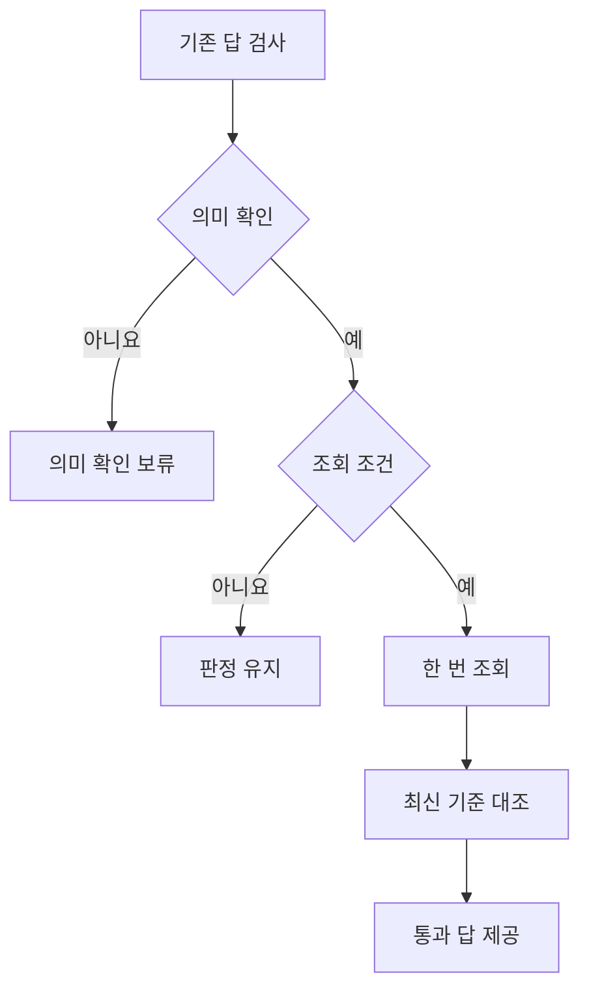

# 선택적 검사 뒤의 제한된 추가조회

상태: 첫 실행 331,776행과 보완 파생 평가 110,592행을 완료했다. [실행 결과](records/20261014-bounded-refresh.md)에 최초 정책과 보완을 구분했다.

프로토콜 `bounded-refresh-1`은 [선택적 검사](semantic-guards-study.md)에서 보류한 답을 현재 원천의 재조회로 복구할 수 있는지 비교한다. 기존 답 12,288행을 재사용하며 유료 모델이나 DB 서버를 호출하지 않는다.

## 정책과 조회 예산

| 정책 | 추가조회 조건 | 한도 |
| --- | --- | --- |
| 보류 유지 | 조회하지 않고 기존 검사 결과 유지 | 0회 |
| 선택 조회 | 의미 검사를 통과하고 업무 대조·관련 변경 검사 중 하나가 실패 | 업무 묶음당 1회 |
| 매번 조회 | 의미 검사를 통과한 모든 묶음 | 업무 묶음당 1회 |

한 묶음은 같은 제품의 공급 국가·지역 제한·공급자 추천 세 업무다. 한 번 읽은 원천으로 세 업무를 다시 계산한다. 이번 구현은 해당 크기의 JSON 원천 스냅샷 전체를 파일에서 읽으며 필요한 필드만 반환하는 실제 API는 아니다. 조회량은 읽은 파일의 바이트 수로 기록한다. 세 결과 행에 같은 조회 비용이 표시돼도 합산은 묶음 기록에서 한 번만 한다.

기존 JSON·RDF 조건은 최초 답을 만든 경로를 가리킨다. 추가조회는 모두 같은 JSON 경로를 사용하므로 RDF·SPARQL 재조회나 저장 엔진 비교 결과로 해석하지 않는다.

## 응답 상태와 재검사

조회 서비스는 현재 원천, 서비스 실패, 초기 원천을 다시 반환하는 세 조건으로 나눈다. 초기 원천이 해당 질문에 여전히 맞는 경우도 있어 오래된 응답을 모두 오답으로 간주하지 않는다.



의미 근거 확인 분기는 보류 사유를 남기는 단계다. 문서를 자동으로 읽는 기능은 이번 실행에 포함하지 않는다.

이 흐름에서는 의미가 확인된 질문에만 원천 재조회를 허용하고 응답을 기존 최신 기준과 다시 대조한다. 조회 요청이 실패하면 세 답을 보류한다. 응답을 받았더라도 관련 데이터가 여전히 오래됐으면 보류하며 현재 원천에 국가가 없으면 확인 불가로 남긴다.

최신 원천·설정의 지문을 제공하는 별도 발행 경로가 있다는 가정을 유지한다. 재조회한 응답으로 이 기준을 덮어쓰지 않는다. 지문을 만드는 비용과 발행 경로 자체의 장애는 이번 비교에 포함하지 않는다.

## 의미 매핑과 정답의 분리

필드 설명은 올바른 설명·누락·잘못된 설명의 세 조건을 유지한다. 의미가 충돌하거나 설명이 없으면 자동으로 다른 필드에 연결하지 않는다. 잘못된 설명이 잘못된 매핑을 승인한 경우에는 최신 원천을 읽어도 같은 필드로 판단할 수 있다.

실행 중에는 기존 답·근거·발행된 설정·지문·카탈로그만 검사기에 전달한다. 조회 함수는 원천 JSON 바이트만 반환한다. 평가 기준과 오류 주입 이름은 사후 점수 계산에만 사용하며 참조 정답으로 필드를 바꾸거나 원천을 채우지 않는다.

## 평가와 재현

기존 12,288행에 카탈로그 세 조건·응답 세 조건·정책 세 조건을 적용해 331,776개 결과 행과 110,592개 묶음 판정을 계획한다. 독립 표본 수를 늘린 평가가 아닌 개발 사례의 대응 비교다.

통과한 오답, 통과한 정답, 보류한 답, 원래 오답에서 정답으로 바뀌어 통과한 답, 원래 정답에서 오답으로 바뀌어 통과한 답을 구분한다. 출력이 평가 기준과 같지만 보류된 경우도 결정 가능한 답과 원래 확인 불가인 답을 나눠 센다. 잘못된 매핑으로 우연히 맞은 답도 출력 일치 지표에서는 정답에 포함한다. 조회 횟수·실패·바이트 수는 묶음 단위로 집계한다.

독립 검토와 등록 테스트 뒤 최대 600초로 실행한다. 입력 해시·실행 소스·운영 패킷·전후 답과 근거·실패를 보존한다. 별도 분석기로 전체 행과 조회 횟수, 실제 반환 원천에 따른 새 답·근거를 대조한다.

```bash
uv run --locked python scripts/run_bounded_refresh_study.py --output runs/bounded-refresh-reproduction
uv run --locked python scripts/analyze_bounded_refresh_study.py --run runs/bounded-refresh-reproduction --output _workspace/bounded-refresh-reproduction-analysis
```

## 장애 후 기존 답 유지 보완

첫 실행에서 요청한 추가조회가 실패하면 묶음 전체를 보류하는 문제가 확인돼 `refresh-fallback-1`을 추가했다. 선택 조회에서 통과하지 못한 답 가운데 조회 전 검사를 모두 통과했던 답만 기존 값과 근거로 되돌린다. 새 답과 기존 답을 합친 뒤 업무 대조·변경·의미 검사를 다시 적용한다. 기존에 검사를 통과하지 못한 답을 장애 때문에 허용하지 않는다.

보완 평가는 저장한 선택 조회 응답으로 110,592행을 재계산한다. 새 원천 조회는 수행하지 않으며 정책 비교의 조회 비용은 원래 선택 조회 기록을 그대로 물려받는다. 실제 호출 가능한 보완 함수도 구현하되 전체 집합의 결과는 응답을 재사용한 파생 평가로 구분한다.
