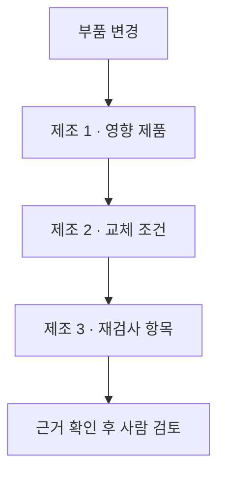

# 금융·제조업 여섯 업무 질문

업무 질문을 먼저 고정하고 각 질문에 필요한 관계·조건·출처를 비교한다. 제조업은 부품 변경 검토, 금융은 기업 관계 자료 검토를 대상으로 삼는다. 자연어 질문을 자유롭게 해석하는 단계는 분리하고 이번 실행에는 사람이 지정한 질문 유형과 입력 필드를 사용한다.

## 제조업 질문과 판단 기준

| 질문 | 필요한 자료 | 반환할 결과 | 정보가 부족할 때 |
| --- | --- | --- | --- |
| 제조 1. 부품 A를 바꾸면 어떤 제품을 다시 검증해야 하나? | 활성 BOM, 구성 관계의 방향, 적용 버전·수집 범위 | 영향 제품과 근거 레코드 | 수집 범위가 불완전하면 전체 판단 보류 |
| 제조 2. 제품 P에서 A를 B로 교체할 조건을 충족하나? | 제품 요구 규격, B의 규격·단위, 적용 인증과 유효 기간 | 명시한 조건 충족·미충족·판단 보류 | 규격·인증이 없으면 판단 보류 |
| 제조 3. 이번 변경으로 어떤 검사를 다시 해야 하나? | 변경 필드, 검사 항목별 의존 관계, 의존성 목록의 범위 | 다시 수행할 검사 항목과 사유 | 목록이 불완전하면 검사 없음으로 처리하지 않음 |

제조 2의 판단은 선언한 실험 규칙을 충족했는지를 뜻한다. 실제 설비 적합성·물리 성능·인증 효력을 검증하거나 교체를 승인하는 결과로 사용하지 않는다.

세 질문은 같은 변경 검토 업무를 다른 관점에서 다룬다. 이번 파일럿은 질문별 기능을 따로 평가하며 세 출력을 자동으로 이어 실제 변경을 실행하지 않는다.

## 금융 질문과 판단 기준

| 질문 | 필요한 자료 | 반환할 결과 | 정보가 부족할 때 |
| --- | --- | --- | --- |
| 금융 1. 기준일에 기업 A의 직접 회계 연결 모회사는 어디인가? | 직접 회계 연결 RR, 관계 상태·기간, 해당 범주의 REPEX | 보고된 모회사·보고 예외·충돌·확인 불가 | 운용사나 최종 모회사로 대체하지 않음 |
| 금융 2. A와 B의 보고된 최종 회계 연결 모회사는 같은가? | 두 기업 각각의 최종 회계 연결 RR와 유효 기간 | 같음·다름·확인 불가·충돌 | 한쪽 자료가 없으면 다른 그룹이라고 단정하지 않음 |
| 금융 3. 현재 자료로 기업 관계의 내부 검토를 완료할 수 있나? | 법인 상태, LEI 등록 상태, 관계 자료·버전·보고 예외 | 실험 내부 규칙상 검토 가능·재검토 필요·자료 부족 | 등록 갱신 상태를 법인 소멸과 혼동하지 않음 |

금융 2의 같음은 회계 연결 관계의 한정된 비교다. 지분·경제적 이해관계·모든 법적 계열 관계가 같다는 뜻은 아니다. 금융 3은 실험용 내부 검토 기준이며 신용 판단·투자 추천·법적 고객확인 완료를 의미하지 않는다.

GLEIF의 [RR-CDF 2.1](https://www.gleif.org/en/lei-data/access-and-use-lei-data/level-2-data-relationship-record-rr-cdf-2-1-format)은 직접·최종 회계 연결과 다른 관계 종류를 구분한다. [보고 예외 형식](https://www.gleif.org/en/lei-data/access-and-use-lei-data/level-2-data-reporting-exceptions-2-1-format)은 직접·최종 부모 범주에 맞는 예외를 기록한다. 이 구분을 유지하며 FIBO 용어를 적용한 것처럼 표시하지 않는다.

## 첫 비교의 범위

`business-questions-1`은 질문 여섯 개에 각각 여섯 개의 수작업 통제 사례를 만든다. 질문별 정상·부정·자료 누락·충돌·구버전·관계 또는 역할 혼동을 고려하되 모든 질문에 같은 오류 이름을 억지로 적용하지 않는다. 평가용 기대 답은 실행 함수 밖에 선언한다.

비교 조건은 단순 조회, 질문별 명시적 규칙·JSON, 같은 규칙·RDF다. 단순 조회는 의미·시간 등의 조건 일부를 제거한 비교이며 현행 LLM이나 운영 시스템을 대표하지 않는다. RDF 조건은 실제 SPARQL로 레코드를 조회한 뒤 JSON 조건과 같은 판단 함수를 사용한다. 이 비교에서 규칙 기반 두 방식의 일치가 확인돼도 RDF 고유의 효과나 독립된 의미 해석이 입증되는 것은 아니다.

36개 사례에 세 조건을 적용해 108행을 계획한다. 답의 상태·값, 근거 레코드, 잘못된 긍정 판단과 불필요한 보류를 구분한다. 여섯 업무의 건수를 하나의 산업 정확도로 해석하지 않는다. 별도 실제 GLEIF 예시는 원천에 연결된 동작 확인이며 합성 사례의 정답률에 합산하지 않는다.

## 재현과 확대 기준

독립 방법·구현 검토와 등록 테스트 후 제한된 오프라인 실행을 수행한다. 입력·소스·해시·전체 출력과 실패를 보존하고 별도 분석기로 행 수·점수·근거·질문별 결과를 대조한다. 유료 모델 호출과 데이터베이스 서버 설치는 포함하지 않는다.

다음 확대에서는 같은 질문을 유지한 채 대상과 오류 조건을 늘린다. 먼저 질문과 판정 기준이 실제 업무에 맞는지 확인한다. 그 뒤 자연어 질문 해석과 실제 문서에서 조건을 추출하는 작업을 별도 단계로 추가한다.

## 실행 정책과 해석 범위

기준일은 2026-10-12다. 금융 관계는 해당 스냅샷의 ACTIVE·PUBLISHED 레코드 중 관계 기간에 기준일이 포함된 자료만 사용한다. LEI의 ISSUED와 RR의 PUBLISHED는 서로 다른 등록 상태다. LAPSED 관계를 제외하는 것은 이번 내부 검토 정책이며 관계 자체가 거짓이라는 뜻은 아니다. 회계 기준별 복수 모회사는 별도로 모델링하지 않았다.

제조 1은 BOM 전체 수집 여부를 입력으로 받는다. 불완전하다고 선언된 경우 부분 영향 목록을 반환하지 않고 판단을 보류한다. 반환되는 근거 ID로 원천 연결을 추적할 수 있지만 설명용 경로를 별도로 생성하지는 않는다. 제조 3도 의존성 목록의 완전성을 외부에서 선언한다. 두 조건 모두 시스템이 실제 완전성을 증명한 결과가 아니다.

실제 GLEIF 예시는 RR 앞 256행에서 직접·운용 관계의 첫 주체와 최종 모회사 관계의 첫 두 주체를 고른 편의 표본이다. 선택한 주체에 대해 RR·REPEX 전체를 검색하고 LEI 자료를 결합한다. 회계 기간을 관계 기간으로 대신 쓰지 않으며 보고 예외의 날짜는 원천에 없는 기간을 만들어내지 않도록 어댑터 내부의 스냅샷 적용 범위로만 기록한다.

제조 1은 탐색 경로에 포함 부정 레코드가 하나라도 있으면 보수적으로 충돌을 반환한다. 긍정·부정 쌍을 요구하는 일반 모순 탐지기는 아니다. 원천 자료 누락과 검색 누락을 이 파일럿에서 별도로 발생시켜 비교하지는 않는다.
