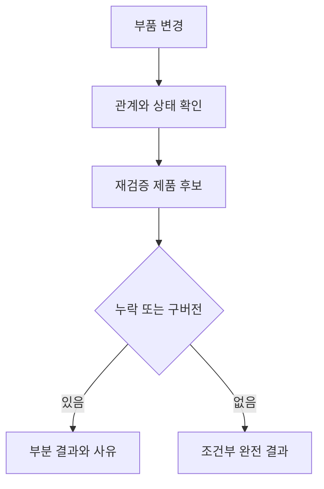

# 부품 변경에 따른 재검증 대상 탐색

상태: 192개 사례·2,304행의 [실행과 독립 검증](records/20261014-change-impact.md)을 완료했다.

프로토콜 `change-impact-1`은 제조업의 합성 BOM에서 부품 변경이 어떤 제품에 잠재적 영향을 미치는지 찾는다. 제품 성능을 예측하거나 교체를 승인하는 실험은 아니다. [도메인별 연구 지도](domain-characteristics.md)에서 다루는 첫 통제 실험이다.

## 입력과 통제 조건

관계 깊이 1·2·4·8, 가지 수 1·3, 시드 11·23·37·53, 원천 상태 여섯 가지를 조합해 192개 사례를 만든다. 가지 수는 변경 부품만 공유하는 길이 d의 독립 사슬 수다. 매 층에서 가지가 계속 늘어나는 지수형 트리가 아니다. 시드에 따라 제품·중간 노드와 관계의 방향 표현이 달라진다.

원천 상태는 정상, 관계 누락, 구버전 관계, 잘못된 관계 종류, 매핑 누락, 잘못된 매핑이다. 누락 조건에는 수집 범위가 불완전하다는 메타데이터를 제공한다. 구버전에는 소비한 버전과 공표된 버전의 차이를 제공한다. 잘못된 관계와 잘못된 매핑은 사후 평가만 알고 있으며 실행기에 정답 신호로 전달하지 않는다.

같은 패킷을 JSON·CSV·RDF로 왕복 변환해 세 표현의 정보 일치를 확인한다. CSV는 노드·관계 표와 JSON 값을 넣은 메타데이터 표를 사용한다. RDF는 관계 레코드와 메타데이터를 보존한다. 임의의 현장 CSV·RDF를 자동 해석하는 일반 변환기가 아니다.

## 탐색 정책

| 조건 | 처리 방식 | 해석 |
| --- | --- | --- |
| 직접 관계만 | 관계 종류·방향을 해석하고 한 단계 탐색 | 다중 단계 탐색 제거 실험 |
| 종류 없는 연결 탐색 | 활성 관계를 무방향으로 이어 탐색 | 관계 종류·방향 제거 실험 |
| 명시적 관계 규칙·JSON | 공개된 매핑으로 방향을 맞춘 뒤 여러 단계 탐색 | 동일 규칙의 Python 비교군 |
| 명시적 관계 규칙·RDF | 같은 유효 관계를 RDFLib SPARQL 경로로 탐색 | RDF DB 서버·OWL 추론과 구분 |

`partOf`·`usedIn`은 상위 조립체 방향으로, `contains`는 역방향으로 해석한다. 정상 매핑은 `associatedWith`를 제외한다. 비활성 관계는 제외한다. 잘못된 매핑은 연관 관계도 구성 관계로 인정하며 실행기가 평가 정답으로 이를 고치지 않는다.



직접 탐색과 종류 없는 탐색은 근사 정책으로 표시한다. 두 정책은 완전성을 주장하지 않는다. 따라서 완전성 오류가 없다는 이유로 더 안전한 정책으로 순위를 매기지 않는다. 규칙 기반 정책의 완전 결과도 제공된 범위·버전·매핑이 맞다는 조건 아래의 주장이다.

## 평가와 검증

평가용 정답은 오류 주입 전의 독립 child·parent BOM에서 계산한다. 실행 함수에는 변경 부품·노드·관계·매핑·범위 메타데이터만 전달한다. 원천에서 사라진 연결을 정답으로 복구하지 않는다.

192개 사례에 세 표현과 네 정책을 적용해 2,304행을 기록한다. 주요 집계는 JSON 표현의 정책별 192개 사례로 한정하며 다른 표현을 독립 표본처럼 세지 않는다. 누락·과잉 후보 수, 후보 집합 일치, 부분 결과, 틀린 완전성 주장을 함께 보고한다. 경로 증거와 실제 SPARQL 결과를 보존한다.

독립 방법·구현 검토와 등록 테스트 뒤 300초 이내로 실행한다. 별도 분석기로 192개 정답, 576개 직렬화 패킷, 2,304개 결과와 경로, 표현 간 일치와 규칙 기반 두 정책의 일치를 확인한다. 실행 실패·소스·해시를 보존한다. 유료 API와 DB 서버는 사용하지 않는다.

```bash
uv run --locked python scripts/run_change_impact_study.py --output runs/change-impact-reproduction
uv run --locked python scripts/analyze_change_impact_study.py --run runs/change-impact-reproduction --output _workspace/change-impact-reproduction-audit
```
