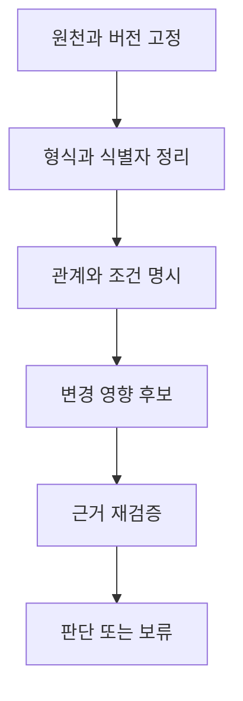

# 도메인과 데이터 구조에 따른 변경 영향 분석

현재 근거: [제조업 변경 영향 실험](records/20261014-change-impact.md)과 [실제 원천 여섯 종류의 특성 점검](records/20261014-domain-characteristics.md)을 완료했다. 도메인별 의사결정 성능 비교와 입문 안내서 완성은 후속 작업이다.

이 자료는 온톨로지 입문 안내서의 근거를 쌓기 위한 연구 지도다. 제조업·금융·의료는 업무 도메인이고 YAGO·Wikidata는 지식베이스이며 JSON·CSV·RDF·문서는 표현 방식이다. 이 세 축을 한 줄의 성능 순위로 합치지 않는다.

연구 목적은 데이터 변경 뒤 재검증할 판단을 찾고 근거가 부족한 범위를 드러내는 것이다. 불량률이나 손실률을 예측하는 물리·통계 시뮬레이션과 구분한다. 영향 후보를 찾았다는 사실만으로 교체·거래·진료를 승인하지 않는다.

## 전처리와 의미 모델의 경계

전처리에서는 파일 파싱, 식별자·단위·날짜 정리를 수행한다. 의미 모델에서는 관계의 방향, 관계를 이어도 되는 조건, 유효 기간과 업무 규칙을 정한다. 평가용 정답을 보고 누락된 관계를 채우는 작업은 허용하지 않는다.

형식 정리가 끝났어도 의미 연결은 틀릴 수 있다. 관계가 없다는 사실과 관계를 아직 수집하지 못했다는 사실도 다르다. 따라서 원천의 누락, 검색 과정의 누락, 잘못된 관계, 오래된 관계를 별도 조건으로 남긴다.

## 도메인별 판단 단위

| 대상 | 변경 후 확인할 질문 | 보존할 정보 | 피해야 할 해석 |
| --- | --- | --- | --- |
| 제조업 | 부품 변경으로 어떤 제품을 재검증해야 하나 | BOM 방향, 부품 버전, 활성 관계, 규격 | 연결된 제품의 성능이 반드시 나빠진다는 해석 |
| 금융·GLEIF | 관계 변경 시 어떤 기업 연결을 다시 확인해야 하나 | 관계 종류, 상태, 기간, 보고 예외 | 펀드 운용 관계를 지배·소유 관계로 바꾸는 해석 |
| 금융·FIBO | 같은 금융 용어와 관계를 어떻게 일관되게 표현하나 | 클래스·속성 정의, 모듈과 import, 버전 | 온톨로지 정의를 실제 거래 데이터로 취급 |
| 의료·FHIR | 기록 변경이 어떤 자원과 검토 작업에 연결되나 | 자원 유형과 ID, 참조 역할, 코드 체계, 단위 | 연결을 따라 환자 맥락을 무조건 상속 |
| YAGO | 선언된 클래스·속성과 사실이 어떻게 연결되나 | 원본 SHACL, RDF 자료형, 출처·릴리스 | 제약 통과를 현실의 사실 확인으로 해석 |
| Wikidata | 특정 시점·조건의 진술이 무엇인가 | statement ID, rank, qualifier, reference | 모든 진술을 시점 없는 단일 값으로 평탄화 |
| 문서 | 어떤 조항·버전이 판단 근거인가 | 절·표·예외, 유효 시점, 원문 위치 | 가까운 문장끼리 연결됐다는 이유로 규칙을 확정 |

FIBO는 금융 개념과 관계를 정의하는 OWL 온톨로지다. 실제 기업·계약 데이터와 연결하는 매핑은 별도 작업이다. [FIBO 공식 저장소](https://github.com/edmcouncil/fibo)에 정의와 모듈 구성이 설명돼 있다.

FHIR 참조는 관계를 나타내지만 참조 사슬을 따라 환자 맥락이 자동으로 전달되지는 않는다. 자원별 subject를 확인하거나 적용 프로파일의 규칙을 따라야 한다. [FHIR R4 참조 명세](https://hl7.org/fhir/R4/references.html)의 원칙을 기록 연결 실험의 기준으로 사용한다. 이번 연구는 임상적 진단·치료의 유효성을 평가하지 않는다.

Wikidata의 진술에는 순위·한정자·참조가 붙을 수 있다. 이를 버린 삼중항만으로 원래 질문에 답할 수 있는지는 질문의 시간·조건에 달려 있다. [Wikidata 데이터 모델](https://www.wikidata.org/wiki/Wikidata:Data_model)을 기준으로 정보 손실을 기록한다. YAGO는 [공식 4.6 배포](https://yago-knowledge.org/downloads/yago-4-6)의 스키마와 라이선스를 보존한다.

제조업 원천은 표 형태의 BOM에만 한정되지 않는다. [NIST STEP 자료](https://www.nist.gov/services-resources/software/step-file-analyzer-and-viewer)는 조립 구조·형상·제조 정보를 다룬다. 이번 통제 실험의 합성 BOM과 실제 STEP 모델의 해석·기하 검증을 같은 성과로 묶지 않는다.

## 비교 조건과 지표

같은 정보와 규칙을 JSON·CSV·RDF로 표현한 비교에서는 표현 방식만 바꾼다. JSON에 관계와 규칙을 주지 않고 RDF에만 제공하는 비교는 추론 기능의 제거 실험으로 표시한다. RDF 조건에는 같은 규칙을 실행하는 Python 조건을 함께 둔다.

서로 다른 도메인을 비교할 때는 정답률 하나로 합산하지 않는다. 영향 대상 누락·과잉 선택, 잘못된 완전성 주장, 근거 경로의 재현성, 추가로 필요한 정보, 변환 중 손실된 조건을 각각 기록한다. 실제 데이터에서는 독립 정답이 없는 경우도 있으므로 형식 점검·정보 손실 진단과 의사결정 정확도를 구분한다.

## 실행 순서와 안내서용 기록

1단계는 제조업의 변경 영향 후보를 찾는 통제 실험이다. 관계 깊이와 종류, 누락·구버전·잘못된 매핑을 나눠 비교한다. 제품을 찾는 과정과 제품 변경을 승인하는 과정을 분리한다.

2단계는 실제 자료의 특성 점검이다. GLEIF의 관계·예외, FIBO의 모듈, FHIR의 유형별 참조, YAGO의 제약, Wikidata의 진술 메타데이터를 작은 고정 표본에서 직접 읽는다. 자료별 표본 범위가 다르므로 대표성을 주장하지 않는다.

3단계는 각 도메인의 고유한 질문과 독립 평가 기준을 만든다. 금융의 관계 종류·시점, 의료 기록의 참조 역할, 문서의 유효 조항을 그대로 보존한다. 제조업의 노드 이름만 바꾼 실험을 도메인 전이로 부르지 않는다.

4단계는 실패 사례를 바탕으로 안내서를 정리한다. 각 항목에 입력 예시, 전처리 전제, 필요한 관계·규칙, 실제 결과, 실패 조건, 권장 재확인 절차와 아직 검증하지 않은 범위를 붙인다. 온톨로지가 없어도 충분한 사례도 함께 남긴다.
