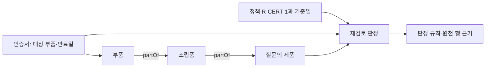

# 인증 상태와 제품 재검토 근거의 새 비교 설계

상태: `evidence-report-1` 설계 기준안 v0.1입니다. 기존 실험을 새 평가에 재사용하지 않습니다. 현재 산출물은 프로토콜, 공개 개발 예시와 오프라인 데모이며 LLM 실험 결과는 없습니다. 모델·예산·최종 평가 자료의 동결 전이므로 사전등록 완료나 확증 연구 완료로 부르지 않습니다.

## 연구 문제와 단일 업무 질문

품질 담당자가 “기준일 현재 인증서 CERT-Q의 상태 때문에 제품 PROD-Q를 재검토해야 하며, 어떤 기록과 규정이 근거인가?”라고 묻습니다. 답에는 재검토 필요·불필요·판단 유보와 이를 뒷받침하는 원천 행이 필요합니다. 재검토 필요는 안전성이나 출하 승인 판정이 아닙니다.

질문과 정책을 고정해도 LLM이 부품과 제품의 연결을 놓치거나 판정은 맞지만 다른 부품을 근거로 인용할 수 있습니다. 계산된 판정과 상세 근거를 함께 제공하면 이 오류가 줄어드는지 검사합니다. 온톨로지의 자동 구축이나 RDF 우월성을 중심 가설로 두지 않습니다.

## 원천 구축과 병목 진단의 보완 설계

[원천 데이터·규칙 구축과 실행 병목의 진단](source-to-rule-guide.md)에 관계 추출·SHACL 작성, 처리 경로별 입출력, 규칙 구축과 적용의 진단, 그래프 선택 조건을 정리합니다. 이는 사전 구축 절차와 후속 검증 제안입니다. 현재 A/B/C 주실험은 상세 근거 보고서의 효과를 비교하며 자연어 추출이나 그래프 우월성까지 평가하지 않습니다.

## 하나의 시나리오와 고정 정책

연구자가 새로 작성한 제조 기록을 사용합니다. 공개 표준을 읽었다는 사실을 실제 제조 데이터 확보로 표현하지 않습니다. 이 연구의 결과는 합성 업무 계약에 대한 결과입니다.

입력은 인증서 행, 부품·조립품·제품의 타입, `partOf` 관계 행, 기준일, 정책 버전과 근거 범위 선언입니다. 최종 평가에서는 객체 식별자를 불투명한 값으로 배정합니다. 업무 역할을 드러내는 이름이 평가 정답의 단서가 되지 않도록 합니다.



R-CERT-1은 만료일을 포함해 유효하다고 정합니다. `expires_on < as_of`일 때 만료입니다. 알려진 유효 인증이면 이 인증으로 인한 재검토는 불필요합니다. 만료된 인증의 대상 부품에서 질문 제품까지 제공된 유효 `partOf` 경로가 있으면 필요합니다. 인증이나 관계 근거가 부족하면 유보합니다. 만료됐지만 경로가 없다는 이유만으로 불필요로 판정하려면 질문 범위의 관계가 완전하다는 별도 선언이 필요합니다. 이 부정 경로 분기는 첫 주실험에 포함하지 않습니다.

관계 방향, 기간과 정책을 입력에 명시합니다. 원천 레코드의 진실성과 범위 선언의 진실성은 평가하지 않습니다. 자동 보완 조회, 사용자 질문 계약 추출, 정책 변경과 스키마 매핑 변경은 주실험에서 제외합니다.

## 비교 조건과 조작 요소

| 조건 | 공통 입력에 추가하는 정보 | 확인할 효과 |
|---|---|---|
| A 원시 근거 | 없음 | LLM의 직접 판정·근거 선택 |
| B 판정 제공 | 계산된 `decision`만 | 사전 판정의 효과 |
| C 상세 근거 제공 | B의 동일 판정과 적용 규칙, 원천 행으로 연결한 경로 또는 누락 설명 | 판정 외 근거 묶음의 추가 효과 |

모든 조건은 같은 질문·정책·조회 근거·근거 범위 선언을 받습니다. B와 C의 판정은 같은 런타임 함수에서 가져옵니다. C에 숨겨진 원천 행이나 평가 정답을 넣지 않습니다. C의 정보는 A에도 있는 기록에서 계산합니다. 정보량·정리 방식·경로 제시가 함께 달라지므로 결과는 이 근거 묶음 전체의 효과이며 개별 필드 하나의 효과가 아닙니다. 입력 토큰 수와 절단 여부를 기록하고 정보량 증가의 비용을 함께 보고합니다.

주 비교는 **C−B**입니다. B−A는 부차 비교입니다. C가 B보다 낫지 않아도 결과를 그대로 남깁니다. 결정적 계산기 단독 결과를 별도로 제시해 업무 판정에 LLM이 꼭 필요한지 확인합니다. LLM의 역할은 설명과 근거 선택이며 계산기보다 우수한 판정기를 전제하지 않습니다.

## 근거 상태와 분리 단위

| 상태 | 제공된 근거 | 계약상 판정 | 비교 목적 |
|---|---|---|---|
| E1 | 만료 인증 + 완전한 연결 경로 | required | 긍정 판정과 경로 근거 |
| E2 | 유효 인증 + 연결 경로 | not_required | 상태·날짜의 반대 조건 |
| E3 | 만료 인증 + 중간 관계 누락, 원천에는 존재 | unknown | 조회 근거가 부족한 경우 |
| E4 | E3와 같은 조회 근거, 원천에도 중간 관계 없음 | unknown | 관측 불가능한 차이의 대조 |

E3와 E4의 모델 입력은 식별자를 포함해 동일하게 만들고 `case_id`나 상태 이름을 프롬프트에 넣지 않습니다. 두 상태를 런타임이 구별할 수 없어야 합니다. 원천 부재와 검색 누락 구분은 채점용 원천 기록에만 있습니다. 이 연구에서는 추가 조회를 하지 않으므로 복구 성능이나 누락 원인의 식별 능력을 주장하지 않습니다.

한 가족은 같은 기본 구조에서 파생한 네 상태입니다. 공개 데모 1가족·4상태는 이미 본 개발 예시로만 사용합니다. 별도로 개발 8가족·32사례, 평가 32가족·128사례를 계획합니다. 평가는 새로 작성할 구조와 별도 식별자를 사용하되 같은 제한된 생성 문법이므로 새로운 산업이나 자유 문서에 일반화한 결과가 아닙니다. 평가 자료는 아직 만들지 않았습니다.

평가 계획은 128사례 × 3조건 × 2반복 = 768개 에피소드입니다. E3/E4는 동일한 가시 입력을 가진 진단 복제이므로 128개의 독립 문제로 집계하지 않습니다. 주 지표는 가족별로 E1·E2·unknown 세 가시 상태의 평균을 구하고 unknown은 E3/E4를 먼저 평균합니다. 이후 반복을 가족 안에서 평균하고 가족을 분석 단위로 씁니다. 공개 데모와 개발 사례는 평가 분모에서 제외합니다.

## 출력 계약과 평가

세 조건 모두 다음 구조로 답합니다. 조건별 설명 길이 요구를 다르게 주지 않습니다.

```json
{
  "decision": "required | not_required | unknown",
  "rule_id": "R-CERT-1",
  "support_row_ids": ["원천 행 식별자"],
  "missing": ["부족한 관계 또는 필드"],
  "explanation": "근거를 설명하는 한국어 문장"
}
```

주 지표는 **판정과 근거의 공동 충족률**입니다. 다음을 모두 만족해야 통과합니다.

1. 판정이 제공된 자료에 대한 계약 기준과 일치합니다.
2. 인용한 행이 모델 입력에 실제로 존재합니다.
3. 필요 판정이면 인증 행과 최소 하나의 유효 연결 경로를 인용합니다. 불필요 판정이면 유효 기간을 확인하는 인증 행을 인용합니다. 유보 판정이면 제공된 자료에서 부족한 항목을 올바르게 지정합니다.
4. 지원되지 않는 행·규칙·관계를 구조화 출력에 추가하지 않습니다.

정확한 문자열 한 개와의 일치 대신 허용되는 근거 집합을 판정합니다. 개발 전용 독립 채점기에서 행 삭제·다른 제품 경로·날짜 경계·여러 유효 경로를 확인하고 런타임은 채점기와 정답 파일을 읽지 못하게 분리합니다. 현재 데모 빌더의 점검은 개발 스모크이며 독립 채점기 구현이 아닙니다. 채점기를 동결할 때는 누락 설명의 허용 표현, 무관하지만 실제 존재하는 행의 인용, 불필요하게 추가한 누락 주장, 잘못된 rule_id, 대체 가능한 유효 경로의 처리까지 명시합니다. 보이지 않는 누락 원인을 추측해 맞힌 답에는 가점을 주지 않습니다.

자연어 설명의 근거 충실도는 별도 부차 지표입니다. 조건 이름을 가린 답변을 두 검토자가 독립 판정하고 불일치를 보고합니다. 구조화 출력이 통과했다는 이유로 자연어 전체의 충실도를 자동 통과시키지 않습니다. 검토자가 확보되지 않으면 이 지표는 미측정으로 남깁니다.

부차 지표는 판정 일치, 잘못된 확답, 불필요한 유보, 근거 인용 오류, 출력 형식 오류, 미완료, 토큰·응답 시간·실제 비용입니다. 유보가 정답인 상태의 높은 비율로 성능이 부풀지 않도록 상태별 결과와 위의 가족별 평균을 함께 보고합니다.

주 비교 C−B의 가족별 차이와 가족 단위 bootstrap 95% 구간을 보고할 계획입니다. E3/E4, 두 반복과 세 조건을 독립 표본으로 부풀리지 않습니다. 이 표본 수에는 검정력 보장이 없습니다. 개발 단계에서 목표 정밀도와 비용을 검토해 평가 자료를 보기 전에 최종 수를 동결합니다. 평가 중 결과가 좋아질 때까지 표본을 늘리지 않습니다.

## 실행 동결과 실패 처리

개발에서 프롬프트·런타임·채점기의 오류를 고친 뒤 새 버전과 해시를 고정합니다. 이후 별도 평가 자료와 참조 근거를 생성·봉인하고 조건 순서를 가족·반복별로 균형 배정합니다. 모델 공급자·모델 버전·온도·출력 상한·전체 입력 한도·중단 기준도 평가 전에 확정합니다. 현재는 미정이며 유료 실행을 시작하지 않습니다.

한 에피소드는 한 번의 모델 요청입니다. 자동 수정·재시도·정답 주입을 하지 않습니다. 공급자 오류·형식 오류·미완료는 전체 배정 분모에 포함하고 별도 열로 남깁니다. 유효 응답만의 분석은 부차 분석으로 표시합니다. 유료 호출은 별도 승인된 금액·시도 수 상한과 새 장부가 있어야 하며 과거 장부의 잔여액을 재사용하지 않습니다.

## OWL·SHACL과 일반 코드의 역할

첫 비교는 보고서 제공 방식의 효과를 다룹니다. 도구를 일부러 어렵게 구현한 Python 대조군으로 RDF 이점을 만들지 않습니다. 개발 데모에서는 Python 경로 탐색과 RDF·OWL-RL의 전이 관계가 같은 연결 여부를 내는지 점검합니다. SHACL은 인증서 필드의 명시적 조건을 검사하고 업무 판정과 원천 행 경로는 공통 코드가 구성합니다. SHACL 보고서 하나가 모든 업무 근거를 자동으로 제공한다고 설명하지 않습니다.

[SHACL](https://www.w3.org/TR/shacl/)은 선언한 조건과 검증 보고서 어휘를 제공합니다. [OWL 2 RL](https://www.w3.org/TR/owl2-profiles/#OWL_2_RL)은 제한된 논리 정의를 규칙으로 실행하는 범위입니다. [PROV-O](https://www.w3.org/TR/prov-o/)는 출처 정보 교환에 참고할 표준이며 이번 프로토타입의 행 ID 목록을 PROV-O 구현이라고 부르지 않습니다. 표준 검토는 최신 관련 연구 전체의 조사나 독창성 입증이 아닙니다.

## 관계 변경과 실제 자료의 후속 관문

이번 주실험에서는 스키마와 정책 버전을 고정합니다. 같은 뜻의 필드 이름 변경은 입력 매핑, 의미가 다른 관계는 새 정의, 시점 변경은 기간·버전으로 구분하는 방안을 후속 과제로 남깁니다. 유지보수 시간은 사람의 작업을 실제로 관측하기 전에는 주장하지 않습니다.

실제 제조 자료를 확보하면 먼저 원천의 식별자·관계·시점·사용권과 질문의 답을 검토합니다. 자료가 없으면 현재 연구를 합성 통제 연구로 보고합니다. 노드 이름만 금융·의료로 바꾸어 도메인 전이라고 부르지 않습니다. 기존 GLEIF·YAGO 결과는 이번 평가의 일부가 아닙니다.

## 데모와 다음 완료 조건

[오프라인 데모](evidence-report-demo/index.html)는 새로 작성한 공개 4상태의 원천·조회 근거·계산 보고서·세 프롬프트를 보여 줍니다. 모델 답변 영역에는 “미실행”을 표시합니다. 새 연구의 개발 도구이며 성능 결과 화면이 아닙니다.

현재 단계의 완료 조건은 주장별 종료 문서, 이 설계 기준안, 기계가 읽는 프로토콜, 실행 가능한 개발 예시와 데모의 독립 검토입니다. 다음 실행 단계는 독립 채점기와 새 개발 가족 작성, 개발 점검, 모델·예산 동결, 미열람 평가 자료 생성 순서입니다. 새 연구의 목적은 그대로 두고 이 관문을 통과한 뒤 유료 평가를 시작합니다.

[기존 탐색 연구 종료 문서](../journal/2026-10-27-exploration-closeout.md)
