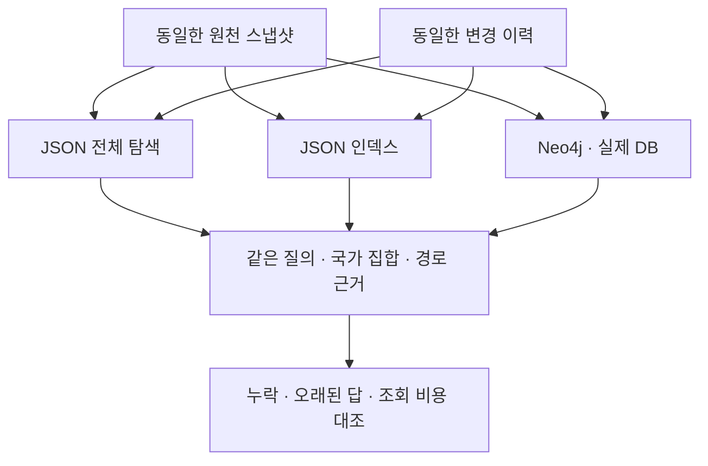

# 데이터·관계·규칙 변경의 운영 비교

상태: 실제 JSON·Neo4j 비교 2,880행 실행 완료. [관측 결과](records/20261014-graph-lifecycle.md)를 별도 기록했다. RDFLib SPARQL로 48개 상태의 960개 질의를 다시 실행해 전체 2,880행과 일치함을 확인했다. 이전 실험에서는 정적인 추론 결과가 같았다. 그 후속 질문인 변경 반영과 조회 비용을 실제 Neo4j까지 포함해 비교한다. 이 문서의 예상 결과는 측정값이 아니다.

## 비교 목적

JSON으로 같은 답을 만들 수 있다는 사실만으로 그래프 DB가 불필요하다고 판단할 수 없다. 데이터를 추가하거나 관계와 업무 규칙을 바꾼 뒤 기존 답이 제대로 갱신되는지, 조회와 저장에 얼마의 시간이 드는지 따로 확인한다. 이번 비교는 구현한 처리 경로의 운영 특성을 관찰하며 사람의 유지보수 시간이나 일반적인 DB 우열을 측정하지 않는다.

## 비교군

| 비교군 | 저장과 조회 | 변경 반영 |
| --- | --- | --- |
| JSON 전체 탐색 | JSON 파일·관계 목록 탐색·노드 타입 조회표 | 전체 파일을 원자적으로 교체 |
| JSON 인덱스 | 같은 JSON 파일과 메모리의 인접 관계 인덱스 | 파일 교체와 인덱스 재생성 |
| Neo4j | 실제 DB의 노드·관계와 Cypher 질의 | 변경된 노드·관계를 트랜잭션으로 반영 |

JSON을 일부러 느린 구현으로만 두지 않는다. 인덱스가 있는 비교군도 같은 입력과 규칙을 받는다. Neo4j 결과는 실제 Cypher 질의로 얻고 Python의 정답을 DB 결과 대신 넣지 않는다. RDFLib SPARQL은 저장된 스냅샷의 결과를 다시 확인하는 별도 기준으로 사용하며 RDF DB 서버로 표시하지 않는다.

## 데이터와 변경 지점

합성 공급망에서 제품은 공급자, 공급자는 지역, 지역은 국가에 연결된다. 질의는 허용된 공급자 역할을 따라 도달하는 국가의 집합과 그 경로를 요청한다. 국가 집합이 비어 있으면 현재 스냅샷과 규칙으로 확인되는 경로가 없다는 뜻이며 현실에 공급자가 없다는 사실 판정은 아니다.

제품 100·1,000·5,000개로 시작하는 세 규모를 각각 두 번 실행한다. 초기 상태 뒤 제품 추가, 공급자 지역 변경, 공급 관계 삭제, 복구, 예비 공급 관계 추가, 예비 공급자 허용, 허용 규칙 복원을 누적 적용한다. 초기 상태를 포함한 여덟 지점마다 20개 제품을 질의한다. 세 비교군의 예정 결과는 2,880행이다.

두 반복은 서로 다른 난수 시드의 배경 관계를 사용하며 독립적인 기업 표본이 아니다. 영향을 받는 제품과 영향을 받지 않아야 하는 제품을 함께 확인하고, 변경 전후에 답이 실제로 바뀌는 경우를 따로 집계한다. 예비 관계가 존재하더라도 현재 규칙이 주 공급자만 허용하면 답에 포함하지 않는다.

## 규칙 변경의 범위

이번 규칙 변경은 미리 지원하도록 구현한 허용 역할 목록을 바꾸는 것이다. 같은 설정을 모든 비교군에 전달하며 목록이 바뀔 때 코드를 수정하지 않는다. 규칙 파일은 공통으로 저장하며, 규칙만 바뀌면 JSON 그래프 파일과 인덱스도 다시 만들지 않는다. 이 결과를 새로운 종류의 업무 정책도 코드 수정 없이 처리한다는 근거로 삼지 않는다. 구현 파일 수나 코드 줄 수를 사람의 관리 비용으로 환산하지 않는다.

관계 삭제 뒤 이전 국가가 남거나 복구 뒤 필요한 경로가 돌아오지 않으면 회귀 오류로 센다. 경로 근거도 국가 집합과 별도로 대조한다. 평가용 정답은 원천 스냅샷에서 계산하고 각 실행기의 입력이나 수정 과정에 전달하지 않는다.

## 시간과 변경 기록

각 질의를 한 번 예열한 뒤 세 번 측정한다. 원시 측정값을 남기고 같은 실행의 반복을 독립 표본처럼 해석하지 않는다. Neo4j 시간에는 localhost HTTP와 응답 직렬화가 포함되고 JSON은 같은 Python 프로세스 안에서 조회한다. 이 차이를 포함한 전체 경로의 시간이며 저장 엔진만의 성능 비교가 아니다.

초기 적재, 변경 적용, 파일 직렬화, 인덱스 재생성 시간을 구분한다. JSON 파일 크기와 DB에 전달한 변경량은 기록하되 네트워크 바이트, 디스크 쓰기량, 실제 DB 저장 크기를 같은 지표로 취급하지 않는다. 단일 사용자·따뜻한 캐시·제한된 그래프에서 얻은 값이며 동시성, 장애 복구와 장기 운영은 평가하지 않는다.

## 실행 환경과 중단

이미 캐시된 Neo4j Community 컨테이너를 localhost에서만 실행한다. 컨테이너 자원 한도를 두고 실험이 끝나면 종료한다. 상시 서비스나 새 AWS 인스턴스는 만들지 않는다. 실험 이름공간에 속한 데이터만 정리하고 실패한 출력·로그·미실행 예정 행은 보존한다. OpenRouter와 다른 모델 API는 호출하지 않는다.

실행 코드와 입력을 고정한 뒤 독립 방법론·구현 검토와 소프트웨어 테스트를 통과해야 실제 실험을 시작한다. 결과는 실행 기록에, 해석과 후속 결정은 연구 일지에 별도로 남긴다.
