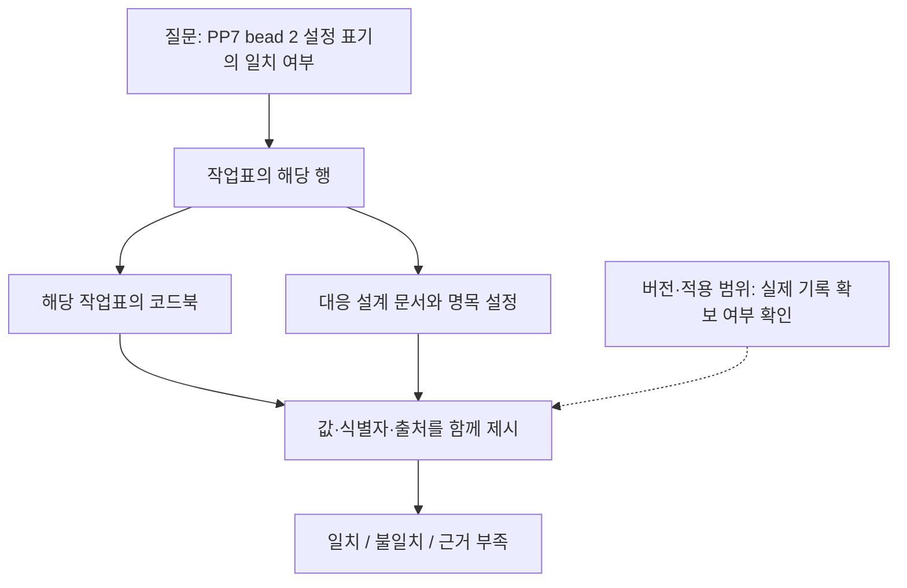

# 벡터 검색·관계 확장·의미 검증의 근거 확보 비교

`graphrag-evidence-1` · 설계 초안 0.1 · 2026-10-30

현재 상태는 실행 전 설계입니다. A–E 조건의 검색·답변 실험은 아직 수행하지 않았습니다. 기존 개발 사례의 수치와 이번 비교의 결과를 합산하지 않습니다.

2026-11-01에 [원천 관계와 개발 질문](../journal/2026-11-01-graphrag-source-contract.md)을 정리했습니다. 검색용 입력과 입출력 계약을 만든 단계이며 성능 결과는 아직 없습니다.

## 연구 문제와 제조 기록 시나리오

제조 기록의 식별자가 질문에 그대로 등장하면 해당 문서의 검색만으로 충분할 수 있습니다. 다른 작업표·코드북·설계 문서를 연결해야 하는 질문에서는 필요한 근거가 검색 결과에서 빠질 수 있습니다. 이번 연구는 관계 확장이 이 누락을 줄이는지, 의미 검증이 잘못 연결된 근거를 가려내는지 분리해 평가합니다. 그래프가 반드시 우수하다는 전제는 두지 않습니다.

시작 사례는 PENELOPE의 PP7 bead 2입니다. 기존 원천 점검에서 작업표의 설정 1과 설계 문서의 명목 설정 2를 대조했습니다. 실제 측정 전류나 공정 변경 권고로 해석하지 않습니다. 질문도 “전류를 무엇으로 바꿀까?” 대신 “두 기록의 설정 표기가 일치하는가? 비교에 사용한 행과 정의는 무엇인가?”로 제한합니다. 이 사례는 이미 확인한 개발 예시이므로 새 평가 자료로 취급하지 않습니다.

작업표와 코드북의 연결은 추출 기록으로 확인합니다. 설계 문서와의 연결은 사람이 검토한 출처 대응표로 관리합니다. 절차 버전·검토 이력·변경 이력은 현재 자료에서 충분히 확보하지 못했습니다. 이를 작성해 보충하면 합성 조건으로 표시하고 실제 자료 결과와 따로 보고합니다.

## 비교 조건과 효과의 범위

| 조건 | 근거 확보와 처리 | 비교 목적 |
|---|---|---|
| A · 벡터 RAG | 같은 원문 청크의 임베딩 유사도 검색 → LLM | 벡터 검색 단독 기준선 |
| B · 하이브리드 RAG | 키워드·벡터 검색 결합 → reranking → LLM | 실용적인 검색 기준선 |
| C · 관계 확장 RAG | B의 후보를 시작점으로 선언된 관계 확장 → 공통 예산 안에서 근거 선택 → LLM | 관계를 따라 추가 근거를 확보하는 효과 |
| D · 의미 검증 RAG | C와 동일한 최종 근거 묶음 → 참조·버전·적용 조건 검사 보고서 → LLM | 근거가 같을 때 검증 정보의 효과 |
| E · SQL/Python 관계 조회 | C와 같은 시작점·관계·탐색·정렬을 SQL/Python으로 실행 → LLM | 관계 정보의 효과와 구현 형식의 차이 구분 |

B−A는 키워드 검색과 reranking을 함께 추가한 효과입니다. 각각의 효과로 나누어 주장하지 않습니다. C−B를 관계 확장의 주 비교로 삼습니다. C−A만으로 그래프 효과를 결론 내리지 않습니다. C−E는 동일한 관계 정책의 구현 비교이며 같은 결과가 나와도 의미 있는 대조입니다.

D는 C의 근거를 삭제하거나 추가하지 않습니다. C의 저장된 근거 묶음을 그대로 받아 검사 보고서만 제공합니다. D−C는 검사 정보의 효과이며 근거 필터링이나 자동 거부 정책의 효과는 포함하지 않습니다. 검증을 강제로 적용하는 후속 조건은 별도 설계가 필요합니다.

## 공통 입력과 실행 통제

원문·질문·생성 모델·답변 prompt·출력 형식은 공통입니다. 모든 조건에서 원문 청크에 출처 ID와 위치를 붙입니다. C/D/E가 사용하는 관계 대응표도 A/B의 검색 대상에 동일한 내용의 텍스트로 포함합니다. 그래프 조건에만 숨은 사실이나 정답 요약을 주지 않습니다. 차이는 그 정보를 조회하는 방법입니다.

관계 대응표의 작성 비용과 오류는 별도로 기록합니다. 기본 비교는 사람이 확인한 동일 관계를 사용합니다. LLM이 관계를 추출하는 성능은 후속 진단으로 분리하여 검색 오류와 섞지 않습니다. 원문에 없는 연결은 만들지 않습니다.

| 고정 항목 | 사전 기록 내용 |
|---|---|
| 원천·청크 | 원본 해시, 문서·시트·셀·페이지 위치, 청크 경계, 중복 제거 기준 |
| 검색 | 임베딩 모델·버전, 키워드 방식, 후보 수, 결합 방식, reranker, tie-break |
| 관계 확장 | 허용 관계 종류, 방향, 최대 깊이, 시작점 수, 후보 상한, 순환 방지 |
| 최종 근거 | 동일 evidence-token 상한, 결정적 정렬과 절단, 실제 토큰 수 |
| 검증 | 동일 근거 해시, 원천에 명시된 메타데이터, 검사 규칙·버전, 보고서 상한 |
| 생성 | 동일 모델·버전·prompt·출력 schema·온도·출력 토큰 상한 |
| 비용 | 추출·인덱싱·관계 작성의 초기 비용과 질문별 검색·검사·생성 비용 분리 |

모든 조건의 총 입력 상한 안에 검증 보고서용 슬롯을 미리 확보합니다. A/B/C/E에는 그 슬롯을 근거 확장에 재사용하지 않고 검사 미실행을 표시합니다. 실제 입력 길이와 비용은 따로 보고합니다. C/E의 정렬·절단 후 근거 ID와 내용이 일치하는지 생성 전에 확인합니다. 불일치는 구현 실패로 남기며 정답을 보고 맞추지 않습니다.

모델·후보 수·토큰 수·반복 수는 아직 확정하지 않았습니다. 개발 자료에서 실행 가능성을 점검한 뒤 평가 질문을 열기 전에 고정합니다. 유료 API·임베딩 호출은 이번 문서 작성에 포함하지 않습니다.

## 질문 구성과 평가 지표

| 질문 유형 | 예시 | 확인할 실패 |
|---|---|---|
| 직접 조회 | 특정 행에 기록된 설정 번호 | 식별자가 있는데도 해당 행을 놓침 |
| 관계 결합 | 행의 번호가 해당 코드북에서 뜻하는 값 | 다른 코드북의 같은 번호를 연결함 |
| 문서 간 대조 | 작업표와 대응 설계 문서의 표기 비교 | 한쪽만 검색하거나 다른 대상을 비교함 |
| 불완전한 근거 | 적용 버전을 확인할 기록이 없는 경우 | 누락을 확답으로 바꾸거나 답할 수 있는 부분도 포기함 |

평가자는 원천 위치와 허용 가능한 근거 묶음을 답변 생성 전에 작성합니다. 여러 동등한 근거 경로를 허용하며 하나의 경로와 다르다는 이유만으로 오답 처리하지 않습니다. 정답·필수 근거·질문 유형 라벨은 채점 전용이고 검색기·LLM에는 전달하지 않습니다.

주 지표는 원천에 충분한 근거가 있는 질문의 **유효 근거 묶음 확보율**과 **출처로 뒷받침되는 답변 정확도**입니다. 부분 근거 재현율, 잘못 연결한 근거, 근거 없는 주장, 답변 가능한 질문의 불필요한 보류도 함께 보고합니다. 원천에 없는 근거를 검색 실패의 분모에 넣지 않습니다. 질문별 출력을 보존하고 동일 문서·작업표에 속하는 질문의 의존성을 반영해 묶음별 결과를 보고합니다. 반복 실행은 독립적인 새 사례로 세지 않습니다.

평가 상태는 `source_absent`, `retrieval_omission`, `wrong_link`, `unsupported_answer`, `execution_failure`로 나누어 저장합니다. 검사 통과와 현실의 사실 확인은 다른 평가입니다. 원천이 틀렸으나 내부적으로 일관된 경우는 별도 확인 없이는 탐지했다고 주장할 수 없습니다.

## 데이터 확보와 실행 진입 조건

현재 PENELOPE의 243개 주석 행은 원천 추출과 SHACL 점검에 사용한 개발 자료입니다. 기존 32개 합성 사례 및 이전 144개 사례도 소비된 개발 자료로 유지합니다. 이들을 새 평가 자료로 이름만 바꾸지 않습니다.

먼저 문서·행·코드북·설계 문서의 연결 목록을 작성하고 실제로 답할 수 있는 질문을 가려냅니다. 충분한 문서 간 질문이 없으면 공개 자료를 추가 확보하거나 연구 범위를 코드북 연결로 좁힙니다. 그래프에 유리한 관계를 만들기 위해 결측 연결을 사실처럼 보충하지 않습니다. 새 평가 집합은 문서·작업 단위로 개발 집합과 분리하고 인접 행·동일 문서 사본의 누출을 확인합니다. 독립 집합을 확보하지 못하면 탐색적 개발 비교로 보고합니다.

실행 전에는 자료 라이선스·원천 해시·관계 출처·질문 분할·채점 기준·모델과 비용 상한을 고정해야 합니다. 이후 작은 오프라인 검색 재현성 검사와 C/E 근거 일치 검사를 거쳐 승인된 예산 안에서만 생성 실험을 시작합니다.

## Open Ontologies의 활용 범위

검토 대상은 [fabio-rovai/open-ontologies](https://github.com/fabio-rovai/open-ontologies/tree/2ecb50c2ca7e99778d767251ec8ca64146c1669f) 커밋 `2ecb50c2ca7e99778d767251ec8ca64146c1669f`입니다. README·LICENSE·설계 기록 0007을 읽었으며 도구를 설치하거나 실행하지 않았습니다.

저장소는 Rust 기반 추론·SHACL 검증·변경 관리 도구를 소개합니다. 제조업 원천 자료나 완성된 업무 스키마를 대신 공급하는 용도로 채택하지 않습니다. [README](https://github.com/fabio-rovai/open-ontologies/blob/2ecb50c2ca7e99778d767251ec8ca64146c1669f/README.md)

특히 설계 기록 0007은 원천 그래프와 검색된 부분 그래프가 동일한 규칙 범위에서 같은 양의 명제를 도출하는지 비교합니다. 지원 범위가 제한되며 도출되지 않는다는 결과는 현실에서 거짓이라는 증명이 아닙니다. 인증된 도출과 엔진 단독 판정도 구분합니다. 이 구분을 선택적 근거 보존 진단에 참고합니다. [설계 기록 0007](https://github.com/fabio-rovai/open-ontologies/blob/2ecb50c2ca7e99778d767251ec8ca64146c1669f/docs/decisions/0007-a-slice-preserves-a-conclusion-or-it-does-not.md)

| 도입 후보 | 이번 설계의 위치 | 채택 전 확인 |
|---|---|---|
| 근거 보존 검사 | 검색 누락 원인에 대한 보조 진단 | 제한된 규칙 범위, 부분집합 조건, 실패·미지원 판정 |
| SHACL 검사 | D의 검증기 대안 | 기존 pySHACL과 필요한 문법·보고서의 호환성 |
| 온톨로지 변경 검사 | 후속 스키마 변경 실험 | 변경 전후 스냅샷과 실제 영향 대상 |

근거 보존 진단을 추가할 때는 모든 조건에 같은 규칙을 적용해 사후 평가합니다. 이를 D에만 추가해 A–E의 차이를 여러 기능이 뒤섞인 비교로 바꾸지 않습니다. 정답 명제는 사후 평가에서만 사용합니다. 실행 중 검사가 필요하면 모델이 제시한 명제나 사전 정의된 질문 계약만 사용하며 숨은 정답으로 검색 결과를 보충하지 않습니다. 자연어를 RDF로 옮긴 해석의 정확성은 별도 평가 대상입니다.

코드의 [MIT 라이선스](https://github.com/fabio-rovai/open-ontologies/blob/2ecb50c2ca7e99778d767251ec8ca64146c1669f/LICENSE)는 고지 유지 조건으로 사용·수정·배포를 허용합니다. 포함되거나 연결된 제3자 온톨로지·데이터의 권리는 개별 출처에서 확인해야 합니다. 이번에는 코드나 외부 데이터의 재배포 없이 설계 참고 후보로 기록합니다.

## 다음 산출물

원천과 관계의 출처 목록, 개발·평가 질문 목록, A–E 공통 입출력 명세를 먼저 작성합니다. 이어 검색 결과와 관계 확장 경로를 나란히 보여주는 데모를 구성합니다. 도구 호환성 확인, 검색 성능, 답변 성능은 각각 실제 실행 기록이 생긴 뒤 보고합니다.
