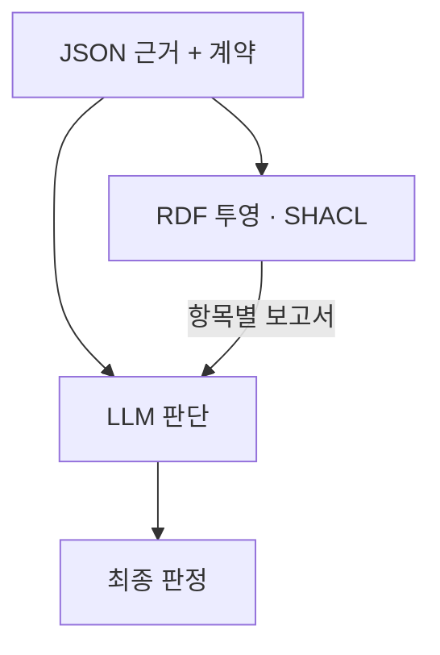
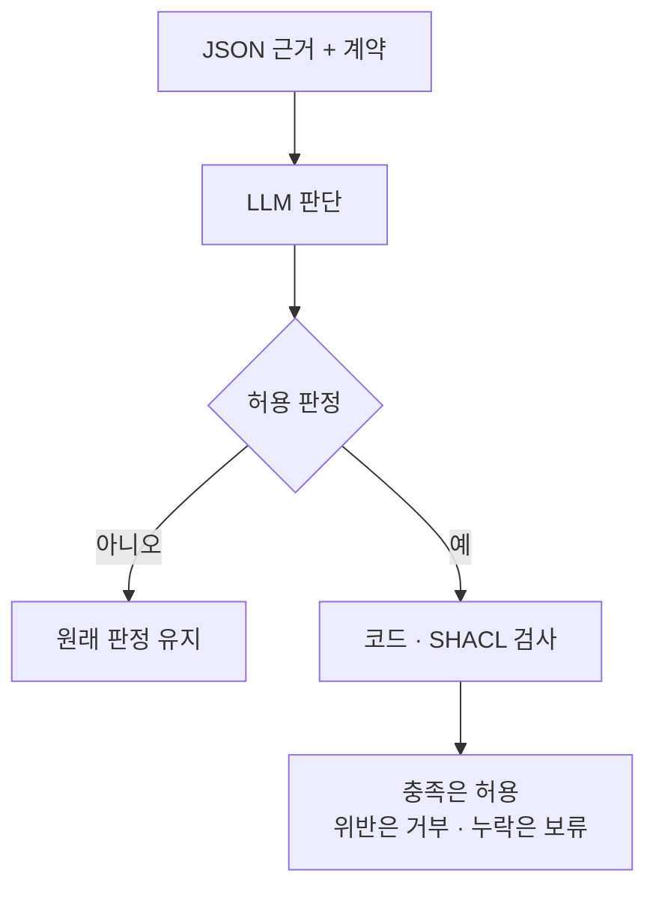
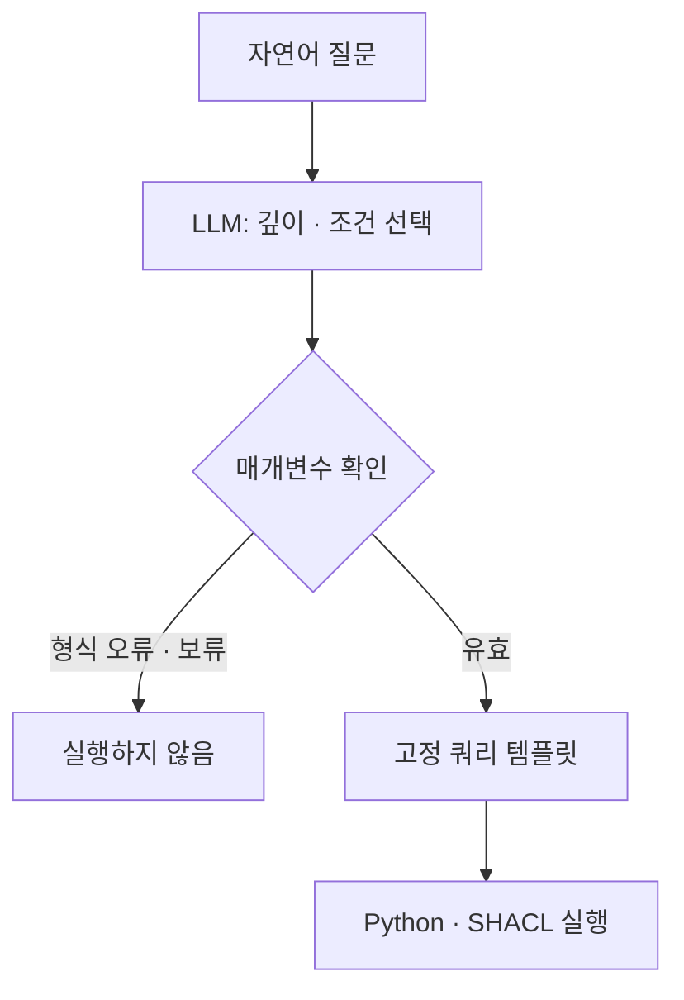

# 복잡도와 최소 온톨로지 개입 실험

실행 상태: 합성 첫 120문항과 두 번째 반복 69문항 완료. 응답 미수신 두 건 이후 유료 호출 중단. GLEIF는 오프라인 검증 완료, 모델 비교와 질문 계약 추출은 미실행. [결과와 실제 사례](records/20261013-hybrid-comparison.md)에 계획과 관측을 구분해 기록했다.

## 연구 목적

팔란티어와 같은 업무·의사결정 시스템이나 금융·의료 감사 시스템을 만든다는 요청에서 출발했다. 중요한 판단을 LLM에 맡길 때, 이미 구축한 RDF나 그래프 데이터를 어디에 써야 도움이 되는지 확인하려는 연구다. 그래프가 있다는 이유만으로 답이 정확해지지는 않는다. LLM이 SPARQL을 잘못 만들거나 원천 데이터가 틀리면 그래프를 조회해도 잘못된 결론이 나올 수 있다.

이번 질문은 어느 정도의 관계·조건 복잡도에서, 판단 과정의 어느 위치에 명시적인 검사를 넣는 것이 도움이 되는가다. RDF와 SHACL이 우수하다는 결론을 전제하지 않는다. 같은 검사를 JSON과 Python으로 구현해도 같은 결과가 나온다면 그 사실을 그대로 보고한다.

모든 데이터를 온톨로지로 바꾸지 않는다. 설명과 메모는 JSON에 남기고 관계·허용 상태·날짜·자격처럼 이번 판단에 필요한 필드만 RDF로 옮긴다. 여기서 온톨로지는 제한된 어휘와 명시적인 제약을 뜻한다. OWL 추론이나 실제 산업 도메인 전체의 모델링을 구현한 것은 아니다.

## 이전 실험과의 연결

이전 비교에서는 코드와 SHACL의 정확도가 같았다. 형식과 제약을 만족하는 거짓 데이터는 두 방법 모두 통과시켰다. 후속 실험에서는 추가 조회 정책을 따르는지에 따라 결과가 달랐지만 그 차이를 SHACL 자체의 장점이라고 볼 근거는 없었다.

이번에는 연결 깊이, 함께 확인할 조건, 무관한 정보를 따로 바꾼다. 복잡도를 높였다는 표현만으로 서로 다른 문제를 섞지 않기 위해서다. 자연어 질문을 계약으로 해석하는 단계와, 주어진 계약을 검사하는 단계도 구분한다. 이번 실험은 후자를 측정한다.

## 비교 구조

판단 전에는 검사 결과를 LLM의 입력으로 제공한다.



판단 후에는 허용 판정에만 검사를 적용한다.




| 비교군 | 처리 순서 | 모델 호출 |
| --- | --- | --- |
| 코드 | JSON → Python 규칙 → 판정 | 0 |
| SHACL | JSON → 필요한 필드의 RDF → SHACL → 판정 | 0 |
| LLM 직접 판단 | JSON과 계약 → LLM | 1 |
| LLM 추가 검토 | 직접 판단 → 같은 모델이 근거를 다시 읽고 검토 | 2 |
| 판단 전 검사 | SHACL의 항목별 보고서 + JSON과 계약 → LLM | 1 |
| 판단 후 검사 | LLM의 허용 판정에만 SHACL 결과 적용 | 1 |
| 판단 후 코드 검사 | LLM의 허용 판정에만 Python 결과 적용 | 1 |
| 깊이별 선택 | 깊이 1이면 직접 판단, 2·4이면 판단 전 검사 | 1 |
| 조건별 선택 | 연결만 확인하면 직접 판단, 복합 조건이면 판단 전 검사 | 1 |

추가 검토는 독립적인 전문 모델이나 연구 운영 에이전트가 아니다. 실험 모델을 한 번 더 호출하는 통제군이다. 사후 검사는 허용을 거부·보류로 바꿀 수 있지만 LLM의 불필요한 거부·보류를 허용으로 고치지는 않는다.

판단 전 보고서에는 최종 판정이나 평가 정답을 넣지 않고 검사 항목의 통과·실패·미확인 상태를 넣는다. 이 상태만으로 답이 결정될 수도 있다. 따라서 개선이 나타나면 계산된 판단 근거를 제공한 효과로 해석하며 LLM의 추론 능력이 좋아졌다고 표현하지 않는다.

선택 검사와 사후 검사는 실제로 얻은 직접 판단·사전 검사 응답을 재사용해 계산한다. 독립적으로 모델을 다시 호출한 결과가 아니다. 비교군별 비용은 해당 구성을 배포했을 때의 호출 비용 추정치이며 이를 모두 더하면 실제 사용액을 중복 계산하게 된다.

## 합성 제조 승인 과제

실제 제조 설비를 조작하지 않는 모의 과제다. 출하 대상에서 지정된 조직까지 관계를 따라가고 정책에 따라 승인 여부를 판단한다.

| 축 | 값 |
| --- | --- |
| 관계 깊이 | 1·2·4개 링크 |
| 판단 조건 | 연결만 확인 / 연결·조직 유형·허용 상태·기간·인증서 확인 |
| 무관한 정보 | 0개 / 연결되지 않은 조직 8개 |
| 근거 상태 | 정상 / 잘못된 도착점 / 허용 상태 또는 기간 위반 / 마지막 링크 누락 / 제약을 만족하는 거짓 사실 |
| 식별자 구성 | 두 가지 고정 seed |

120문항을 두 번 실행한다. 120개의 독립적인 기업이나 업무를 표집한 것이 아니다. 두 식별자 구성을 반복적으로 변형한 요인 실험이며 정상과 거짓 사실 조건은 보이는 입력까지 같다. 통계적 유의성이나 보편적인 복잡도 경계는 주장하지 않는다.

같은 근거에 연결만 확인하는 계약과 복합 조건 계약을 각각 적용한다. 예를 들어 인증서가 만료돼도 연결만 묻는 질문에는 허용이 맞고 인증 유효성까지 요구하는 질문에는 거부가 맞다. 무관한 조직의 허용 상태가 거짓이어도 해당 출하 대상과 연결되지 않았다면 판정에 영향을 주지 않아야 한다.

```text
질문: 이 출하 대상을 현재 계약에 따라 승인할 수 있는가?

출하 대상 ── 조직 A ── 조직 B ── 조직 C ── 지정 조직
    │
    └── 인증서: 지정 발급자 / current / 유효 기간

무관한 조직 8개: 별도 기록으로 존재하지만 위 경로에는 연결되지 않음
```

기간은 시작일과 종료일을 모두 포함한다. 확인된 위반이 하나라도 있으면 거부, 위반 없이 필수 근거가 없으면 보류, 나머지는 허용이다. SHACL 보고서의 `conforms=true`와 승인 가능은 동의어가 아니다. 누락을 Warning으로 기록하는 경우에도 최종 정책은 보류로 처리한다.

제약을 만족하는 거짓 사실 조건에서는 제공된 근거가 평가자가 별도로 가진 합성 원본과 다르다. 평가 원본은 어느 판단기에도 전달하지 않는다. 그 차이를 잡지 못한 것을 문법 검사 실패로 부르지 않으며 반대로 평가 정답과 비교한 결과를 SHACL이 찾아낸 오류라고 부르지도 않는다.

## 실제 GLEIF 관계 탐색

동일한 Golden Copy의 RR 490,833행에서 기존 실험과 연결된 50개 컴포넌트, 75개 식별자를 제외했다. 깊이 1·2·4별로 서로 다른 컴포넌트에서 출발 기업 4개씩, 총 12개를 선택했다. 각 기업에서 도달 가능한 대상과 도달할 수 없는 대상을 한 번씩 묻는다. 같은 기업의 두 질문에는 동일한 근거를 제공한다.

도달 불가능한 대상도 실제 별도 컴포넌트의 관계 기록에 등장한다. 입력에서 식별자가 보이는지만 보고 답할 수 없도록 했다. 다만 선택된 근거는 무관한 관계 1개를 포함해 각각 2·3·5개의 간선으로 이루어진 단순한 사슬이다. 복잡한 분기 그래프나 대규모 검색 성능 검증은 아니다.

이 과제의 기호적 비교군은 실제로 실행한 SPARQL 경로 조회이며 SHACL은 사용하지 않는다. `ACTIVE`, `PUBLISHED`, 직접 회계 연결 관계라는 조건과 최대 탐색 깊이를 확인한다. 회계 기간이나 문서 제출 기간을 관계의 유효 기간으로 해석하지 않는다. 공개 스냅샷 안의 도달 가능성만 평가하며 실제 기업 지배 관계 전체에 대한 정답으로 확대하지 않는다.

## 쿼리 생성과 정답 분리

질문의 출발점·대상·관계·깊이·판단 조건은 모든 비교군에 명시한다. 실행 쿼리는 고정 템플릿에서 만든다. 이 선택은 쿼리 생성 실패와 판단 실패를 분리하기 위한 통제다. 자연어만으로 계약을 올바르게 선택할 수 있는지, 자유로운 Text2SPARQL이 얼마나 정확한지는 측정하지 않았다.

실행 입력에는 질문·계약·근거만 들어간다. 근거 상태 이름, 정답, 합성 원본은 별도 평가 파일에 보관한다. 누락 조건은 제공된 원천 근거가 없는 상황이며 이번 실험에는 추가 조회가 없다. 이전 실험의 검색 누락과 혼동하지 않는다.

## 평가 기준과 예산

계획된 전체 행을 분모로 계약 판정 일치, 거짓 사실을 포함한 평가 원본 기준 일치, 잘못된 허용, 불필요한 보류, 형식 오류·미실행을 보고한다. 깊이·조건·무관한 정보·근거 상태별로 나눠 살핀다. 인용 식별자 존재 여부는 별도로 계산하지만 인용이 존재한다는 이유로 의미적 근거가 충분하다고 판정하지 않는다.

Python과 SHACL의 실행 시간, RDF로 옮긴 필드 수와 직렬화 크기도 기록한다. 불필요한 설명 필드를 제외했다고 저장 용량이 반드시 줄어드는 것은 아니다. 각 비교군의 실제 적용 여부와 추가 호출 비용을 함께 보고 정확도가 같다면 더 복잡한 구조를 도입할 근거가 생겼다고 주장하지 않는다.

합성 120문항 × 2회 × 9개 비교군 = 2,160행, GLEIF 24문항 × 8개 비교군 = 192행이다. 실제 모델 호출은 합성 720회와 GLEIF 72회로 최대 792회다. 기존 캠페인 전체의 3,200회·예약액 5달러 한도를 그대로 적용한다. 실패한 호출과 결과를 보존하고 비용 확인이 불가능하면 중단한다. 모델은 OpenRouter의 `openai/gpt-4o-mini`, temperature 0으로 고정한다. AWS와 Codex 비용은 별도다.

## 해석과 후속 범위

결과가 같다면 현재 깊이와 조건에서는 JSON에 같은 규칙을 적용하는 것으로 충분할 수 있다. 사전 검사만 개선되면 어떤 검사 항목이 판단을 바꿨는지 확인한다. 사후 검사가 잘못된 허용을 줄이면서 불필요한 보류를 늘리는지도 함께 본다. 추가 LLM 검토만으로 같은 개선을 얻는다면 그 대안의 비용과 결과도 그대로 비교한다.

이번 선택 정책은 미리 정한 깊이·조건 기준이다. 결과를 보고 가장 좋은 임계값을 고른 뒤 검증된 정책이라고 부르지 않는다. 이후에는 분기·여러 경로의 충돌, 시간에 따른 상태 변경, 자유로운 질문의 계약 추출, 다른 모델·도메인으로 확장할 수 있다. 현재 결과만으로 그 효과를 예측하거나 실무 안전성을 보장하지 않는다.

## 질문 계약 추출의 별도 진단

앞의 비교는 계약을 제공한 상태에서 진행한다. 질문 해석에서 생기는 오류는 `hybrid-intent-diagnostic-1`로 따로 점검한다. 구성한 영어 질문 24개를 두 번 실행하며 모델은 SPARQL 본문을 작성하는 대신 `depth`와 `load`를 선택한다. 검증된 매개변수만 고정 템플릿에 넣어 실행한다.

12개 질문은 지원하는 계약을 명확히 요청한다. 나머지 12개는 깊이가 빠져 있거나 정확히 정해진 깊이 대신 최대 깊이를 묻거나 전체 복합 조건 중 날짜만 요청한다. 현재 템플릿으로 표현할 수 없는 질문은 보류하는 것이 이 진단의 기준이다. 이는 제한된 템플릿 선택 실험이며 자유로운 Text2SPARQL 성능을 측정한 것은 아니다.




유효한 형식으로 틀린 계약을 선택한 응답도 그대로 실행하고 평가한다. 뒤의 Python과 SHACL이 일치하더라도 원래 질문을 제대로 해석했다는 뜻은 아니다. 계약 일치, 불필요한 보류, 지원하지 않는 질문의 실행, 형식 오류, 실행 오류를 분리해 보고한다. 최대 48회 호출을 추가하며 기존 캠페인 예산을 공유한다.
