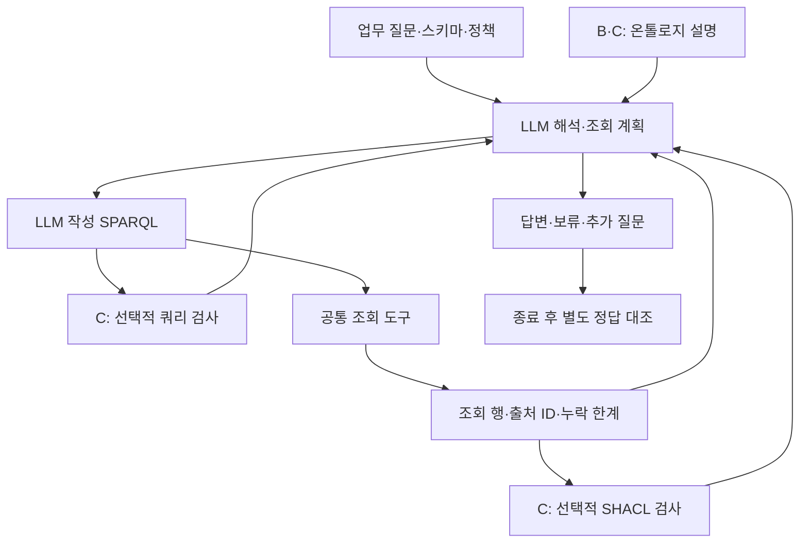

# LLM 주도 조회와 온톨로지 검증 도구

## 연구 범위

질문 해석, SPARQL 작성, 추가 조회, 검증 도구 선택과 최종 답변을 LLM이 맡는다. 온톨로지와 SHACL은 이 과정에서 호출할 수 있는 도구다. 기존 금융·제조업 36개 사례의 규칙 기반 실행은 도구의 기준 동작으로 남기고 이번 LLM 실행과 구분한다.

연구 질문은 “명시적인 개념 설명과 검증 도구가 LLM의 업무 질문 처리에 어떤 도움과 비용을 주는가?”이다. 온톨로지가 더 좋은 결과를 낸다고 전제하지 않는다.

## 비교군과 공통 조건

| 조건 | LLM에 제공하는 정보와 도구 |
| --- | --- |
| A · 조회 | 물리 스키마, 공통 업무 정책, SPARQL 조회, 답변 종료 |
| B · 의미 설명 | A에 개념·관계 역할·단위·상태 구분 설명 추가 |
| C · 검증 도구 | B에 쿼리 계약 검사와 SHACL 근거 검사 추가 |

모두 같은 RDFLib 스냅샷을 사용한다. A와 B의 차이는 **설명 정보의 차이**이므로 RDF 표현의 우월성으로 해석할 수 없다. B와 C에서는 검증 도구의 제공 여부가 달라진다. C의 검사 호출은 강제하지 않는다. 검사에 호출 한도를 쓰는 부담도 결과에 포함한다.

## 업무 질문과 사례 구성

제조업에서는 부품 변경의 영향 제품, 대체 부품의 조건 충족, 변경 후 재검증 업무를 묻는다. 금융에서는 직접 회계 모회사, 동일한 최종 회계 모회사 보고 여부, 내부 관계 검토 준비 여부를 묻는다. 각 유형에 정상·누락·충돌 또는 상태 차이를 둔 3개 사례를 배정한다.

18개 사례 × 3개 조건 × 1회, 총 54개 에피소드다. 기존 합성 개발 자료에서 가져온 사례이며 독립 평가 자료가 아니다. 제조업의 결과는 물리 시뮬레이션이나 생산 승인으로 해석하지 않는다. 금융도 실제 GLEIF 원천을 새로 평가한 결과가 아니다.

실행기는 자연어 질문만 전달하며 정답 업무 유형, 상황 이름, 기대 답변을 전달하지 않는다. 완전성 선언과 업무 정책은 공개 입력이다. 데이터에서 감춰진 누락을 자동으로 알아내는 실험은 아니다.

## 도구의 검사 범위

쿼리 검사는 LLM이 선언한 역할과 쿼리의 기본 패턴에 들어 있는 상수를 비교한다. `FILTER`, 경로, `UNION` 등 지원하지 않는 의미 분석은 `unknown`으로 남긴다. 날짜·단위·도메인·범위 전부를 검증하는 도구가 아니다. **LLM이 질문을 잘못 이해하고 그 해석에 맞는 쿼리를 만들면 통과할 수 있다.**

SHACL은 이미 조회한 레코드의 속성 존재, 자료형, 일부 단위 열거값을 검사한다. 누락된 인증서를 찾을 수 있지만 인증서의 현실 유효성이나 근거 전체의 충분성을 보장하지 않는다. 검사 결과를 받아 수정할지, 답할지, 보류할지는 LLM이 결정한다.

모든 조건의 조회 도구는 외부 접속·갱신 쿼리를 거부한다. 별도 프로세스에 5초·512 MiB 제한을 적용하며 최대 100행을 반환한다. `LIMIT`이나 정상 종료를 근거 완전성의 증거로 쓰지 않는다.

## 실행 한도와 실패 보존

`openai/gpt-4o-mini`, temperature 0, 응답 최대 1,000 tokens를 사용한다. 조건 순서는 seed 17로 섞는다. 에피소드당 모델 6회, 조회 4회, 검사 4회, 전체 도구 10회, 쿼리 변경 2회, 실행 시간 120초로 제한한다. 시간 제한 중 API 응답 비용을 확인하지 못하면 전체 캠페인을 중단하고 예약 금액을 유지한다.

캠페인 전체는 **최대 324회 API 요청, 예약 비용 1.50 USD**다. 기존 비용 장부는 그대로 보존하고 새 장부에 기록한다. 예약 금액은 실패해도 돌려놓지 않는다. 첫 사례의 세 조건을 연결 점검으로 실행한 뒤 전송이 정상적이면 나머지 51개를 실행한다. 답변 성적이 나쁘다는 이유로 다시 실행하지 않는다.

## 평가와 오류 해석

실행 종료 후 별도 채점기가 상태·값 일치, 필요한 주의 문구, 인용 ID 일치를 각각 계산한다. 인용이 맞지 않아도 우연히 답이 맞을 수 있으므로 하나의 정확도로 합치지 않는다. 미완료·실패도 처음 배정한 분모에 남긴다. 잘못된 단정과 불필요한 보류를 함께 기록한다.

질문 해석, 쿼리, 조회 누락, 검증, 최종 답변의 오류를 구분한다. 다만 최종 답이 틀렸다는 사실만으로 앞 단계의 오류를 자동 추정하지 않는다. 실제 질문·쿼리·조회 행을 대조한 사례에만 구체적인 원인을 붙인다. 조회 과정에서 정답을 보고 고치는 일은 없다.

금융의 `LAPSED` 관계는 등록 상태에 주의를 붙여 보고할 수 있는 사실과 내부 검토에 사용할 자격을 나눈다. `PUBLISHED`만 허용하는 내부 정책을 직접 모회사 질문에 그대로 적용하면 불필요한 보류가 될 수 있다.

<!-- HUMANIZE-SUMMARY
- 적용 모드: light, report, 보수적 윤문
- 변경: 연결어미·시간절 뒤 불필요한 쉼표 2곳 삭제(C-11).
- 보존: 제목, 수치, 코드, Mermaid, 기술 용어, 사실 한정과 주장의 강도.
- 자체검증: 6항 점검, 미통과 항목 0건. 변경률 확정은 오케스트레이터 검증에 따름.
-->
