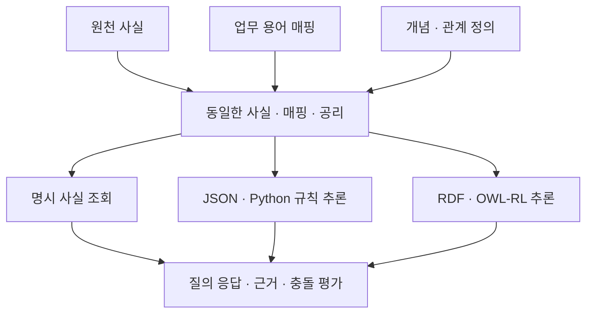

# 개념 통합과 명시적 추론 실험

상태: 합성 그래프 64개·질의 640개·세 비교군 1,920행 실행 완료. [실제 결과와 근거](records/20261013-ontology-reasoning.md)에 관측값을 기록했다. 아래 예상 결과는 실행 전 가설이며 기존 SHACL 비교의 결과는 그대로 보존한다. 연구 운영의 마지막 분석 기록 재제출은 미완료다.

## 연구 질문과 범위

온톨로지의 역할을 데이터 검사에 한정하지 않는다. 서로 다른 데이터의 용어를 연결하고 명시된 사실과 공리로부터 추가 관계를 도출하며 같은 정의를 다른 데이터에 재사용하는 과정을 비교한다. 이번 단계에서는 OWL-RL의 제한된 규칙을 실제로 실행한다. 자유로운 SPARQL 생성과 LLM의 판단은 분리한다.

OWL은 개념과 관계에 대한 공리를 표현하며 추론기로 함축된 지식을 도출하거나 일관성을 확인하는 데 쓰인다. SHACL은 주어진 그래프가 선언된 제약을 만족하는지 검사한다. 두 기능은 함께 사용할 수 있지만 이번 실험의 주 비교 대상은 추론이다. [W3C OWL 2 Primer](https://www.w3.org/TR/2012/REC-owl2-primer-20121211/), [W3C SHACL](https://www.w3.org/TR/shacl/).

## 비교군과 공정한 입력

| 비교군 | 처리 | 비교 목적 |
| --- | --- | --- |
| 명시 사실 조회 | 입력에 적힌 트리플만 조회 | 추론 기능을 제거한 대조군 |
| JSON·Python 규칙 추론 | 같은 사실과 공리를 일반 규칙 엔진으로 전개 | 온톨로지 도구 없이 같은 의미를 구현한 비교군 |
| RDF·OWL-RL 추론 | 같은 사실과 공리를 표준 추론기로 전개 | 선언된 공리의 실행과 재사용 확인 |

모든 비교군에 같은 사실과 공리를 준다. 명시 사실 조회는 공리를 실행하지 않으므로 기능을 제한한 대조군이다. 이 대조군보다 성능이 높아도 RDF가 Python보다 우수하다고 해석하지 않는다. Python에는 같은 종류의 추론 규칙을 구현하고 새 업무 어휘는 규칙 코드가 아닌 입력 공리로 전달한다.

JSON 비교군도 동일한 온톨로지 의미를 구현한다. 두 추론기의 비교는 같은 의미 모델을 실행하는 도구의 비교이며, 온톨로지의 유무를 비교하는 실험으로 부르지 않는다.

## 과제 구성

| 과제 | 입력 예시 | 확인할 내용 |
| --- | --- | --- |
| 개념 계층 | 정밀부품 공급사는 공급사의 하위 개념 | 구체 타입만 있는 대상을 상위 개념으로 찾는가 |
| 어휘 매핑 | 공급 시스템의 판매자 관계를 공통 공급 관계에 연결 | 다른 어휘로 기록한 사실을 같은 질의로 찾는가 |
| 역관계 | A가 B에 공급한다 | B의 공급자로 A를 찾는가 |
| 전이 관계 | 직접 상위 조직 관계와 조상 조직 관계를 구분 | 간접 연결을 도출하면서 직접 관계를 잘못 추가하지 않는가 |
| 관계 합성 | 제품의 공급자와 공급자의 소재 국가 | 제품의 공급 국가를 명시 공리로 도출하는가 |
| 개념 충돌 | 서로 배타적으로 선언한 두 타입에 같은 대상이 속함 | 충돌을 별도 기록하며 정상 판단과 섞지 않는가 |

경로 깊이와 분기 수를 바꾸고 다른 업무 어휘로 같은 구조를 표현한다. 어휘 매핑이 없는 조건도 따로 둔다. 매핑이 없어서 연결하지 못한 것을 모델의 추론 실패로 해석하지 않는다. 자동 어휘 정렬, 실제 기업의 의미 매핑 정확도와 유지보수 인건비는 이번에 측정하지 않는다.

계획된 규모는 깊이 1·2·4·8, 분기 수 1·3, 매핑 유무, 두 업무 어휘, 충돌 유무를 조합한 64개 그래프다. 그래프당 10개 질의를 세 비교군에 적용해 1,920개 결과 행을 생성한다. 분기는 주 경로에 말단 이웃을 추가한 구조이며 완전한 트리는 아니다. 두 업무 어휘도 같은 구조의 이름을 바꾼 것이므로 실제 산업 간 전이 검증과 구분한다.

관계의 전이성은 사람이 선언한 의미에 따른다. 직접 지배 관계나 공급 관계 전체를 편의상 전이적으로 만들지 않는다. 관계 합성도 특정 공리가 허용한 경로에만 적용한다.

## 예상 결과와 반증 기준

추론이 필요한 질의에서는 명시 사실 조회보다 두 추론기가 더 많은 정답 근거를 찾을 것으로 예상한다. 이는 규칙 실행의 효과에 관한 가설이다. 동일한 표현 범위에서는 JSON·Python과 OWL-RL의 질의 결과가 같아야 한다. 차이가 나면 어느 쪽이 우수하다고 결론 내리기 전에 규칙 구현과 OWL 의미론의 차이를 조사한다.

다른 업무 어휘에 대한 공리만 추가하고 두 추론기의 코드를 그대로 사용한다. 재사용이 확인돼도 온톨로지 도구만의 장점으로 부르지 않는다. 코드 기반 엔진도 공리를 입력으로 받아 같은 재사용이 가능한지 확인한다.

매핑이 없거나 필요한 관계가 없으면 답은 미확인이다. 그래프에 사실이 없다는 이유로 현실에서 거짓이라고 판단하지 않는다. 원천 사실이 틀려도 공리와 모순되지 않으면 추론 결과가 틀릴 수 있다. 온톨로지가 독립적인 사실 확인을 대신한다는 가설은 세우지 않는다.

## 지표와 기록

질의별 함축 여부, 잘못 도출한 관계, 놓친 관계, 명시 사실과 추가 도출 사실의 구분, 두 추론기의 대응 일치, 배타 클래스 충돌을 기록한다. 합성 평가 정답은 추론 함수에 전달하지 않는다. 입력과 스키마 해시를 보존하고 실행 실패를 삭제하거나 정상 결과로 재분류하지 않는다.

충돌이 있는 그래프의 `entailed`는 양의 규칙을 실행한 결과에 해당 트리플이 있다는 표시다. 모순된 온톨로지의 고전 논리적 함축 전체를 뜻하지 않는다. 충돌 표시는 그래프 전체의 배타 클래스 사례를 찾은 결과이며 각 질의가 잘못됐다는 뜻도 아니다. 초기화 이전 실패는 실행기 로그와 부분 디렉터리를 보존하고, 초기화 이후의 중단은 상태 파일에 남긴다.

Python의 도출 근거는 규칙과 선행 사실로 기록한다. OWL-RL의 질의 결과와 이 근거를 비교하더라도 Python의 설명을 OWL 추론기가 반환한 증명이라고 표현하지 않는다. 실행 시간은 같은 호스트의 제한된 관측값이며 그래프 데이터베이스의 성능 평가가 아니다.

## 후속 실험의 연결

이번 단계가 통과하면 LLM에 원천 사실만 주는 조건과 도출된 사실·근거를 추가하는 조건을 비교할 수 있다. 도출 결과를 정답처럼 숨겨 넣지 않고 사전에 계산한 근거를 제공한 효과로 평가한다. 자연어 질문을 개념과 관계에 연결하는 오류는 별도 과제로 남긴다.

실제 GLEIF에는 제공된 관계의 의미를 보존하는 공리만 적용한다. 공급 관계나 법률상 지배 관계로 확대 해석하지 않는다. 제조·의료 데이터에 적용하려면 해당 도메인의 정의와 매핑을 별도로 검토해야 한다. 이번 합성 실험으로 실제 감사 시스템의 안전성을 주장하지 않는다.

<!-- HUMANIZE-SUMMARY
role: monolith
genre: report
mode: conservative light
changes: C-11 연결어미 뒤 쉼표 2곳 제거. 후속 실험 문장의 조사 1곳 정리.
preserved: 제목, 기술 주장, 수치, 유보와 의무 표현, 링크, 표, Mermaid 원문.
self_check: 6항 점검 완료. 미통과 항목 0건. 변경률 확정은 오케스트레이터 검증에 따름.
-->
