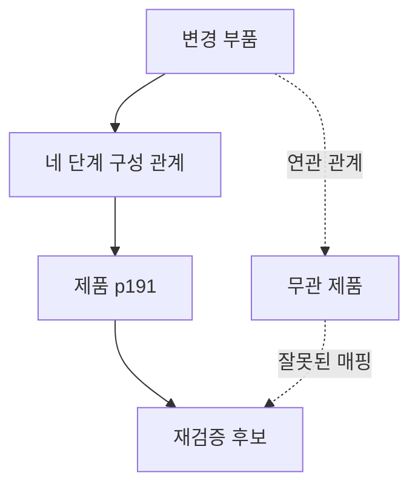

# 2026-10-14 — 부품 변경의 영향 경로와 잘못된 완전성

실행 `20261014T155805Z-change-impact`에서 제조업 합성 사례 192개를 세 표현·네 정책으로 처리해 2,304행을 기록했다. 별도 분석기가 전체 정답·패킷·후보·경로·점수와 해시를 확인했다. [프로토콜](../change-impact-study.md)에 오류 주입과 실행 범위를 설명했다.

## 정상 관계와 다중 단계 탐색

정상 원천 32개 사례에서 명시적 관계 규칙을 적용한 JSON·RDF 조건은 모두 정확한 재검증 제품 집합을 찾았다. JSON과 RDF의 출력은 전체 576쌍에서 같았다. 세 형식의 입력도 왕복 변환 뒤 일치했다.

같은 의미와 방향을 제공하면 이 범위에서는 표현 형식보다 탐색 규칙이 결과를 결정했다. RDF만의 정확도 이점이나 실제 그래프 DB의 성능을 측정한 결과는 아니다. RDF 조건도 Python 조건과 같은 유효 관계와 경로 증거를 사용한다.

## 오류 조건별 후보와 완전성

아래는 명시적 관계 규칙·JSON 조건의 결과다. RDF 조건도 같다. 각 행은 32개 사례이며 누락·과잉은 사례 수가 아닌 제품 후보 수다.

| 원천·매핑 상태 | 정확한 집합 | 누락 후보 | 과잉 후보 | 틀린 완전성 주장 |
| --- | ---: | ---: | ---: | ---: |
| 정상 | 32 | 0 | 0 | 0 |
| 관계 누락 | 0 | 32 | 0 | 0 |
| 구버전 관계 | 0 | 32 | 32 | 0 |
| 잘못된 관계 종류 | 0 | 32 | 0 | 32 |
| 매핑 누락 | 0 | 55 | 0 | 0 |
| 잘못된 매핑 | 0 | 0 | 32 | 32 |

누락·구버전·매핑 부재는 부분 결과로 표시했다. 이 중 관계 누락과 구버전은 제공된 범위·버전 메타데이터로 판별했다. 시스템이 알려지지 않은 누락을 스스로 발견했다는 뜻은 아니다.

잘못된 관계 종류와 매핑은 각각 32개 사례에서 틀린 집합을 완전하다고 표시했다. 버전과 수집 범위가 맞아도 관계의 의미가 틀리면 이 검사는 통과할 수 있다. 여섯 상태는 의도적으로 같은 수를 넣었으므로 실제 현장의 오류 발생률로 해석하지 않는다. 매핑 누락은 해당 관계 종류 전체에 영향을 주므로 한 연결만 지운 조건보다 오류 주입 범위가 넓다.

## 실제 실행 경로

깊이 4·가지 수 3·시드 11 사례의 정답은 p140·p191·p225다. 아래 결과는 실제 실행 패킷에서 가져왔다.

| 조건 | 찾아낸 재검증 제품 | 상태 |
| --- | --- | --- |
| 정상 | p140·p191·p225 | 조건부 완전 |
| 첫 연결 누락 | p140·p225 | 부분 결과 |
| 첫 연결을 연관 관계로 변경 | p140·p225 | 잘못된 완전 주장 |
| 연관 관계를 구성 관계로 매핑 | p140·p191·p225·unrelated | 잘못된 완전 주장 |

같은 제품이 누락돼도 시스템이 모른다고 표시한 경우와 모두 찾았다고 주장한 경우는 다르다. 안내서에는 후보 집합뿐 아니라 결과의 완전성을 주장하는 근거도 함께 보여줘야 한다.

## 정책별 전체 집계

정책별 192개 사례만 집계하며 형식 반복은 제외했다.

| 정책 | 정확한 집합 | 누락 후보 | 과잉 후보 | 부분 결과 | 틀린 완전성 주장 |
| --- | ---: | ---: | ---: | ---: | ---: |
| 직접 관계만 | 8 | 323 | 64 | 192 | 0 |
| 종류 없는 연결 탐색 | 0 | 64 | 224 | 192 | 0 |
| 명시적 관계 규칙·JSON | 32 | 151 | 64 | 96 | 64 |
| 명시적 관계 규칙·RDF | 32 | 151 | 64 | 96 | 64 |

직접 탐색과 종류 없는 탐색은 항상 부분 결과를 반환하는 기능 제거 조건이다. 틀린 완전성 주장이 0이라고 더 안전한 시스템으로 순위를 매기지 않는다. 종류 없는 조건은 방향도 제거하므로 관계 종류만의 효과를 분리한 실험이 아니다.

## 검증과 자료

독립 방법·구현 검토 후 단위 검사 199개가 통과했다. 실행 시간은 5.32초, 실행기 최대 RSS는 43,492 KiB였다. 192개 평가 정답·576개 직렬화 패킷·2,304행·576개 규칙 정책 쌍을 별도 분석기로 대조했다. 데이터베이스 서버와 유료 모델 API는 호출하지 않았다.

[집계와 검증](20261014-change-impact-summary.json), [원천·경로·오류 사례](20261014-change-impact-samples.json)를 공개한다. 전체 원시 실행과 소스는 실행 폴더에 보존했다. 이 연구는 잘못된 영향을 실제 승인에 사용했는지, 물리 성능이 변했는지, 사람이 얼마나 시간을 절약했는지는 측정하지 않았다.
