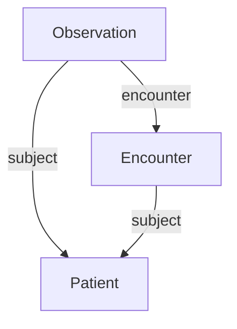

# 2026-10-14 — 실제 원천의 관계·시점·출처 표현

실행 `20261014T160043Z-domain-characteristics`에서는 실제 배포 자료와 공식 예시 여섯 종류를 읽어 구조를 점검했다. 업무 정확도를 비교한 벤치마크가 아니라 [도메인별 연구 지도](../domain-characteristics.md)의 입력 특성을 확인하는 작업이다. 원본을 고정하고 자료별 표본 범위를 따로 기록했다.

## 고정 자료와 관찰 범위

| 자료 | 이번에 읽은 범위 | 직접 관찰한 특성 |
| --- | --- | --- |
| GLEIF | 2026-10-12 08:00 릴리스 RR·REPEX 각각 앞 256행 | 관계 종류 5개, 관계·등록 상태와 기간·예외 필드 |
| FIBO | 고정 커밋의 Relations RDF/XML 모듈 하나 | 162개 트리플, 객체 속성 26개, import 9개 |
| FHIR | R4 공식 Observation·Patient·Encounter 예시 3개 | bare ID가 모두 example, 유형을 붙이면 3개 자원 |
| YAGO | 4.6 원본 SHACL 스키마 | 5,536개 트리플, NodeShape 55개 |
| Wikidata | Q80의 고정 응답 한 개 | 진술 283개, 한정자 값 168개, 참조 블록 152개 |
| 문서 | GLEIF Level 1 안내 HTML·CDF 3.1 XSD | 등록 주소·본사 주소가 같은 AddressType을 사용 |

GLEIF는 파일 순서대로 잘라낸 편향된 표본이고 Wikidata는 의도적으로 고른 한 개체다. FHIR 자료는 공식 예시이며 실제 환자 집단이 아니다. FIBO·YAGO는 스키마층을 읽었으므로 기업 사실·임상 기록·지식베이스 인스턴스와 같은 모집단으로 비교하지 않는다.

## FHIR 식별자와 참조 역할

공식 예시의 올바른 키는 `Observation/example`, `Patient/example`, `Encounter/example`이다. 유형을 버리고 `example`만 딕셔너리 키로 쓰면 세 자원 중 두 자리가 덮어써진다. 원본의 오류가 아니라 의도적으로 부적절한 키를 선택했을 때 생기는 손실이다.

예시 묶음에는 참조가 4개 있었고 그중 1개는 이 세 자원 안에서 해소되지 않았다. 원래 서버 전체에서 잘못된 참조라는 뜻은 아니다. Observation의 subject와 encounter처럼 참조 경로가 역할을 나타내므로 경로를 지운 연결 목록도 원래 의미를 보존하지 못한다.



위 그림은 선택한 묶음의 참조 중 세 개를 보여준다. 모든 연결이 같은 종류는 아니다. [FHIR R4 참조 명세](https://hl7.org/fhir/R4/references.html)는 참조 사슬의 맥락이 자동으로 상속되지 않는다는 점을 설명한다. 관계를 이어 환자를 추정하기보다 명시된 역할과 적용 규칙을 확인해야 한다.

## Wikidata의 평탄화 손실

Q80 응답의 revision ID는 `2556310829`다. 진술 283개 중 101개에 한정자가 있었고 112개에 참조가 있었다. 순위는 normal 278개, preferred 3개, deprecated 2개였다.

각 진술의 subject·property·mainsnak만 남기는 의도적인 변환을 정의했다. 이때 statement ID 283개, rank 283개, 한정자 값 168개, 참조 블록 152개가 빠진다. mainsnak과 snaktype은 보존하며 중복 제거는 하지 않는다. 실제 정답이 몇 개 틀렸다는 점수는 아니며 Wikidata의 공식 truthy 추출을 구현한 것도 아니다.

고용 관계 `P108`의 실제 진술과 한정자는 사례 파일에 남겼다. 시점이 있는 질문을 다룰 때 이런 정보를 지워도 되는지를 먼저 결정해야 한다. [Wikidata 데이터 모델](https://www.wikidata.org/wiki/Wikidata:Data_model)의 진술 구조를 기준으로 측정했다.

## 금융 관계와 스키마 의존성

GLEIF 표본에는 직접 연결 93개, 최종 연결 96개에 해당하는 회계 연결 관계 외에 펀드 운용 42개, 하위 펀드 24개, 국제 지점 1개가 있었다. 모두 ACTIVE였지만 등록 상태는 PUBLISHED 215개·LAPSED 41개였다. 서로 다른 상태 필드를 같은 의미로 합치지 않는다. 기간 유형도 관계 기간·회계 기간·문서 제출 기간으로 나뉘었다.

REPEX의 앞 256행에는 보고 예외가 있었다. 관계가 표본에 없다는 사실만으로 부모 기업이 없다고 판정하지 않았다. 두 표본을 조인한 기업별 의사결정 실험은 이번 실행에 포함하지 않았다.

FIBO는 고정 커밋 `9d9e5375dddc528f7c5fc96f0c508e2fcb05ea0b`의 [Relations 모듈](https://github.com/edmcouncil/fibo/blob/9d9e5375dddc528f7c5fc96f0c508e2fcb05ea0b/FND/Relations/Relations.rdf)을 읽었다. import 9개를 목록으로 기록했지만 가져오거나 추론하지 않았다. 따라서 이 파일 하나를 읽은 결과를 FIBO 전체 의미 체계의 평가로 제시하지 않는다. 저장소의 MIT 라이선스와 EDM Council·OMG 출처를 유지한다.

## 원본 제약과 문서의 역할

YAGO 4.6 스키마의 원본 해시가 이전 다운로드 기록과 같음을 확인했다. 명시적으로 PropertyShape 유형을 선언한 노드는 0개지만 `sh:property` 등으로 연결된 속성 제약 노드는 156개였다. 명시적 유형 선언만 세면 제약이 없는 것으로 오해할 수 있다. 이번 실행은 스키마 특성 점검이며 인스턴스에 SHACL을 새로 실행하지 않았다.

YAGO 자료의 출처는 YAGO team, Télécom Paris이며 CC BY 4.0을 따른다. [공식 배포와 라이선스](https://yago-knowledge.org/downloads/yago-4-6)를 참조한다.

GLEIF의 `LegalAddress`와 `HeadquartersAddress`는 XSD에서 모두 `lei:AddressType`이었다. 같은 형식이라는 사실로 두 필드의 업무 목적이 같다고 볼 수 없다. [공식 CDF 안내](https://www.gleif.org/en/lei-data/access-and-use-lei-data/level-1-data-lei-cdf-3-1-format)에 근거한 수동 해석과 자동 문서 이해를 구분했다. HTML 제목 개수는 구조적 기록일 뿐 의미 추출 성능이 아니다.

## 검증·제약·재현

독립 방법·구현 검토와 단위 검사 199개 통과 후 실행했다. 실행 시간은 0.41초, 실행기 최대 RSS는 39,260 KiB였다. 입력·코드 16개 항목의 해시와 보관한 코드·테스트를 대조했다. GLEIF RR·REPEX는 같은 릴리스의 배포 해시와 대조했고 YAGO·HTML·XSD는 이전 원본 해시와 비교했다. 주요 건수는 별도 재계산했으며 모든 집계 항목을 두 번째 구현으로 다시 작성한 것은 아니다.

NIST BOM 스프레드시트는 다운로드가 HTTP 403으로 실패했다. 실패 기록을 보존했으며 실제 제조업 파일을 분석했다고 표시하지 않았다. 제조업의 [합성 변경 영향 실험](20261014-change-impact.md)과 구분한다.

[자료별 집계·출처·검증](20261014-domain-characteristics-summary.json), [실제 필드와 진술 사례](20261014-domain-characteristics-samples.json)를 제공한다. 원본 다운로드는 별도 보존하며 유료 API와 DB 서버는 사용하지 않았다.

```bash
uv run --locked python scripts/profile_domain_sources.py --output runs/domain-characteristics-reproduction
```

재현에는 기록된 해시의 원천 파일이 필요하다. 현재 웹 응답을 다시 받으면 특히 Wikidata의 내용·revision이 달라질 수 있다.
