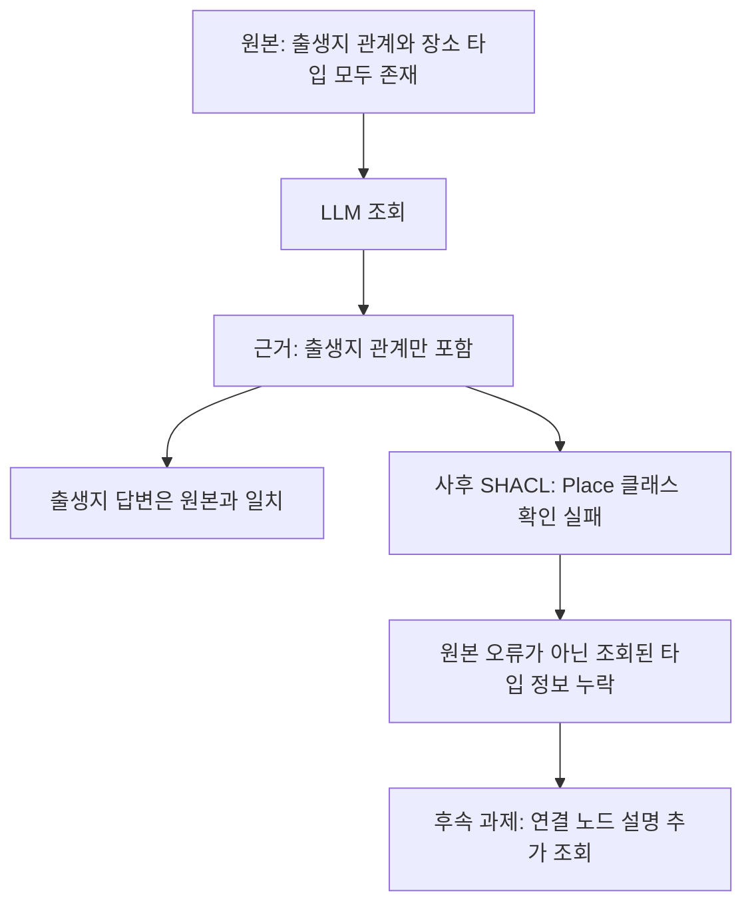

# YAGO LLM 조회·검증 실행 기록

## 첫 실행의 결과

YAGO 4.6의 기존 인물 4명과 원본 SHACL을 사용해 세 조건에서 12개 실행을 마쳤다. 실행 종료까지 답변을 낸 경우는 5개였고 7개는 모델 응답 한도 12회에 도달했다. 답변 5개 중 3개는 조회한 원본 트리플과 일치했고 인용도 답변을 뒷받침했다. 나머지 2개는 원본에 출생지 정보가 있는데도 모른다고 답했다.

| 조건 | 배정 | 답변 종료 | 원본·인용과 일치한 답변 | 불필요한 모름 | 실제 SHACL 검사 |
|---|---:|---:|---:|---:|---:|
| A: 조회만 | 4 | 3 | 1 | 2 | 0 |
| B: 검사 선택 | 4 | 2 | 2 | 0 | 0 |
| C: 검사 필수 | 4 | 0 | 0 | 0 | 0 |

C의 답변이 없다는 사실을 안전성 향상으로 해석하지 않는다. 검증 도구 요청은 B에서 1회, C에서 4회 있었지만 모두 검사에 필요한 근거가 없어 판정 불가로 끝났다. 이 요청들을 실제 SHACL 통과·위반 판정으로 세지 않았다.

실험 모델은 `openai/gpt-4o-mini`이며 모델 호출은 124회, 보고 비용은 $0.02273985였다. 기존 제조업·금융 실험의 비용과 별도로 기록한다.

## 확인된 쿼리 인터페이스 문제

LLM이 다음처럼 대상 IRI를 직접 넣으면서 `?s` 변수는 연결하지 않는 경우가 있었다.

```sparql
SELECT ?s ?p ?o WHERE {
  <http://yago-knowledge.org/resource/Abu_Nuwas> ?p ?o .
}
```

`?p`와 `?o`에는 값이 있지만 `?s`는 비어 있다. 도구는 실제 원본 트리플인 세 항을 요구하므로 이를 거부했다. 메시지가 값 연결 누락을 구체적으로 설명하지 않고 원본 트리플이 아니라고만 알려줘 모델이 같은 형태를 반복하는 데 영향을 주었을 가능성이 있다. 이 인과관계 자체를 통제 실험으로 확인한 것은 아니다.

다른 실패에는 빈 조회와 조회 횟수 제한 이후의 반복 요청도 포함된다. 스키마를 기존 YAGO로 바꿨다는 사실만으로 LLM과 도구 사이의 요청 형식 문제가 해결되지는 않았다.

## 검증 필수 조건의 종료 문제

근거가 없는 상태에서 검증을 요청하면 판정 불가가 반환된다. C는 실제 검사 판정을 요구했기 때문에 모델이 모른다고 답해도 종료를 거부했다. 첫 실행에서 이러한 종료 거부가 14회 발생했다. 이는 SHACL 자체의 제약이라기보다 실행 제어 정책의 문제다.

후속 설계에서는 검사 실행 여부를 기록하되 근거 부족 때문에 검사를 진행하지 못한 경우에도 근거 부족 사유와 함께 종료할 수 있어야 한다. 이 경로는 검사 통과나 사실 확인으로 표시하지 않는다. 첫 실행 결과는 수정하지 않는다.

## 쿼리 예시를 제공한 별도 진단

첫 실행을 보존한 뒤 첫 인물에 대해 C 조건을 한 번 더 실행했다. 모든 변수가 연결된 일반 조회 예시와 연결 노드의 타입·라벨을 보존하라는 안내를 추가했다. 정답이나 출생지는 제공하지 않았다. 여러 안내를 함께 바꾼 사후 진단이므로 변수 연결 안내 하나의 효과로 해석할 수 없다.

이 실행도 모델 응답 12회 안에 종료하지 못했다. 모델은 같은 미연결 변수 쿼리를 두 번 요청했고 빈 근거에 검증을 다섯 번 요청했다. 실제 SHACL 판정은 없었다. 예시 한 줄을 추가하는 방식으로는 이번 모델의 반복 실패가 해결되지 않았다.

첫 12개와 별도 1개를 합친 모델 호출은 136회, 보고 비용은 $0.02452470이다. 반환하지 않는 예약 누계는 $0.32394015이며 캠페인 상한 144회와 $1.50 이내다. 비용이 미해결된 호출은 없다. 첫 실행과 별도 진단의 분모는 합쳐 성능 지표로 사용하지 않는다.

## 원본과 조회 근거의 사후 검사

모델 실행이 끝난 뒤 연구자가 같은 도구로 원본과 저장된 근거를 직접 검사했다. 이 사후 분석은 LLM의 도구 사용 횟수에 포함하지 않는다.

| 검사 대상 | 건수 | 결과 |
|---|---:|---|
| 기존 원본 부분집합, 인물별 검사 | 4 | 모두 통과 |
| 정답을 낸 LLM의 누적 조회 근거 | 3 | 모두 출생지 클래스 제약 위반 |

예를 들어 모델은 `Abu_Nuwas → birthPlace → Ahvaz`를 찾아 정답과 인용을 냈다. 그러나 조회 근거에 Ahvaz의 타입 설명이 없어서 SHACL은 Ahvaz가 Place인지 확인하지 못했다. 원본에는 해당 타입 정보가 있었다. 이 위반을 출생지가 틀렸다는 뜻으로 해석하면 안 된다.



## 다음 수정 범위

쿼리의 미연결 변수를 구체적으로 알려주는 오류 메시지와, 근거 부족을 표시하고 종료하는 경로가 필요하다. 연결 노드의 타입 설명을 요청할 수 있는 도구도 준비한다. LLM이 대상 IRI와 필요한 정보를 선택하고 도구가 문법을 처리하는 방식은 자유 SPARQL 작성과 별도 조건으로 비교한다. 자동으로 정답을 조회하거나 모든 위반을 사실 오류로 처리하지 않는다.

현재까지 원본 YAGO 데이터·taxonomy·SHACL 해시와 기존 캠페인 비용 장부는 변하지 않았다. 첫 실행 전 테스트 251개, 별도 진단 전 테스트 253개를 통과했다. 독립 검토는 각각 두 건씩 받았으며 생략된 내부 코드와 실제 메모리 사용량은 검토자가 확인하지 못한 범위로 남겼다.

[실험 명세](../yago-native-tools-study.md) · [집계와 사후 검사](20261015-yago-native-tools-summary.json) · [질문·쿼리·도구 응답 전체 기록](20261015-yago-native-tools-traces.json)
