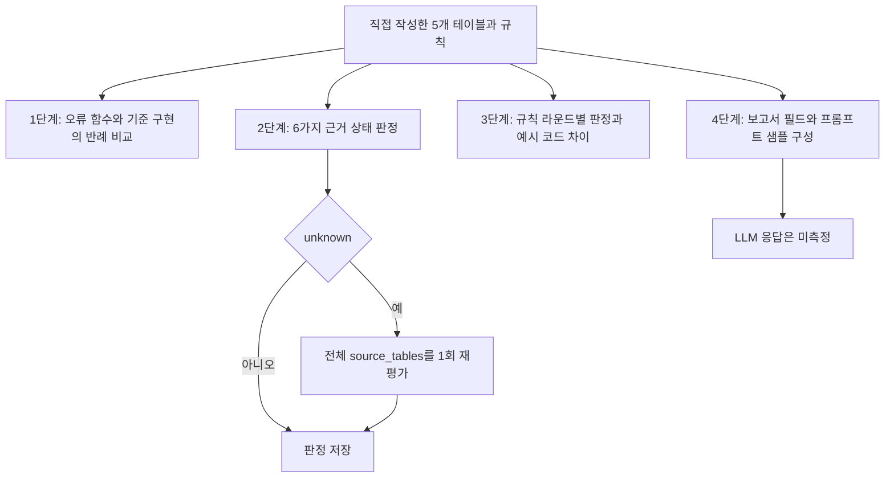

# 통합 규칙 생명주기 오프라인 진단 (`unified-rule-lifecycle-1`)

2026-10-26 코드·주장 감사에서 원고의 측정 범위를 정정했다. 파일명의 20261022는 기록 식별자이며 실행 시각을 인증하지 않는다. 기존 집계 `_workspace/unified-rule-lifecycle-1/summary.json`과 프롬프트 샘플은 그대로 보존한다. 기존 집계의 전체 소요 시간은 `12.832`초다. 과거 문서의 `10.13`초와 다른 지연 시간은 이 집계와 연결되지 않아 철회했다.

실행 코드는 `scripts/unified_rule_lifecycle.py`, 테스트는 `tests/test_unified_rule_lifecycle.py`다. 네 단계는 같은 합성 테이블 구조를 사용하는 별도 진단 함수이며, 자연어 규칙 생성부터 LLM 응답까지 이어지는 종단간 실험은 아니다. 유료 API 호출과 LLM 호출은 `0`회다.

## 사전 점검과 측정 경계

실제 GLEIF 원천 24건을 실행했다는 이전 주장은 철회한다. 해당 코드는 상태 이름 24개를 만들고 결과 상수를 넣었으며 원천 로딩·세 구현체 실행·채점이 없었다. 새 출력은 `gleif_transfer_24.status = not_executed`로 표시한다. 실제 GLEIF 선행 연구는 별도 기록이며 이 진단의 전이 검증으로 합산하지 않는다.

`STANDARD_DICTIONARY`는 직접 작성한 단어 7개·도메인 4개·용어 6개의 예시다. 공식 사전 수입본이 아니며 이 실행에서 자연어를 정규화하거나 컴파일하는 데 사용되지 않는다. 원천은 `items_contracts`, `order_requests`, `approval_reviews`, `reviewers`, `departments`의 다섯 테이블이다.

텍스트 요약: 네 진단은 같은 스키마를 공유하지만 앞 단계가 생성한 규칙이나 실제 LLM 응답을 다음 단계로 전달하지 않는다.

## 1단계: 수작업 오류 주입과 반례 비교

12개 정책 계열에 한국어·영어 라벨을 붙인 24개 항목에 각각 4종 증인을 적용했다. 언어 쌍은 같은 테이블·오류 함수를 재사용한다. `96`은 증인 평가 수이며 독립적인 자연어 생성 표본 수가 아니다. L0는 미리 작성한 오류 함수를 선택하고 L1은 미리 작성한 Python·SQLite·SHACL 구현을 실행한다.

| 비교 | 단일 정상 예제 통과 | 4종 증인 전부 일치(CEM) | 정상 / 경계 위반 / 무관 변형 / 결측 실패 |
| --- | --- | --- | --- |
| L0 오류 함수 | 24/24 | 0/24 | 6 / 6 / 14 / 8 |
| L1 기준 구현 | 미측정 | 24/24 | 0 / 0 / 0 / 0 |

L1의 세 구현은 정책별 네 증인의 판정 벡터에서 `24/24` 일치했다. 기존 `SVR 24/24`와 L1 `Naive SER 24/24`는 무조건 증가시킨 카운터였으므로 측정치에서 제외했다. L0의 `Naive SER`는 정상 예제 하나만 검사하며 음성 예제는 포함하지 않는다. 이 결과는 지정한 오류가 반례에 드러남을 보여 주지만 사전 정규화·자연어 컴파일·언어 간 성능 차이를 검증하지 않는다.

## 2단계: 합성 근거 상태와 전체 원천 재평가

60개 식별자 각각에 `normal`, `irrelevant_noise`, `retrievable_omission`, `source_absence`, `explicit_violation`, `valid_fact_substitution`을 적용한 `360`건이다. 여섯 상태의 반복 구성으로, 자연 발생 오류 빈도는 측정하지 않았다. U0는 금액만 확인하는 결정적 기준선이다. G1은 질문 밖 품목 상태와 비고 정규식을 추가 검사하므로 선택 범위와 규칙 강도가 함께 달라진다. S1은 실행하지 않았다.

S2는 최초 판정이 `unknown`이면 전체 `source_tables`를 한 번 재평가한다. `sh:resultPath`로 조회 대상을 선택하지 않으며 네트워크 호출도 없다. 검색 누락 60건과 원천 부재 60건에 각각 시도하므로 팔마다 논리적 재평가 횟수는 `120`이다. 원천 부재는 재평가 뒤에도 `unknown`으로 남는다.

| 정책 | 계약 판정 일치 | 오승인 / 전체 | 불필요 보류 / 원천 계약상 승인 가능 | 사실 치환의 외부 합성 진실 오류 | 기존 집계 평균 ms/건 |
| --- | --- | --- | --- | --- | --- |
| U0 | 240/360 | 120/360 | 0/240 | 60/60 | 0.0008 |
| G1 | 240/360 | 0/360 | 120/240 | 60/60 | 0.0135 |
| S2 Python | 360/360 | 0/360 | 0/240 | 60/60 | 0.0068 |
| S2 SQLite | 360/360 | 0/360 | 0/240 | 60/60 | 0.5915 |
| S2 SHACL | 360/360 | 0/360 | 0/240 | 60/60 | 7.0208 |

불필요 보류 분모 `240`은 정상·무관 오류·검색 누락·사실 치환의 네 상태다. 사실 치환은 계약상 승인 가능하지만 외부 합성 진실에서는 틀리므로 계약 일치와 사실 정확도를 혼동하면 안 된다. 세 S2 팔의 최종 결정은 `360/360` 일치했다. 시간은 보존된 단일 실행의 참고값이며 신뢰구간·최대 메모리·DB 서버 성능을 측정하지 않았다. 통합 SHACL 팔은 OWL-RL을 실행하지 않는다.

## 3단계: 규칙 라운드와 예시 코드 줄 수

R0는 계약 상태 `Active`, 할인율 상한, 순결제금액 `100000`, 적격자의 `Primary` 승인을 검사한다. R1은 `achieved_margin_rate >= min_margin_rate`를 추가한다. R2는 적격자의 `Audit` 승인도 요구한다. 서로 다른 두 사람인지, 긴급·고액 요청인지 검사하는 조건은 없다. R3는 요청 부서와 검토자 부서의 상위 본부가 겹치는지 검사한다. 요청 부서에서 시작하는 SHACL 경로는 역방향 1개와 순방향 4개로 구성된다.

각 라운드에서 여섯 테이블 패턴을 40회 반복해 `240`회, 네 라운드에서 `960`회 평가했다. 고유한 패턴·라운드 조합은 `24`개다. 세 구현체의 전체 반환값이 `960/960` 일치했으며 독립 사례 960개를 검증한 것은 아니다.

줄 수는 `ARM_STAGE_SOURCE_SNIPPETS`의 설명용 문자열을 비교한다. 빈 줄을 제외하고 앞뒤 공백을 지운 뒤, 반대쪽 문자열의 줄 집합에 없는 줄을 추가·삭제로 각각 센다. 순서나 동일 줄의 중복 횟수 변화는 반영하지 않는다. 실행 함수의 버전별 diff, AST 거리, 최소 구현 비용 또는 작업 시간으로 해석하지 않는다.

| 전환 | Python 예시 조인 / 규칙 줄 차이 | SQLite 예시 조인 / 규칙 줄 차이 | SHACL 그래프 크기 증가 |
| --- | --- | --- | --- |
| R0→R1 | 0 / 1 | 4 / 3 | 22 트리플 |
| R1→R2 | 7 / 6 | 3 / 3 | 18 트리플 |
| R2→R3 | 8 / 3 | 5 / 3 | 39 트리플 |
| 합계 | 15 / 10 | 12 / 9 | 79 트리플 |

`generic_tables_to_rdf`는 모든 라운드에서 같은 함수를 호출한다. 따라서 투영기 변경은 `0`이지만 Arm G 전체의 규칙별 Python 처리가 없다는 뜻은 아니다. `evaluate_arm_g_shacl`에는 검토자·부서 결측을 확인하는 Python 조회와 판정 조립이 남아 있다. 실제 함수의 물리적 줄 수는 새 집계의 `source_function_lines`에 정의와 함께 기록한다. 함수 선언부터 마지막 본문까지 docstring·빈 줄을 포함하며 예시 문자열 차이와 별도 지표다.

소비처 비교는 실제 서비스 세 곳을 배포하지 않았다. Python R3와 R1을 호출해 두 라운드 뒤처진 버전을 의도적으로 비교하면 `80/240`이 달랐고 SHACL R3를 두 번 호출하면 `0/240`이 달랐다. 핀 해시 검사·배포 누락률·공유 Python 대조는 없다. 이 수치는 버전 선택 예시이며 RDF 고유의 일관성 이득을 입증하지 않는다.

## 4단계: 보고서 필드와 프롬프트 구성

할인율 초과·마진 미달·Audit 역할 부재·본부 충돌의 네 패턴을 60회씩 반복했다. `240`건 전체가 5-hop 위반이나 결측 사례인 것은 아니다. M0는 원천 테이블, M1은 Python의 `decision`·`violations`와 원천 테이블, M2는 SHACL 결과를 변환한 JSON을 제공하도록 설계했다. 보고서 필드 집계와 한 본부 충돌 사례의 세 프롬프트 샘플을 생성하며 LLM 응답은 측정하지 않는다.

| 구성 | 미리 계산한 decision | 비어 있지 않은 focus_node | 비어 있지 않은 result_path | 비어 있지 않은 value_node |
| --- | --- | --- | --- | --- |
| M0 | 0/240 | 0/240 | 0/240 | 0/240 |
| M1 | 240/240 | 0/240 | 0/240 | 0/240 |
| M2 | 240/240 | 240/240 | 240/240 | 180/240 |

M2는 정렬한 첫 검증 결과의 비어 있지 않은 필드를 센다. `QualifiedMinCount` 실패 60건에는 충돌 값이 없어 `value_node`가 비어 있다. 이전 코드는 이를 값이 있는 것처럼 세어 `240/240`으로 보고했다. 수정된 집계는 이 60건을 제외한다. M0의 0은 원천 정보 부재가 아니라 미리 계산한 보고서 필드 부재를 뜻한다.

Python `+14`줄·SQL `+11`줄·SHACL `0`줄이라는 근거 추적 비용은 구현 비교 없이 넣은 상수였으므로 철회했다. SHACL 필드의 JSON 변환에도 `_compact_uri`, `extract_shacl_llm_report`라는 공통 코드가 필요하다. `conforms`는 실제 SHACL 반환값이고 `policy_eligible`은 Python 정책 판정으로 분리한다. 보고서에 필드가 있다는 사실은 설명의 정확성·근거 완전성·외부 진실을 보장하지 않는다. 동일한 구조화 보고서를 반환하는 Python·SQL 대조군은 미측정이다.

<!-- HUMANIZE-SUMMARY -->
<!-- 경로 light / 등급 B / 자체검증 6/6 통과. C-11 연결어미 뒤 쉼표 2곳만 제거했다. 사실·수치·날짜·기술 용어와 측정 범위 한정을 보존했다. 이미 좋은 글로 추가 윤문을 생략했다. 변경률은 별도 게이트 로그를 따른다. -->
