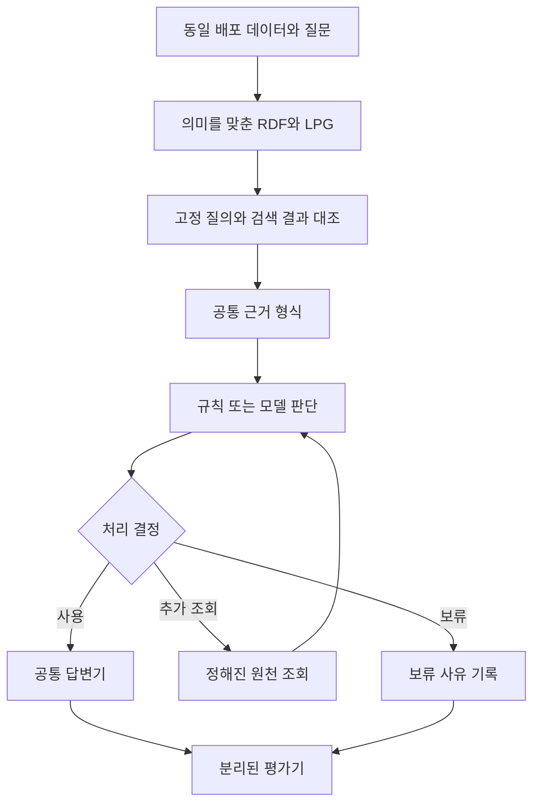

# 온톨로지 기반 질의응답과 변경 영향 분석 연구계획서

연구 범위 확장: [도메인·데이터 구조 연구 지도](domain-characteristics.md). 변경 뒤 재검증할 판단을 찾고, 금융·의료·지식베이스·문서의 고유한 의미 조건을 보존한다. 제조업 합성 실험과 실제 원천 구조 점검을 구분해 입문 안내서의 근거를 쌓는다.

최근 복구 비교: [선택적 검사 뒤의 제한된 추가조회](bounded-refresh-study.md). 원천 재조회로 복구 가능한 사례와 의미 확인이 필요한 사례를 구분한다.

검사 비교: [업무 일관성·버전·의미 매핑의 선택적 검사](semantic-guards-study.md). 기존 답을 유지하거나 보류하는 효과와 카탈로그 신뢰의 한계를 분리한다.

공통 규칙 비교: [공통 의미 규칙과 업무 간 변경 일관성](shared-semantics-study.md). 여러 업무가 같은 의미 정의를 사용할 때 변경 누락과 오류 전파를 함께 비교한다.

후속 운영 비교: [데이터·관계·규칙 변경](graph-lifecycle-study.md)에서 JSON 두 구현과 실제 Neo4j를 비교한다.

작성일: 2026-10-13 · 상태: 전체 연구계획은 초안, GLEIF·의미 판단 후속 실행 완료, 최소 온톨로지 개입 부분 실행·중단 분석 완료

이 연구는 동일한 데이터와 질문에서 RDF·SHACL 기반 질의응답이 다른 구현보다 어떤 이점과 한계를 보이는지 평가한다. RDF와 LPG의 표현·검색 차이, 명시적 규칙과 모델 판단의 차이를 분리한다. RDF·SHACL의 우월성, 효과 없음, 다른 방법의 우월성을 모두 가능한 결과로 둔다.

기존 실행은 [명세 0.4](specification.md)에 따른 탐색 파일럿으로 보존한다. 이 계획은 새 실험을 위한 초안이며 실행 명세의 대체본은 아니다. 이번 확대 실행의 조건과 분석 범위는 [명세 0.5-study1](specification.md)에 기록했다.

[실험 과정 애니메이션 열기](preview/index.html) — 네 아키텍처 카드에서 같은 질문의 검색·검사·추가조회·출력 경로를 함께 볼 수 있다. 실제 측정값이 아닌 설명용 시뮬레이션이다.

첫 개발 실행은 [2026-10-13 연구 일지](../journal/2026-10-13-gleif-comparison-development.md)에 기록했다. 개발 1,296개·별도 평가 3,240개·Jev 개발 216개 결과는 [확대 비교 연구 일지](../journal/2026-10-13-expanded-comparison.md)에 정리했다.

## 현재 연구 초점

SHACL 검사에 한정했던 비교를 [개념 통합과 명시적 추론](ontology-study.md)으로 넓혔다. JSON 규칙 엔진과 RDF·OWL-RL에 같은 사실과 공리를 주고, 개념 계층·어휘 매핑·역관계·관계 합성의 효과를 분리한다. JSON 비교군도 같은 온톨로지 의미를 구현하므로 온톨로지가 없는 대조군으로 부르지 않는다. 합성 1,920행을 실행했고 두 추론기는 640개 질의에서 일치했다. [해석과 후속 방향](../journal/2026-10-13-ontology-reasoning.md)에 도구 비교와 의미 모델의 효과를 구분했다.

업무·의사결정 시스템과 금융·의료 감사처럼 판단 근거가 중요한 활용에서 출발한다. 모든 데이터를 온톨로지로 바꾸기보다, 관계·날짜·자격 등 필요한 부분만 명시적으로 관리했을 때 도움이 되는 범위를 찾는다. 현재 질문은 **어느 정도의 데이터·질문 복잡도에서, 어느 처리 단계에 온톨로지 검사를 넣는 것이 적절한가**다.

[복잡도와 최소 온톨로지 개입 실험](hybrid-study.md)은 같은 JSON 근거에서 코드·SHACL·LLM·추가 LLM 검토·판단 전후 검사·선택 검사를 비교한다. 합성 제조 승인 120문항을 두 번 반복하고 기존 기업군과 겹치지 않는 GLEIF 24문항을 추가한다. 고정 계약으로 쿼리 생성과 판단을 분리하며, RDF·SHACL의 우위를 전제하지 않는다. 실제로는 첫 120문항과 두 번째 반복 69문항까지 완료한 뒤 응답 미수신 두 건으로 유료 호출을 중단했다. [관측 결과와 해석](../journal/2026-10-13-hybrid-intervention.md)에 GLEIF 모델 비교·계약 추출의 미실행 범위도 기록했다. 아래의 전체 계획과 과거 실행 기록은 이 후속 실험과 구분해 보존한다.

## 의미 판단 후속 설계

고정 계약 검사 결과로 LLM의 의미 판단 능력을 평가할 수 없다는 한계를 반영했다. [의미 판단 후속 실험](semantic-study.md)에서 관계의 범위·시점·상충 근거를 추가한다. 합성 통제 사례 180행과 사후 대응 점검 36행을 실행했다. [후속 결과](../journal/2026-10-13-semantic-comparison.md)는 기존 GLEIF 평가와 구분한다. 질문 계약의 자동 해석과 외부 사실 검증은 별도 과제로 남긴다.

## 연구 배경과 선행 실험

| 관측 결과 | 후속 설계에 반영할 내용 |
| --- | --- |
| GLEIF에서 법인명 누락이 답할 수 있는 모회사 질문을 차단 | 질문의 필수 근거와 일반 데이터 품질 조건을 구분 |
| YAGO의 불필요한 보류는 G1 12/15, S2 0/15 | 질문 관련 검사와 누락 보완의 효과를 따로 비교 |
| S2와 U2의 정답은 각각 15/27, 오답은 3/27과 6/27 | 조회로 회복한 정답과 타입 검사로 차단한 오답을 구분 |
| 정상 장소로 치환한 사실 오류 3건은 S2에서도 오답 | 제약 충족, 근거 지지, 사실 정확성을 별도 평가 |
| GLEIF의 정상 보고 예외에서도 LLM이 보류 | 판단 정책과 답변 생성의 실패를 분리 |

출처는 [GLEIF 파일럿](../journal/2026-10-12-gleif-pilot.md), [YAGO 선택적 검증](../journal/2026-10-12-yago-selective.md), [실제 질문·답변 사례](../journal/2026-10-12-yago-case-examples.md)다. YAGO 후속 실험은 이미 본 인물 3명과 출생지 질문을 재사용했다. 인위적으로 주입한 오류의 결과이며 자연 발생 오류의 빈도나 일반적인 GraphRAG 성능을 뜻하지 않는다. 같은 규칙의 Python 판정과 일치한 사실도 SHACL만의 우월성 근거가 되지 않는다.

[Self-RAG](https://arxiv.org/abs/2310.11511)는 필요에 따른 검색과 자기 평가를, [CRAG](https://arxiv.org/abs/2401.15884)는 검색 결과 평가에 따른 후속 처리를 다룬다. 재검색이나 보류가 있다는 사실 자체를 차별점으로 주장하지 않는다. 본 연구는 동등한 정보·규칙 아래에서 표현과 판단 방법의 효과를 분리하고 실패 유형별 적용 범위와 비용을 공개하는 것을 기여 후보로 삼는다. 독창성 판단에는 관련 연구의 원문·코드·평가 조건 대조가 추가로 필요하다.

## 연구 목적과 검증 가설

중심 질문은 동일한 사실·질의·판단 기준에서 RDF·SHACL은 LPG·코드 규칙·모델 판단과 비교해 답변 품질과 처리 비용에 어떤 차이를 만들며, 그 차이는 어떤 조건에서 발생하는가?

| 검증 대상 | 가설과 반증 조건 |
| --- | --- |
| 표현과 검색 | 의미가 동등한 RDF·LPG에서 같은 질의 결과를 얻으면 답변 품질 차이는 작을 것이다. 결과가 다르면 변환·질의·추론 차이를 먼저 확인한다. |
| 명시적 검증 | 질문 관련 제약 검사는 무검증보다 구조적 오류의 답변 사용을 줄일 것이다. 정상 근거의 차단 증가와 함께 평가하며 순이득을 전제하지 않는다. |
| 판단 모델 | 일반 LLM이나 Jev는 일부 의미 판단에서 규칙보다 유리할 수 있다. 구조 검사, 오답 허용, 비용을 포함한 비교에서 불리하면 채택 근거가 약해진다. |
| 결합 방식 | 규칙과 모델을 결합하면 단독 방식의 오류를 줄일 수 있다. 추가 비용과 불필요한 보류가 증가하면 결합의 효용이 없을 수 있다. |
| 규칙 재사용 | SHACL이 사전 지정한 스키마·질문 변경에서 수정량과 회귀 오류를 줄일 수 있다. 직접 측정한 경우에만 운영상 이점으로 보고한다. |

SHACL은 데이터 그래프가 선언한 조건을 만족하는지 검사한다. 그 조건만으로 사실의 진실성을 보장하지 않는다. [W3C SHACL 명세](https://www.w3.org/TR/shacl/)

Jev는 정의된 선택지에 대한 판단과 확률을 반환하는 비교 후보다. 공급자의 타입 안전성·속도·확신도 주장을 우리 데이터의 정확도로 대체하지 않는다. [TypeSafe 공식 소개](https://typesafe.ai/blog/introducing-system-one-models-and-jev)

## 비교 구조와 원인 분리

텍스트 흐름은 데이터·질문 고정 → RDF·LPG 변환 → 동등 질의 → 공통 근거 → 판단 → 답변·추가 조회·보류 → 평가다. 추가 조회는 최대 한 번으로 제한한다. 원천과 검색기의 반환 가능 범위를 모든 조건에 동일하게 제공하며 평가 정답은 조회할 수 없다.

표현 비교에서는 RDF와 LPG의 검색 결과를 공통 JSON 사실 목록으로 정규화한다. 식별자, datatype, 언어 태그, 관계 방향·다중성, 타입 계층과 출처를 보존하고 결과 집합·중복·순서를 대조한다. 기준 정보가 손실된 변환은 수정한 뒤 비교한다. 추론은 우선 끄고 필요할 때 별도 조건에서 양쪽에 동등한 타입 폐쇄를 제공한다.

이 조건에서 결과가 같으면 LLM 입력도 같게 만든다. 품질 동률은 타당한 결과다. RDF 문법 자체를 LLM이 더 잘 읽는지는 별도의 직렬화 비교이며 이번 주 비교에 섞지 않는다. RDFLib·Neo4j처럼 엔진이 다른 실행 시간은 구현 스택의 차이로 보고하고 표현 자체의 효과로 단정하지 않는다.

## 비교군과 공통 판단 기준

첫 비교는 RDF 무검증, RDF+SHACL, LPG 무검증, LPG+동등한 코드 규칙으로 구성한다. RDF에도 같은 Python 규칙을 실행하는 조건을 두어 SHACL 구현의 차이를 분리한다. 저장 엔진 비교를 위해 Neptune까지 동시에 도입하지 않는다.

판단 방법 비교는 표현 비교에서 동등성을 확인한 공통 근거를 재사용한다.

| 판단 방법 | 입력과 역할 |
| --- | --- |
| 무검증 | 같은 근거를 공통 답변기에 전달하는 기준선 |
| 코드 규칙 | SHACL과 동등한 조건을 결정적으로 검사 |
| SHACL | 공통 사실을 RDF로 복원해 동일 제약 검사 |
| 일반 LLM | 동일 근거·판단 기준으로 검사 항목별 상태 선택 |
| Jev | 동일 근거·판단 기준으로 상태와 확률 반환 |
| SHACL+일반 LLM | 규칙 검사와 모델 판단의 결합 효과 확인 |
| SHACL+Jev | 규칙 검사와 decision model의 결합 효과 확인 |

검사 항목의 출력은 충족·위반·확인 불가로 맞춘다. 명시적 제약과 질문별 사용 조건을 모델에도 제공하고 검색기·판단기·답변기 모두 실제 정답·오류 유형 이름·주입 전 값에 접근하지 못하게 한다. 원시 SHACL 보고서와 공통 상태로의 매핑을 둘 다 저장한다. 예를 들어 타입 근거가 검색에서 누락된 경우와 확인된 잘못된 클래스는 구별한다. 이 매핑은 별도의 정책이며 SHACL 자체의 추론 능력으로 설명하지 않는다.

검사를 수행하는 판단 방식에는 같은 코드 정책을 적용한다. 질문 관련 필수 항목이 충족되면 사용하고 확인 불가이면 한 번 추가 조회하며 확인된 위반이면 보류한다. 재조회 뒤에도 충족되지 않으면 보류한다. 무검증 조건은 검사와 조건부 재조회를 모두 생략하고 첫 근거를 답변기에 전달한다. 무조건 재조회 조건은 검사 없이 같은 원천을 정확히 한 번 더 읽고 최종 근거를 답변기에 전달한다. 두 조건 모두 공통 답변기가 값 없음·복수 후보이면 보류하며 별도 타입 검사를 끼워 넣지 않는다. 이 비교로 단순한 추가 검색의 효과를 확인한다.

결합 조건은 SHACL에서 확인된 필수 위반을 먼저 차단한다. 그 밖의 항목은 같은 근거와 기준을 받은 모델이 판단하고 사용에는 필요한 규칙 검사와 모델 판단이 모두 통과해야 한다. 이 보수적 결합이 응답률을 낮출 가능성도 평가한다. 결합과 모델 단독의 차이를 규칙 정보의 추가 제공 효과와 혼동하지 않도록 모델의 입력은 동일하게 유지한다.

확률 임계값은 개발 집합에서만 정하고 동결한다. 일반 LLM의 자기보고 확률과 Jev 확률의 보정 상태를 각각 확인한다. 모델 확신도를 근거로 없는 사실을 보충하지 않는다.

## 데이터와 질문 구성

GLEIF는 동일 배포의 LEI·RR·REPEX와 원본 해시를 유지한다. 회계연결 관계와 보고 예외를 구분하며 법적 지배 관계로 확대 해석하지 않는다. YAGO 4.6은 원본 SHACL 바이트와 CC BY 4.0 표시를 보존한다. 추가 질문 조건은 별도 파일에 둔다.

YAGO에서는 출생지와 다른 타입·값 제약을 갖는 관계, GLEIF에서는 직접 모회사·보고 예외와 제한된 관계 경로를 후보로 삼는다. 정확한 속성과 질문 목록은 데이터 탐색 후 개발 단계에서 확정한다. LLM이 SPARQL이나 Cypher를 자유 생성하지 않는다. 질문 유형·매개변수·고정 질의·필요 검사 집합을 하나의 계약으로 저장한다.

표본의 출발안은 데이터셋별 새 중심 개체 42개다. 12개는 개발·임계값 조정, 30개는 평가용으로 분리한다. 개체당 최대 두 질문을 구성하되 질문 적격성·층화·추출 seed를 먼저 고정한다. GLEIF는 연결된 기업군, YAGO는 인물과 연결된 평가 대상의 중복을 점검해 관련 개체가 양쪽에 섞이지 않도록 그룹 단위로 분리한다. 공통 스키마와 일반 장소 사전은 공유 자원으로 별도 표시한다.

기존 파일럿 개체와 확인한 정답은 평가에서 제외한다. 위 표본 수는 유의성이나 대표성을 보장하는 계산 결과가 아니다. 개발 집합의 분산·실행 비용으로 검정력과 필요한 규모를 산정한 뒤 평가 표본을 열기 전에 확정한다. 확대가 어려우면 탐색 비교로 명시한다.

| 근거 상태 | 조작과 평가 범위 |
| --- | --- |
| 정상 근거 | 추가 조작 없이 기준 응답·오탐 확인 |
| 질문과 무관한 품질 오류 | 다른 속성 오류가 답변을 막는지 확인 |
| 검색 결과의 관계·타입 누락 | 원천에는 유지하고 조회로 복구 가능한지 확인 |
| 원천의 필수 관계 누락 | 현재 스냅샷에서 답할 수 없는 상황의 보류 평가 |
| 명시적 타입·값·관계 위반 | 잘못된 클래스, datatype, 허용하지 않은 다중성 검사 |
| 제약에 맞는 사실 치환 | 주입 전 값과 다른 정상 값의 오답 여부를 별도 평가 |

각 상태는 같은 원본의 독립 복사본에서 만든다. 유형별로 보고하고 인위적인 유형 비율의 평균을 실제 운영 성능으로 해석하지 않는다. 원천 누락과 검색 누락의 원인은 평가자만 안다. 현실 데이터의 오류 빈도는 이 실험으로 추정하지 않는다.

## 정답과 답변 생성의 분리

정답은 주입 전 스냅샷에서 만들되 답변값, 근거로 허용되는 정보, 적절한 처리 상태를 구분한다. 원천 누락에는 원본 값이 남아 있더라도 실행 중 답변 가능한 것으로 채점하지 않는다. 사실 치환에서는 스냅샷 정답과의 불일치를 기록하며 현실의 독립적인 진실 판정이라고 부르지 않는다.

유명 개체의 사실을 모델이 암기해 맞힌 경우와 현재 근거로 지지되는 답변을 구분한다. 불투명 식별자로 바꾼 대응 사례를 별도 보조 분석에 두어 모델 기억의 영향을 확인한다. 외부 출처 충돌 탐지는 후속 연구로 남기며 원천에 없는 정보를 만드는 복구를 허용하지 않는다.

답변기는 결정적 값 추출기와 고정 LLM 두 종류로 분리한다. 우선 추출기로 판단·검색 효과를 확인하고 같은 최종 근거와 결정에 LLM을 적용해 생성 단계의 추가 오류를 측정한다. GLEIF 예외 응답 문제는 개발 집합에서 해결한 뒤 prompt를 고정한다. 독립 평가기는 모델 판단을 정답으로 사용하지 않으며 모호한 사례는 사전 기준에 따른 사람 검토·유보 기록을 남긴다.

## 평가 지표와 분석 원칙

주 비교는 SHACL 대 동등 코드 규칙, SHACL 대 일반 LLM, SHACL 대 Jev로 정한다. 주 지표는 전체 사례 기준 오답률과 답변 가능 사례 기준 불필요한 보류율이다. 두 데이터셋의 주 비교·주 지표를 하나의 검정 묶음으로 등록하고 확증 분석에서는 Holm 보정을 적용한다. Jev 접근이 불가능한 경우 평가 전에 미측정으로 고정한다. 무검증·조회·결합 조건과 오류 유형별 분석은 기전 확인을 위한 탐색 비교로 표시한다.

조건별 전체 사례의 정답·오답·보류·실패 비율도 모두 보고한다. 불필요한 보류의 분모는 실행 시점의 허용 원천에 모호하지 않은 정답 근거가 있는 사례로 한정한다. 실패·timeout을 분모에서 제거하지 않는다.

응답 중 오답률과 응답률을 함께 그리고 모델 임계값에 따른 risk–coverage 곡선과 규칙 방식의 고정 지점을 표시한다. 임계값은 개발 집합에서만 선택한다. 평가 집합에서 사후에 응답률을 맞춰 고른 결과는 기술적 분석으로 구분하며 확정된 운영 성능이라고 부르지 않는다.

비용은 첫 검색·변환·검증·재조회·모델 판단·답변 생성을 포함한 시간, 검색 횟수·반환량, 토큰·API 사용액과 최대 메모리를 기록한다. 동일 품질 범위에서 시간과 비용을 비교하고 품질·비용 간 상충도 함께 제시한다. AWS 비용은 모델 API 비용과 분리한다.

같은 사례의 조건별 결과를 짝지어 비교한다. 여러 오류 변형·질문·반복이 같은 개체에서 나왔다는 점을 반영해 개체 또는 기업군 단위 bootstrap으로 95% 구간을 산출한다. 모델 조건은 고정 설정에서 3회 반복하고 실제 모델·제공자·버전을 기록한다. 비열등성이나 동등성은 허용 차이와 검정력을 실행 전에 정한 경우에만 주장한다. 차이가 유의하지 않다는 사실만으로 동등하다고 결론 내리지 않는다. 실행 명세 동결 시 데이터셋별 재표집 군집, 3회 반복의 집계, 짝지은 검정 방법, 분모가 0인 항목의 null 처리를 명시한다.

규칙 재사용 평가는 미리 지정한 세 변경 과제인 속성 추가, 제약 변경, 질문 유형 추가에서 수행한다. 수정 파일·규칙 수, 검사 회귀 오류, 작업 시간을 기록하고 동일 담당자의 학습 효과를 줄이도록 순서를 교차 배치한다. 자동화 여부·숙련도 영향을 함께 밝히며 정확도 결과를 본 뒤 새 성공 지표로 추가하지 않는다.

## 진행 단계와 자원 계획

| 단계 | 작업과 완료 기준 |
| --- | --- |
| 사전 점검 | 원문 기반 관련 연구 비교표, 접근 가능한 모델·가격·버전, 데이터 적격성·규칙 범위 확인 |
| 1단계 | RDF·LPG 변환과 동등 질의, 공통 근거·판정 계약, 개발·평가 분리와 해시 고정 |
| 2단계 | 코드·SHACL·무검증 및 조회 기준선으로 결정적 검증, 생성 실패 분리 |
| 3단계 | 일반 LLM·Jev·결합 조건을 같은 근거로 비교, 동결한 평가 집합에서 품질·비용 분석 |
| 4단계 | 사전 정의한 변경 과제 평가와 결과 종합, 필요할 때 엔진·응용 후속 연구 설계 |

현재 기반은 RDFLib·pySHACL이며 LPG 비교 경로는 후속 구현 대상이다. GraphDB Free는 기존 RDF 엔진 후보, Neo4j Community는 LPG 후보로 둔다. Neptune은 별도 엔진 연구가 필요할 때 짧은 기간으로 검토한다. 기존 파일럿 결과를 새 엔진의 측정값으로 전용하지 않는다.

연구 운영과 구현은 Codex·서브에이전트, 일반 실험 모델은 OpenRouter를 사용한다. Jev의 현재 계정 접근, 고정 버전 제공, OpenRouter 지원 여부는 확인 대상이다. 별도 TypeSafe 연결이 필요하면 접속·사용 조건과 예산을 실행 전에 확정한다. 접근이 안 되면 Jev 조건을 미측정으로 남기고 다른 모델을 Jev라고 표기하지 않는다.

자원은 r7g.large의 16GiB를 기준으로 계획한다. 전체 배포를 메모리에 적재하지 않고 디스크에서 필요한 부분집합을 추출하며 그래프 엔진은 순차 실행한다. 노드·엣지·타입 주변 정보의 최대 범위와 메모리 중단선을 개발 스모크에서 정한 뒤 평가 전에 고정한다.

호출 예약은 개발 호출에 더해, 사례 수 × 반복 수 × 조건별 최대 호출 수의 합으로 계산한다. 모델 판단은 최초와 재조회 후를 합쳐 최대 2회, LLM 답변은 최대 1회이며 규칙 판단의 모델 호출은 0회다. 전송 실패도 호출 시도로 기록하고 자동 API 재시도는 끈다. 명시적 재시도에는 별도 남은 예산을 예약하며 실패 원본은 보존한다. 개발 스모크 후 제공자 가격으로 비용 상한을 고정하고 매 호출 직전에 한도를 검사한다. 현재 운영기의 하루 100회 역할 요청 한도는 이 실험의 API 예산과 별개다. 비용 초과 시 중단 기록을 남기며 평가 결과를 보고 유리한 조건만 남겨 예산을 맞추지 않는다.

## 산출물과 결과 해석

산출물은 동결된 데이터·질의·규칙 계약, RDF·LPG 대응표, 조건별 원시 판정·근거·답변·비용, 실패 유형별 비교표와 재현 절차다. 추가 다운로드·모델 접속이 필요한 부분은 실행 시점과 버전을 기록한다.

RDF·SHACL이 우세하면 그 조건과 비용을 밝힌다. 코드 규칙과 같으면 검증 규칙의 효과와 SHACL 구현의 효과를 구분한다. LLM·Jev가 우세하거나 결합의 이득이 없으면 그 결과를 그대로 남긴다. 보류 증가만으로 오답이 줄었는지 확인하고 측정하지 않은 유지보수 이점을 사후 설명으로 붙이지 않는다.

추천·감사 응용은 이 비교에서 유효했던 기능을 고른 뒤 설계한다. 추천 순위의 유용성과 실제 감사 판단은 각각 별도 데이터·평가가 필요하다. 본 연구의 첫 산출물은 특정 기술의 우승 선언보다 어떤 조건에서 어떤 구성이 유효했는지 재검증할 수 있는 비교 결과다.
