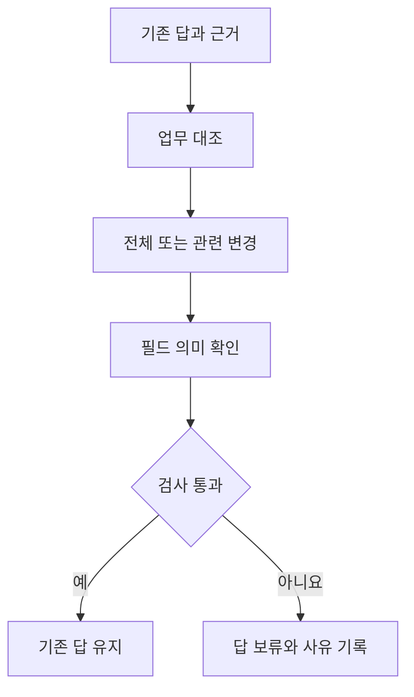

# 업무 일관성·버전·의미 매핑의 선택적 검사

상태: 221,184개 판정과 별도 분석기 대조 완료. [실제 결과](records/20261014-semantic-guards.md)를 기록했다.

프로토콜 `semantic-guards-1`. 앞선 [공통 의미 규칙 실험](shared-semantics-study.md)의 실제 출력 12,288행을 고정하고, 답을 내보내기 전에 적용하는 검사를 비교한다. 같은 개발 사례를 재사용하는 후속 분석으로, 새로운 독립 평가 집합은 구성하지 않는다. 모델 API나 그래프 DB를 다시 호출하지 않는다.

## 연구 목적

공급 국가 조회·지역 제한 점검·대체 공급자 추천이 서로 같은 기준을 쓴다고 해서 올바른 답을 보장하지는 않는다. 공통 설정이 오래됐거나 세금 관련 국가를 공급 국가로 잘못 연결하면 세 업무가 함께 틀릴 수 있다. 이번에는 서로 모순된 답, 오래된 입력, 다른 의미의 필드를 연결한 매핑을 구분해 검사한다.

온톨로지의 역할 가운데 원천 필드를 업무 개념에 연결하는 부분을 작게 떼어낸다. `operating_country`라는 업무 개념과 원천 필드의 관계를 명시하고 그 관계가 제공된 필드 카탈로그와 맞는지 확인한다. 이번 구현은 JSON으로 표현한 의미 계약이다. RDF·OWL·SHACL만의 효과나 외부 사실의 진실성을 검증하는 실험으로 해석하지 않는다.

## 검사 범위와 비교 조건

| 조건 | 적용 검사 |
| --- | --- |
| 검사 없음 | 기존 답을 그대로 유지 |
| 업무 대조만 | 국가·제한·추천 결과 사이의 명시적 모순 |
| 전체 버전만 | 원천·설정·추출 매핑의 전체 변경 |
| 의미 매핑만 | 사용한 국가 필드와 업무 개념의 연결 |
| 모두 적용 | 업무 대조·전체 버전·의미 매핑 |
| 선택 적용 | 업무 대조·질문별 의존성 변경·의미 매핑 |

업무 대조는 국가 목록이 완전할 때 지역 제한 결과와 맞는지 확인한다. 추천한 공급자의 국가가 그 목록에 있고 제한 대상이 아닌지도 확인한다. 모순을 발견하면 어느 업무가 틀렸는지 단정하지 않고 세 업무 모두 보류한다. 세 업무가 일관되게 틀리거나 이 관계에 드러나지 않는 오류는 통과할 수 있다.

전체 버전 검사는 현재 발행된 원천·업무 설정과 실제로 사용한 입력을 비교한다. 선택 적용은 제품의 존재, 연결된 관계, 해당 공급자의 국가, 업무에 필요한 설정만 비교한다. 추천에는 비용을 추가하고, 국가 목록 조회에는 지역 제한 설정을 넣지 않는다. 아직 허용되지 않은 역할의 관계도 포함해 역할 허용 변경을 놓치지 않도록 한다. 설명이나 다른 제품의 변경은 제외한다. 필드명 변경은 보수적으로 불일치로 남긴다. 역할 별칭·허용 역할 설정은 해당 업무 전체에 적용하므로 선택 적용도 최소 검사 범위를 학습한 정책은 아니다.

두 조건 모두 의미 매핑 검사는 유지한다. 선택 적용은 사전에 명시한 세 업무의 의존성 계약을 따른다. 온톨로지를 사용할지 LLM이 판단하지는 않는다. 최신 원천을 읽어 의존성 지문을 만드는 비용도 운영 비용이므로, 검사 시간만으로 실제 서비스의 속도 이득을 주장하지 않는다.



텍스트 흐름은 기존 답을 세 기준으로 검사한 뒤 유지하거나 보류하는 구조다. 검사기는 새 답을 만들거나 평가 정답으로 데이터를 고치지 않는다.

## 운영 메타데이터와 평가 정답의 분리

검사 입력에는 실제 답과 근거, 설치된 설정, 현재 발행된 설정·원천의 지문, 필드 카탈로그만 전달한다. 평가 정답·정답 일치 여부·오류 주입 이름은 전달하지 않는다. 운영 메타데이터를 구성하는 부분과 순수 검사 함수, 사후 점수 계산을 분리한다.

현재 발행된 설정을 알 수 있다는 가정은 명시한다. 설정 지연에서는 최신 발행본과 오래된 설치본이 다르다. 공통 매핑 오류에서는 발행본도 같은 잘못된 필드를 가리킨다. 따라서 버전이 맞는다는 이유만으로 의미 오류가 발견되지 않는다. 이 발행 채널 자체가 누락되거나 잘못된 상황 전반을 측정하는 실험은 아니다.

필드 카탈로그는 합성 데이터의 별도 운영 메타데이터로 세 조건을 만든다. 올바른 설명은 국가 필드와 세금 관련 국가 필드를 구분한다. 설명 누락은 확인 불가로 보류한다. 잘못된 설명에서는 세금 관련 필드에도 공급 국가라는 뜻을 부여한다. 이 조건은 검사기와 카탈로그가 함께 틀릴 때의 한계를 확인한다. 실제 원천 문서를 읽어 의미를 독립적으로 알아낸 결과는 아니다.

## 평가 지표와 해석

12,288행에 카탈로그 세 조건과 검사 여섯 조건을 적용해 221,184개의 판정을 예정한다. 같은 답에 여러 검사를 적용한 대응 비교이므로 표본 수가 그만큼 늘었다고 해석하지 않는다. 기존 네 구조와 오류 조건별 수치도 따로 남긴다.

틀린 답을 그대로 통과시킨 수, 틀린 답을 보류한 수, 맞는 답을 유지한 수, 맞는 답을 보류한 수를 구분한다. 맞는 답을 보류했을 때 원래 답할 수 있었던 사례는 불필요한 보류로 집계한다. 원래 확인 불가였던 사례는 따로 센다. 오답을 보류했다고 정답으로 고친 것으로 계산하지 않는다. 이 지표는 출력 일치에 따른 분류이므로 잘못된 매핑으로 우연히 같은 답을 낸 사례도 맞는 답에 포함한다. 업무상 반드시 부적절한 보류였다는 뜻은 아니다.

현재 원천과 업무 계약에 따른 일치는 외부 세계의 사실 정확성과 다르다. 합성 오류의 구성 비율은 자연 발생 빈도가 아니므로 전체 정확도 하나로 운영 정책을 추천하지 않는다. 비용·시간과 실제 문서의 의미 추출은 후속 검증 대상이다.

## 실행과 재현

독립 방법론·구현 검토와 등록 단위 검사를 통과한 뒤 기존 실행 기록을 읽는다. 입력 해시, 실행 소스, 검사 사유, 부분 실행과 실패를 보존한다. 이전 결과 폴더는 수정하지 않는다.

```bash
uv run --locked python scripts/run_semantic_guard_study.py --run runs/20261014T063154Z-shared-semantics --output runs/semantic-guards-reproduction
```
