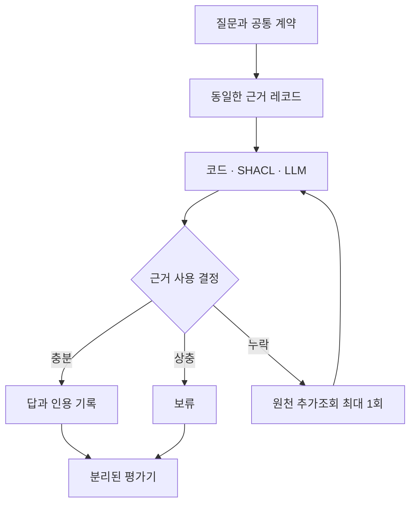

# 의미 판단 후속 실험

## 기존 결과의 해석 수정

0.5-study1의 LLM은 개체 수·타입·예외 코드라는 고정 계약을 검사했다. 프롬프트는 실제 사실의 진위 판단을 금지했다. 이 결과로 LLM의 일반적인 의미 판단 능력이 낮다고 결론 내릴 수 없다. SHACL도 형식만 검사하는 도구로 한정할 수 없다. 관계의 범위·시점·상충 조건을 명시하면 해당 조건을 검사할 수 있다. 다만 선언하지 않은 업무 의미나 외부 사실을 스스로 알아내지는 않는다.

이번 후속 실험은 질문에 맞는 근거를 선택하는 능력을 확인한다. 같은 관계 레코드, 질문과 기준을 코드·SHACL·LLM에 제공하고 선택한 답과 인용 근거를 기록한다. 직접 모회사와 최종 모회사, 현재 유효한 관계와 종료된 관계, 같은 우선순위의 상충 레코드를 구분한다.

## 통제 사례와 실제 데이터의 구분

우선 식별자를 가린 합성 사례로 의미 판단 경로를 점검한다. 실제 기업 이름을 보고 모델이 기억으로 답하는 일을 줄이고 오류 원인을 확인하기 위한 개발 실험이다. 기존 GLEIF 평가 30개 기업을 새 평가 표본으로 재사용하지 않는다. 이 점검의 성공을 실제 데이터 벤치마크 성과로 보고하지 않는다.

모든 비교군에 동일한 계약을 준다. 계약에는 질문의 관계 종류와 기준 시점을 명시한다. 자연어 질문만 보고 계약을 알아내는 능력은 아직 측정하지 않는다. 질문 표현을 바꾼 반복은 견고성 점검이며 독립 표본 수를 늘린 것으로 계산하지 않는다.

## 오류와 근거 부족의 구분

| 사례 | 확인할 판단 |
| --- | --- |
| 직접·최종 모회사 동시 제시 | 질문이 요구한 관계의 근거만 사용 |
| 현재·종료 관계 동시 제시 | 기준 시점에 유효한 관계 선택 |
| 같은 조건에서 서로 다른 모회사 | 임의로 하나를 선택하지 않고 보류 |
| 첫 검색에서 필요한 관계 누락 | 동일 원천을 한 번 추가조회 |
| 원천에도 필요한 관계 없음 | 추가조회 후 보류 |
| 형식과 의미 조건을 모두 만족하는 거짓 관계 하나 | 근거만으로 발견할 수 없는 사실 오류로 별도 채점 |

마지막 사례에는 반증 정보가 없다. 이를 맞히도록 모델에 요구하면 기억이나 추측을 평가하게 된다. 계약에 맞는 판단과 외부 정답에 대한 정확성을 별도 항목으로 남긴다.

## 실행과 평가

텍스트 흐름은 질문·계약 → 동일 근거 → 비교군별 판단 → 답변·보류·한 번의 추가조회 → 분리된 평가다. 평가 정답과 사례 유형은 판단기에 전달하지 않는다. 원천에서 얻지 못한 값을 평가 정답으로 보충하지 않는다.

결정 일치, 근거 선택, 정답·오답·보류·실행 오류, 불필요한 보류, 추가조회 수와 API 비용을 함께 기록한다. 의미 조건을 확장한 뒤 코드와 SHACL이 같아도 유효한 결과다. 그 경우 SHACL 고유의 정확도 이점은 확인되지 않은 것으로 해석한다. 모델 결합은 단독 판단의 오류를 확인한 다음 별도 조건으로 검토한다.

기존 실행·실패·비용 장부는 보존한다. 새 실행도 기존 공유 상한 3,200회·예약액 $5 안에서 진행하며 AWS와 Codex 비용은 별도다. 프롬프트·규칙·생성 사례·코드 해시를 실행 전에 고정한다. 실행 결과를 보고 바꾸면 새 개발 실행으로 기록한다.

## 고정한 개발 실행 조건

`semantic-exploratory-1`과 출력 형식을 고친 `semantic-exploratory-2`는 합성 상황 10개·질문 표현 3개·반복 2회로 구성한다. 직접 관계, 최종 관계, 현재·종료 관계 혼합, 종료 관계만 존재, 미래 관계만 존재, 상충 관계, 동일 후보를 지지하는 중복 레코드, 원천 누락, 검색 누락, 반증 없는 거짓 관계를 포함한다. 코드·SHACL·LLM 각 60개로 총 180개 결과 행이다. Jev는 이 후속 실행에서 아직 측정하지 않는다. 앞선 Jev 개발 결과를 이번 의미 판단 성능으로 대신 제시하지 않는다.

모든 비교군은 같은 `subject`, `relation`, `as_of`와 레코드를 받는다. 유효 구간은 시작일 포함·종료일 제외이며 상태가 `current`인 레코드만 사용한다. 레코드의 권위는 모두 같다고 가정한다. 이 조건은 통제 사례의 계약이며 실제 GLEIF의 전체 시간·보고 규칙을 구현한 것은 아니다.

SHACL은 RDF로 변환한 레코드에서 SHACL-SPARQL 제약을 실제 실행한다. Python에서 먼저 정답 후보를 고른 뒤 SHACL에 넘기지 않는다. SHACL 보고서를 답변·보류·추가조회로 연결하는 정책은 별도 코드다.

모델은 gpt-4o-mini, temperature 0이며 최대 출력은 300토큰이다. API 자동 재시도는 하지 않는다. 최대 예정 호출은 120회이고 실행기 상한은 120회·예약액 $0.80이다. 한 행에서 허용한 추가조회 외에 추가 호출을 반복하지 않는다. 기존 공유 예산은 그대로 적용한다.

## 실제 데이터 확장 준비

같은 GLEIF 배포본의 RR 490,833행을 전수 집계했다. 회계연결 관계는 260,586행이다. ACTIVE·PUBLISHED인 관계에서 직접·최종 모회사가 각각 하나씩 있고 서로 다른 중심 기업은 21,804개다. [원천 집계 JSON](records/20261013-gleif-semantic-inventory.json)에 원본 SHA-256과 집계 범위를 기록했다. 신규 평가 표본을 선정하거나 정답을 검증한 수치는 아니다.

원천에는 `RELATIONSHIP_PERIOD`, `ACCOUNTING_PERIOD`, `DOCUMENT_FILING_PERIOD`가 함께 있다. 이를 모두 관계 유효기간으로 바꾸면 잘못된 질문과 정답을 만들 수 있다. 실제 데이터 확장에서는 기간 종류를 보존하고 관계 범위 질문부터 적용한다. 앞서 사용한 기업군은 새 평가에서 제외해야 한다.

## 응답 형식 수정 이력

첫 버전의 LLM 60행은 모두 응답 형식 오류였다. 출력 계약은 중첩 JSON 문자열을 요구했지만 실제 응답은 JSON 객체여서 맞지 않았다. [첫 실행 전체 기록](records/20261013-semantic-v1-format-failures.json)을 보존하며 이 결과를 의미 판단 정확도로 해석하지 않는다.

두 번째 버전은 같은 근거·질문·판단 계약에서 출력만 단순한 JSON으로 바꾸고 별도 게이트를 거친다. 모델이 보류와 함께 인용을 반환한 경우도 결과를 남기고 계약 준수 여부로 채점한다. 의미상 부적절한 답이나 인용을 실행기에서 교정하지 않는다.

## 오래된 검색 근거의 대응 점검

`semantic-stale-followup-1`은 두 번째 개발 실행에서 관찰한 조기 보류를 확인하는 사후 설계다. 종료 관계만 보이는 사례와 미래 관계만 보이는 사례의 첫 질문·계약·근거는 그대로 둔다. 추가조회할 원천에만 다른 후보의 현재 관계를 넣는다. 질문 표현 3개·반복 2회·세 조건으로 총 36행이며 모델 호출은 최대 24회·예약액 $0.10이다.

원천이 바뀌었다는 표시는 판단기에 주지 않는다. 추가조회를 요청한 비교군만 새로운 관계를 받는다. 두 상황은 이전 사례와 대응되므로 새 독립 평가 표본으로 해석하지 않는다. 첫 입력의 동일성과 코드·SHACL의 원천 기반 회복을 테스트하고 별도 검토를 거친 뒤 실행한다.
