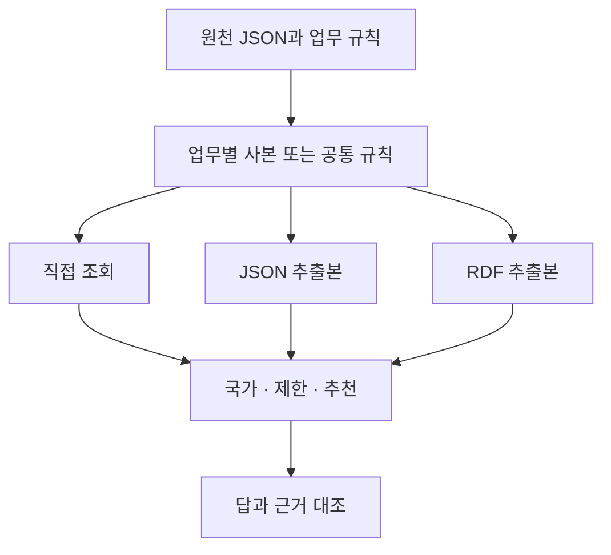

# 공통 의미 규칙과 업무 간 변경 일관성

상태: 12,288행 실행과 별도 분석기의 전체 대조 완료. [실제 결과](records/20261014-shared-semantics.md)에 정상 갱신과 오류 주입 결과를 구분해 기록했다. 프로토콜 `shared-semantics-1`은 공급 국가 조회·지역 제한 점검·대체 공급자 추천이 같은 의미 규칙을 공유할 때의 변경 반영을 비교한다. 이전 JSON·Neo4j 실험의 결과와 구분하고 모델 API는 호출하지 않는다.

## 연구 목적과 비교 범위

이전 실험에서는 동일한 규칙을 제공하면 JSON·SHACL·OWL 또는 Neo4j가 지정된 범위에서 같은 결과를 냈다. 이번에는 하나의 변경이 여러 업무에 적용되는 상황을 만든다. 업무별 규칙 사본, 공통 규칙, 필요한 필드만 변환해 저장하는 하이브리드에서 변경 누락과 오류의 영향을 확인한다.

규칙을 한 곳에 모으면 수정할 사본이 줄어든다. 이는 구조에서 정해지는 값이지 실험으로 발견한 생산성 향상이 아니다. 공통 규칙이 틀렸을 때 여러 업무가 함께 틀리는 경우도 같은 비중으로 기록한다. 사람의 작업 시간, 실제 배포 오류 확률, 기업 데이터의 진실성은 측정하지 않는다.

## 비교군

| 비교군 | 규칙과 원천 접근 | 비교 목적 |
| --- | --- | --- |
| 업무별 JSON | 세 업무가 각각 규칙 사본을 보유하고 현재 원천 조회 | 사본별 변경 누락의 영향 |
| 공통 JSON 직접 조회 | 하나의 규칙과 현재 원천 사용 | 공통 규칙의 효과와 오류 전파 |
| 공통 JSON 추출본 | 필요한 필드를 JSON으로 변환해 저장하고 조회 | 변환본 동기화 비용과 오류 |
| RDF 하이브리드 | 같은 필드를 RDF로 변환해 실제 SPARQL 조회 | 같은 의미·추출 범위에서 RDF 표현 대조 |

RDF 조건에서도 이름과 설명 등 업무 판정에 쓰지 않는 메타데이터는 JSON에 둔다. JSON 추출본과 RDF 추출본은 동일한 의미의 필드를 사용한다. 네 조건의 최종 결정 함수는 공통이며 배포된 규칙과 근거 조회 경로를 비교한다. RDF 조건은 실제 SPARQL 반환 근거를 사용한다. OWL 추론, SHACL 검사와 그래프 DB 서버는 이번 비교에 포함하지 않는다.



텍스트 흐름은 동일한 원천을 네 경로로 처리한 뒤 세 업무의 답과 근거를 비교하는 구조다. 추출본에는 원천·설정 버전을 함께 기록해 동기화 상태를 확인한다. 버전 불일치를 관측하더라도 평가 정답으로 자동 복구하지 않는다.

## 질문과 판단 계약

공급 국가 조회는 허용된 역할의 공급 관계에서 확인한 국가 집합과 근거의 완전성을 반환한다. 지역 제한 점검은 제한 국가가 하나라도 있으면 차단한다. 차단 근거 없이 필요한 정보가 빠졌으면 확인 불가로 남긴다. 관계가 없다는 이유만으로 안전하다고 판단하지 않는다.

대체 공급자 추천은 해당 제품에 연결된 허용 후보 중 제한 국가를 제외한다. 남은 후보에서 비용이 가장 작은 공급자를 고른다. 비용이 같으면 ID로 순서를 고정한다. 필요한 국가·비용 정보가 빠지면 확인 불가로, 모든 후보가 제한 대상이면 추천 불가로 처리한다. 자유로운 상품 추천이나 사용자 선호 학습이 아닌, 명시한 업무 조건에 따른 후보 선택이다.

## 데이터와 변경 과제

합성 제품 24개와 96개 규모를 두 난수 시드로 만든다. 각 조건에서 기존 제품 7개와 존재하지 않는 ID 하나를 질의한다. 관심 제품은 변경 사례를 포함하도록 고정하므로 규모와 시드가 독립적인 기업 표본을 늘려 주는 것은 아니다.

초기 상태, 예비 공급자 허용, 국가 필드명 변경과 매핑 수정, 대체 역할 별칭 추가, 제한 국가 변경, 공급자 국가 이동, 국가 정보 삭제, 비용 변경의 여덟 상태를 비교한다. 각 상태는 초기 원천에서 독립적으로 만든다. 관심 제품은 초기에는 공급 국가 C0·C1·제한 국가 C2와 비용이 다른 후보들을 포함한다. 제품 p3의 국가 이동·삭제와 p4의 비용 순위 변경을 고정 사례로 사용한다. 여러 변경을 누적하는 장기 운영 실험은 아니다.

## 오류 주입과 공정한 대조

각 상태에 네 가지 배포 조건을 적용한다. 정상 갱신에서는 모든 비교군을 완전히 갱신한다. 설정 사본 지연에서는 업무별 JSON의 한 업무가 이전 설정을 유지한다. 공통 조건에서는 공통 설정이 이전 버전으로 남는다. 지연할 업무는 시드와 변경 상태에 따라 순환한다. 선택한 시드 17과 29는 3으로 나눈 나머지가 같으므로 같은 변경 상태에서는 같은 업무가 지연 대상이다.

추출본 지연에서는 JSON·RDF 추출본을 같은 이전 상태에 둔다. 직접 조회 조건에는 추출본이 없으므로 현재 원천을 사용한다. 공통 매핑 오류에서는 모든 조건이 공급 국가 대신 다른 의미의 정상 국가 필드를 읽도록 같은 잘못된 매핑을 적용한다. 문법과 값의 형식이 맞아도 의미가 틀린 설정을 구분하기 위한 조건이다.

이 오류들은 의도적으로 주입한다. 설정 하나가 영향을 주는 업무 수가 구조별로 다르므로 오류 수의 단순 합계를 종합 순위로 사용하지 않는다. 적용 대상이 없는 초기 상태나 변경도 따로 표시하고 오류 발생 확률을 추정하지 않는다.

## 평가와 실행 예산

두 규모·두 시드·여덟 상태·네 오류 조건·여덟 대상·세 업무·네 비교군으로 예정 결과는 12,288행이다. 실행 전에 전체 ID를 고정하고 실패와 미실행도 분모에 남긴다. 모델 API와 DB 서버는 사용하지 않으며 단일 호스트의 제한된 오프라인 실행으로 진행한다.

현재 원천과 의도한 설정에서 계산한 평가 기준은 실행기의 입력·수정 과정에 전달하지 않는다. 배포된 설정과 의도한 설정의 차이는 평가용 정보다. 실행 중 확인할 수 있는 원천·설정·추출본 버전의 정합성과 구분한다. 결정·값의 일치와 근거의 일치를 나눠 기록한다. 정상 조건과 오류 주입 조건, 영향받은 업무 수, 놓친 제한 대상과 불필요한 차단·보류를 구분한다. 버전 일치가 의미의 정확성을 보장하는지도 별도로 확인한다.

설정 사본 수와 변경된 설정 수, 추출 필드·파일 크기 및 처리 시간은 구현 기록으로 남긴다. 이를 사람의 유지보수 비용이나 저장 엔진 우열로 환산하지 않는다. 독립 방법론·구현 검토와 등록 테스트를 통과한 뒤 실제 실행하며 원천·설정·변환본·결과와 실패 이력을 보존한다.

## 재현 경로

[연구 운영 절차](../setup/research-operations.md)의 독립 검토와 등록 검사를 마친 뒤 새 출력 폴더에서 실행한다. 아래 분석기는 전체 기본 조합을 요구한다. 기존 결과 폴더는 덮어쓰지 않는다.

```bash
uv run --locked python scripts/run_shared_semantics_study.py --output runs/shared-semantics-reproduction
uv run --locked python scripts/analyze_shared_semantics_study.py --run runs/shared-semantics-reproduction --output _workspace/shared-semantics-reproduction-analysis
```
