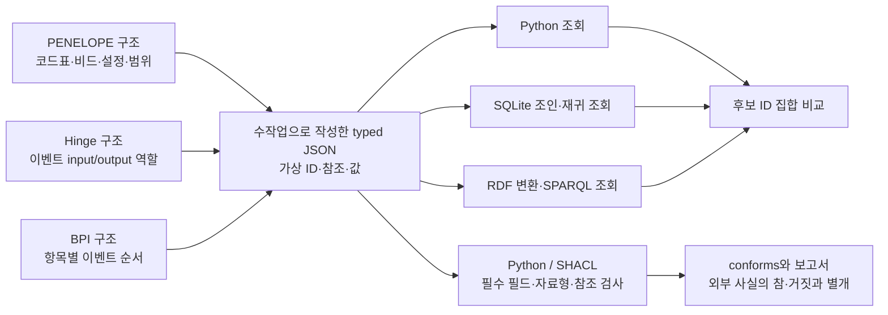

# 공개 자료 기반 합성 데이터와 관계 조회 진단

`source-grounded-1`은 PENELOPE·Hinge·BPI 2019에서 확인한 구조를 참고해 작성한 개발용 실험입니다. 세 자료를 서로 다른 작업으로 유지하며 같은 의미 조건을 Python·SQLite·RDFLib에 구현했습니다. **144개 사례는 모두 연구자가 만든 합성 데이터이며 이번 실행으로 소비한 개발 사례입니다.** 실제 공장 정확도나 LLM 성능을 평가한 결과는 아닙니다.

## 라이선스와 공개 범위

2026년 10월 29일 공식 배포 메타데이터와 Creative Commons 라이선스 조건을 확인했습니다. 세 자료 모두 분석과 수정·변형을 허용합니다. 합성 데이터라는 이름만으로 원본의 이용 조건이 사라지지는 않으므로 출처, 라이선스 링크, 변경 내용을 함께 기록했습니다.

| 자료 | 원본 성격 | 확인한 라이선스 | 이번 데이터의 배포 조건 |
|---|---|---|---|
| [PENELOPE SAW v2](https://zenodo.org/records/15083865) | 실제 용접 시험편·설정·검사 기록 | CC BY 4.0 | 출처·변경 표시, CC BY 4.0 적용 |
| [Hinge sOCEL 2.0 v1.0](https://zenodo.org/records/13638681) | 원본부터 시뮬레이션한 제조 이벤트 | CC BY-SA 4.0 | 출처·변경 표시, 파생 데이터도 CC BY-SA 4.0 적용 |
| [BPI Challenge 2019 v1](https://doi.org/10.4121/uuid:d06aff4b-79f0-45e6-8ec8-e19730c248f1) | 실제 기업에서 제공한 구매 이벤트 로그 | CC BY 4.0 | 출처·변경 표시, CC BY 4.0 적용 |

PENELOPE와 Hinge는 Zenodo API의 `metadata.license.id`, BPI는 **원본 DOI**의 [DataCite `rightsList`](https://api.datacite.org/dois/10.4121/uuid:d06aff4b-79f0-45e6-8ec8-e19730c248f1)를 확인했습니다. BPI의 후대 OCEL 변환본 라이선스를 원본에 대신 적용하지 않았습니다. PENELOPE의 v2 표시는 웹 페이지에 있고 API의 `version` 필드는 비어 있어 두 사실을 기록에 구분했습니다.

[CC BY 4.0](https://creativecommons.org/licenses/by/4.0/legalcode.en)은 출처와 변경 표시 등을 조건으로 공유·수정을 허용합니다. [CC BY-SA 4.0](https://creativecommons.org/licenses/by-sa/4.0/legalcode.en)은 파생 저작물 공개 시 동일조건변경허락도 요구합니다. 이번에는 자료별 폴더를 분리하고 통합 평가 파일·통합 결과표에는 보수적으로 CC BY-SA 4.0을 적용했습니다. 단순히 파일을 한 저장소에 모았다는 이유로 모든 코드에 동일 라이선스가 적용된다는 뜻은 아닙니다.

원본 검사 보고서의 인명·서명·개인 식별 정보와 원본 거래 행은 배포하지 않습니다. 새 식별자와 가상 수치·순서값을 작성했습니다. 원저자나 기관이 이 합성 데이터 또는 검증 규칙을 승인했다는 의미도 없습니다. 라이선스가 개인정보 등 다른 권리까지 일괄 허용하는 것은 아니므로 공개 범위는 이처럼 작성한 구조적 예시로 한정했습니다.

## 실제 자료와 합성 요소의 경계

| 원천에서 확인한 내용 | 합성 데이터로 옮긴 구조 | 새로 작성한 부분 |
|---|---|---|
| PENELOPE의 XLSX 코드 2는 융합불량, RX 보고서 코드 2는 기공 | 관측 → 코드표 항목 → 의미, 관측 → 비드 → 설정 | 시험편·관측 ID, 전류값, 방해 관측, 누락·거짓 정보 |
| PENELOPE UT의 모재 OK와 전체 RECHAZADO는 판정 범위가 다름 | 관측의 `scope` 구분 | 범위가 다른 관측을 검색에 섞는 조건. 실제 판정표 전체는 재현하지 않음 |
| Hinge의 이벤트에는 input·output·with 등 관계 역할이 있음 | 재료 → 투입 이벤트 → 산출물, 1~4단계 연결 | 새 객체·이벤트, 역할 혼동과 순환을 검사하는 예시 |
| BPI에 발주 항목별 입고·송장 이벤트가 있음 | 같은 항목의 입고와 송장 순서 비교 | 정수 순서값과 “입고가 송장보다 엄격히 먼저”라는 연구자 규칙 |

PENELOPE는 PP3의 소량 파일만 선택적으로 읽었습니다. 전체 약 12.7 GB 압축파일의 체크섬과 HDF5 측정 신호는 확인하지 않았습니다. 선택 파일의 해시와 ZIP CRC 검사는 보존했습니다. Hinge 원본은 합성 로그이며 XML에서 센 이벤트 수 38,528개와 설명문에 적힌 약 3,850개가 다릅니다. BPI는 입고·송장 문서의 업무 식별자를 제공하지 않으므로 문서 사이의 실제 연결이나 상계 관계를 만들었다고 주장하지 않습니다.

## 세 작업의 입력과 출력



| 작업 | 고정한 질문 조건 | 출력 |
|---|---|---|
| PENELOPE | 특정 시험편에서 융합불량이며 용접부 범위이고 비드·설정 참조가 연결되는 관측 | 관측 ID 목록 |
| Hinge | 특정 재료에서 이벤트의 input→output 관계를 따라 도달하는 제품 | 제품 ID 목록 |
| BPI | 특정 발주 항목에서 더 이른 입고 이벤트가 존재하는 송장 이벤트 | 송장 이벤트 ID 목록 |

자연어 질문에서 계약을 자동 추출하지 않았습니다. 질문 조건과 필드 대응은 연구자가 제공합니다. BPI의 규칙은 회사의 실제 준수 기준이 아니며 취소·금액·문서 상계를 처리하지 않습니다. PENELOPE도 원인 진단이나 제품 승인 대신 근거 후보를 찾습니다.

예를 들어 PENELOPE의 코드표 두 개는 아래처럼 별도 항목으로 표현합니다. 같은 문자열 `2`가 곧 같은 결함이라는 가정을 하지 않습니다.

```json
[
  {"id":"SYN_book", "type":"Code", "namespace":"worksheet", "code":"2", "meaning":"lack_fusion"},
  {"id":"SYN_rx", "type":"Code", "namespace":"radiography", "code":"2", "meaning":"porosity"}
]
```

관측은 `book` 필드로 어느 코드표 항목을 가리키는지 명시합니다. 이 모델에서는 코드표 항목 참조가 의미를 구분합니다. RDF에만 가능한 표현이 아니며 JSON 참조와 SQL 조인으로도 구현됩니다.

## 개발 사례와 비교 조건

자료별 8개 작은 가족에 아래 6개 상태를 적용해 총 144개 사례를 작성했습니다. 가족 안의 변형들은 서로 독립된 표본이 아닙니다. PENELOPE와 BPI는 주로 ID·값이 달라지고 Hinge는 경로가 1~4단계입니다. 새로운 문제 유형에 대한 일반화나 통계적 검정력을 주장하지 않습니다.

| 상태 | 조작 | 확인 대상 |
|---|---|---|
| 정상 | 필요한 기록·참조 제공 | 기본 조회와 검사 실행 |
| 의미 방해 | 다른 코드표·범위, with 역할, 다른 발주 항목을 추가 | 의미 조건을 생략했을 때 생기는 오연결 |
| 끊어진 참조 | 참조가 가리키는 노드를 삭제 | 참조 대상 검사 |
| 원천 부재 | 필요한 관계 필드를 제출 자료에서 제외 | 보이는 자료의 불완전성 |
| 검색 누락 | 원천 부재와 같은 입력을 제공 | 시스템이 두 원인을 구별할 수 없다는 경계 |
| 거짓 사실 | 참조·자료형은 유지하고 의미·투입 관계·순서값을 바꿈 | 구조 검증을 통과한 사실 오류 |

Python, SQLite, RDFLib는 동일한 명시적 의미 조건을 적용합니다. Hinge의 RDF 비교군은 유효한 이벤트의 input/output 쌍을 SPARQL로 구한 뒤 `step` 관계를 만들고 property path로 조회합니다. OWL 추론은 사용하지 않습니다. SQLite는 메모리 내 속성 테이블과 재귀 CTE를 사용합니다. 서버형 그래프 DB나 처리시간 비교는 하지 않았습니다.

별도 `unqualified_python`은 PENELOPE의 코드표·범위, Hinge의 역할 구분, BPI의 항목 조건을 의도적으로 생략합니다. **이 비교군은 키워드 검색·벡터 RAG·일반 LLM의 대리 성능이 아닙니다.** PENELOPE에서는 코드표와 범위가 함께 바뀌므로 두 요인의 개별 효과도 분리하지 못합니다.

SHACL과 Python 검사는 필수 필드, 자료형, 참조 대상의 클래스만 검사합니다. 유일성·실제 사실·근거 완전성·업무 승인 규칙 전체를 검사하지 않습니다. pySHACL은 `inference='none'`으로 실행했습니다.

## 첫 실행 결과

| 관측 | 결과 | 해석 |
|---|---:|---|
| Python·SQLite·RDFLib 후보 집합 일치 | 144/144 | 이 개발 입력에서 같은 의미를 구현한 세 방식이 일치 |
| Python·SHACL 검사 및 작성 예상값 일치 | 144/144 | 이번 필수 필드·자료형·참조 검사 계약의 실행 확인 |
| 의미 방해 사례의 한정 조회 정답 | 24/24 | 세 자료 각각 8/8, 작성 계약 기준 |
| 의미 조건을 생략한 조회의 정답 | 의미 방해 사례에서 0/24 | 설계한 오연결 재현. 일반 검색 성능으로 해석 불가 |
| 구조 검사를 통과한 거짓 사실 사례 | 24/24 | 같은 의미의 세 구현도 외부 합성 정답과 불일치 |
| 원천 부재·검색 누락의 동일 입력 쌍 | 24/24 | 보이는 입력만으로 누락 원인 판별 불가 |

실행기는 정답 파일을 읽기 전에 모든 조회 결과를 저장합니다. 이후 별도의 작성 정답과 비교하며 결과를 고치지 않습니다. 다만 정답은 생성자가 설계한 상태별 기대값이므로 독립적인 현장 정답이나 전문가 판정이 아닙니다. 행별 결과와 자료별·상태별 집계는 [실행 기록 JSON](records/20261029-source-grounded.json)에 남겼습니다.

`declared_complete`는 합성 입력에 제공한 선언입니다. 시스템이 숨겨진 누락을 찾아낸 결과가 아닙니다. 특히 끊어진 참조 사례는 이 선언이 참이어도 SHACL이 실패할 수 있습니다. 후보 목록, 완전성 선언, 구조 검사 결과를 각각 읽어야 합니다. 빈 후보 목록은 실제 제품·관측이 없다는 사실을 증명하지 않습니다.

## 재현과 확인 범위

저장소 루트에서 다음 명령으로 기존 합성 입력을 실행합니다. 결과 디렉터리는 새 이름을 사용하며 기존 실행을 덮어쓰지 않습니다.

```bash
uv run --locked python -m scripts.source_grounded.run \
  research/source-grounded-1/data _workspace/source-grounded-reproduction
uv run --locked python -m unittest tests.test_source_grounded -q
```

출력에는 입력·코드 해시, 후보 목록, 검사 결과, SHACL shape, 네 예시의 RDF와 실제 검증 보고서가 포함됩니다. 데이터 원본은 `research/source-grounded-1/`, 코드는 `scripts/source_grounded/`에 있습니다. 자료별 `ATTRIBUTION.txt`, `licenses.json`, `source-anchors.json`에서 라이선스와 원천 근거를 확인할 수 있습니다. 수집한 원본은 다시 내려받지 않았고 유료 모델 API 호출은 0회입니다.

## 다음 연구의 판별 기준

이번 실행은 공개 자료를 사용할 수 있는지와 작게 만든 관계 문제를 구현할 수 있는지 확인한 단계입니다. 그래프가 검색보다 낫다는 가설은 아직 검증하지 않았습니다.

주 사례는 PENELOPE의 검사 근거 연결로 좁힙니다. 남은 시험편에서 코드표·비드·설정·검사 범위가 안정적으로 연결되는지 확인하고 같은 코드를 다른 의미로 쓰는 빈도와 연결 누락을 실제 행 단위로 기록해야 합니다. 다단계 질문에 필요한 식별자가 부족하면 Hinge의 관계 실험을 보조 진단으로 유지하며 이를 실제 제조 성능으로 바꾸어 부르지 않습니다.

다음 비교에서는 직접 식별자 질문과 여러 기록을 연결하는 질문을 구분하고 실제 구현한 키워드 검색·벡터 검색·동일 정책 SQL/Python·관계 조회에 같은 원문과 질의를 제공합니다. 후보 정답뿐 아니라 근거 경로의 누락·오연결, 불필요한 보류, 구축·변경 작업량을 별도로 측정할 계획입니다. 자연어→필드·관계·shape 작성은 조회 이후의 문제와 분리해 수작업 정규화 자료를 받은 조건과 원문을 받은 조건으로 나누어야 합니다.

이 단계에서는 **명시적 의미 조건이 필요한 사례를 만들 수 있었고 그 조건은 Python·SQL·RDF 모두 구현할 수 있었습니다**. 그래프의 추가 가치는 관계 탐색·근거 경로·변경 재사용에서 따로 측정해야 합니다.
