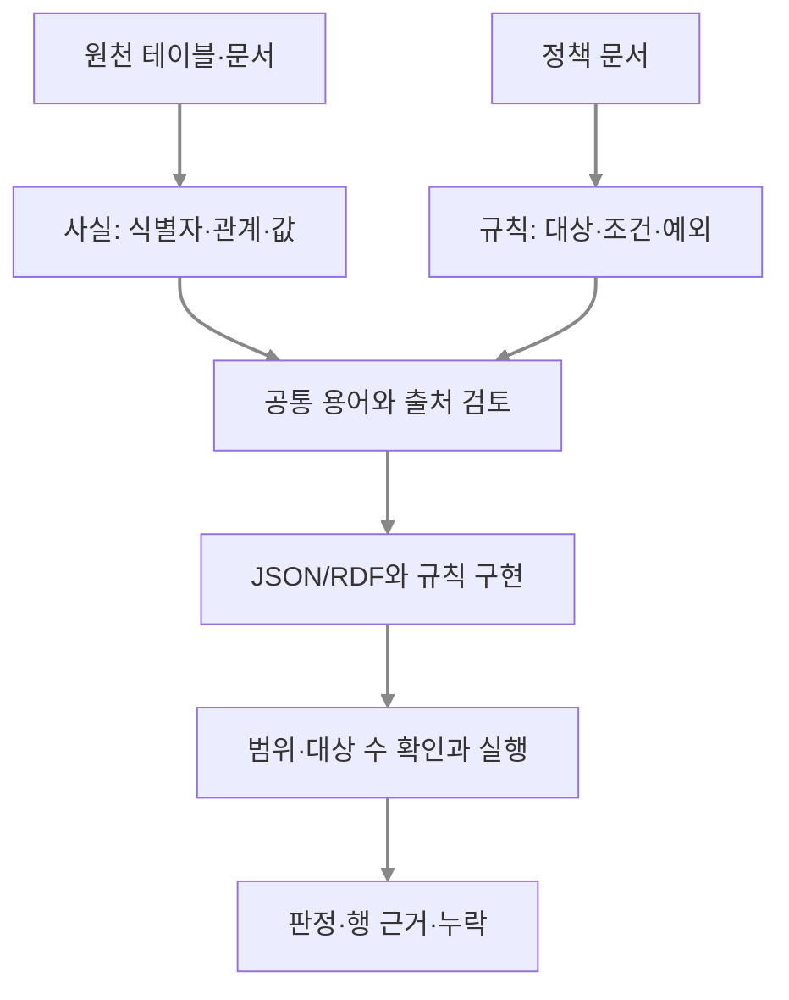

# 원천 데이터·규칙 구축과 실행 병목의 진단

상태: `evidence-report-1`의 보완 설계안입니다. 아래 전처리·프롬프트·진단 권고는 검증할 제안이며 새 실험 결과가 아닙니다. [주실험](evidence-report-study.md)은 동일한 계산 판정에 상세 근거를 추가하는 효과를 비교합니다. 이 문서는 그 앞단의 구축 조건과 기술 선택 기준을 정리합니다.

현재 [공개 데모](evidence-report-demo/index.html)는 연구자가 작성한 인증서·구성 관계를 Python과 RDF로 표현하고 Python 경로 탐색·OWL-RL 연결 여부·SHACL 인증서 필드 검사를 실행합니다. 자연어·원시 테이블에서 관계와 규칙을 자동 추출한 결과는 아닙니다.

## 네 가지 연구 질문과 산출물

| 연구 질문 | 확인할 실패 | 필요한 산출물 |
|---|---|---|
| 원천에서 관계와 규칙을 어떻게 구성하는가 | 식별자 혼동, 관계 방향 오류, 조건·예외 누락 | 원천 행·문장에 연결한 사실과 규칙 초안 |
| LLM·Python·온톨로지에 무엇을 넣고 받는가 | 의미가 다른 입력·출력을 같은 것으로 비교 | 공통 의미 계약과 구현별 입출력 명세 |
| 규칙 구축과 실행 중 어디가 병목인가 | 잘못 만든 규칙과 적용되지 않은 규칙의 혼동 | 단계별 검사와 개발 전용 교체 진단 |
| 그래프가 유리한 조건은 무엇인가 | 관계 표현의 편의와 성능 우위의 혼동 | 업무 조건별 선택 기준과 미측정 항목 |

## 사실 추출과 규칙 작성의 분리

인증서에 적힌 날짜는 사실 후보이고, 그 날짜를 기준일과 비교하는 방식은 정책입니다. 데이터에 어떤 값이 자주 나타난다는 이유만으로 필수 규칙을 만들 수는 없습니다. 두 입력 흐름을 분리한 뒤 같은 식별자·용어 사전으로 연결합니다.



예를 들어 다음은 설명용으로 작성한 입력입니다. 실제 제조 원천이나 LLM 생성 결과가 아닙니다.

| 원천 위치 | 입력 | 해석 대상 |
|---|---|---|
| 인증 테이블 r-cert | CERT-Q, PART-Q, 2026-10-01 | 인증 대상과 만료일 |
| 구성 테이블 r-bom-1 | PART-Q, ASM-Q | 부품 → 조립품의 구성 관계 |
| 구성 테이블 r-bom-2 | ASM-Q, PROD-Q | 조립품 → 제품의 구성 관계 |
| 정책 문서 §2 | 인증서는 인증 대상 하나와 만료일 하나를 기록해야 합니다. | 필수 필드·개수 제약 |
| 정책 문서 §3 | 만료된 인증의 대상 부품을 포함하는 제품은 재검토합니다. | 날짜 비교와 연결 경로를 결합한 업무 규칙 |

§2는 SHACL 속성 제약으로 옮길 수 있습니다. §3은 기준일·경로·근거 부족 처리까지 정해야 합니다. 이번 데모에서는 업무 판정을 공통 Python 코드가 구성합니다. SHACL Core만으로 모든 업무 로직을 자동 처리한다고 가정하지 않습니다.

## 전처리와 관계 추출

테이블은 열의 뜻과 키가 이미 알려져 있으면 명시적 매핑으로 변환합니다. 각 행을 LLM에 다시 해석시키는 과정은 필요하지 않을 수 있습니다. 자연어에서는 문장에 등장한 개체를 식별자와 연결하고 관계의 방향·시점·부정·조건을 구분해야 합니다.

| 항목 | 테이블 전처리 | 자연어 전처리 |
|---|---|---|
| 식별자 | 문자열 보존, 선행 0·중복 키 확인, 외래 키 연결 | 이름과 식별자 구분, 동명이체·약칭의 미해결 상태 보존 |
| 관계 | 열 역할과 방향을 매핑표로 고정 | 주체·관계·대상과 이를 지지하는 문장 범위 추출 |
| 값 | 날짜 형식·단위·코드값 정규화, 원문 값도 보존 | 날짜·단위·기간·조건을 분리하고 불명확한 값 표시 |
| 누락 | 빈칸·해당 없음·미제공 코드를 구별 | 언급 없음과 명시적 부정을 구별 |
| 출처 | 파일 버전·행 ID·열 이름 유지 | 문서 버전·절·문장 위치 유지 |
| 범위 | 추출한 테이블·기간·필터 기록 | 읽은 문서·절과 제외한 범위 기록 |

‘만료일’처럼 같은 뜻의 필드 이름이 바뀌면 매핑을 수정합니다. ‘인증 대상’과 ‘납품 대상’처럼 뜻이 다르면 별도 관계로 정의합니다. 관계의 유효 기간이 바뀌면 시점·버전을 기록합니다. 이름을 비슷하게 붙이는 것만으로 의미가 공유되지는 않습니다.

관계형 DB에는 작성자가 원천 열과 대상 어휘를 지정하는 [R2RML 매핑](https://www.w3.org/TR/r2rml/)을 참고할 수 있습니다. 이는 관계의 업무 의미를 자동 발견하는 방법이 아닙니다. CSV에서도 같은 매핑 원칙을 적용할 수 있지만 R2RML 자체를 범용 CSV 파서로 취급하지 않습니다.

## 프롬프트·스킬의 핵심 계약

프롬프트에는 역할 설명보다 사용할 용어, 관계 방향, 근거 위치, 미해결 항목의 출력 방법을 구체적으로 적습니다. 스킬에는 같은 계약과 정상·위반·경계·누락 예시, 검사 절차, 버전을 함께 묶을 수 있습니다. 스킬 파일이 있다는 사실만으로 추출 정확도가 보장되지는 않습니다.

아래는 개발용 프롬프트 예시이며 실행하지 않았습니다.

```text
목적: 제공된 원문에서 사실 후보와 요구사항 후보를 분리해 작성합니다.
허용 타입: Certificate, Component, Assembly, Product
허용 관계: certifies(인증서→부품), partOf(구성요소→상위 구성요소)
허용 값: expiresOn(xsd:date)
입력: 원문, 원천 위치, 식별자 목록, 용어 정의, 관계 방향, 정책 버전

출력 JSON:
- facts: subject, predicate, object, source_ref
- requirements: target, path, constraint, parameters, source_ref
- unresolved: 원문으로 결정할 수 없는 식별자·방향·조건·예외

요구사항:
- 사실과 필수 입력 규칙을 구별합니다.
- 허용 목록에 없는 관계는 unresolved에 제안하고 바로 확정하지 않습니다.
- 모든 후보에 원문 위치를 붙입니다.
- 모호한 날짜·부정·예외는 임의로 확정하지 않습니다.
```

검토한 요구사항을 다음 단계에서 SHACL로 변환합니다. 즉 ‘원문 → 즉시 Turtle’만 비교하기보다 ‘원문 → 명시적 규칙 명세 → Turtle’의 각 단계에서 무엇이 틀렸는지 기록합니다. 중간 명세 방식의 개선 효과는 별도 비교가 있어야 주장할 수 있습니다.

```json
{
  "target_class": "Certificate",
  "path": "expiresOn",
  "min_count": 1,
  "max_count": 1,
  "datatype": "xsd:date",
  "source_ref": "policy-v1:section-2"
}
```

이 명세를 변환한 설명용 shape은 다음과 같습니다. 이 조각은 만료일 필드만 검사하며 인증 대상이나 재검토 여부까지 검사하지 않습니다.

```turtle
@prefix ex: <https://example.org/> .
@prefix sh: <http://www.w3.org/ns/shacl#> .
@prefix xsd: <http://www.w3.org/2001/XMLSchema#> .

ex:CertificateShape a sh:NodeShape ;
    sh:targetClass ex:Certificate ;     # 검사할 대상 클래스
    sh:property [
        sh:path ex:expiresOn ;         # 검사할 속성
        sh:minCount 1 ; sh:maxCount 1 ; # 정확히 한 개의 값
        sh:datatype xsd:date           # 날짜 자료형
    ] .
```

문법 검사 뒤에는 대상 노드 수를 확인해야 합니다. 타입 매핑이 빠져 검사 대상이 없으면 기대한 인증서를 검사하지 않고도 위반이 없을 수 있습니다. 이어 정상 값, 필드 누락, 잘못된 자료형, 여러 값, 업무 날짜 경계를 따로 검사합니다. 마지막 날짜 비교는 위 shape의 검사 범위가 아닙니다. 추론 전후 중 어느 그래프를 검증하는지도 명시합니다. [SHACL 표준](https://www.w3.org/TR/shacl/)

## NL2SHACL 선행연구의 적용 범위

[NL2SHACL-Bench](https://arxiv.org/abs/2608.07530)는 자연어 제약을 SHACL로 옮길 때 문법적 성공과 의미적 정확성을 구분해야 한다는 근거로 참고합니다. 복잡한 논리·구조 제약을 다룰 때의 어려움을 임의의 업무 문서 전체에 대한 성능으로 확대하지 않습니다.

확인한 [번역 구현의 고정 버전](https://github.com/DE-TUM/NL2SHACL-Framework/blob/328bc5071c9c6ca00c707db99e416762f1e2eb90/NL2SHACL-Translator/README.md)은 자연어 설명에 온톨로지 정보·접두어·예시를 결합합니다. 우리 연구에는 ‘SHACL을 만들어라’만 요청하지 않고 용어와 출력 조건을 함께 제공하는 절차를 가져옵니다. 정리된 제약 설명의 변환과 원시 문서에서 요구사항을 발견하는 작업은 별도로 평가해야 합니다.

[논문](https://arxiv.org/html/2608.07530v2)은 구조 비교와 의미 평가를 구별합니다. 확인한 [평가 코드 경로](https://github.com/DE-TUM/NL2SHACL-Framework/blob/328bc5071c9c6ca00c707db99e416762f1e2eb90/Shapes-Evaluation/evaluators.py)의 한 방식은 참조 shape에서 만든 그래프에 두 shape을 적용해 위반 focus node 집합을 비교합니다. 유한한 검사 그래프에서 결과가 같다는 사실은 모든 데이터에서 두 규칙이 동등하다는 증명이 아닙니다. 따라서 우리 개발 검사에는 경계·누락·예외를 겨냥한 반례를 추가하되 이를 완전한 의미 동등성 검사라고 부르지 않습니다.

## 구현별 데이터 타입과 입출력

LLM은 처리 주체, Python은 구현 언어, 온톨로지는 의미 정의이므로 세 항목은 배타적인 기술 분류가 아닙니다. Python에서 RDF·SHACL을 실행하거나 LLM이 그래프 도구를 호출할 수도 있습니다. 비교하려면 아래처럼 처리 경로로 정의합니다.

| 처리 경로 | 입력 형태 | 실제 연산 | 원시 출력 | 공통 출력으로 바꾸는 작업 |
|---|---|---|---|---|
| LLM 직접 판단 | 질문·정책·행을 담은 텍스트/JSON | 모델의 판정·근거 선택 | JSON 후보 또는 형식 오류 | 스키마 검사, 입력 행 인용 여부 검사 |
| Python 명시적 계산 | 타입을 확인한 객체·행, 정책·기준일 | 날짜 비교, 경로 탐색, 누락 처리 | bool·경로·상태·예외 | 업무 판정과 행 근거 보고서 구성 |
| RDF·OWL·SHACL을 사용하는 계산 | RDF 데이터, 온톨로지, shapes, 질의·기준일 | 추론, 조회, 선택한 그래프의 제약 검사 | 추론 트리플·질의 결과·SHACL 보고서 | 공통 업무 로직과 출처 매핑으로 보고서 구성 |

공정한 비교에서는 같은 사실·정책·관계 방향·날짜 경계·근거 범위를 제공합니다. JSON의 빈 배열과 RDF의 트리플 부재가 무엇을 뜻하는지, 원본과 추론 결과 중 무엇을 읽는지, 오류와 판단 유보를 어떻게 구분하는지도 고정합니다. 다른 정보를 준 비교는 구현 방식만의 효과가 아닙니다.

[pySHACL](https://github.com/RDFLib/pySHACL)의 `validate`는 `conforms`, RDF 결과 그래프, 텍스트 결과를 반환합니다. `conforms`는 선택한 검증 조건에 부합하는지 나타내며 `required`라는 업무 판정이나 현실의 사실 확인 결과가 아닙니다. 쿼리 실패·파싱 실패도 정상적인 `unknown` 판정과 구별해 실행 상태에 남깁니다.

```text
입력: 인증서 행 + 구성 관계 행 + 기준일 + 정책 + 조회 범위
중간: 날짜 비교 / 경로 / 제약 위반 / 실행 상태
출력: decision, rule_id, support_row_ids, missing, explanation
별도 로그: 파싱·실행 오류, 검사 대상 수, 버전, 시간·비용
```

이 마지막 다섯 필드는 현 주실험의 답변 계약입니다. 위의 세 처리 경로를 새로운 세 실험군으로 바꾸지는 않습니다. 주실험 A/B/C는 같은 원시 근거 위에 계산 판정과 상세 근거를 얼마나 제공하는지 비교합니다.

## 구축 병목과 적용 병목의 진단

‘규칙이 안 된다’는 표현을 관측 가능한 실패로 나눕니다. 다음은 제안하는 진단 순서이며 검증된 자동 원인 분류기가 아닙니다.

| 진단 지점 | 확인할 기록·검사 | 실패했을 때 우선할 조치 |
|---|---|---|
| 원천·정책의 정의 | 관계·의무·예외를 원문에서 특정할 수 있는가 | 정책 담당자의 정의·자료 보완, 미해결 명세 유지 |
| 사실 추출·매핑 | 식별자·방향·날짜가 원천과 맞는가 | 전처리와 용어 매핑 수정 |
| 규칙 작성·변환 | 검토한 요구사항과 구현의 대상·조건·예외가 같은가 | 규칙 명세와 변환 프롬프트/코드 수정 |
| 실행 범위 | 대상 수, 읽은 행·버전, 필터, 추론 설정이 맞는가 | target·질의·실행 설정 수정 |
| 근거 확보 | 필요한 행이 조회 입력에 들어왔는가 | 조회 보완 또는 근거 부족으로 종료 |
| 보고서 활용 | 계산은 맞는데 답변이 판정·근거를 바꾸는가 | 근거 보고서와 응답 계약 개선 |

예를 들어 ‘만료일 필수’가 정책에 없으면 규칙의 정의 문제입니다. 정책에는 있는데 `minCount`가 빠지면 변환 문제입니다. shape은 맞지만 `Certificate` 타입이 누락돼 대상이 0개면 적용 범위 문제입니다. SHACL 검사는 통과해도 제품까지의 구성 경로를 못 찾으면 별도의 관계 근거 문제입니다.

개발용 자료에서는 추출 데이터 D̂와 생성 규칙 R̂를 검토한 D*·R*와 교차해 실행할 수 있습니다.

| 개발 진단 | 비교 목적 |
|---|---|
| D̂ + R̂ | 현재 파이프라인의 실패 관찰 |
| D* + R̂ | 데이터 추출·매핑을 바로잡았을 때의 변화 |
| D̂ + R* | 규칙 정의·변환을 바로잡았을 때의 변화 |
| D* + R* | 검토한 입력·규칙으로도 실행·보고가 실패하는지 확인 |

자료나 규칙 하나를 바꾸어 개선됐다고 모든 원인을 그 단계로 단정하지 않습니다. 두 오류의 상호작용이나 상쇄가 있을 수 있습니다. D*·R*는 문서와 업무 정의를 사람이 검토한 개발 참조이며 외부 진실의 보증이 아닙니다. 이 교체 진단은 개발 전용으로 하고 평가 중 런타임 답을 정답으로 수리하지 않습니다. 원천 부재와 검색 누락은 별도 원천 감사 없이는 구별할 수 없습니다.

병목의 빈도와 비용도 분리합니다. 단계별 실패 건수·분모와 함께 실제 검토 시간·수정 횟수·재실행 범위를 기록해야 ‘규칙 마련이 가장 비싸다’고 말할 수 있습니다. 코드 줄 수나 위반 개수만으로 사람의 유지보수 비용을 추정하지 않습니다.

## 그래프의 장점과 비용

이 시나리오의 그래프는 ‘인증서 → 부품 → 조립품 → 제품’의 연결을 표현합니다. 하나의 연결 자료를 재검토 판정, 영향 제품 조회, 근거 경로 표시에서 재사용할 수 있습니다. 다만 모듈화한 SQL·Python도 같은 질문을 처리할 수 있습니다. 아래는 선택 근거와 검증 과제이며 성능 우위의 결과표가 아닙니다.

| 업무 조건 | 그래프에서 활용할 점 | 비용·한계 또는 대안 |
|---|---|---|
| 여러 단계·종류의 관계를 반복 조회 | 노드·간선과 경로를 공통 표현으로 사용 | 조인·재귀 SQL·인덱스 기반 Python도 가능, 탐색 폭 증가 비용 |
| 여러 질문에서 같은 관계를 사용 | 관계 정의와 데이터의 재사용 | 공유 JSON 정책도 가능, 변경 영향·버전 관리 필요 |
| 판정 근거를 사람이 검토 | 연결 경로를 화면과 원천 행에 대응 | 출처 매핑을 따로 구현해야 하며 경로 존재는 사실 확인이 아님 |
| 클래스 정의에 따른 결론 필요 | 선택한 OWL 추론 범위에서 결론 도출 | 의미 정의·추론기 지원 확인, 추가 트리플·실행 비용 |
| 시스템 간 규칙 교환 필요 | RDF 식별자와 SHACL 제약·보고서 어휘 활용 | 동일 어휘의 의미와 버전에 합의해야 함 |
| 단일 행·고정된 소수 조건 | 그래프 도입의 추가 이득이 작을 수 있음 | 기존 SQL/Python 검증이 더 간단한 후보 |

일반적인 그래프의 연결 표현, RDF의 교환 형식, OWL의 논리 정의, SHACL의 제약 검사는 서로 다른 기능입니다. 그래프를 썼다는 이유만으로 추론·검증·출처 추적이 모두 생기지는 않습니다. 표준이 없어도 공유 스키마를 관리할 수 있고 표준을 채택해도 매핑 작업은 남습니다.

관계가 유동적일수록 먼저 안정적으로 공유할 최소 용어를 정하고 원천별 이름은 매핑에 둡니다. 새 의미는 기존 속성을 몰래 바꾸지 않고 정의·버전을 추가합니다. 이 절차의 관리 비용이 재사용 이득보다 크면 그래프 도입 범위를 줄이는 것이 합리적입니다. 실제 유지보수 이득은 같은 변경 요청을 수행하는 비교와 사람의 작업 기록으로 검증해야 합니다.

## 주실험과 후속 검증의 경계

이번 연구의 권고안 초안에서는 원천 사실, 규칙 의미, 실행 범위, 답변 활용을 분리 점검하고 실패가 관찰된 단계에 개입하도록 권고합니다. ‘모든 데이터를 온톨로지로 바꾼다’는 권고가 아닙니다.

주실험은 검토한 규칙·데이터를 고정하고 마지막 보고서 활용을 A/B/C로 검사합니다. 사전 구축은 위 명세·반례·대상 수 점검으로 문서화합니다. 자연어 추출 프롬프트의 효과와 그래프 유지보수 효과는 별도 비교가 준비되기 전까지 설계 제안으로 남깁니다. 네 질문을 모두 한 실험의 효과로 주장하지 않습니다.

다음 오프라인 작업은 원천 예시와 매핑표, 개발 전용 규칙 명세·반례, 독립 채점기 순서로 구성할 수 있습니다. 각 산출물에 작성·검토·실행 여부를 표시한 뒤 데모에서 ‘원천 → 사실·규칙 → 실행 → 보고서’로 보여 줍니다. 현재 데모와 주실험의 평가 입력·표본 계획은 이 문서 추가만으로 변경하지 않습니다.
