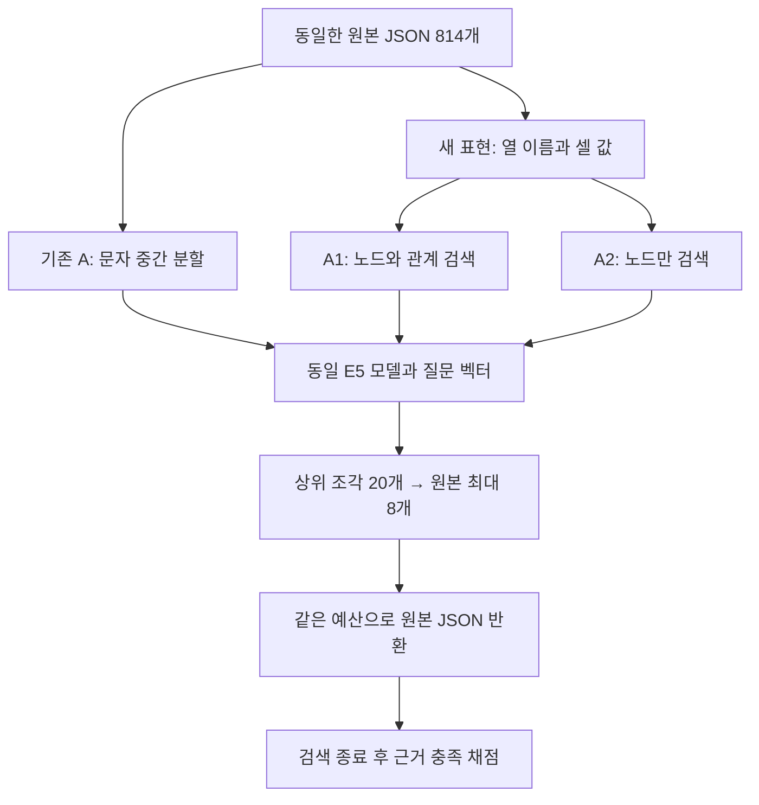

# 벡터 검색의 표현·청킹 개선 비교

기존 A의 낮은 점수를 벡터 검색 자체의 한계로 해석하기 전에 검색용 텍스트를 다듬어 비교했습니다. 원본 A와 기존 B·C·D·E 결과는 그대로 보존하고 새 비교를 vector-refinement-1로 분리했습니다. 이번에는 벡터 DB 제품을 교체하지 않았습니다. 로컬에 저장한 벡터와 NumPy 전수 검색을 사용했습니다.

## 기존 A의 검색 구성

A는 작업표·코드북 기록 328개와 관계 기록 486개를 JSON으로 직렬화했습니다. 길이가 512토큰을 넘으면 문자 중간에서 나눴고 오버랩이나 필드 경계 처리는 없었습니다. 원본 814개에서 검색 조각 1,483개가 만들어졌습니다. 모든 질문에서 선택한 192개 청크는 관계 기록이었으며 근거 충족은 0/18이었습니다. 이는 이 설정의 결과이지 벡터 RAG 일반의 성능이 아닙니다.

## 새 비교 조건

A1은 같은 원천의 셀 값과 열 이름을 짧은 필드 줄로 표현합니다. 각 청크에 파일의 작업표 식별자·시트·행을 반복하고 필드 중간을 자르지 않습니다. 해시와 긴 경로 등은 검색 텍스트에서 제외하되 반환하는 원본 근거에는 그대로 남겼습니다. 자료를 읽고 새 사실이나 정답 설명을 덧붙이지 않았습니다.

A2는 A1의 벡터를 그대로 쓰면서 검색 후보를 작업표·코드북 노드로 제한합니다. 별도 관계 청크는 제외하지만 노드에 들어 있던 코드북 참조는 남깁니다. 따라서 A1과 A2의 차이는 후보 종류이며, 두 조건을 독립적인 모델 실행으로 세지 않습니다.

모델은 기존 multilingual-e5-small, 질문은 기존 24개와 저장된 질문 벡터를 그대로 사용했습니다. 조각 상위 20개에서 원본 최대 8개를 고르고 원본 JSON 전체를 4,096 E5 토큰·64,000바이트 이내로 담는 방식도 유지했습니다. 검색용 텍스트를 짧게 만들었다고 반환 근거의 예산까지 줄인 것은 아닙니다.

## 실행 결과

새 검색 텍스트는 814개이며 최대 174토큰입니다. 이번 자료에서는 추가 분할 없이 각 원본 기록을 하나의 검색 청크로 표현할 수 있었습니다. 두 조건 모두 질문 24개에서 검색 실행을 완료했습니다. 원천 묶음에 정보가 없는 6개는 별도로 두고 나머지 18개에서 필요한 근거를 모두 확보했는지 채점했습니다.

| 조건 | 설정 번호 직접 조회 | 명목 Idc 연결 조회 | 결함명 연결 조회 | 전체 |
| --- | ---: | ---: | ---: | ---: |
| 기존 A | 0/6 | 0/6 | 0/6 | 0/18 |
| A1 필드 단위 표현 | 5/6 | 0/6 | 0/6 | 5/18 |
| A2 노드만 검색 | 5/6 | 0/6 | 0/6 | 5/18 |
| 기존 B 혼합 검색 | 1/6 | 0/6 | 0/6 | 1/18 |
| 기존 C 관계 확장 | 1/6 | 2/6 | 4/6 | 7/18 |
| 기존 E SQL/Python | 1/6 | 2/6 | 4/6 | 7/18 |

A1과 A2는 같은 질문 5개에서 근거를 확보했습니다. 관계 청크를 제외하면 노드 선택 횟수는 72개에서 102개로 늘었지만 근거 충족은 더 좋아지지 않았습니다. 원본 근거의 길이 제한 때문에 후보를 건너뛴 횟수는 각각 65회와 90회였습니다. 이 횟수는 질문 수가 아니라 후보 발생 횟수입니다.

예를 들어 dev-005는 PP4 작업표 2행의 설정 번호를 묻습니다. A1은 해당 작업표 기록을 찾았습니다. 반면 dev-006은 그 행과 코드북을 연결해 명목 Idc를 물었는데, A1은 설정 코드 2의 코드북 기록들을 선택했습니다. 필요한 작업표와 올바른 코드북을 함께 확보하지 못했습니다.

## 해석과 다음 비교

이번 결과는 검색용 표현과 청킹을 바꾸면 직접 조회의 근거 확보가 달라진다는 관찰입니다. 두 변경을 함께 적용했으므로 각각의 기여를 분리하지는 못했습니다. A2도 기존 관계 청크 편중을 본 뒤 정한 조건입니다. 모든 자료와 질문은 개발에 사용했으므로 새로운 검증용 데이터가 아닙니다.

기존 C는 A1이 확보한 직접 조회 근거 4건을 놓쳤고 A1은 C가 확보한 연결 조회 근거 6건을 놓쳤습니다. 두 방식의 점수만으로 일괄적인 우열을 정하기 어렵습니다. 기존 C·E는 새 검색 결과에서 다시 실행하지 않았으므로 다음에는 개선된 검색을 공통 출발점으로 두고 관계 확장을 추가하는 비교가 필요합니다.

이번 작업은 검색 단계의 비교입니다. LLM 답변 생성, SHACL·OWL 실행, 벡터 DB 엔진 성능, 사실 정확도는 측정하지 않았습니다. 유료 API 호출도 없었습니다. 기존 실행과 실패 기록을 보존했으며 새 결과를 보고 재튜닝하지 않았습니다.

## 검색 입력과 원본 근거



원본 기록 → 검색용 표현 → 벡터 검색 → 원본 근거 반환 → 사후 채점의 순서입니다. A2는 A1의 벡터를 재사용합니다.

실제 A1 코드북 검색 입력의 일부입니다.

```text
passage: record=PP3:welding_settings_code:1; workbook=PP3; sheet=welding_settings_code; Excel row=3
Code [A3] = 1
welding settings / Vdc (V) [B3] = 27
Idc (A) [C3] = 450
Vac (V) [D3] = null
Iac (A) [E3] = null
wfs (dc) [F3] = 1.6
wfs (ac) [G3] = null
ts (cm/min) [H3] = 48
```

## 재현 파일

저장소의 `research/vector-refinement-1/`에서 결과를 확인할 수 있습니다.

- `protocol.md`: 비교 조건과 해석 범위
- `run-001/children.json`: 실제 임베딩 입력과 원본 식별자
- `run-001/child-vectors.npy`: 저장된 벡터
- `run-001/A1.jsonl`, `run-001/A2.jsonl`: 질문별 검색 결과와 원본 근거
- `score-a1-001/scores.json`, `score-a2-001/scores.json`: 질문별 채점
- `comparison.json`: 기존 결과와의 비교

구현은 `scripts/graphrag_semantic_projection.py`와 `scripts/run_graphrag_vector_refinement.py`에 있습니다. 원천 출처와 CC BY 4.0 표기는 동결한 원본 코퍼스에 보존했습니다. [기존 연구일지](../journal/2026-11-01-graphrag-retrieval-closeout.md)와 [기존 실험 설계](graphrag-evidence-study.md)도 함께 유지합니다.
