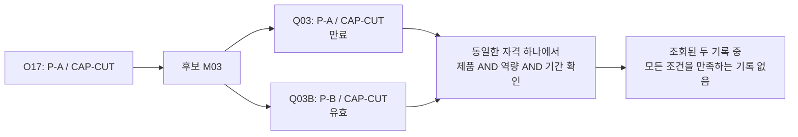
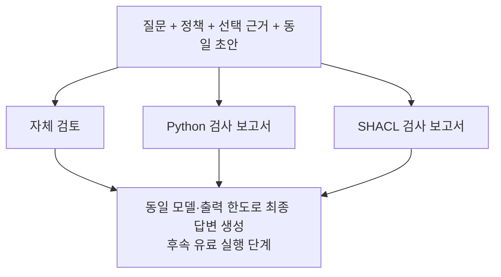

# 가상 공장 검토 실험의 여섯 사례

> 후속 실행: 2026-11-10에 36건의 최종 답변 생성을 완료했다. 아래는 입력 준비 단계의 기록이다. [실제 실행 결과와 한계](../journal/2026-11-10-factory-final-answer-cycle.md)를 함께 확인할 수 있다.

이번 실험은 자체 검토, Python 검사, SHACL 검사에 같은 초안과 근거를 제공하도록 입력을 만든다. 초안이 이미 맞는 경우와 의도적으로 오류를 넣은 경우를 함께 둔다. 모든 데이터와 초안은 작성한 가상 사례다. 실제 LLM이 낸 오류나 현장 설비의 운전 조건으로 해석하지 않는다.

## 사례와 판단 범위

| 사례 | 질문과 근거 | 올바른 판단 | 넣어 둔 오류 |
|---|---|---|---|
| 단순 배정 조회 | O17의 배정 관계는 M02를 가리킨다. | M02라는 사실을 답한다. 자격 검사 대상은 없다. | 배정 설비를 M01이라고 답한다. |
| 모든 선언 조건 충족 | M01은 가용 상태이고 Q01은 P-A·CAP-CUT·기준일을 함께 만족한다. | 선언 조건을 충족한다고 답하되 운전 승인은 하지 않는다. | 유효한 Q01을 만료됐다고 판단한다. |
| 유효기간 위반 | M03의 Q03은 기준일 전에 만료됐다. | 조회된 자격으로 조건 충족을 확인할 수 없다고 답한다. | 제품과 역량만 보고 조건을 충족한다고 답한다. |
| 서로 다른 자격의 조건 혼합 | Q03은 만료된 P-A 자격, Q03B는 유효한 P-B 자격이다. | 같은 자격 하나가 모든 조건을 만족해야 한다. | 두 자격에서 맞는 조건만 합쳐 적합하다고 답한다. |
| 조회에서 빠진 자격 | 원본에는 Q01이 있지만 선택된 근거에는 포함하지 않았다. | 자격 적용 여부는 미확인이다. | 원천에도 자격이 없다고 단정한다. |
| 규칙 밖의 납기·최적성 | M01의 자격 조건은 충족하지만 부하·생산능력·안전 정보가 없다. | 납기 보장·최적성·즉시 투입은 판단하지 않는다. | 자격 검사 통과를 최적성·안전성의 증거로 확대한다. |

모든 사례는 `factory-v2`에서 파생하되 별도의 식별자로 보관한다. 기준일은 기존 실험과 같은 `2026-11-09`다. 조건 혼합 사례에만 Q03B를 추가한다. 기존 Neo4j 데이터나 두 원본 스냅샷은 수정하지 않는다.

## 대표 사례의 자격 관계

이 사례의 초안에는 “Q03으로 P-A 자격이 확인되고 Q03B로 유효한 CAP-CUT 자격이 확인되므로 조건을 충족한다”는 오류를 넣는다. 올바른 초안도 같은 근거로 만든다. 보고서가 오류를 고치는 데 도움이 되는지뿐 아니라 올바른 초안을 불필요하게 바꾸는지도 평가할 수 있다.

## 동일 초안의 세 검토 조건

6개 사례에 올바른 초안과 오류 초안을 하나씩 두어 총 12개 초안을 작성했다. 각 초안을 3개 검토 조건으로 나눠 총 36개 최종 답변 입력을 생성한다. **36개는 모델 실행 결과가 아니라 미실행 입력 수다.**

Python과 SHACL은 같은 정책과 선택 근거를 검사한다. 최종 답변 입력에서 검사 엔진 이름은 제거한다. 두 엔진의 정규화된 보고서가 같으면 프롬프트도 같아진다. 이때 출력 차이를 곧바로 엔진 효과로 해석할 수 없다. 보고서 표현이나 엔진 이름의 효과를 조사하려면 별도 조건으로 분리해야 한다.

자체 검토 조건에도 같은 질문·정책·초안·근거와 공통 한계를 제공하지만 계산된 위반 목록은 주지 않는다. 최종 단계에는 추가 조회 도구가 없다. 출력 한도와 모델을 고정하는 것은 이후 실행의 전제이며 아직 실행하지 않았다.

## 평가 자료와 실행 입력의 분리

`runtime/`에는 모델에 전달할 `messages`만 저장한다. `evaluator/`에는 원본 스냅샷, 초안의 작성 유형, 기대 판단, 검사 결과를 따로 둔다. 호출기는 파일명이나 평가자 메타데이터를 모델에게 보내면 안 된다. 각 조건의 공통 입력 해시를 비교해 질문·정책·초안·근거가 같은지 확인한다.

근거 누락 사례에서 Q01이 원본에 존재한다는 사실은 평가자만 확인한다. 검사기는 선택된 근거만 받으므로 원천 부재와 검색 누락을 구분할 수 없다. 이 한계 자체가 사례의 평가 대상이다.

## 측정할 결과와 미측정 항목

후속 LLM 실행에서는 오류 수정, 올바른 답의 불필요한 변경·보류, 인용 뒷받침, 근거 없는 단정, 검토할 대상과 이유를 각각 평가한다. 오류를 넣은 초안과 올바른 초안의 결과를 섞어 하나의 성공률로 표시하지 않는다. 실패·잘린 응답도 원래 입력 수에 포함하고 자동으로 재시도하지 않는다.

현재 생성기는 LLM이나 데이터베이스를 호출하지 않는다. Python과 실제 pySHACL의 검사 결과를 비교하는 것은 소프트웨어 검증이며 답변 개선 효과가 아니다. 기존 채팅 화면의 검토 모드별 독립 실행 역시 이 동일 초안 비교와 구분한다.

자연 발생 오류 실험은 다음 단계다. LLM이 직접 조회하고 작성한 초안을 먼저 보존한 뒤 같은 근거와 초안으로 세 조건을 구성해야 한다. 맞은 답을 제외하거나 틀린 답만 골라 일반적인 오류율처럼 발표하지 않는다. 현재 사례들은 개발용으로 소비된 합성 진단이며 새로운 평가 집합이 아니다.
