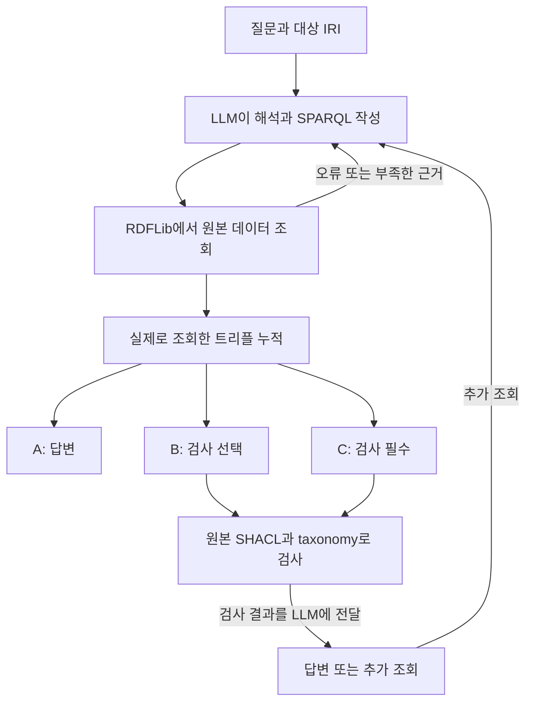

# YAGO 원본 데이터의 LLM 조회·검증 연결

제조업 합성 사례에서는 직접 작성한 관계 방향 설명에 오류가 있었고 LLM의 쿼리 작성 실패와 데이터 설계 문제를 분리하기 어려웠다. 이번 실행은 이미 확보한 YAGO 4.6 데이터와 원본 SHACL로 돌아가 조회와 검증의 연결 상태를 확인한다.

## 데이터와 질문 범위

기존 파일럿에서 사용한 인물 4명과 연결된 출생지의 38개 트리플을 그대로 사용한다. 전체 YAGO를 적재한 실험은 아니다. 질문은 각 인물의 출생지를 묻는다. 이미 확인한 집합을 재사용하므로 새로운 평가 집합이나 일반적인 정확도 벤치마크로 해석하지 않는다.

데이터·taxonomy·schema 파일은 기존 manifest의 SHA-256과 대조한다. SHACL은 원본 바이트를 보존한다. 인물 이름과 IRI만 질문에 제공하고 manifest의 출생지·생년월일과 평가 정답은 LLM 입력에서 제외한다.

출처: YAGO team, Télécom Paris, YAGO 4.6. [공식 배포](https://yago-knowledge.org/data/yago4.6/), [CC BY 4.0](https://creativecommons.org/licenses/by/4.0/).

## 세 가지 실행 조건

| 조건 | 조회 | SHACL | 답변 종료 조건 |
|---|---|---|---|
| A | LLM이 SPARQL 작성 | 도구 없음 | 조회를 한 번 이상 요청 |
| B | LLM이 SPARQL 작성 | LLM이 선택 | 조회를 한 번 이상 요청 |
| C | LLM이 SPARQL 작성 | 필수 | 최신 조회 근거에 실제 검사 실행 |

세 조건에 같은 스키마 설명을 제공한다. C는 검사 통과를 요구하지 않으며 위반을 보고한 뒤에도 답변할 수 있다. 다만 근거가 비어 있거나 적용할 shape가 없어 검사가 판정 불가로 끝나면 종료 조건을 충족하지 못한다. 이러한 제어 흐름의 실패도 미완료로 남긴다. 이 비교는 도구 사용과 연결 상태를 확인하며 온톨로지 설명의 효과나 JSON과 RDF의 차이를 측정하지 않는다.

## 조회와 검증 경계

LLM은 `SELECT ?s ?p ?o`를 작성한다. 도구는 반환된 세 항이 원본의 실제 트리플인지 확인하고 URI·리터럴·자료형·언어 태그를 보존한다. 모델이 잘못된 조건을 선택한 경우 정답을 이용해 고치지 않는다. 원본 트리플을 반환하도록 제한한 인터페이스이므로 임의 형태의 SPARQL 답변 투영을 평가한 것은 아니다.

검사에는 누적 조회 근거와 원본 SHACL, taxonomy를 전달한다. 전체 검사 후 질문 대상과 조회된 출생지 노드의 결과를 추린다. SHACL 통과는 질문 해석의 정확성, 근거의 완전성, 외부 세계의 사실성을 보장하지 않는다. 빈 조회 결과만으로 원천 데이터가 없다고 단정하지 않는다.

## 실행 한도와 기록

인물 4명에 세 조건을 적용해 12개 실행을 배정한다. 실행당 모델 응답 12회, 조회 8회, 검사 6회, 전체 도구 요청 24회로 제한한다. 240초는 모델 응답 사이에 확인하는 시간 제한이며 엄격한 전체 실행 종료 시각은 아니다. 개별 조회와 검사 작업에는 각각 10초와 30초, 512MiB 제한을 둔다. 실제 최대 메모리 사용량은 측정하지 않았다.

이번 캠페인은 OpenRouter 최대 144회와 반환하지 않는 예약 예산 $1.50으로 제한한다. 기존 캠페인과 새 캠페인의 일별 요청 합계에는 500회 상한을 적용한다. Codex 연구 운영의 하루 500회 기록 제한은 별도다. 실패·미해결 비용과 이전 실행을 보존하고 자동으로 재실행하지 않는다.

완료 여부, 실제 SHACL 실행, 조회 오류, 원본과 답변의 일치, 인용의 답변 뒷받침 여부를 분리해 기록한다. 평가는 실행이 끝난 뒤 저장된 결과를 읽으며 답변을 수정하지 않는다.

[실제 실행 결과와 실패 사례](records/20261015-yago-native-tools.md)
