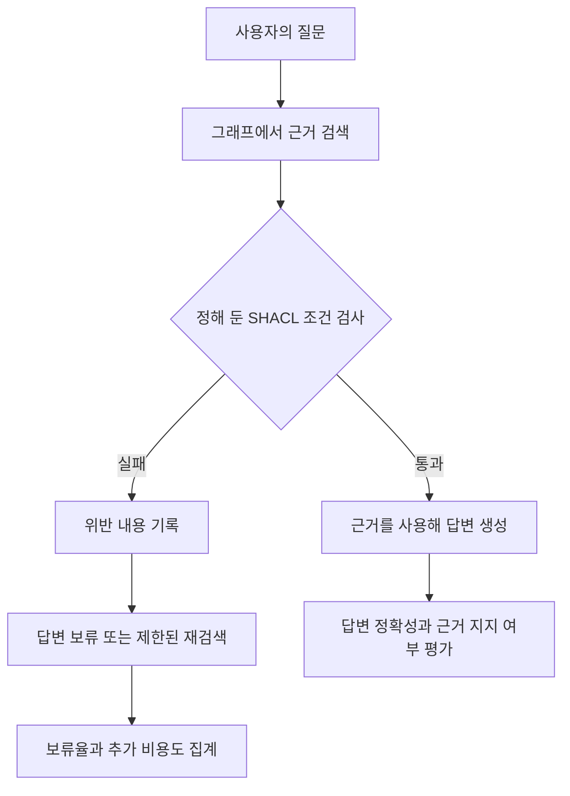

# SHACL GraphRAG Lab

## 최근 연구 상태

10월 27~28일에는 기존 탐색 주장을 정리하고 상세 근거 보고서의 효과를 비교하는 새 설계를 작성했습니다. 새 LLM 평가는 아직 실행하지 않았습니다. BPI 2019 원본 로그는 실제 자료 후보로 적합성을 검사했으며 기존 제조 시나리오를 대체하기로 확정하지 않았습니다.

- [최신 연구일지](journal/index.md)
- [새 연구 설계](experiments/evidence-report-study.md) · [원천·규칙 구축과 병목 진단](experiments/source-to-rule-guide.md)
- [세미나 자료](experiments/seminar-guide.md) · [오프라인 근거 보고서 데모](experiments/evidence-report-demo/index.html)

아래 소개는 기존 파일럿의 배경과 구현 범위입니다.

최신 실행: [LLM 주도 조회·온톨로지 도구](experiments/records/20261015-llm-ontology-tools.md). 54개 실제 모델 실행의 질문·쿼리·답변과 한계를 공개한다.

AI가 찾은 근거를 답하기 전에 검사하면, 잘못된 답을 얼마나 줄일 수 있을까?

이 연구는 지식그래프에서 찾은 근거에 SHACL 검증을 적용하고 오류를 걸러내는 효과와 그에 따른 손실을 함께 측정한다. 잘못된 근거를 막는 만큼 정상 근거도 놓치는지, 답변을 보류하거나 다시 검색하면 시간과 비용이 얼마나 늘어나는지 확인하려 한다.

첫 데이터셋은 GLEIF다. 법인·회계연결 모회사·보고 예외 배치를 같은 시점으로 고정하고 RDF 검색, SHACL 검증, OpenRouter 답변, 정답 채점까지 작은 파일럿으로 연결했다. 대표성 있는 본 실험이나 그래프 DB 성능 비교와는 구분한다.

YAGO 4.6의 원본 SHACL을 사용하는 후속 파일럿도 추가했다. [YAGO 실행과 해석](journal/2026-10-12-yago-pilot.md)에서 출생지 제약과 검색 누락의 차이를 정리한다.

후속으로 [질의 관련성에 따른 선택적 검증](journal/2026-10-12-yago-selective.md)을 비교한다. 데이터를 완전하게 정리하기보다 현재 답변을 막아야 하는 오류와 근거 부족을 구분한다.

## 검색 근거의 오류와 불완전성

GLEIF는 법인의 식별자 LEI와 직접·최종 회계연결 모회사 관계를 제공한다. 모회사 관계를 보고하지 않는 경우에는 별도의 보고 예외가 있을 수 있다. 여기서는 직접 모회사 질의로 범위를 좁힌다.

```text
법인 ──직접 회계연결 모회사──> 다른 법인
  └──보고 예외──> NON_CONSOLIDATING 등
```

그림은 데이터 구조를 단순화한 것이다. 이번 표본에서는 활성 직접 모회사 관계 또는 보고 예외 중 하나가 있는 법인을 선택했다. 이 조건을 모든 법인과 과거 관계에 그대로 적용하지 않는다. 회계연결 모회사 관계를 지분율이나 최종 실소유자 정보로 해석하지도 않는다.

모회사 식별자가 잘못된 형식이면 SHACL로 검출할 수 있다. 그러나 형식이 올바른 엉뚱한 법인을 연결하면 같은 검사를 통과한다. 반대로 원본에 있는 관계가 검색 결과에서만 빠지면 불완전한 근거 때문에 답을 보류할 수 있다. 원천 오류와 검색 누락을 나눠 실험하는 이유다.

## SHACL 기반 근거 검증 절차

GraphRAG는 그래프의 개체와 관계를 검색해 LLM이 답할 근거로 사용한다. 이번 파일럿은 아래 흐름을 구현한다. 질문에는 LEI가 주어지고 고정 질의로 직접 관계를 조회하므로 자유로운 질의 생성이나 다중 홉 추론의 성능을 측정한 것은 아니다.



검증을 통과한 뒤에도 LLM은 근거에 없는 내용을 말할 수 있다. 그래서 근거의 검사 결과와 답변의 정확성을 따로 평가한다.

| 개념 | 이 연구에서 맡는 역할 |
| --- | --- |
| 온톨로지 | 법인·회계연결 모회사 같은 개념과 관계의 의미를 정의한다. |
| OWL | 선언한 공리로부터 따라오는 사실을 추론한다. 도입 시 SHACL과 별도 조건으로 비교한다. |
| SHACL | 주어진 데이터가 정해 둔 조건을 만족하는지 검사하고 위반 보고서를 만든다. |
| 출처·이력 기록 | 어떤 데이터와 질의, 근거, 검사 결과로 답했는지 다시 확인할 수 있게 한다. |

OWL의 의미 추론과 SHACL의 데이터 검사는 역할이 다르다. SHACL 통과는 검사 조건을 만족했다는 뜻이며 현실의 사실이나 답변의 정답을 보증하지 않는다. [OWL 2 Primer](https://www.w3.org/TR/owl2-primer/)와 [SHACL 명세](https://www.w3.org/TR/shacl/)를 기준으로 구분한다.

## 검증·보류·재검색 조건 비교

먼저 같은 질문에서 얻은 **동일한 그래프 근거**를 검증 없이 쓸 때와 검증 후 쓸 때를 비교한다. 그래프를 사용한 효과, 데이터를 정리한 효과, 검증을 추가한 효과가 한꺼번에 섞이지 않도록 하기 위해서다.

| 조건 | 확인하려는 질문 |
| --- | --- |
| G0 · 검증 없음 | 검색한 근거를 그대로 쓰면 어떤 오류가 나는가? |
| G1 · 검증 후 보류 | 같은 근거를 검사하면 오류와 응답률이 어떻게 달라지는가? |
| G2 · 검증 후 재검색 | 위반 보고서로 다시 찾으면 얼마나 복구되며 비용은 얼마나 늘어나는가? |

이번 R0는 동일 사실을 텍스트로 직렬화한 조건이다. 별도의 벡터 검색기를 비교하지 않는다. SHACL 자체의 효과는 G0와 G1에서 먼저 해석한다. 재검색은 추가 연산의 효과와 구분한다. 상세한 조건과 최대 재검색 횟수는 [실험 명세](experiments/specification.md)에 있다.

## 파일럿과 사전 점검의 구분

사전 점검의 공개 실행 두 건은 각각 정상 2건과 위반 4건, 총 6건의 기대 판정과 일치했다. 이는 검증과 채점이 예제대로 작동하는지 확인한 결과다. GraphRAG의 정확도나 환각 감소율을 측정한 결과로 해석하지 않는다. 입력과 결과는 [실행 기록](experiments/records/index.md)에 남겼다.

GLEIF 파일럿은 모회사 관계가 있는 법인과 보고 예외가 있는 법인을 각각 3개 선정해 24개 사례를 만든다. 정상 근거, 검색 누락, 형식 위반, 제약을 통과하는 사실 오류를 구분한다. 여기에 여섯 비교 조건을 적용한다. 결과와 한계는 [GLEIF 전환 일지](journal/2026-10-12-gleif-pilot.md)에 정리한다.

4단계 엔진 배치 비교는 아직 실행하지 않았다. 다음 본 실험에서는 표본과 질문을 넓히고 보고 예외 종류·시간 조건·다중 홉 관계를 따로 다룬다.

## 연구 배경

온톨로지 표준과 공공데이터 메타데이터를 다루던 경험에서 출발했다. LLM 서비스에서 온톨로지를 활용한다는 말을 접하면서 개념과 관계를 정리하는 일이 실제로 어떤 오류를 줄이는지 확인하고 싶었다. 이 문제의식은 [온톨로지의 스키마란?](https://chaeeunsong.tistory.com/116)에 적었다.

[개인 블로그](https://chaeeunsong.tistory.com/)에서는 지식그래프 구축, Text2SPARQL, OWL·SHACL, 출처 추적과 평가를 공부하고 정리한다. 이 저장소에는 그중 실험으로 확인할 질문을 좁혀 명세·코드·실행 결과를 함께 남긴다. 블로그의 별도 구축 사례나 논문에서 인용한 성능 수치를 이 저장소의 성과로 합치지 않는다.

## 실험 명세와 실행 기록

| 읽을 거리 | 내용 |
| --- | --- |
| [연구 방향](journal/2026-10-12-research-direction.md) | 블로그와 연구의 연결, 우선순위와 후속 제안 |
| [실험 명세](experiments/specification.md) | 연구 질문, 비교 조건, 채점 기준, 진행 순서 |
| [실행 기록](experiments/records/index.md) | 실행마다 생성한 결과와 환경 정보 |
| [연구 일지](journal/index.md) | 시도한 이유, 관찰, 해석, 다음 결정 |
| [기록 운영 방법](setup/recording.md) | 재실행과 문서 미리보기, GitHub Pages 공개 절차 |
| [환경 구성](setup/bootstrap.md) | Ubuntu와 uv로 실험 환경 준비 |
| [시행착오](lessons-learned/README.md) | 반복하지 않으려는 실수와 해결 방법 |

## 금융·제조업의 업무 질문

[여섯 업무 질문](experiments/business-questions-study.md)과 [첫 실행의 실제 입력·출력](experiments/records/20261014-business-questions.md)을 정리했다.
