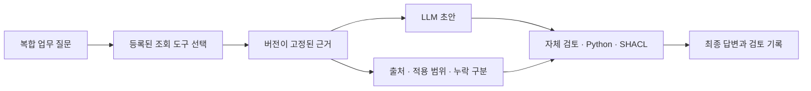

# SHACL GraphRAG Lab

LLM이 그래프에서 찾은 근거를 바탕으로 답할 때, 관계 조회와 규칙 검사가 어디에 도움이 되는지 살펴보는 연구 기록입니다. 제조 사례를 중심으로 검색, 답변 생성, 사후 검토, 데이터 변경을 따로 비교합니다.

## 지금 살펴보는 질문

> 제품과 설비의 관계가 바뀌었을 때 LLM은 새 근거를 찾아 적용 범위를 정확히 설명할까? 검사 보고서는 이미 쓴 답에서 무엇을 더 발견할까?

현재 Factory Lab은 미리 정의한 다섯 조회 도구로 그래프를 읽고 같은 초안과 근거에서 세 가지 최종 검토 답변을 만듭니다. SHACL 보고서는 판단을 강제로 바꾸지 않는 참고 자료입니다. 화면에 표시하는 그래프는 해당 질문에서 실제 조회한 근거를 요약합니다. 합성 공장 자료이므로 설비 운영이나 안전 판단에 쓸 수 없습니다.

## 최근 확인한 결과

| 범위 | 확인한 내용 | 해석의 경계 |
| --- | --- | --- |
| [검색과 관계 확장](journal/2026-11-02-refined-hybrid-backends.md) | 개발 질문 18건에서 필요한 근거를 모두 확보한 경우가 비교 조건별로 5건, 6건, 7건이었습니다. | 답변 정확도나 그래프 DB의 우위를 측정한 수치는 아닙니다. |
| [여섯 모델의 사후 검토](journal/2026-11-04-paired-six-model-review.md) | 같은 초안에서 자체 검토와 SHACL 보고서 검토를 비교하고, 수정과 실패를 함께 기록했습니다. | 작성한 질문 유형의 개발 실험입니다. 새로운 질문으로의 일반화는 확인하지 않았습니다. |
| [Neo4j·Neptune 추론 범위](journal/2026-11-06-backend-inference-review.md) | 같은 도출 사실을 조회하고, 관계·규칙 변경 뒤 오래된 결과가 남는 조건을 확인했습니다. | Neptune 내부 추론기가 실행된 것은 아닙니다. 외부에서 계산한 결과를 저장해 조회했습니다. |
| [Factory Lab 조회 이식성](experiments/records/2026-11-10-factory-rdf-parity.json) | 합성 자료 3버전의 고정 조회 48쌍에서 Neo4j와 로컬 RDFLib의 반환 순서와 공통 근거가 일치했습니다. | 이 실행의 Neptune 48건은 미실행입니다. 임의 쿼리나 대규모 데이터의 동등성도 뜻하지 않습니다. |
| [자격 갱신과 실제 LLM 답변](experiments/records/2026-11-10-factory-renewal-live.json) | M03의 제품 A 자격 갱신을 초안부터 찾았고 제품 B에는 적용하지 않았습니다. 최종 답변에는 검사 사유를 섞어 쓰는 문제가 남았습니다. | 한 모델·한 작성 사례입니다. 검토 보고서의 일반적 답변 개선 효과를 보여주지 않습니다. |

## 문서 찾아보기

- [온톨로지·SHACL을 어디에 쓰는가](journal/2026-11-11-ontology-shacl-role.md): 의미 공유, 데이터 변경, 근거 검토에서의 역할과 Python 대조
- [실험 명세](experiments/specification.md): 질문, 입력, 비교 조건과 평가 경계
- [실행 기록](experiments/records/index.md): 성공·실패와 원본 결과 파일
- [연구 일지](journal/index.md): 결과 해석, 설계 변경과 논문 리뷰
- [25장 발표 자료](experiments/seminar-guide.md): 현재 제조 사례와 아키텍처를 설명하는 슬라이드
- [환경 설정과 공개 절차](setup/recording.md): 실행 환경, 문서 빌드, GitHub Pages 운영

이전에 진행한 GLEIF·YAGO 파일럿과 규칙 생명주기 실험도 [실험 명세](experiments/specification.md)와 [일지](journal/index.md)에 남아 있습니다. 각 결과는 해당 자료와 질문 범위에서 읽어야 합니다.
