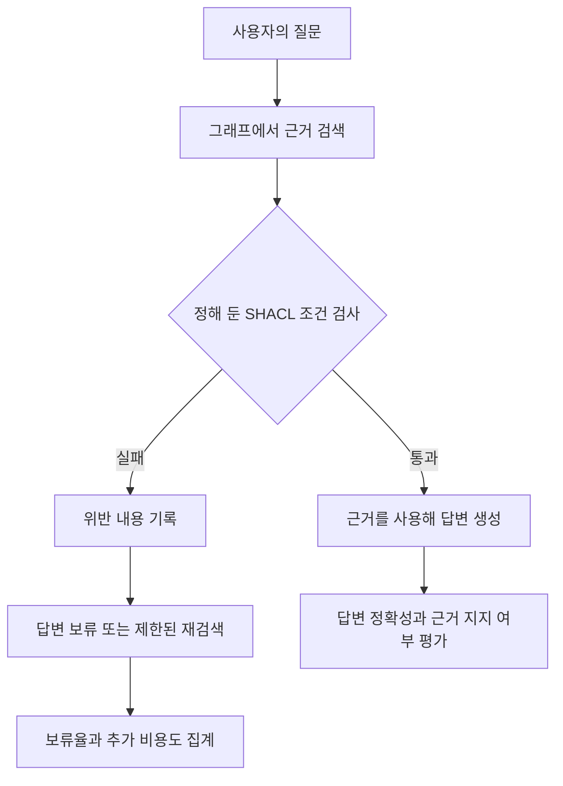

# SHACL GraphRAG Lab

AI가 찾은 근거를 답하기 전에 검사하면, 잘못된 답을 얼마나 줄일 수 있을까?

이 연구는 지식그래프에서 찾은 근거에 SHACL 검증을 적용하고 오류를 걸러내는 효과와 그에 따른 손실을 함께 측정한다. 잘못된 근거를 막는 만큼 정상 근거도 놓치는지, 답변을 보류하거나 다시 검색하면 시간과 비용이 얼마나 늘어나는지 확인하려 한다.

현재는 합성 RDF로 검증기와 채점 절차를 확인한 **E0 단계**다. YAGO와 LLM을 사용한 GraphRAG 비교 실험은 아직 진행하지 않았다.

## 어떤 문제를 풀려는가

가령 AI에게 어느 직원이 맡은 프로젝트의 고객사를 묻는다고 하자. 아래는 연구 질문을 설명하기 위한 가상 사례이며, 현재 실험 데이터는 아니다.

```text
직원 ──참여──> 프로젝트 ──고객사──> 회사
                                  ↑
                         여기에 사람이 연결됐다면?
```

이 예제에서 고객사는 회사여야 한다는 검사 규칙을 정했다면, 사람을 고객사로 연결한 근거를 걸러낼 수 있다. 하지만 엉뚱한 회사가 연결돼 있어도 회사라는 조건은 만족한다. 실제로 맞는 정보인지까지 알려면 별도의 정답이나 원천 자료가 필요하다.

반대 상황도 있다. 원본에는 고객사가 있는데 검색 결과에서 그 관계를 빠뜨렸다면, 필수 관계가 없다는 검사 결과만 보고 정상 데이터를 잘못 차단할 수 있다. **데이터가 잘못된 경우와 검색이 덜 된 경우를 구분하는 것**이 이 연구에서 확인하려는 중요한 문제다.

## 답변 전에 검사하는 흐름

GraphRAG는 그래프의 개체와 관계를 검색해 LLM이 답할 근거로 사용한다. 여기에 검사 단계를 넣어 다음 흐름을 비교할 계획이다. 아래는 목표 구조이며, 현재 구현된 범위는 합성 RDF의 검증과 채점이다.



검증을 통과한 뒤에도 LLM은 근거에 없는 내용을 말할 수 있다. 그래서 근거의 검사 결과와 답변의 정확성을 따로 평가한다.

| 개념 | 이 연구에서 맡는 역할 |
| --- | --- |
| 온톨로지 | 직원·프로젝트 같은 개념과 관계의 의미를 정의한다. |
| OWL | 선언한 공리로부터 따라오는 사실을 추론한다. 도입 시 SHACL과 별도 조건으로 비교한다. |
| SHACL | 주어진 데이터가 정해 둔 조건을 만족하는지 검사하고 위반 보고서를 만든다. |
| 출처·이력 기록 | 어떤 데이터와 질의, 근거, 검사 결과로 답했는지 다시 확인할 수 있게 한다. |

OWL의 의미 추론과 SHACL의 데이터 검사는 역할이 다르다. SHACL 통과는 검사 조건을 만족했다는 뜻이며, 현실의 사실이나 답변의 정답을 보증하지 않는다. [OWL 2 Primer](https://www.w3.org/TR/owl2-primer/)와 [SHACL 명세](https://www.w3.org/TR/shacl/)를 기준으로 구분한다.

## 무엇을 비교하는가

먼저 같은 질문에서 얻은 **동일한 그래프 근거**를 검증 없이 쓸 때와 검증 후 쓸 때를 비교한다. 그래프를 사용한 효과, 데이터를 정리한 효과, 검증을 추가한 효과가 한꺼번에 섞이지 않도록 하기 위해서다.

| 조건 | 확인하려는 질문 |
| --- | --- |
| G0 · 검증 없음 | 검색한 근거를 그대로 쓰면 어떤 오류가 나는가? |
| G1 · 검증 후 보류 | 같은 근거를 검사하면 오류와 응답률이 어떻게 달라지는가? |
| G2 · 검증 후 재검색 | 위반 보고서로 다시 찾으면 얼마나 복구되며 비용은 얼마나 늘어나는가? |

일반 RAG인 R0도 비교하되, SHACL 자체의 효과는 G0와 G1에서 먼저 해석한다. 재검색은 추가 연산의 효과와 구분한다. 상세한 조건과 최대 재검색 횟수는 [실험 명세](experiments/specification.md)에 있다.

## 어디까지 했는가

E0의 공개 실행 두 건은 각각 정상 2건과 위반 4건, 총 6건의 기대 판정과 일치했다. 이는 검증과 채점이 예제대로 작동하는지 확인한 결과다. GraphRAG의 정확도나 환각 감소율을 측정한 결과로 해석하지 않는다. 입력과 결과는 [실행 기록](experiments/records/index.md)에 남겼다.

다음 단계는 YAGO 4.6의 작은 범위를 정하고, 어떤 관계까지 검색해야 검증할 수 있는지와 누락을 어떻게 처리할지 확정하는 E1이다. 이후 고정 질문으로 검색·답변 비교를 진행한다. 블로그 글에서 출발한 문제의식과 후속 실험 제안은 [연구 방향 일지](journal/2026-10-12-research-direction.md)에 정리했다.

## 이 연구를 시작한 배경

온톨로지 표준과 공공데이터 메타데이터를 다루던 경험에서 출발했다. LLM 서비스에서 온톨로지를 활용한다는 말을 접하면서, 개념과 관계를 정리하는 일이 실제로 어떤 오류를 줄이는지 확인하고 싶었다. 이 문제의식은 [온톨로지의 스키마란?](https://chaeeunsong.tistory.com/116)에 적었다.

[개인 블로그](https://chaeeunsong.tistory.com/)에서는 지식그래프 구축, Text2SPARQL, OWL·SHACL, 출처 추적과 평가를 공부하고 정리한다. 이 저장소에는 그중 실험으로 확인할 질문을 좁혀 명세·코드·실행 결과를 함께 남긴다. 블로그의 별도 구축 사례나 논문에서 인용한 성능 수치를 이 저장소의 성과로 합치지 않는다.

## 실험 따라가기

| 읽을 거리 | 내용 |
| --- | --- |
| [연구 방향](journal/2026-10-12-research-direction.md) | 블로그와 연구의 연결, 우선순위와 후속 제안 |
| [실험 명세](experiments/specification.md) | 연구 질문, 비교 조건, 채점 기준, 진행 순서 |
| [실행 기록](experiments/records/index.md) | 실행마다 생성한 결과와 환경 정보 |
| [연구 일지](journal/index.md) | 시도한 이유, 관찰, 해석, 다음 결정 |
| [기록 운영 방법](setup/recording.md) | 재실행과 문서 미리보기, GitHub Pages 공개 절차 |
| [환경 구성](setup/bootstrap.md) | Ubuntu와 uv로 실험 환경 준비 |
| [시행착오](lessons-learned/README.md) | 반복하지 않으려는 실수와 해결 방법 |
