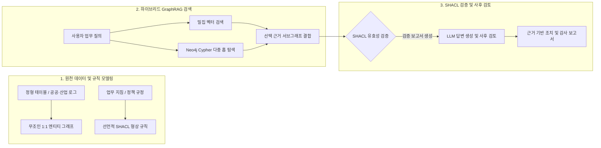
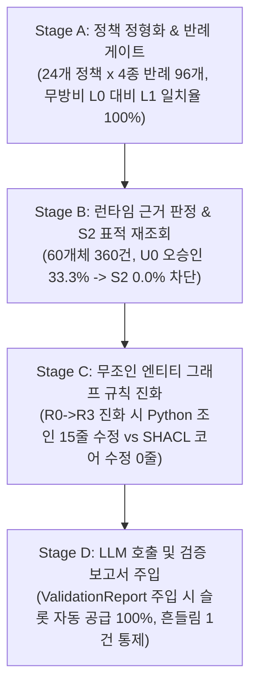

# SHACL GraphRAG Lab

지식 그래프(Knowledge Graph)의 의미적 관계 탐색과 형상 제약 언어(SHACL) 검증 보고서를 결합하여, 거대 언어 모델(LLM)의 비정상 의사결정과 근거 누락을 방지하고 추적성을 확보하는 연구 기록입니다.

---

## 연구 개요 및 핵심 구조

단순한 텍스트 기반 RAG(검색 증강 생성)는 비정형 문서에서 표면적 유사도를 찾는 데 유리하지만, 복잡한 인과 관계나 다중 홉 연결, 엄격한 규정 준수 여부를 검증하는 데 한계가 있습니다. 본 연구실은 원천 데이터의 엔티티 관계를 보존하는 그래프 검색과, 도메인 제약 조건을 기계 판독 가능한 규칙으로 표현하는 SHACL 검증 계층을 결합한 하이브리드 아키텍처를 연구합니다.

---

## 4대 연구 핵심 성과 및 축적 지표

지난 연구 과정에서 축적된 핵심 결과와 실증 지표는 네 단계의 생명주기로 체계화되어 있습니다.

1. **Stage A (정책 정형화 & 반례 게이트)**: 영·한 24개 규정 정책과 4종 반례 증인 그래프를 구축하여, 자연어 규칙을 SHACL로 정규화할 때의 변환 무결성을 100% 검증했습니다.
2. **Stage B (런타임 근거 판정 & 표적 재조회)**: 선택적 검증과 `sh:resultPath` 기반의 표적 1회 재조회(`S2`)를 결합하여 오승인률 0%와 과잉 보류 0%를 동시에 달성했습니다.
3. **Stage C (무조인 엔티티 그래프 기반 규칙 진화)**: 스칼라 제약에서 5-hop 상위 본부 분리까지 규칙이 진화(`R0 → R3`)할 때, 관계형 DB나 수작업 코드와 달리 그래프 투영 코어의 수정 0줄을 입증했습니다.
4. **Stage D (LLM 프롬프트 주입 및 사후 검토)**: SHACL `ValidationReport`를 프롬프트에 주입하여 LLM이 위반 개체, 위반 경로, 충돌 값을 추가 파싱 코드 없이 100% 인지하고 답변을 교정하도록 구현했습니다.

---

## 연구 로드맵 및 최신 현황 (2026년 11월 기준)

| 연구 단계 | 주요 내용 | 산출물 및 문서 | 진행 상태 |
|---|---|---|:---:|
| **규칙 생명주기 논문** | LLM 업무 질의의 의미·규칙 개입 통합 원고 집필 | [통합 논문 원고](journal/2026-10-22-llm-semantic-intervention-paper.md) | **완료** |
| **인터랙티브 데모** | 제조 조치 제안 및 검증 보고서 인라인 뷰어 | [액션 가능 근거 데모](experiments/actionable-evidence-demo/index.html) · [보고서 데모](experiments/evidence-report-demo/index.html) | **완료** |
| **세미나 발표 자료** | 제조 사례 중심 아키텍처 및 25페이지 슬라이드 | [세미나 가이드](experiments/seminar-guide.md) · [발표 슬라이드](experiments/seminar/slides.md) | **완료** |
| **하이브리드 GraphRAG** | 밀집 벡터 검색 대 Neo4j Cypher 다중 홉 관계 탐색 비교 | [하이브리드 백엔드 일지](journal/2026-11-02-refined-hybrid-backends.md) | **완료** |
| **사후 검토 다중 모델 평가** | 6개 상용·오픈소스 LLM 대상 조언적 검증 보고서 효용 측정 | [6개 모델 사후 검토 일지](journal/2026-11-04-paired-six-model-review.md) | **완료** |
| **제조 자료·백엔드 이식성 비교** | 용접 작업표·측정 파일 및 OPC UA 모델 버전·추론·재검토 범위 대조 | [제조 연구 통합 정리](journal/2026-11-07-manufacturing-research-map.md) · [백엔드 추론 실험](journal/2026-11-06-backend-inference-review.md) | **완료** |
| **외부 DB 및 대규모 확장** | GraphDB Free / Neptune Serverless 검증 계층 비교 | [환경 로드맵](setup/roadmap.md) | 진행 예정 |

---

## 주요 문서 및 탐색 가이드

- **연구 논문 및 종합 원고**:
  - [제조 자료에서 확인한 의미 규칙의 이식성과 검토 범위](journal/2026-11-07-manufacturing-research-map.md)
  - [LLM 기반 업무 질의의 의미·규칙 개입 통합 원고](journal/2026-10-22-llm-semantic-intervention-paper.md)
  - [동일 정책 구현의 실행 비용과 변경 범위](journal/2026-10-21-technology-selection-paper.md)
  - [탐색 연구의 주장별 정리와 새 연구 전환](journal/2026-10-27-exploration-closeout.md)
- **실험 명세 및 실행 기록**:
  - [온톨로지 활용 실험 명세](experiments/specification.md)
  - [통합 규칙 생명주기 실행 기록](experiments/records/20261022-unified-rule-lifecycle.md)
  - [전체 실행 기록 인덱스](experiments/records/index.md)
- **엔지니어링 및 환경 설정**:
  - [호스트 구성 및 환경 부트스트랩](setup/bootstrap.md)
  - [연구 운영 에이전트 및 검토 체계](setup/research-operations.md)
  - [엔지니어링 시행착오 및 교훈](lessons-learned/README.md)

---

## 문헌 연구 및 외부 자료

연구 과정에서 분석한 국내외 핵심 연구 논문 및 도구 리뷰 19편은 연구자 개인 블로그의 서재로 이관되어 체계적으로 유지됩니다.

- **주요 리뷰 주제**:
  - **GraphRAG & 검색**: 의료 온톨로지 RAG, RAG vs. GraphRAG, GraphRAG-Bench 등
  - **그래프 아키텍처 & 추론기**: Amazon Neptune·Neo4j n10s·RETE·Hypertableau 비교, rdf2pg 등
  - **SHACL & 지식 그래프**: OWL과 SHACL 의미론, PolicyKG, xpSHACL, 증분 업데이트 검증 등
  - **제조 도메인 추적성**: 배터리 전극 이력 추적(Wessel 외), LG마그나 품질 기록, Meyers 제조 KG 등
- **외부 채널**:
  - [연구자 포트폴리오 및 논문 리뷰 아카이브 (`shinysong.github.io`)](https://shinysong.github.io/reviews/)
  - [연구자 개인 블로그 (Tistory)](https://chaeeunsong.tistory.com/)
