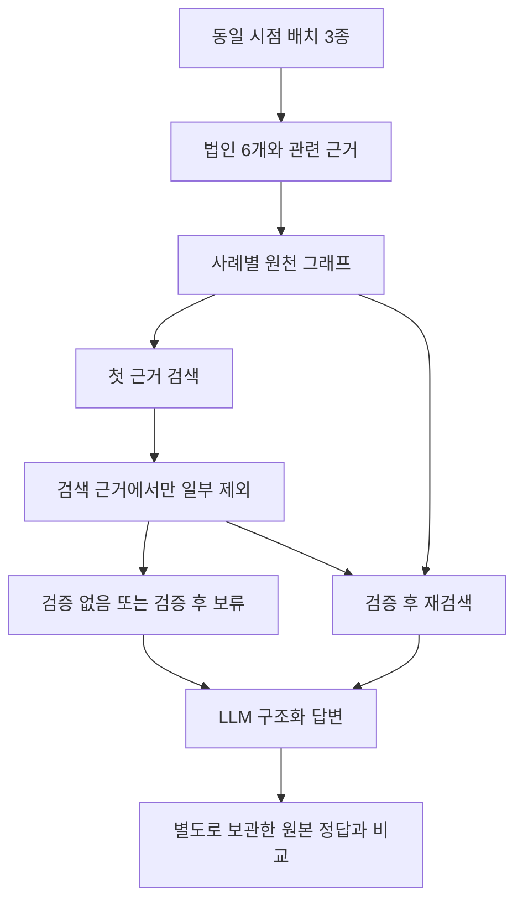

# 2026-10-12 GLEIF 전환과 첫 파일럿

첫 데이터셋을 YAGO에서 GLEIF Golden Copy로 바꾸고 배치 수집, RDF 검색, SHACL 검증, OpenRouter 답변, 정답 채점까지 한 번 실행했다. 1~3단계의 작은 파일럿이며 4단계 엔진 비교는 수행하지 않았다. 과거 합성 RDF 결과는 그대로 보존했다.

## 배치 고정과 표본 구성

2026-10-12 08:00:00 기준 법인·관계·보고 예외 CSV를 내려받았다. 압축 파일 합계는 590,427,464 bytes다. 원본의 실제 행 수는 공식 메타데이터와 일치했다.

| 배치 | 실제 행 수 | 역할 |
| --- | --- | --- |
| LEI | 3,458,852 | 법인 식별자와 이름·상태 |
| RR | 490,833 | 회계연결 등 관계 |
| REPEX | 6,411,075 | 모회사 보고 예외 |

[공식 Golden Copy 안내](https://www.gleif.org/en/lei-data/gleif-golden-copy)와 [CC0 이용 조건](https://www.gleif.org/en/meta/lei-data-terms-of-use/)을 확인했다. 다운로드 시각, 원본 URL, SHA-256은 실행 JSON에 남겼다. 최초 API 예시는 구조를 확인하는 용도로만 사용했고 이번 실행은 배치 데이터에서 새로 추출했다.

모회사 관계가 있는 법인과 보고 예외가 있는 법인을 네 개씩 선정했다. 각 집단의 첫 법인은 개발용으로 분리하고 나머지 세 개씩을 파일럿에 사용했다. 법인 선택은 CSV 등장 순서에 따른 편의 표본이다. 파일럿의 보고 예외 세 건은 모두 NON_CONSOLIDATING이므로 다른 예외 코드로 일반화하지 않는다.

| 파일럿 법인 | 원본의 직접 모회사 정보 |
| --- | --- |
| RGA INTERNATIONAL REINSURANCE COMPANY DESIGNATED ACTIVITY COMPANY | 모회사 관계 |
| STANBIC IBTC STOCKBROKERS LIMITED | 모회사 관계 |
| ARM SECURITIES LTD | 모회사 관계 |
| ARISTEIA CAPITAL, L.L.C. | NON_CONSOLIDATING |
| Oakmark International Fund | NON_CONSOLIDATING |
| Prudential Investment Portfolios 18 | NON_CONSOLIDATING |

## 검색 누락과 원천 오류의 분리

모회사 법인은 정상·법인명 누락·관계 누락·LEI 형식 위반·다른 모회사 연결의 다섯 사례로 구성했다. 보고 예외 법인은 정상·예외 누락·미정의 예외 코드의 세 사례로 구성했다. 총 24개 사례에 여섯 조건을 적용했다.

텍스트 대체: 배치에서 사례별 원천 그래프를 만들고 첫 검색 근거를 고정한다. 누락 사례는 검색 근거만 바꾸고 형식·사실 오류는 사례별 원천에 주입한다. 재검색은 해당 원천만 조회하며 주입 전 정답을 보지 않는다.

법인명이나 관계가 검색에서 빠진 경우는 복구 가능하다. 원천에 잘못된 식별자가 들어 있는 경우는 같은 원천을 다시 읽어도 고쳐지지 않는다. 주입한 오류를 실제 GLEIF 데이터 품질 문제로 해석하지 않는다.

## 파일럿 결과

| 조건 | 정답 / 전체 | 응답 중 정답 | 보류 | API·파싱 오류 |
| --- | --- | --- | --- | --- |
| R0 · 같은 사실의 텍스트 표현 | 6/24 | 6/10 | 14 | 0 |
| G0 · RDF 근거, 검증 없음 | 6/24 | 6/12 | 12 | 0 |
| G1 · SHACL 후 보류 | 3/24 | 3/6 | 18 | 0 |
| G2 · SHACL 후 재검색 | 9/24 | 9/12 | 12 | 0 |
| U2 · 무조건 전체 재조회 | 9/24 | 9/15 | 9 | 0 |
| P1 · Python 규칙 후 보류 | 3/24 | 3/6 | 18 | 0 |

파일럿은 조건 실행 144건, 실제 LLM 호출 108회였다. 모델은 openai/gpt-4o-mini, 응답에 기록된 제공자는 모두 Azure였다. 파일럿 비용은 0.011475 USD, 별도 개발 실행은 36회 호출에 0.00387105 USD였다. 합계는 0.01534605 USD이며 OpenRouter 응답의 usage.cost 합산값이다. 클라우드 사용료는 포함하지 않는다. 비용 누락 응답은 없었다.

- [24개 사례 파일럿 실행](../experiments/records/20261012T111331Z-gleif-c4fa23cb.md)
- [분리한 개발 표본 실행](../experiments/records/20261012T111127Z-gleif-2609aca2.md)
- [LLM 없는 개발 기능 점검](../experiments/records/20261012T111057Z-gleif-1ac30548.md)

## 검증과 답변 품질의 차이

SHACL은 미리 정한 기대 판정과 24/24 일치했고 Python 검사와도 24/24 일치했다. 이는 주입 사례에 대한 검사 동작을 확인한 결과다. 실제 세계의 오류 검출률이나 SHACL의 독자적인 우위를 입증한 수치는 아니다.

G1은 잘못된 형식의 근거를 차단했지만 정답도 줄었다. 법인명만 빠진 세 사례는 G0가 모회사 LEI를 맞혔는데 G1은 보류했다. 이름을 필수로 요구한 규칙이 이 질문에 필요한 근거보다 강했다. 제약을 많이 넣는 것과 답변 품질을 높이는 것은 같은 일이 아니다.

G2는 검색 누락을 복구해 정답을 늘렸다. 그러나 U2도 같은 정답 수를 얻었다. G2의 응답 중 정확도는 9/12로 U2의 9/15보다 높았지만 더 많이 보류했다. 이 작은 표본에서 SHACL 기반 재검색이 일반 재조회보다 우수하다고 결론 내릴 수 없다.

다른 정상 법인을 모회사로 연결한 세 사례는 SHACL을 통과했고 G2도 틀린 답을 냈다. 답변의 인용은 주어진 근거와 일치했으므로 근거 지지 검사도 통과했다. 구조와 출처만으로는 원천 사실의 정확성을 보장하지 못한다.

정상 보고 예외 세 건은 검사에 통과했지만 모든 조건에서 LLM이 답변을 보류했다. G2가 누락 예외를 복구한 뒤에도 보류했다. 원본 요청에 exceptionReason과 NON_CONSOLIDATING이 포함돼 있음을 확인했다. 원인은 아직 확정하지 않았으며 규칙 실패와 구분해 남긴다. 결과를 본 뒤 prompt를 바꾸어 이번 수치를 덮어쓰지 않았다.

## 해석 범위와 다음 실험

이번 파일럿은 LEI가 주어진 단일 홉 질의이며 R0는 같은 근거의 텍스트 표현이다. 개체 연결, Text2SPARQL, 벡터 검색 품질, 자유 서술 답변, 다중 홉 추론, GraphDB·Neo4j·Neptune 성능은 측정하지 않았다. 보고 예외 정답은 원본 코드와의 일치이며 법률·회계 판단을 평가한 것이 아니다.

다음 실험은 개발 표본에서 보고 예외 응답 문제를 먼저 분리한다. 동일한 사실을 간단한 JSON과 RDF로 제시했을 때의 차이, 예외 코드의 설명 유무, 결정적 추출기와 LLM의 차이를 비교한다. 그 결과로 prompt를 고정한 뒤 새로운 평가 표본을 뽑는다. 이번 6개 법인은 이미 결과를 확인했으므로 새로운 비공개 평가 표본으로 간주하지 않는다.

제약은 질문별 필수 조건과 참고 품질 조건을 나눈다. 법인명 누락을 바로 보류 사유로 삼을지 개발 표본에서 검토한다. 이후 다른 보고 예외 코드와 여러 모회사 경로, 기준 시점이 다른 관계로 넓힌다. 우선 응용은 기업 관계 질의의 검토 근거를 남기는 기능으로 좁히며 실제 금융 감사나 위험 판정을 자동화했다고 주장하지 않는다.
