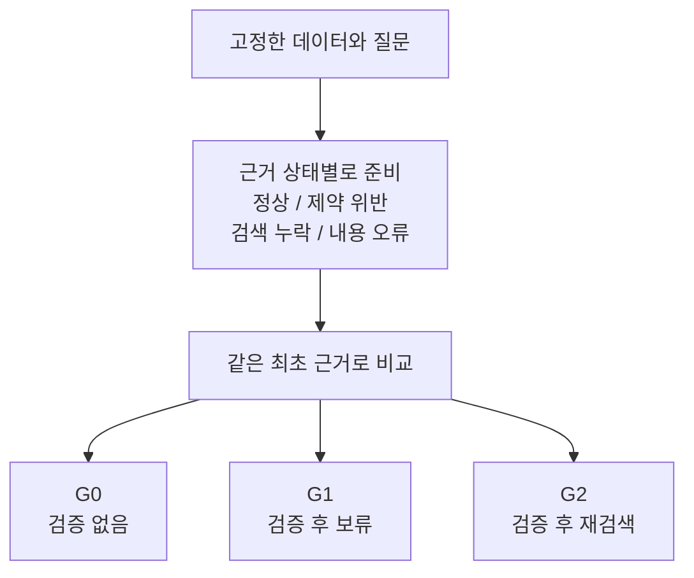

# 2026-10-12 — 블로그에서 실험으로: 연구 질문과 다음 방향

상태: 후속 실험 제안. 기존 실험 명세 0.1과 사전 점검 결과는 변경하지 않았다. 아래 추가 조건과 지표는 본 실험 전에 명세에 반영하고 확정해야 한다.

블로그 글 열 편을 함께 읽으면 관심의 흐름이 보인다. 온톨로지의 의미를 설명하는 데서 시작해 그래프를 만들고 자연어로 질의하고 제약을 검사하고 답변의 출처를 확인하는 과정으로 이어진다. 이 연구에서는 그중 검색한 근거를 검사하는 단계에 집중하고자 한다. 검사가 잘못된 답을 줄이는지와 정상 근거까지 버리게 되는지를 같은 조건에서 확인하는 것이 우선이다.

## 연구 질문과 범위

제안하는 중심 질문은 **검색한 근거가 불완전할 때, SHACL 검증은 어떤 오류를 줄이고 어떤 정상 근거를 잘못 차단하는가?**이다.

[시리즈 1편](https://chaeeunsong.tistory.com/116)은 그래프 구조의 효과와 제약의 효과를 구분해야 한다는 문제를 제기한다. [4편](https://chaeeunsong.tistory.com/119)은 제약을 검색 과정에 적용하는 방법을, [5편](https://chaeeunsong.tistory.com/120)은 답변을 재검증할 기록과 평가를 다룬다. 이 세 관심사를 묶으면 검증 전후의 근거, 결정, 답변을 함께 비교하는 실험으로 좁힐 수 있다.

SHACL을 붙였다는 사실만으로 새 연구라고 주장하기는 어렵다. 검증이 유효한 오류와 원래 잡을 수 없는 오류를 구분하고 검색 범위가 좁아질 때 생기는 과잉 차단을 측정하는 데 기여 가능성이 있다. 기존 연구와의 차이는 원문·코드·실험 설정을 비교한 뒤 판단해야 한다.

## 발생 단계별 오류 유형

[그래프 구축 글](https://chaeeunsong.tistory.com/117)은 데이터 최신성을, [Text2SPARQL 글](https://chaeeunsong.tistory.com/118)은 실행은 되지만 의미가 틀린 질의를 다룬다. 같은 오답이어도 원인이 다르므로 한 가지 검증 점수로 합치면 개선 지점을 알기 어렵다.

| 위치 | 오류의 예 | 구분해서 확인할 방법 |
| --- | --- | --- |
| 원천·적재 | 변경된 정보가 아직 그래프에 반영되지 않음 | 데이터 시점과 갱신 이력 확인. SHACL 통과만으로 최신성 판정 불가 |
| 질의 | 없는 속성을 쓰거나 질문과 다른 방향으로 탐색 | 구문·어휘 검사와 실행 결과 평가. 타입이 맞아도 의도는 틀릴 수 있음 |
| 검색 범위 | 원본의 필수 관계가 검색 결과에서 빠짐 | 원본과 검색 부분 그래프를 대조하고 누락 원인 기록 |
| 근거 데이터 | 필수 값 누락, 잘못된 datatype, 제약에 어긋난 관계 대상 | 해당 shape로 검증하되 검증 대상과 주변 정보 범위를 고정 |
| 사실 내용 | 올바른 타입의 엉뚱한 회사가 연결됨 | 독립 정답이나 원천 자료와 대조. 구조 검사만으로는 구분 불가 |
| 답변 생성 | 근거에 없는 주장이나 잘못 결합한 설명 | 주장 단위로 근거의 지지 여부 평가 |

특히 필수 값이 없다는 결과는 그 값이 현실에 없다는 증거가 아니다. 검증에 전달한 데이터에 값이 없을 수도 있다. SHACL 보고서에 나타난 위반과, 평가자가 정한 실제 오류 원인을 따로 저장하는 편이 좋다. SHACL은 주어진 데이터 그래프를 shapes graph의 조건에 따라 검사한다. [W3C SHACL 명세](https://www.w3.org/TR/shacl/)를 기준으로 검증 범위를 정한다.

## 근거 상태별 검증·재검색 비교 설계

기존 명세의 G0·G1·G2를 유지하고 같은 질문의 근거를 다음처럼 나누는 방안을 제안한다. 아래는 후속 설계이며 아직 실행하지 않았다.



정상·변형 사례는 같은 원본에서 각각 만든다. 정보 누락 사례에서는 원본의 관계를 삭제하는 조작과 검색 결과에서만 제외하는 조작을 구분한다. 이 둘을 섞으면 데이터 오류와 검색 실패를 구별할 수 없다. 제약을 만족하는 내용 오류도 넣어 SHACL이 잡지 못하는 사례를 함께 보고한다.

질문에 답할 근거와 제약을 검사하는 데 필요한 주변 정보도 구분한다. 예를 들어 대상의 타입이나 다른 관계 값이 검사에 필요하다면, 이를 어느 범위까지 추가할지 미리 정한다. 추가 검색량과 검증 시간도 비용에 포함한다. 반환된 노드에 타입 정보가 없어서 검증 대상 선택 자체가 빠지는 경우도 확인해야 한다.

shape는 개발용 데이터와 도메인 규칙을 보고 작성하고 평가용 질문·정답을 보고 수정하지 않는다. 파일럿에서 수정했다면 별도 평가 집합을 고정한 뒤 본 실험을 진행한다. 개발·평가 분리 단위와 중복 방지 방법도 명세에 남길 필요가 있다.

G0와 G1은 같은 검색 결과를 재사용해 검증과 보류의 효과를 본다. G2는 위반 보고서로 재검색하므로 추가 연산의 효과가 섞인다. 기존 명세의 동일 검색 호출 수 비교를 구체화해 위반 보고서를 받지 않고 같은 예산으로 다시 검색하는 조건을 보조 비교군으로 두는 방안을 제안한다.

## 평가 지표와 해석 기준

잘못된 근거를 더 많이 막았더라도 정상 근거를 대거 버리면 좋은 결과라고 하기 어렵다. 답한 질문만으로 정확도를 계산하면 보류를 많이 하는 조건이 유리해질 수도 있다.

| 측정 대상 | 함께 볼 값 |
| --- | --- |
| 근거 검사 | 오류 유형별 검출률, 정상 근거 오탐률, 위반 위치·종류 일치 |
| 최종 답변 | 전체 질문 기준 정확도, 응답한 질문 기준 정확도, 응답률·보류율·실패율 |
| 근거 지지 | 인용한 근거가 실제 주장 내용을 뒷받침하는 비율 |
| 운영 비용 | 추가 검색량, 토큰·API 비용, 검증 시간과 전체 시간의 p50·p95 |
| 불완전한 검색 | 누락 원인별 보류와 복구, 주변 정보 추가량에 따른 변화 |

기존 명세의 근거 검증가능률은 참조가 유효하고 제약을 통과했는지를 센다. 이 값과 자연어 주장이 근거의 지지를 받는 비율은 다르다. 참조 ID가 존재한다고 해서 그 문장이 참이거나 근거에서 따라오는 것은 아니다. 구조화된 답은 미리 정한 필드로 대조하고, 자유 서술은 독립적인 평가 기준과 사람 검토 범위를 정해야 한다.

표본 수, 반복 횟수, 허용할 비용과 정상 근거 손실은 파일럿 뒤 본 실험 전에 확정한다. 비교는 질문 단위로 짝을 맞추고 충분한 표본을 확보하면 불확실성도 함께 보고한다. 아직 목표 정확도나 개선율을 성과 수치처럼 제시하지 않는다.

검출률은 늘지만 전체 질문의 답변 정확도가 떨어진다면, 차단 규칙이나 검색 범위를 재검토한다. 추가 검색만으로 비슷하게 개선된다면 보고서 기반 복구의 이점은 제한적이라고 기록한다. 효과가 없었던 조건도 결과로 남긴다.

## 답변 재검증을 위한 출처·이력 기록

[검증과 평가 글](https://chaeeunsong.tistory.com/120)의 질의·탐색·검증 기록을 후속 실험의 실행 단위에 연결하는 방향을 제안한다. 변경되는 그래프에서 재현하려면 질의와 실행 시각 외에 데이터 스냅샷, shapes 버전, 추론·엔진 설정도 필요하다.

```text
run(question_id, data_snapshot)
  -> retrieve(query, engine_config, evidence_ids)
  -> validate(shape_version, inference_config, report)
  -> decide(use | abstain | retry)
  -> answer(claims, citations, model_config)
  -> evaluate(gold_version, correctness, support, cost)
```

이는 구현할 기록 구조의 예시다. 현재 사전 점검은 입력·shapes·보고서·환경 정보를 보관하지만 위의 질의 생성과 답변 평가 전체를 실행하지는 않는다. 평가용 정답은 생성 모델이나 복구 과정에 전달하지 않는다.

출처 기록이 있으면 실패를 되짚을 수 있다. 기록 자체가 답변의 사실성을 증명하지는 않으므로, 재현 가능성과 정확성은 별도 결과로 제시한다.

## 진행 순서와 확장 범위

| 순서 | 우선 남길 산출물 | 범위 |
| --- | --- | --- |
| 1단계 | 데이터 배포 정보·체크섬, 질문 예시, shapes 목록, 누락 처리 기준 | 기존 계획대로 YAGO 4.6의 작은 슬라이스부터 검토 |
| 2단계 | 고정 질문·정답·검색·모델·prompt 설정과 R0·G0 결과 | 그래프 검색 자체의 기본 오류 확인 |
| 3단계 | 같은 근거의 G0·G1 비교, G2와 예산을 맞춘 재검색 비교 | 검증의 효과, 과잉 차단, 복구 비용 측정 |
| 4단계 | 검증 위치와 엔진 설정을 맞춘 비교 | 의미가 일치하는지 확인한 뒤 내부·외부 검증 비교 |
| 후속 도메인 실험 | Synthea 데이터 버전과 변환 코드, 도메인 질문·정답 | 앞선 결과를 다른 데이터에서도 확인할 때 검토 |

[Synthea 구축 글](https://chaeeunsong.tistory.com/121)은 질문에서 시작해 온톨로지와 그래프를 만드는 구체적인 연결점이다. 다만 해당 글의 별도 구축 경험을 현재 저장소에서 재현한 것으로 보지는 않는다. 지금 YAGO 계획을 교체하기보다는, 코드와 데이터 생성 조건을 확보한 뒤 도메인 실험 후보로 검토하는 편이 낫다. 두 데이터셋에서 처음부터 같은 실험을 병행하면 준비 비용과 원인 분석 범위가 커진다.

OWL 추론, hop별 탐색 제어, OBDA, 여러 DB의 성능 비교는 중심 실험 뒤에 순서대로 확장한다. 한 번에 도입하면 어느 변경이 효과를 냈는지 해석하기 어렵다. OWL의 domain/range를 닫힌 세계의 입력 거부 규칙처럼 취급하지 않고 추론 설정과 SHACL 검사를 분리한다. [OWL 2 Primer](https://www.w3.org/TR/owl2-primer/)를 기준으로 실험 가정을 명시한다.

## 운영 플랫폼·데이터 거버넌스와의 연결

[Palantir 글](https://chaeeunsong.tistory.com/123)은 데이터 모델이 업무 행동과 연결되는 모습을 설명한다. Palantir 공식 문서도 Ontology를 객체·관계의 의미와 actions·functions 같은 동작을 함께 다루는 운영 계층으로 소개한다. RDF·LPG와 플랫폼 전체를 같은 수준의 대안으로 비교하기보다는, 데이터 표현과 운영 기능을 나누어 보는 편이 정확하다. [Palantir Ontology 개요](https://www.palantir.com/docs/foundry/ontology/overview)를 참고했다.

현재 연구의 범위는 검색 근거의 검사와 답변 평가다. 실제 업무 action을 실행하려면 권한, 승인, 상태 변경과 실패 복구를 별도로 다뤄야 한다. 이를 SHACL 통과 여부로 대신하지 않는다. Palantir 내부 저장 방식이나 구현을 추정해 연구의 비교 기준으로 삼지도 않는다.

[데이터 조직 로드맵 글](https://chaeeunsong.tistory.com/122)에서는 신뢰할 데이터와 지표, 리니지를 준비하는 일이 AI 활용에 앞선다는 문제의식을 가져올 수 있다. 이 연구에서는 이를 데이터·규칙의 버전과 판단 근거를 남기는 방식으로 연결한다. 글에 등장하는 기업들을 대상으로 새로운 실증 조사를 수행한 것은 아니다.

## 관련 연구 검토와 재현 조건

[논문 개관 글](https://chaeeunsong.tistory.com/114)은 탐색 지도로 활용하고 비교 실험에 넣을 논문부터 원문·코드·버전·평가 데이터·검증 위치를 표로 대조하는 것이 좋다. 넓은 목록만으로 차별성이나 재현 가능성을 확정하지 않는다.

[SPARQL-LLM 리뷰](https://chaeeunsong.tistory.com/115)는 질의 예시와 가벼운 메타데이터를 이용하는 질의 생성 비교군의 후보를 제공한다. 다만 질의 생성의 개선과 검색된 근거에 대한 SHACL 검증 효과는 따로 비교해야 한다. 원문은 블로그 리뷰 작성 이후 v2로 개정됐다. 후속 비교에서는 [논문 버전](https://arxiv.org/abs/2512.14277)과 코드 commit을 고정하고 리뷰의 수치를 다른 버전의 실험 조건과 섞지 않는다.

다음 작업으로는 1단계용 데이터 범위와 함께 작은 질문 목록, 질문별 필요한 관계, 검사할 shape, 누락 시 판정 기준을 한 표에 적는 것을 제안한다. 이 표가 준비되면 답할 수 있는 질문과 검증할 수 있는 조건을 구분해 명세의 다음 버전에 반영할 수 있다.
