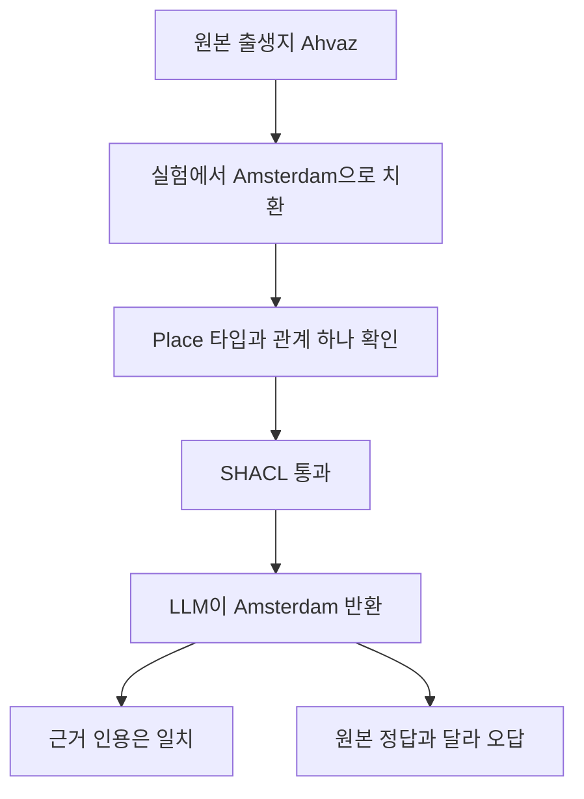

# YAGO 질문·근거·답변의 실제 사례

남은 오답 3건은 장소의 타입과 관계 개수는 맞지만 출생지로 연결된 장소가 틀린 사례다. 검증기가 의미를 전혀 검사하지 않은 것은 아니다. Person과 Place의 구분은 검사했지만 그 사람이 실제로 그 장소에서 태어났는지는 확인하지 못했다.

아래 사례는 실행 `20261012T123009Z-yago-selective-abb7e636`의 저장된 요청·응답·근거에서 추출했다. 새 답변을 생성하지 않았다. 오류는 실험용 복사본에 주입했으며 YAGO에서 자연 발생한 오류를 발견했다는 뜻은 아니다. 정답 기준은 주입 전 YAGO 스냅샷이다.

## 비교 조건과 읽는 방법

G0는 검증 없이 답한다. G1은 SHACL 위반이 있으면 답변을 막는다. S2는 출생지 질문에 관련된 위반만 차단하고 필요한 관계가 부족하면 같은 원천을 다시 읽는다.

모델의 실제 출력은 문장형 답변이 아니라 URI와 근거 ID를 담은 JSON이다. 표의 한국어 질문은 원래 영문 질문을 설명한 것이고 짧은 장소명은 URI의 마지막 부분이다. LLM을 호출하지 않은 보류는 모델의 응답과 구분해 표시했다. 근거 ID는 각 요청 안에서만 유효하므로 서로 다른 사례의 E002를 같은 사실로 해석하지 않는다.

## 제약을 통과한 사실 오류 3건

| 질문의 한국어 설명 | 주입 전 정답 | S2가 실제 반환한 값 | 인용 | SHACL / 정답 판정 |
| --- | --- | --- | --- | --- |
| Abu Nuwas의 출생지는? | Ahvaz | Amsterdam | E002 | 통과 / 오답 |
| Annette Salmeen의 출생지는? | Ann_Arbor_Michigan | Amsterdam | E011 | 통과 / 오답 |
| Anne Hutchinson의 출생지는? | Alford_Lincolnshire | Amsterdam | E011 | 통과 / 오답 |

세 인물의 출생지를 모두 Amsterdam으로 바꿨다. 서로 다른 3종의 실패가 아니라 같은 사실 오류 유형을 인물 3명에 적용한 결과다. Amsterdam은 클래스 경로를 따라 Place로 확인되고 출생지 관계도 하나뿐이어서 원본 SHACL과 충분성 검사를 통과했다. S2는 세 경우 모두 재검색하지 않았다.

Abu Nuwas 사례의 실제 질문은 다음과 같다.

```text
What is the birthPlace URI of http://yago-knowledge.org/resource/Abu_Nuwas?
```

모델에 전달한 근거 중 E002는 다음과 같다. 전체 요청에는 인물·장소의 타입과 라벨도 포함되어 있다.

```text
[E002] <http://yago-knowledge.org/resource/Abu_Nuwas> <http://schema.org/birthPlace> <http://yago-knowledge.org/resource/Amsterdam> .
```

실제 모델 응답을 JSON으로 정렬하면 다음과 같다.

```json
{
  "status": "answer",
  "kind": "birthPlace",
  "value": "http://yago-knowledge.org/resource/Amsterdam",
  "evidence_ids": ["E002"]
}
```



이 경우 모델은 제공된 잘못된 근거를 그대로 따랐다. 근거에 없는 장소를 새로 지어낸 답변과는 다르다. 평가 기록의 `supported: true`는 인용한 트리플에 답변 값이 있다는 뜻이고 `correct: false`는 주입 전 정답과 다르다는 뜻이다. 사실 오류를 별도로 평가해야 하는 이유가 이 차이에 있다.

## 같은 질문에서 달라진 답변과 보류

아래는 모두 Abu Nuwas의 출생지를 묻는 같은 질문이다. 원본 정답 URI는 `http://yago-knowledge.org/resource/Ahvaz`다. 데이터 상태와 처리 조건만 바꿨다.

| 근거 상태 | 실제 처리와 출력 | 판단 근거 |
| --- | --- | --- |
| 정상 근거 | S2: Ahvaz 답변, E002 인용 | 필요한 관계가 하나이고 Place 타입 확인 |
| 출생일을 xsd:string으로 변형 | G1: 시스템이 보류, LLM 호출 안 함 | birthDate의 OrConstraintComponent 위반 |
| 같은 출생일 오류 | S2: Ahvaz 답변, E002 인용 | 출생일 오류를 기록하되 출생지 답변은 허용 |
| 검색 결과에서만 출생지 누락 | G1: LLM이 abstain 반환 | SHACL은 통과했지만 모델에 출생지 관계가 없음 |
| 같은 검색 누락 | S2: 한 번 추가 조회 후 Ahvaz 답변, E002 인용 | 원천에 남아 있는 관계를 복구 |
| 출생지 자리에 인물 Anthony_Sweijs 연결 | G0: Anthony_Sweijs를 출생지로 답변, E002 인용 | 검사 없이 제공된 관계를 따름, 오답 |
| 같은 잘못된 클래스 | S2: 한 번 추가 조회 후 시스템이 보류, LLM 호출 안 함 | ClassConstraintComponent 위반이 원천에도 남음 |
| 원천에서도 출생지 제거 | G0: LLM이 abstain 반환 | 제공된 근거에 출생지 관계가 없음 |
| 같은 원천 누락 | S2: 한 번 추가 조회 후 시스템이 보류, LLM 호출 안 함 | 다시 읽어도 필요한 관계를 확인하지 못함 |

출생일 오류에서는 SHACL 전체 판정이 실패해도 S2가 답했다. 이는 검사를 건너뛴 것이 아니라 출생지 답변을 막을 오류로 분류하지 않은 결과다. 반대로 인물을 출생지로 연결한 경우는 질문의 답 자체에 문제가 있어 차단했다.

보류 출력은 두 경로에서 같은 JSON 형식을 사용한다.

```json
{"status":"abstain","kind":null,"value":null,"evidence_ids":[]}
```

G1의 검색 누락과 G0의 원천 누락에서는 LLM이 위 내용을 반환했다. S2의 원천 누락·클래스 오류에서는 시스템이 LLM 호출 전에 같은 형식의 결과를 기록했다. `retrieval_calls: 2`는 첫 검색 1회와 추가 조회 1회를 합친 수다. 원천에 없다는 판정은 현재 스냅샷에서 확인할 수 없다는 뜻이며 현실에서 출생지가 없다는 뜻은 아니다.

## 원본 기록과 재확인

[사례별 실제 요청·모델 출력·근거 JSON](../experiments/records/20261012T123009Z-yago-selective-abb7e636-samples.json)에 표에 사용한 12개 실행을 모았다. `request: null`이면 LLM을 호출하지 않았다. `graphs`에는 오류를 반영한 사례별 원천, 첫 검색 근거, 최종 근거가 들어 있다. 모델을 호출한 경우 응답 원문을 보존하고 파싱 결과가 실행 기록과 일치하는지 확인했다.

자료는 [YAGO 4.6](https://yago-knowledge.org/downloads/yago-4-6), YAGO team, Télécom Paris에서 가져왔으며 [CC BY 4.0](https://creativecommons.org/licenses/by/4.0/)을 따른다. 타입 검사만으로 현실의 사실을 판별한 결과나 독립적인 사실 감사로 해석하지 않는다.

[전체 비교 결과](2026-10-12-yago-selective.md) · [전체 실행 JSON](../experiments/records/20261012T123009Z-yago-selective-abb7e636.json)
