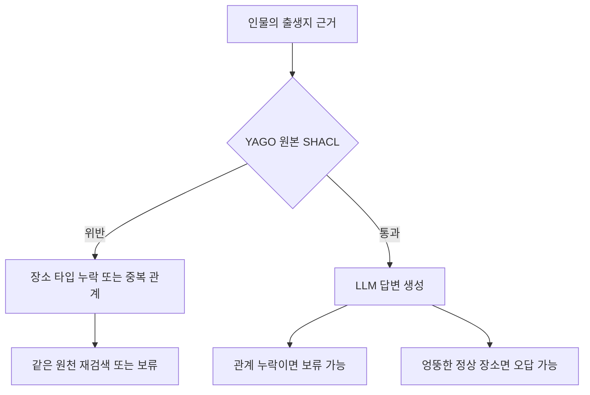

# YAGO 원본 SHACL 파일럿

## 데이터와 제약

YAGO는 RDF 데이터와 SHACL 스키마를 함께 배포한다. 이번에는 [YAGO 4.6 공식 배포](https://yago-knowledge.org/downloads/yago-4-6)의 schema와 tiny를 내려받아 출생지 질의를 실행했다. GLEIF에서 직접 정의한 제약과 달리 원본 SHACL을 수정하지 않았다. 두 데이터셋의 질문과 제약이 다르므로 정확도를 직접 비교하지 않는다.

배포 파일은 약 91 MB이며 tiny 전체를 실험 표본으로 사용한 것은 아니다. 파일 순서에서 조건에 맞는 인물 4명을 고르고 첫 1명은 개발, 나머지 3명은 파일럿으로 나눴다. 인물·장소의 실제 사실 38개와 클래스 경로 문맥 195개를 사용했다. 클래스 경로의 양 끝에는 RDFS 의미에 따른 클래스 선언을 추가했다. 정상 자료의 사실과 원본 제약을 고친 것은 아니다. 표본은 작고 일부 다른 인물·장소를 오류 주입 대상으로 함께 사용하므로 개체가 완전히 분리된 평가도 아니다.

| 인물 | YAGO에 기록된 출생지 | 용도 |
| --- | --- | --- |
| Anthony Sweijs | Amsterdam | 개발 |
| Abu Nuwas | Ahvaz | 파일럿 |
| Annette Salmeen | Ann Arbor, Michigan | 파일럿 |
| Anne Hutchinson | Alford, Lincolnshire | 파일럿 |

출처는 YAGO team, Télécom Paris이며 라이선스는 [CC BY 4.0](https://creativecommons.org/licenses/by/4.0/)이다. 원본 URL·다운로드 시각·SHA-256과 파생 과정은 저장소의 `experiments/yago/manifest.json`과 `NOTICE.md`에 남겼다.

## 원본 제약의 탐지 범위

출생지는 `schema:Place`여야 하고 최대 하나여야 한다. 그러나 출생지가 반드시 존재해야 한다는 `sh:minCount`는 없다. 다음 차이는 원본 제약을 유지했기 때문에 드러난다.



타입과 개수 제약을 만족해도 사실이 맞는지는 별도 문제다. 검색에서 출생지 관계가 빠져도 원본 제약은 통과한다. 이때 위반이 있어야 재검색하는 G2는 움직이지 않는다. 반대로 출생일의 자료형 오류는 출생지 답변에 직접 필요하지 않아도 검증 실패를 일으킨다.

인물마다 정상, 라벨 누락, 출생지 관계 누락, 장소 타입 누락, 출생지 중복, 잘못된 대상 클래스, 잘못된 날짜 자료형, 다른 정상 장소로 치환하는 변형을 적용했다. 검색 누락만 원본 재조회로 복구할 수 있다. 원천에 주입한 오류는 같은 원천을 다시 읽어도 남는다.

## 실행 결과

인물 3명 × 8가지 상태의 24개 사례에 6개 조건을 적용해 144개 결과를 기록했다. 원본 SHACL의 기대 판정과 Python 판정이 각각 24/24 일치했다. 모델은 `openai/gpt-4o-mini`이며 API·파싱 오류는 0건이었다.

| 조건 | 정답 / 전체 | 보류 | 응답 중 정답 |
| --- | --- | --- | --- |
| R0 | 12/24 | 6 | 12/18 |
| G0 | 12/24 | 6 | 12/18 |
| G1 | 3/24 | 18 | 3/6 |
| G2 | 9/24 | 12 | 9/12 |
| U2 | 15/24 | 3 | 15/21 |
| P1 | 3/24 | 18 | 3/6 |

R0는 동일 근거의 텍스트 표현, G0는 RDF 근거, G1은 SHACL 후 보류, G2는 SHACL 후 재검색, U2는 무조건 재조회, P1은 Python 검사 후 보류다.

OpenRouter 호출은 105회, 응답에 기록된 비용 합계는 0.01175835 USD였다. 개발 실행 비용은 별도다.

[전체 판정·답변·사용량](../experiments/records/20261012T120139Z-yago-2af3a4ef.md)

| 사례 | G0 정답 | G1 정답 | G2 정답 | U2 정답 |
| --- | --- | --- | --- | --- |
| clean | 3/3 | 3/3 | 3/3 | 3/3 |
| missing_label | 3/3 | 0/3 | 3/3 | 3/3 |
| missing_relation | 0/3 | 0/3 | 0/3 | 3/3 |
| missing_target_type | 3/3 | 0/3 | 3/3 | 3/3 |
| duplicate_relation | 0/3 | 0/3 | 0/3 | 0/3 |
| wrong_class | 0/3 | 0/3 | 0/3 | 0/3 |
| wrong_datatype | 3/3 | 0/3 | 0/3 | 3/3 |
| wrong_place | 0/3 | 0/3 | 0/3 | 0/3 |

## 해석과 다음 실험

SHACL은 데이터에 선언된 조건을 검사한다. 질의에 필요한 근거가 모두 있는지, 근거가 현실의 사실과 맞는지까지 자동으로 보장하지 않는다. 특히 YAGO의 출생지 제약에는 존재 조건이 없어서 검색 누락을 복구하려면 별도의 질의 완전성 검사가 필요하다.

다음 실험에서는 원본 SHACL, 질의별 근거 완전성 검사, 두 검사의 결합을 구분한다. 출생일처럼 현재 답에 직접 쓰이지 않는 속성의 위반은 전체 보류와 선택적 보류로 나눠 비교할 수 있다. 이번 결과를 본 뒤 세운 후속 가설이며 이번 표본의 판정 기준을 바꾸지는 않는다.

현재 결과는 고정 SPARQL, 주어진 개체 URI, 구조화된 단일 관계 답변의 탐색 파일럿이다. Text2SPARQL, 다중 홉 추론, 전체 YAGO, GraphDB의 성능을 측정하지 않았다. 정답도 독립적인 현실 감사가 아니라 주입 전 YAGO 스냅샷이다. 조건당 한 번 실행했으므로 통계적 우열을 주장하지 않는다.

## 검증기 점검과 재현

사전 점검 두 번에서 검증 범위 설정의 오류를 발견했다. 첫 실행은 중첩 날짜 제약을 누락했고 두 번째는 클래스 문맥에서 생략된 라벨까지 오류로 집계했다. 두 실패를 보존하고 전체 검사 후 질의 인물·출생지의 최상위 결과를 추리도록 수정했다. [검증 범위 시행착오](../lessons-learned/2026-10-12-yago-focus.md)에 원인을 남겼다. 전체 스키마 55개 NodeShape, 5,536개 트리플을 전달하지만 판정은 질의 근거 범위에 한정된다. OWL 추론은 사용하지 않았다.

```bash
uv run --locked python scripts/run_yago_pilot.py --split development --validate-only
uv run --locked python scripts/run_yago_pilot.py
uv run --locked python -m unittest discover -s tests
```

전체 배포 파일 재수집은 `scripts/download_yago.py`, 부분집합 재구성은 `scripts/prepare_yago.py`로 실행한다. 공개된 작은 입력만으로도 파일럿을 재실행할 수 있다. 실행별 입력 사본, 근거, 검증 보고서, LLM 요청·응답은 로컬 `runs/`에 남기고 판정·답변·사용량을 담은 JSON을 공개한다.

[실험 명세](../experiments/specification.md) · [실행 기록](../experiments/records/index.md)
