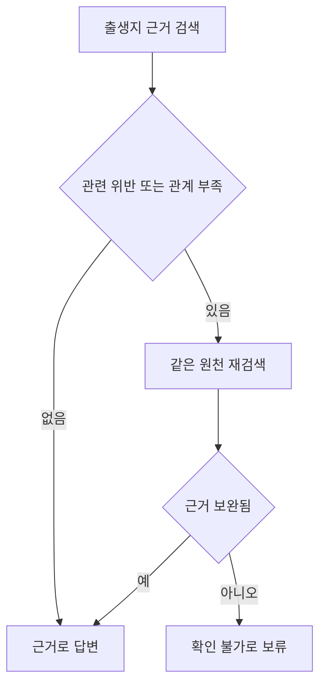

# 불완전한 YAGO 근거의 선택적 검증

YAGO 원본 SHACL을 사용하는 첫 실험에서는 답할 수 있는 출생지 질문도 출생일·라벨 오류 때문에 보류했다. 이번에는 데이터를 완전하게 정리하지 않고, 발견한 오류 중 어떤 것을 답변 차단에 사용할지 바꿨다. [앞선 파일럿](2026-10-12-yago-pilot.md)의 결과를 보고 설계한 후속 탐색 실험이다.

## 비교 조건

기호는 진행 단계가 아니라 서로 다른 답변 처리 방식이다. 같은 인물과 근거를 아래 7가지 방식으로 처리한다.

| 조건 | 처리 방식 |
| --- | --- |
| G0 · 검증 없음 | 검색한 근거로 바로 답변 |
| G1 · 일괄 차단 | SHACL 위반이 있으면 보류 |
| G2 · 일괄 재검색 | 위반 근거를 다시 검색하고 재검사 |
| U2 · 무조건 재조회 | 검사 결과와 관계없이 한 번 더 조회 |
| S1 · 선택적 차단 | 출생지 질문에 관련된 위반만 답변 차단 |
| S2 · 선택적 차단과 누락 보완 | S1에 필요한 관계의 누락·중복 검사와 재검색 추가 |
| C2 · 충분성만 검사 | 관계가 정확히 하나인지 검사하고 재검색; SHACL 위반으로 차단하지 않음 |

S1과 G1을 비교하면 관련 없는 위반을 차단에서 제외한 효과를 확인한다. S2와 S1의 차이는 필요한 근거를 다시 찾아오는 과정이다. C2는 관계 개수만 확인해도 같은 결과가 나오는지 구분하는 비교군이다. 여기서 충분성은 출생지 관계가 정확히 하나 있다는 제한된 뜻이며 사실의 진실성까지 포함하지 않는다.

## 불완전한 근거의 처리

출생지 질의에서는 인물의 `schema:birthPlace` 위반을 차단 대상으로 정했다. 장소 타입이 잘못되거나 출생지가 중복되면 보류하거나 재검색한다. 출생일·라벨 오류도 검사하고 기록하지만 출생지 답변을 막지는 않는다. 이 경로는 사람이 사전에 정했으며 임의 질문에서 자동으로 관련성을 학습한 것은 아니다.



검색 결과에서만 관계가 빠졌다면 원천 재조회로 복구할 수 있다. 원천에도 없다면 정답을 만들어 넣지 않고 확인 불가로 남긴다. 현실에서 출생지가 없다는 주장이 아니라 현재 원천에서 확인하지 못했다는 판정이다. 중복 관계나 잘못된 타입도 같은 원천에 남아 있으면 재검색만으로 해결되지 않는다.

YAGO 4.6 원본 SHACL과 기존 인물 표본은 유지했다. 기존 8가지 상태에 원천에서 출생지 관계를 제거한 상태를 추가했다. 개발 인물 1명의 9개 상태로 사전 점검한 뒤, 파일럿 인물 3명 × 9개 상태 × 7개 조건을 실행했다. 원본은 [YAGO team, Télécom Paris의 YAGO 4.6](https://yago-knowledge.org/downloads/yago-4-6)이며 [CC BY 4.0](https://creativecommons.org/licenses/by/4.0/)을 따른다. 오류는 사례별 복사본에만 주입했다.

## 실행 결과

파일럿 27개 사례에서 189개 결과를 기록했다. 모델은 `openai/gpt-4o-mini`이며 SHACL 기대 판정과 Python 판정은 각각 27/27 일치했다.

| 조건 | 정답 | 오답 | 보류 | 불필요한 보류 / 15 |
| --- | --- | --- | --- | --- |
| G0 · 검증 없음 | 12 | 6 | 9 | 3/15 |
| G1 · 일괄 차단 | 3 | 3 | 21 | 12/15 |
| G2 · 일괄 재검색 | 9 | 3 | 15 | 6/15 |
| U2 · 무조건 재조회 | 15 | 6 | 6 | 0/15 |
| S1 · 선택적 차단 | 9 | 3 | 15 | 6/15 |
| S2 · 선택적 차단과 누락 보완 | 15 | 3 | 9 | 0/15 |
| C2 · 충분성만 검사 | 15 | 6 | 6 | 0/15 |

각 조건의 전체 분모는 27이다. 그중 15개 사례는 원천에서 올바른 출생지를 확인할 수 있어 불필요한 보류의 분모로 사용했다. 원천 누락 3개 사례의 보류는 정답 URI 응답 수와 별도로 평가한다.

API·파싱 오류는 0건이었다. OpenRouter 호출은 141회, 응답에 기록된 비용 합계는 0.01604010 USD다.

[전체 판정·답변·사용량](../experiments/records/20261012T123009Z-yago-selective-abb7e636.md)

| 사례 | G1 정답 | S1 정답 | S2 정답 | C2 정답 |
| --- | --- | --- | --- | --- |
| clean | 3/3 | 3/3 | 3/3 | 3/3 |
| missing_label | 0/3 | 3/3 | 3/3 | 3/3 |
| missing_relation | 0/3 | 0/3 | 3/3 | 3/3 |
| missing_target_type | 0/3 | 0/3 | 3/3 | 3/3 |
| duplicate_relation | 0/3 | 0/3 | 0/3 | 0/3 |
| wrong_class | 0/3 | 0/3 | 0/3 | 0/3 |
| wrong_datatype | 0/3 | 3/3 | 3/3 | 3/3 |
| wrong_place | 0/3 | 0/3 | 0/3 | 0/3 |
| source_missing_relation | 0/3 | 0/3 | 0/3 | 0/3 |

원천 누락(source_missing_relation) 행의 0은 정답 URI를 생성하지 않았다는 뜻이다. 보류의 적절성은 별도 지표로 확인한다.

[질문·검색 근거·모델 답변의 실제 사례](2026-10-12-yago-case-examples.md)에서 남은 오답 3건과 정답·보류 과정을 확인할 수 있다.

## 해석과 후속 범위

일괄 차단 G1은 원천에 답이 있는 15개 사례 중 12개를 보류했다. 질문과 관련된 위반만 차단한 S1에서는 이 수가 6개로 줄었고 누락 보완까지 수행한 S2에서는 0개였다. S2의 정답은 15개로 무조건 재조회 U2와 같았지만 오답은 6개에서 3개로 줄었다. 출생지 자리에 인물이 연결된 3개 사례를 타입 제약으로 차단한 차이다.

관계의 존재·유일성만 확인하는 C2도 정답 15개를 얻었다. 그러나 잘못된 클래스까지 걸러내지는 못해 오답이 6개 남았다. 이번 표본에서는 누락 보완이 정답 회복을, 타입 제약이 일부 오답 차단을 맡았다. 이는 선언된 타입 검사의 역할을 확인한 결과이며 같은 규칙을 Python으로 구현하는 방식보다 SHACL이 우월하다는 증거는 아니다.

원천 누락 3개 사례는 모든 조건에서 보류했다. S2만의 성과로 계산하지 않는다. 정상 Place를 다른 정상 Place로 바꾼 사실 오류 3개는 S2에서도 오답으로 남았다. 데이터를 모두 정리하지 않고도 불필요한 보류를 줄였지만 제약을 만족하는 사실 오류는 해결하지 못했다.

이번 표본은 앞선 결과를 보고 다시 사용한 인물 3명과 한 가지 질문 유형이다. 오류 상태도 사람이 주입했다. 실제 운영 데이터에서 자연 발생한 오류의 빈도나 임의 질문에 대한 효과로 일반화하지 않는다. 정상 형식의 다른 장소를 연결한 사실 오류는 원본 SHACL과 관계 개수 검사만으로 발견할 수 없다.

다음에는 다른 관계와 새 인물로 질문별 필요 근거를 실행 전에 정하고 관련성 규칙이 잘못 지정된 경우도 평가해야 한다. 오류를 차단할 책임과 근거 부족을 확인할 책임을 분리하되 사실 오류는 출처와 상충 근거를 대조하는 별도 실험으로 남긴다.

## 재현과 기록

```bash
uv run --locked python scripts/run_yago_selective.py --split development --validate-only
uv run --locked python scripts/run_yago_selective.py
uv run --locked python -m unittest discover -s tests
```

LLM에는 질문과 현재 근거만 전달한다. 정답과 사례 이름은 전달하지 않는다. 원본 스키마를 고치지 않고 검증 보고서에서 차단 대상을 추린다. C2에서도 감사용 SHACL 검사는 수행하지만 차단에는 쓰지 않으므로 실행 시간을 SHACL 없는 엔진 성능으로 해석하지 않는다.

[명세 0.4](../experiments/specification.md) · [실행 기록](../experiments/records/index.md)
