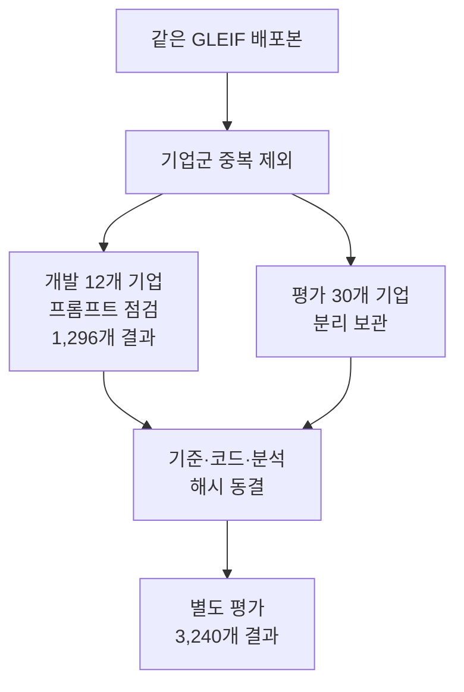

# 2026-10-13 GLEIF 확대 비교와 검사 도구의 역할

별도 평가에서 **코드 규칙과 SHACL+질문 정책의 결과가 같았다.** 각 조건 540회에서 정답 315회·오답 45회·보류 180회였으며 실행 오류는 없었다. SHACL의 추가 정확도 이득은 확인하지 못했다. SHACL+LLM은 오답을 더 줄이지 못하고 불필요한 보류를 35회 늘렸다.

개발 12개 기업·72개 사례와 별도 평가 30개 기업·180개 사례를 여섯 조건으로 세 번씩 실행했다. 개발 1,296개, 평가 3,240개의 결과 행을 얻었다. Jev는 개발 데이터에서만 별도로 216개 결과를 얻었고 실제 Neo4j/Cypher와 RDF/SPARQL의 근거도 대조했다. 세 번의 반복을 독립 기업 세 개로 세지는 않았다.

## 개발 조정과 별도 평가

개발의 작은 점검에서는 첫 모회사·보고 예외 기업 하나씩을 사용했다. v2 구조화 입력은 36회 중 정답 0회·보류 35회·오류 1회였다. 원시 사실만 준 v2도 36회 모두 보류했다. v3는 속성의 전체 IRI, 중복 계산 방지, 카디널리티 표를 명시했고 정답 18회·오답 3회·보류 15회를 얻었다.

동등 코드와 첫 판정이 일치한 횟수는 차례로 17/36, 9/36, 24/36이었다. 미리 정한 선택 기준에 따라 v3를 채택했다. 여러 요소를 함께 바꿨으므로 어느 문구가 개선을 만들었는지는 분리해서 말할 수 없다. 원시 입력에서도 실패했기 때문에 중복 표현만으로 앞선 실패를 설명하기도 어렵다. 모델 내부의 원인은 확인하지 않았다.

별도 평가 파일은 실행 직전까지 내용을 분석하지 않았다. 원천 세 파일과 평가 파일의 해시를 다시 확인하고 15개 입력 파일의 해시를 고정했다. 평가를 시작한 뒤 프롬프트나 검사 기준을 조정하지 않았다. [실행 요약과 입력 해시](../experiments/records/20261013-expanded-comparison.json)에 동결 시각과 기록을 보관했다.

## 별도 평가 결과

| 조건 | 전체 | 정답 | 오답 | 보류 | 오류 | 불필요한 보류 / 대상 | 추가조회 |
| --- | ---: | ---: | ---: | ---: | ---: | ---: | ---: |
| 무검증 | 540 | 225 | 135 | 180 | 0 | 90 / 315 | 0 |
| 코드 규칙 | 540 | 315 | 45 | 180 | 0 | 0 / 315 | 225 |
| SHACL+질문 정책 | 540 | 315 | 45 | 180 | 0 | 0 / 315 | 225 |
| 무조건 추가조회 | 540 | 315 | 135 | 90 | 0 | 0 / 315 | 540 |
| LLM | 540 | 215 | 45 | 280 | 0 | 100 / 315 | 28 |
| SHACL+LLM | 540 | 280 | 45 | 215 | 0 | 35 / 315 | 216 |

각 조건의 540회는 180개 변형 사례를 세 번씩 실행한 것이다. 정답은 답변을 실제로 낸 경우에만 센다. 따라서 적절한 보류까지 모두 오답으로 해석하면 안 된다. 불필요한 보류는 허용된 원천에 올바른 근거가 있었는데 답하지 않은 경우이며, 그 대상 행을 별도 분모로 표시했다.

코드와 SHACL은 답변뿐 아니라 사례·반복별 판정 경로도 540/540회 같았다. 두 조건의 오답 45회는 형식에 맞는 다른 모회사를 주입한 사례였다. LLM과 결합 조건의 오답도 같은 45회였다. 이 데이터에서는 검사를 추가하는 것보다 검사가 다룰 수 있는 오류의 범위가 더 큰 한계였다.

무조건 추가조회는 정답 315회를 얻었지만 오답도 135회 냈다. 조회를 더 하는 것만으로 타입 위반과 잘못된 예외 코드를 차단하지는 못했다. LLM 단독은 불필요한 보류가 100회, 결합 조건은 35회였다. 결합 조건은 LLM 단독보다 보류를 줄였지만 SHACL 단독에는 미치지 못했다. 이 차이를 모든 LLM이나 다른 질문으로 일반화하지 않는다.

전체 오답률과 불필요한 보류율은 기업별로 먼저 평균했다. 그 차이는 paired bootstrap으로 계산했다. 아래 값은 SHACL에서 비교 조건을 뺀 차이이며 단위는 퍼센트포인트다. 앞 표는 행 수를 합친 값이고 아래는 기업별 가중치를 같게 둔 값이다.

| 비교 | 지표 | 기업 평균 차이 | 95% 구간 |
| --- | --- | ---: | ---: |
| SHACL−코드 | 전체 오답률 | 0.00 | [0.00, 0.00] |
| SHACL−코드 | 불필요한 보류율 | 0.00 | [0.00, 0.00] |
| SHACL−LLM | 전체 오답률 | 0.00 | [0.00, 0.00] |
| SHACL−LLM | 불필요한 보류율 | -33.52 | [-42.78, -25.93] |

이 구간은 이번 편의 표본과 고정 변형 안에서 얻은 탐색 결과다. p값을 계산하지 않았으며 모집단의 우열이나 일반적인 동등성을 입증하지 않는다. 같은 형태의 변형을 여러 기업에 적용했으므로 사례 수만 늘었다고 질문의 다양성이 늘어난 것도 아니다. 공통 변형과 일부 대체 법인을 공유하므로 기업별 결과의 완전한 독립성도 가정하기 어렵다.

## 실제 질문과 판정 경로

### 검색 관계 누락

질의: **GATES FINANCE LIMITED** (`21380017P45XJ8NWYS77`)의 직접 회계연결 모회사 또는 보고 예외 코드. 아래는 반복 1회의 실제 기록이다.

원천에는 모회사 관계가 있지만 첫 검색에서 관계만 제거했다. LLM은 근거를 통과시켰으나 공통 추출기는 관계 후보가 없어 보류했다. SHACL 정책은 확인 불가로 처리해 원천을 다시 조회했다.

| 조건 | 실제 판정 경로 | 최종 출력 |
| --- | --- | --- |
| SHACL+질문 정책 | 확인 불가 → 추가조회 → 통과 | GATES INDUSTRIAL CORPORATION PLC (`549300S6K4FWUSB9KM27`) |
| LLM | 통과 | 보류 |
| SHACL+LLM | 확인 불가 → 추가조회 → 통과 | GATES INDUSTRIAL CORPORATION PLC (`549300S6K4FWUSB9KM27`) |

### 타입 근거 없이 맞힌 답

질의: **GATES FINANCE LIMITED** (`21380017P45XJ8NWYS77`)의 직접 회계연결 모회사 또는 보고 예외 코드. 아래는 반복 1회의 실제 기록이다.

모회사 링크와 식별자는 남기고 해당 노드의 타입 근거를 첫 검색에서 제거했다. LLM은 통과시켜 정답을 냈지만 필수 타입 확인을 건너뛰었다. SHACL 정책은 재조회로 타입 근거를 가져온 뒤 답했다. 정답 수만으로는 이 차이를 볼 수 없다.

| 조건 | 실제 판정 경로 | 최종 출력 |
| --- | --- | --- |
| SHACL+질문 정책 | 확인 불가 → 추가조회 → 통과 | GATES INDUSTRIAL CORPORATION PLC (`549300S6K4FWUSB9KM27`) |
| LLM | 통과 | GATES INDUSTRIAL CORPORATION PLC (`549300S6K4FWUSB9KM27`) |
| SHACL+LLM | 확인 불가 → 추가조회 → 통과 | GATES INDUSTRIAL CORPORATION PLC (`549300S6K4FWUSB9KM27`) |

### 원천 관계 누락

질의: **GATES FINANCE LIMITED** (`21380017P45XJ8NWYS77`)의 직접 회계연결 모회사 또는 보고 예외 코드. 아래는 반복 1회의 실제 기록이다.

관계 자체를 허용 원천에서 제거했다. 원천을 다시 조회해도 복구할 수 없으므로 보류가 적절한 사례다. 평가자가 가진 주입 전 값은 복구에 사용하지 않았다.

| 조건 | 실제 판정 경로 | 최종 출력 |
| --- | --- | --- |
| SHACL+질문 정책 | 확인 불가 → 추가조회 → 확인 불가 | 보류 |
| LLM | 통과 | 보류 |
| SHACL+LLM | 확인 불가 → 추가조회 → 확인 불가 | 보류 |

### 형식에 맞는 거짓 관계

질의: **GATES FINANCE LIMITED** (`21380017P45XJ8NWYS77`)의 직접 회계연결 모회사 또는 보고 예외 코드. 아래는 반복 1회의 실제 기록이다.

주입 전 스냅샷의 모회사는 **GATES INDUSTRIAL CORPORATION PLC** (`549300S6K4FWUSB9KM27`)다. 실험에서는 Entity 타입을 가진 다른 법인으로 관계를 바꿨다. 타입과 개수 조건이 맞으므로 형식 검사는 통과하지만 원래 값과 비교하면 오답이다.

| 조건 | 실제 판정 경로 | 최종 출력 |
| --- | --- | --- |
| SHACL+질문 정책 | 통과 | SEE RE Three s.r.o. (`097900BIIU0000167998`) |
| LLM | 통과 | SEE RE Three s.r.o. (`097900BIIU0000167998`) |
| SHACL+LLM | 통과 | SEE RE Three s.r.o. (`097900BIIU0000167998`) |

### 정상 보고 예외의 잘못된 차단

질의: **SEE RE Three s.r.o.** (`097900BIIU0000167998`)의 직접 회계연결 모회사 또는 보고 예외 코드. 아래는 반복 1회의 실제 기록이다.

근거에는 유효한 `NON_CONSOLIDATING` 보고 예외가 있었다. 모회사 링크가 없어도 완전한 답변인 계약인데 LLM은 위반으로 판정했다. 내부 원인은 확인하지 않았다.

| 조건 | 실제 판정 경로 | 최종 출력 |
| --- | --- | --- |
| SHACL+질문 정책 | 통과 | `NON_CONSOLIDATING` |
| LLM | 위반 | 보류 |
| SHACL+LLM | 위반 | 보류 |

[사례별 원시 근거와 항목별 판정](../experiments/records/20261013-expanded-samples.json)에서 실제 사실 목록과 응답을 함께 확인할 수 있다.

주입 전 GLEIF 값을 평가 정답으로 사용했다. 원래 관계와 다른 값을 넣은 사례는 실험자가 만든 오류이며 해당 기업에 실제 데이터 문제가 있다는 뜻이 아니다. SHACL은 원래 모회사를 알아내지 못했다. 이 구분이 있어야 형식 검사와 사실 확인의 역할을 혼동하지 않는다.

## Jev와 실제 Cypher 점검

Jev는 [OpenRouter Decisions API](https://openrouter.ai/docs/guides/community/jev)의 `typesafe/jev-1.13`을 호출했다. 항목별 확률에서 가장 큰 선택지를 사용했고 같은 통과·위반·확인 불가 규칙을 적용했다. 일반 채팅용 router 모델로 대체하지 않았다.

개발 72개 사례·3회 반복의 216개 결과는 코드 규칙·SHACL과 답변 및 판정 경로가 모두 같았다. 정답 126회, 오답 18회, 보류 72회였고 불필요한 보류와 실행 오류는 없었다. API 306회에 확인된 비용은 $0.025372998이었다. 이는 개발 데이터의 관찰이며 Jev의 별도 평가 성능이나 확률 보정을 검증한 결과는 아니다. 입력 직렬화와 모델 인터페이스도 LLM과 다르므로 이 결과만으로 일반적인 모델 우위를 말할 수 없다.

Neo4j Community 5.26.32에서는 노드 라벨·관계·속성을 실제로 적재한 뒤 고정 Cypher 질의를 실행했다. 개발 72개 사례 모두 RDF/SPARQL의 사실 목록과 일치했다. 조회 전 원천과 검색 누락을 적용한 뒤의 근거를 각각 대조했으며 점검 뒤 임시 컨테이너를 종료했다. HTTP 직렬화 등을 포함한 작은 로컬 실행이므로 엔진 속도 비교로 해석하지 않는다.

## 연구 가설의 조정

이번 계약에서는 RDF·SHACL에만 가능한 정확도 이득을 확인하지 못했다. 같은 규칙을 구현한 코드가 같은 결과를 냈고 Jev도 개발 범위에서 그 결과를 재현했다. 반대로 SHACL과 LLM을 결합한다고 불필요한 보류가 줄어드는 것도 아니었다.

다음 실험은 기업 수를 더 늘리는 것과 함께 계약의 종류를 넓혀야 한다. 같은 단일 홉 모회사 질문을 반복하는 현재 설계에서는 도구 사이의 차이가 드러날 여지가 작다.

- **규칙 변경과 유지보수:** 허용 코드나 관계 조건을 바꿀 때 코드·SHACL·모델 기준을 수정하는 양과 새 오류를 비교한다. 변경 과제와 평가 기준을 결과를 보기 전에 정한다.
- **계약 밖 사실 오류:** 형식에 맞는 잘못된 관계는 세 도구 모두 통과했다. 이후에는 독립 출처나 시간·상태 근거를 별도로 넣되 평가 정답을 검색 원천처럼 사용하지 않는다.
- **다른 질문과 데이터:** YAGO 원본 SHACL로 도메인을 옮기고 다중 홉이나 복수 후보 질의를 추가한다. 이미 본 파일럿을 새 평가 집합으로 취급하지 않는다.

이 가운데 다음 우선순위는 규칙 변경 과제와 새 질문 계약이다. 현재 결과를 SHACL의 승패로 끝내기보다 정확도가 같을 때 어떤 표현과 도구가 변경·추적·설명에 유리한지 검증할 필요가 있다. 추천이나 감사 응용의 유용성은 아직 측정하지 않았다.

## 비용과 기록

이번 확대 작업에서 시도한 API 호출은 2,214회다. 응답에 기록된 비용 합계는 **$0.363002838**, 보수적으로 예약한 금액은 **$3.340731**이다. 예약액은 실제 청구액이 아니다. 사전에 정한 3,200회·예약액 $5 안에서 실행했으며 AWS와 Codex 비용은 별도다.

표본 제한 옵션을 빠뜨려 중단한 실행도 보존했다. 정상 응답을 받지 못한 호출 한 건의 실제 청구액은 확정하지 않았으며 예약액을 반환하지 않았다. [중단과 결과 보존 기록](../lessons-learned/2026-10-13-expanded-run-integrity.md)에 원인과 재발 방지 조치를 남겼다.

[전체 실행 기록](../experiments/records/20261013-expanded-comparison.md)에서 개발·평가·Jev의 결과 행을 내려받을 수 있다. [네 카드 구조도](../experiments/preview/index.html)는 설명용 애니메이션을 유지하고 실제 측정값은 별도로 표시한다.
