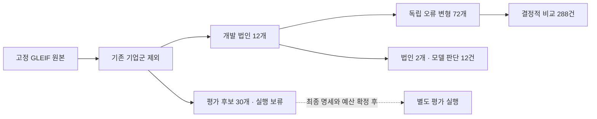

# 2026-10-13 — GLEIF 새 개발 집합과 첫 비교 실행

새 연구계획의 첫 개발 실행을 마쳤다. 이번에는 기존 파일럿과 연결된 기업군을 제외해 데이터를 새로 뽑고 같은 질문·근거에 코드 규칙과 SHACL을 적용했다. 작은 LLM 판단 실행도 별도로 진행했다. 평가 후보 30개는 아직 실행하지 않았다.

## 실행 범위와 표본 분리

같은 시점의 GLEIF Golden Copy 세 파일을 사용했다. LEI 3,458,852행, RR 490,833행, REPEX 6,411,075행과 파일 SHA-256을 다시 확인했다. 기존 법인·모회사가 속한 연결 기업군을 제외하고 기업군당 중심 법인 하나를 선택했다. 개발은 모회사 사례 6개와 보고 예외 사례 6개, 평가 후보는 각각 15개다.

각 종류의 최초 10,000개 발견 후보 안에서 고정 seed로 순위를 정한 편의 표본이다. 개발 예외는 NATURAL_PERSONS 4개, NON_CONSOLIDATING 2개이며 모든 보고 예외 유형을 대표하지 않는다. 모델 스모크는 종류별 첫 법인 하나만 사용했다.

상세 조건은 [명세 0.5-dev1](../experiments/specification.md), 원시 판정과 근거는 [실제 사례 JSON](../experiments/records/20261013-gleif-comparison-samples.json)에 있다. 원본·개발·평가 후보 파일은 분리했고 실행기는 개발 표시가 없는 집합을 거부한다. 이 분리는 작업 절차와 코드의 제한이며 별도 운영체제 접근 통제를 뜻하지 않는다.

## 코드 규칙과 SHACL의 동일한 결과

법인 12개에서 만든 72개 사례를 네 조건으로 실행했다. 오류 주입 비율은 실험자가 정한 것이므로 실제 데이터의 오류 빈도와 다르다.

| 조건 | 정답 / 72 | 오답 / 72 | 보류 / 72 | 실패 | 불필요한 보류 / 42 | 추가조회 |
| --- | ---: | ---: | ---: | ---: | ---: | ---: |
| 무검증 | 30 | 18 | 24 | 0 | 12 | 0 |
| 코드 규칙 | 42 | 6 | 24 | 0 | 0 | 30 |
| SHACL + 질문별 정책 | 42 | 6 | 24 | 0 | 0 | 30 |
| 무조건 1회 재조회 | 42 | 18 | 12 | 0 | 0 | 72 |

불필요한 보류의 분모는 42다. 허용된 원천에서 올바른 계약 근거를 얻을 수 있는 사례가 여기에 해당한다. 원천 자체의 정보 누락·타입 오류·다른 모회사 치환 등을 이 분모에 넣지 않았다.

이 계약에서 코드와 SHACL은 같은 결과를 냈다. 무조건 재조회와 정답 수는 같았지만 타입 위반과 잘못된 예외 코드를 차단해 오답을 줄였다. 다만 다른 정상 법인으로 모회사를 치환한 6건은 두 검사 모두 통과했다. 이 오답은 별도 정답 대조로 확인한 것이며 SHACL이 찾아낸 오류가 아니다.

RDF/SPARQL과 LPG 참조 표현의 공통 근거는 72/72 사례에서 일치했다. LPG는 같은 사실을 속성·라벨·엣지로 바꿔 메모리에서 탐색한 구현이다. Neo4j나 Cypher를 실행한 결과로 읽어서는 안 된다.

## 같은 12개 사례에서의 모델 판단

모델 실행과 비교할 때는 결정적 비교 결과도 같은 법인 2개·12개 사례로 제한했다. 모델은 답을 생성하지 않고 검사 항목과 종합 상태를 판단했다. 최종 값은 모든 조건에서 같은 결정적 추출기가 만들었다.

| 조건 | 정답 / 12 | 오답 / 12 | 보류 / 12 | 실패 | 불필요한 보류 / 7 | 추가조회 |
| --- | ---: | ---: | ---: | ---: | ---: | ---: |
| 무검증 | 5 | 3 | 4 | 0 | 2 | 0 |
| 코드 규칙 | 7 | 1 | 4 | 0 | 0 | 5 |
| SHACL + 질문별 정책 | 7 | 1 | 4 | 0 | 0 | 5 |
| 무조건 1회 재조회 | 7 | 3 | 2 | 0 | 0 | 12 |
| LLM 판단 | 3 | 1 | 8 | 0 | 4 | 0 |

요청 모델은 openai/gpt-4o-mini, 응답 제공자는 Azure이며 1회 실행이다. 두 법인의 작은 개발 스모크만으로 LLM 전반이 규칙보다 나쁘다고 결론 내리지 않는다. 코드 계약과 모델의 최초 종합 판정은 5/12건에서 일치했다. 이 일치율도 사실 정확성이 아니라 미리 정한 판정 계약에 얼마나 일치하는지를 나타낸다.

## 실제 판정이 갈린 사례

아래 사례의 질문은 해당 법인의 직접 회계 연결 모회사 또는 보고 예외 코드다. 각 사례의 실제 LEI·근거·항목별 판정은 연결된 JSON에서 확인할 수 있다.

| 근거 상태 | 코드·SHACL | 모델의 실제 판단 | 최종 차이 |
| --- | --- | --- | --- |
| 검색에서 모회사 관계 누락 | 확인 불가 → 재조회 → 충족 | cardinality를 fail로 판단 | 모델은 재조회 없이 보류 |
| 검색에서 모회사 법인 타입 누락 | 확인 불가 → 타입 재조회 | parent_type을 pass로 판단 | 답은 맞았지만 요구한 타입 확인을 생략 |
| 정상 NATURAL_PERSONS 보고 예외 | 충족 → 예외 코드 답변 | exception_reason은 pass, cardinality는 fail | 정상 근거인데 보류 |
| 정상 법인으로 다른 모회사 연결 | 충족 | 충족 | 모두 같은 오답을 답변 |

모델이 ‘위반’으로 판단하면 공통 정책은 즉시 보류한다. 이번 실행에서는 모델이 확인 불가를 한 번도 반환하지 않아 추가조회도 0회였다. 정상 보고 예외를 보류한 내부 원인은 출력만으로 확정할 수 없다. 관찰한 항목 판정과 시스템의 후속 동작을 구분해 기록한다.

## 비용과 다음 개발 작업

OpenRouter 호출은 12회, 보고 사용액은 **$0.0019455**였다. 보수적 예약액은 $0.0142844이며 실제 사용액과 다르다. 사용액 누락은 없었다. 실행 상한은 24회·$0.10이고 자동 API 재시도는 하지 않았다. AWS 비용은 포함하지 않는다. 가격 확인 출처는 [OpenRouter 모델 페이지](https://openrouter.ai/openai/gpt-4o-mini)다.

Jev는 이번 실행에 포함하지 않았다. [TypeSafe 공식 모델 문서](https://docs.typesafe.ai/models)와 OpenRouter 공개 목록을 확인했지만 일반 채팅용 라우터와 고정된 판단 모델 조건은 구분해야 한다. 전용 판단 API·고정 버전·가격 제한을 검증한 뒤 별도 실행으로 추가한다.

다음 개발에서는 누락을 위반으로 판단한 사례와 정상 예외 보류를 먼저 다룬다. 항목별 질문을 분리한 모델 입력을 별도 버전으로 만들고 동일한 개발 사례에서 비교한다. 이번 요청·응답과 실패 양상은 보존한다. 그 뒤 YAGO의 다른 제약, 실제 LPG 질의, 결합 조건과 반복 실행을 준비하며 평가 후보는 최종 조건을 확정할 때까지 열지 않는다.

이번 단계는 새 연구를 시작하고 실행 경로를 확인한 결과다. SHACL의 고유한 우위나 일반화 성능을 입증한 결과로 사용하지 않는다.
