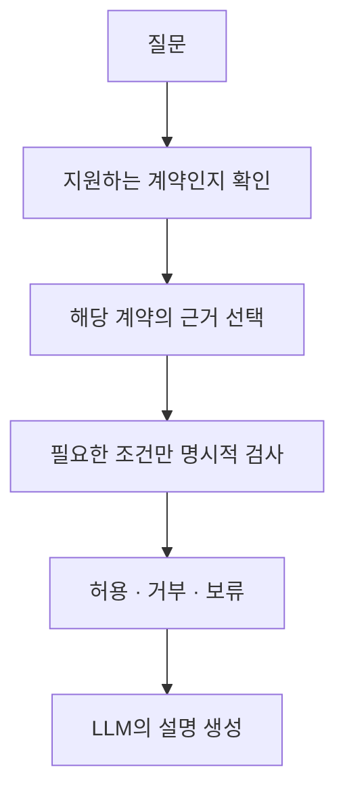

# 질문 계약과 검사 위치에 따른 판단 차이

## 연구 질문의 수정

연구의 출발점은 통제 가능한 업무·의사결정 시스템과 금융·의료 감사였다. LLM의 답을 그대로 믿기 어려운 상황에서 기존 RDF나 그래프 데이터를 어떻게 활용할지, 모든 데이터를 온톨로지로 만들어야 하는지 확인하려는 목적이다.

이번에는 관계 깊이, 판단 조건, 무관한 정보를 나누고 검사를 어디에 넣을지 비교했다. 첫 120문항을 재개분까지 완료했고 두 번째 반복은 69문항까지 완료했다. 응답을 받지 못한 호출이 두 번 발생해 이후 유료 호출은 중단했다. [전체 실행 기록](../experiments/records/20261013-hybrid-comparison.md)에 실패·미실행·재개 이력과 실제 질문·근거·응답을 함께 남겼다.

## 관측 결과

189개 실행 묶음의 결과다. 각 묶음에는 모든 비교군의 출력이 있다. 같은 질문의 반복과 요인별 변형이 포함되므로 189개의 독립적인 질문으로 보지 않는다.

| 방법 | 계약에 맞는 판정 |
| --- | ---: |
| 코드 규칙 | 189 / 189 |
| SHACL | 189 / 189 |
| LLM 직접 판단 | 124 / 189 |
| 같은 LLM의 추가 검토 | 122 / 189 |
| 판단 전 검사 보고서 제공 | 179 / 189 |
| 허용 판정에만 사후 검사 | 139 / 189 |

판단 전 보고서는 직접 판단의 불일치 55개를 바로잡았고 맞던 판정을 틀리게 바꾼 경우는 없었다. 추가 LLM 검토는 불일치를 바로잡은 사례 없이 맞던 판정 2개를 틀리게 바꿨다. 이 작은 구성과 고정 모델에서 얻은 관찰이며 에이전트 검토 전반의 효과로 일반화하지 않는다.

사후 검사는 계약상 허용하면 안 되는 승인 15개를 차단했다. 그러나 거부·보류를 허용으로 바꾸지 않는 정책이므로 불필요한 거부는 고치지 못했다. 검사 도구가 같아도 어디에 넣고 어떤 판정을 바꿀 수 있게 하는지에 따라 결과가 달랐다.

## 복잡도보다 먼저 드러난 문제

첫 반복에서 LLM 직접 판단의 계약 일치는 깊이 1·2·4에서 각각 26/40, 27/40, 28/40이었다. 판단 전 검사는 모두 38/40이었다. 이 범위에서는 경로가 길어질수록 검사가 필요해진다는 경계를 찾지 못했다. 그래프도 단일 경로이며 복잡한 분기나 여러 경로의 충돌은 포함하지 않았다.

더 구체적인 차이는 질문에서 요구한 조건과 무관한 정보에서 나타났다. 연결만 확인하라는 계약인데 조직의 허용 상태가 거짓이면 거부하는 사례가 있었다. 검사 보고서에 그 항목이 적용 대상이 아니라고 표시해도 일부 오류가 남았다. 내부 추론은 관찰하지 못했으므로 특정 조건을 생각했다고 단정하지 않고 같은 근거에 다른 계약을 적용했을 때의 응답 차이를 공개했다.

무관한 조직 8개만 추가한 대응 쌍에서 LLM 직접 판단은 77쌍 중 21쌍의 판정을 바꿨고 판단 전 검사는 1쌍에서 바뀌었다. 이 쌍들은 별도 독립 표본이 아니지만 관계 깊이만으로 개입 여부를 결정하는 정책이 충분하지 않을 수 있다는 후속 가설을 준다.

## 온톨로지 효과의 해석 범위

사전 보고서가 도움이 된 결과와 RDF가 필요하다는 주장은 구분해야 한다. 이번 120문항에서 Python과 SHACL이 만든 보고서 입력은 같았고 두 검사기의 판정도 같았다. 따라서 측정된 개선은 계산된 검사 결과를 제공한 효과이며 RDF만의 효과로 분리되지 않는다.

이름과 설명은 JSON에 남기고 필요한 필드만 RDF로 옮기는 구성은 실행했다. 어떤 필드만 남겨야 최적인지 자동으로 찾지는 않았고 모델링·운영 비용이 줄었다는 실증 결과도 없다. 작은 입력에서 Python 검사가 SHACL보다 훨씬 빨랐다는 관측은 있었지만 실제 그래프 DB나 전체 서비스의 성능 비교는 아니다.

또한 형식과 제약을 만족하는 거짓 사실은 해결되지 않았다. 공통 완료 집합에서 코드와 SHACL은 각각 39번 잘못된 사실에 허용을 내렸다. 평가 원본은 검사기 밖에 있었고 정상 입력과 거짓 입력이 보이는 정보만으로는 같았기 때문이다. 보류와 과도한 거부까지 함께 봐야 환각을 줄였다는 주장을 검토할 수 있다.

## 다음 설계의 우선순위

현재 결과로는 복잡도가 특정 숫자를 넘으면 온톨로지를 켠다는 정책을 정하기 어렵다. 다음 단계에서는 질문 계약의 해석, 근거의 관계 구조, 명시적인 판단 규칙을 분리해 확인하는 편이 타당하다.

이 도식은 후속 구조 제안이다. 마지막 설명 생성과 자유로운 질문 해석의 효과를 이번 실험에서 측정한 것은 아니다. 질문에서 깊이와 조건을 선택해 고정 템플릿에 넣는 별도 진단은 구현과 오프라인 점검까지만 끝났다. 48회 모델 호출은 미실행으로 남겼다.

다음 실험에는 분기와 여러 경로의 충돌, 기간의 중첩, 예외의 우선순위를 추가할 수 있다. JSON·코드 비교군에도 같은 사실과 규칙을 제공해야 한다. 기존 RDF와 SHACL을 재사용하는 이점은 정확도와 별도로 규칙 변경, 입력 연결, 원인 추적에 필요한 작업을 측정해야 확인할 수 있다.

실제 GLEIF에서는 기존 기업군과 겹치지 않는 24개 질문을 준비했고 Python·SPARQL의 오프라인 판정은 모두 일치했다. LLM 비교는 시간 초과 중단 이후 실행하지 않았다. 합성 결과를 실제 금융 감사 성능으로 확대하지 않으며 다음 실행의 시작점을 이 미실행 목록으로 남긴다.
