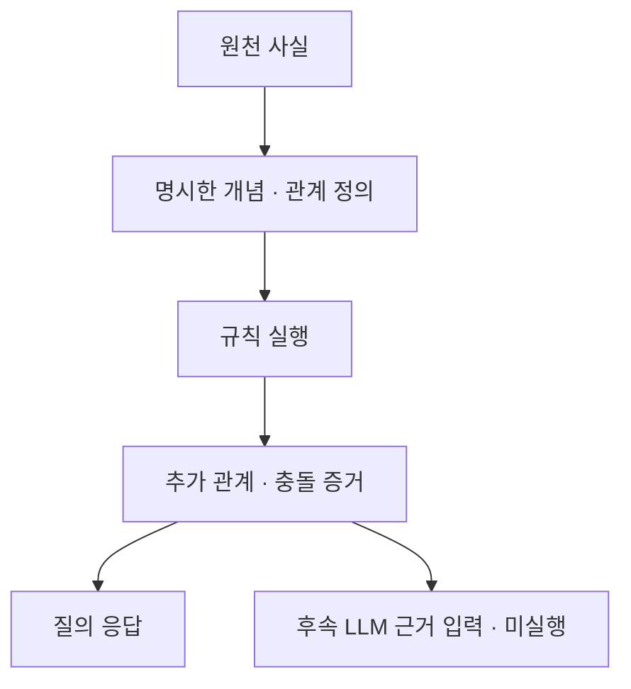

# 온톨로지의 의미 모델과 추론 효과

SHACL을 중심으로 비교할 때는 주어진 근거가 조건을 만족하는지 검사했다. 이번에는 개념 계층과 관계 공리를 실행해 입력에 직접 적혀 있지 않은 답을 도출했다. [실행 결과](../experiments/records/20261013-ontology-reasoning.md)에서 명시 조회가 놓친 136개 답을 두 추론기가 모두 찾았다.

## 의미 정의와 실행 도구

이번 결과에서 온톨로지는 개념과 관계의 의미를 선언하고 여러 사실에 같은 정의를 적용하는 역할을 했다. 어떤 관계가 역관계인지, 어떤 관계를 합성할 수 있는지, 어떤 개념이 서로 배타적인지를 데이터와 분리해 표현했다.

JSON 엔진도 같은 공리를 입력으로 받으므로 같은 온톨로지 의미를 구현한다. 이 비교에서 RDF·OWL-RL과 JSON의 판정이 같았다는 사실은 의미 모델이 불필요하다는 결론도, RDF가 더 좋다는 결론도 뒷받침하지 않는다. 표준 표현과 추론기를 사용할 때 얻는 재사용·도구 호환성의 실익은 실제 변경 작업에서 별도로 측정해야 한다.

## 하이브리드 적용 방향

업무 데이터 전체를 RDF로 옮기는 것보다, 공통 식별자·개념 계층·관계 합성처럼 여러 질문이 공유하는 정의를 별도로 관리하는 방향을 검토할 만하다. 문서와 설명은 기존 저장 방식에 두고 필요한 사실만 의미 모델에 연결할 수 있다. 이는 제안하는 구조이며 이번에 실제 업무 시스템으로 구현한 결과는 아니다.

이 단계에서는 잘못된 매핑을 자동으로 교정하거나 자연어 질문을 공리로 바꾸지 않았다. 원천 사실과 공리가 잘못되면 도출된 답도 틀릴 수 있다. 그래서 이번 결과를 LLM의 환각 감소 수치로 표현할 수 없다.

## 다음 비교의 조건

다음에는 실제 데이터에서 새 업무 용어와 정책 변경을 적용하는 과제가 필요하다. 같은 질문 정확도를 유지하면서 수정해야 하는 정의·코드 범위, 기존 질문의 회귀 오류, 근거 추적 가능성을 비교한다. 업무 어휘 두 개의 이름만 바꾼 이번 구성은 실제 도메인 전이를 검증하지 못한다.

LLM 비교를 재개할 때에는 원천 사실만 주는 조건과 추론 결과·근거를 함께 주는 조건을 분리한다. 자연어를 의미 모델에 연결하는 오류도 따로 측정해야 한다. 현재 유료 호출 중단은 유지하며 이 후속 비교는 아직 실행하지 않았다.
