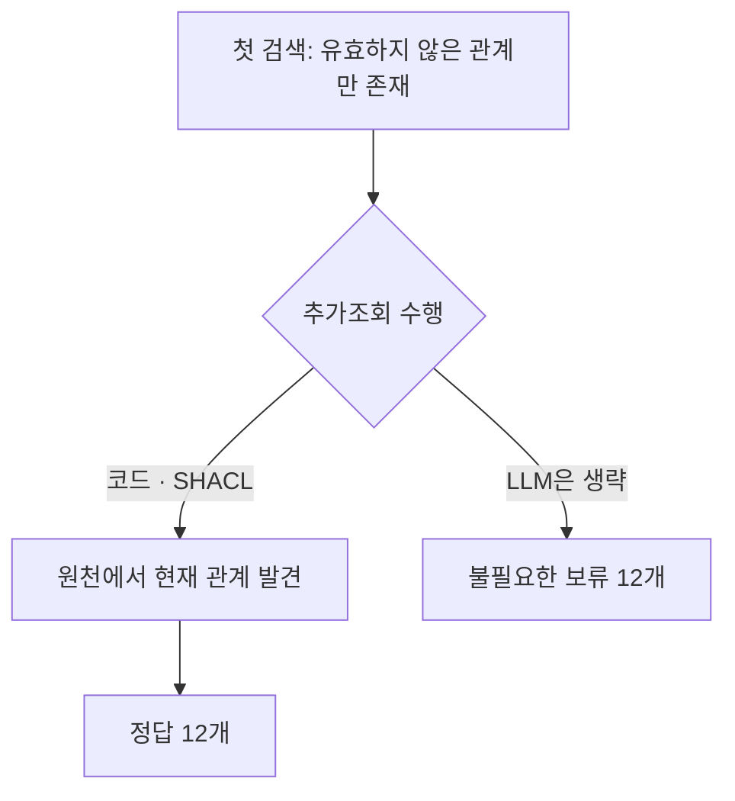

# 질문에 맞는 근거 선택과 의미 판단

## 해석 범위의 수정

앞선 GLEIF 비교에서 모델에 맡긴 일은 개체 수·타입·예외 코드 검사였다. 실제 사실의 진위 판단을 금지했으므로 그 결과를 LLM의 의미 판단 능력 전체로 확대할 수 없었다. 이번에는 직접·최종 모회사, 유효 시점, 상충 레코드를 판단 대상에 넣었다.

SHACL도 관계와 날짜에 관한 조건을 명시하면 해당 의미 조건을 검사할 수 있다. 이 실험은 SHACL이 업무 의미를 스스로 알아내는지보다 같은 기준을 코드·SHACL·LLM이 얼마나 일관되게 적용하는지 확인한다. 모든 비교군에 질문의 관계 종류와 기준 시점을 제공했다. 자유로운 질문 해석 능력은 측정하지 않았다.

## 개발 실행과 형식 오류

10개 합성 상황에 영어 질문 표현 3개와 반복 2회를 적용했다. 비교군마다 60개, 전체 180개 결과 행이다. 실제 기업 데이터나 새 평가 표본이 아니며 반복을 독립 사례로 세지 않는다.

첫 실행은 기존 실행기의 출력 형식을 재사용했다. JSON 안의 `value`에 다시 JSON 문자열을 넣도록 요구했지만 모델은 내부 값을 객체로 반환했다. 해당 실행은 응답 형식 실패 기록으로 보존한다. 의미 판단 오답과 구분하고 성공한 행만 골라 성능을 계산하지 않는다.

두 번째 버전은 `decision`, `candidate`, `citations`의 단순한 JSON을 받는다. 질문 계약과 합성 사례는 유지했다. 프롬프트의 출력 형식과 실행기가 바뀌었으며 새 검토·검증을 거쳐 별도 개발 실행으로 기록했다. 결과를 본 뒤의 수정이므로 독립 평가라고 부르지 않는다.

## 측정 결과

| 조건 | 정답 | 오답 | 보류 | 실행 오류 | 불필요한 보류 |
| --- | ---: | ---: | ---: | ---: | ---: |
| 코드 규칙 | 30 | 6 | 24 | 0 | 0 / 30 |
| SHACL+질문 정책 | 30 | 6 | 24 | 0 | 0 / 30 |
| LLM | 29 | 6 | 25 | 0 | 1 / 30 |

모든 조건의 분모는 60개 결과 행이다. 세 조건의 오답 6개는 모두 반증 정보 없이 거짓 관계 하나를 제시한 사례다. 외부 사실의 진실성을 알아낸 도구는 없었다.

LLM의 최종 결정·후보는 공통 계약과 59/60개 일치했다. 답할 수 있는 현재·종료 혼합 사례에서 한 번 보류했다. 인용까지 포함한 계약 준수는 41/60개다. 나머지 차이 18개는 종료·미래·상충 사례에서 나왔다. 보류할 때 인용을 비우라는 출력 조건을 지키지 않은 경우다. 이 18개를 모회사 선택 오류로 해석하면 안 된다.

첫 처리 결정은 LLM 47/60개, 코드·SHACL 각각 60/60개가 기준과 같았다. LLM은 종료·미래 관계만 보이는 12개 행에서 추가조회 없이 보류했다. 코드·SHACL은 각각 24번, LLM은 12번 추가조회했다. 이 사례들의 원천에는 다른 유효 관계가 없어 최종 보류는 맞았지만 조회 생략이 일반적으로 안전하다는 뜻은 아니다.


판단 기준 준수는 최종 결정·후보·필요한 인용의 일치다. 정답·오답은 분리한 평가 값과 대조한다. 반증 없는 거짓 관계 사례에서는 기준을 지킨 답변도 사실상 틀릴 수 있어 두 지표를 합치지 않는다. 답할 근거가 원천에 있는 행을 분모로 불필요한 보류를 계산한다.

## 질문과 실제 판정

| 질문과 제공 근거 | 실제 LLM 결과 | 평가 |
| --- | --- | --- |
| 직접 모회사 질문에 직접·최종 관계를 함께 제시 | 직접 관계 후보와 해당 레코드만 반환 | 해당 상황 6/6 정답 |
| 현재 관계 하나와 종료된 관계 하나를 함께 제시 | 5회 현재 후보 반환, 1회 두 레코드를 인용하며 보류 | 불필요한 보류 1/6, 내부 판단 원인은 확정하지 않음 |
| 같은 시점의 직접 모회사 후보 둘 | 두 레코드를 인용하며 보류 | 최종 결정은 6/6 적절, 빈 인용 조건은 불일치 |
| 첫 검색이 비어 있지만 원천에 현재 관계 존재 | 추가조회 후 후보 반환 | 6/6 정답 |
| 현재·직접 관계로 표시된 거짓 후보 하나 | 해당 후보 반환 | 코드·SHACL·LLM 모두 6/6 오답 |

예를 들어 `nb82cabe238a2da8d`의 2026-01-01 직접 모회사를 물었다. 첫 표현·첫 반복에서 LLM은 아래처럼 응답했다. 첫 레코드는 현재 관계, 두 번째는 2025-01-01에 끝난 관계다. 코드·SHACL은 첫 레코드의 후보를 답했다.

```json
{"decision":"abstain","candidate":null,"citations":["nfd31b5cc1abf9c16","n999a51fd3ffb2a12"]}
```

식별자는 합성 사례의 실제 실행 값이다. 전체 질문·레코드·응답·분리된 평가 값은 [전체 결과 JSON](../experiments/records/20261013-semantic-comparison.json)에 들어 있다. 표는 열 가지 상황 중 해석에 필요한 사례를 골랐으며 모든 상황별 집계도 같은 JSON에 보존했다.


## 오래된 근거만 검색된 경우

두 번째 실행에서 관찰한 조기 보류를 확인하려고 2개 상황을 대응시킨 사후 점검을 했다. 첫 질문·계약·검색 근거는 그대로 두고 원천에만 현재 유효한 다른 관계를 넣었다. 이전에는 추가조회해도 답이 없었지만 이번에는 추가조회하면 답할 근거가 나온다. 2개 상황·질문 표현 3개·반복 2회로 조건별 12개, 전체 36개 결과다.

| 조건 | 정답 | 오답 | 보류 | 추가조회 | 실행 오류 |
| --- | ---: | ---: | ---: | ---: | ---: |
| 코드 규칙 | 12 | 0 | 0 | 12 | 0 |
| SHACL+질문 정책 | 12 | 0 | 0 | 12 | 0 |
| LLM | 0 | 0 | 12 | 0 | 0 |



텍스트 흐름은 동일한 첫 검색 → 코드·SHACL은 추가조회로 답변, LLM은 조회 없이 보류다. 원천 변경은 모델 입력에 표시하지 않았고 정답을 검색기로 전달하지 않았다. [36개 전체 기록](../experiments/records/20261013-semantic-stale-followup.json)에 첫 근거·추가조회할 원천·응답을 함께 남겼다.

이 차이를 해석하려면 관계 의미를 고르는 능력과 추가조회 결정을 분리할 필요가 있다. 앞선 LLM의 최종 결정·후보 일치는 59/60개였지만 그 결과만으로 불완전한 검색에도 안전하다고 볼 수 없었다. 이번에는 첫 화면에 유효하지 않은 관계가 존재했다. 이때 조회를 생략해 답변을 회복하지 못했다. 선언한 조회 정책을 지킨 효과이며 SHACL만의 이점은 아니다. Python도 같은 결과를 냈다.

결과를 본 뒤 만든 작은 진단이므로 두 상황을 독립 평가처럼 해석하지 않는다. 모델은 gpt-4o-mini 하나, 프롬프트와 영어 질문 표현도 제한돼 있다. 다음 실제 데이터 비교에서는 의미 판단과 조회 정책을 분리하고 모델에 고정 조회 정책을 결합한 조건도 별도로 비교할 계획이다. 이 결합 조건은 아직 측정하지 않았다.

## 다음 실제 데이터 비교

GLEIF RR 원천에서 직접·최종 모회사가 각각 하나씩이며 서로 다른 중심 기업 21,804개를 확인했다. 이는 후보 현황이며 정답 검증이나 신규 표본 선정 결과는 아니다. 실제 관계 범위 질문을 구성할 때 기존 기업군을 제외하고 기간 종류를 보존한다. 회계기간·문서 제출기간을 관계 유효기간으로 대신 쓰지 않는다.

이번 결과만으로 RDF·SHACL이나 LLM의 일반적인 우월성을 주장하지 않는다. 근거 선택을 위한 조건을 명시할 수 있는 범위, 모델이 조건을 적용하는 과정, 원천 자체의 진실성을 확인하는 과정은 각각 따로 평가해야 한다. Jev와 자연어에서 질문 계약을 추출하는 단계는 이번 후속 실행에서 측정하지 않았다.

## 재현 자료와 비용

- [실행 기록](../experiments/records/20261013-semantic-comparison.md)과 [후속 설계](../experiments/semantic-study.md)
- [첫 버전의 형식 실패 180행](../experiments/records/20261013-semantic-v1-format-failures.json), [두 번째 버전의 전체 180행](../experiments/records/20261013-semantic-comparison.json)
- 첫 버전 60회 $0.0070908, 두 번째 버전 72회 $0.0070284. API 응답의 보고 비용이며 AWS·Codex 비용은 별도다. 두 실행의 비용 누락은 0건이다.
- 두 번째 버전의 독립 방법론·구현 검토와 등록 소프트웨어 테스트 109개가 통과했다. 소프트웨어 테스트 수를 연구 표본 수로 해석하지 않는다.


추가 대응 점검은 12회 $0.0011478이며 이번 세 실행의 합계는 144회 $0.015267이다. 새 실행의 비용 누락은 모두 0건이다. 기존 작업에서 비용이 확인되지 않은 중단 호출 한 건은 별도 장부에 계속 남아 있다. 마지막 변경 후 등록 소프트웨어 테스트 111개가 통과했다.
