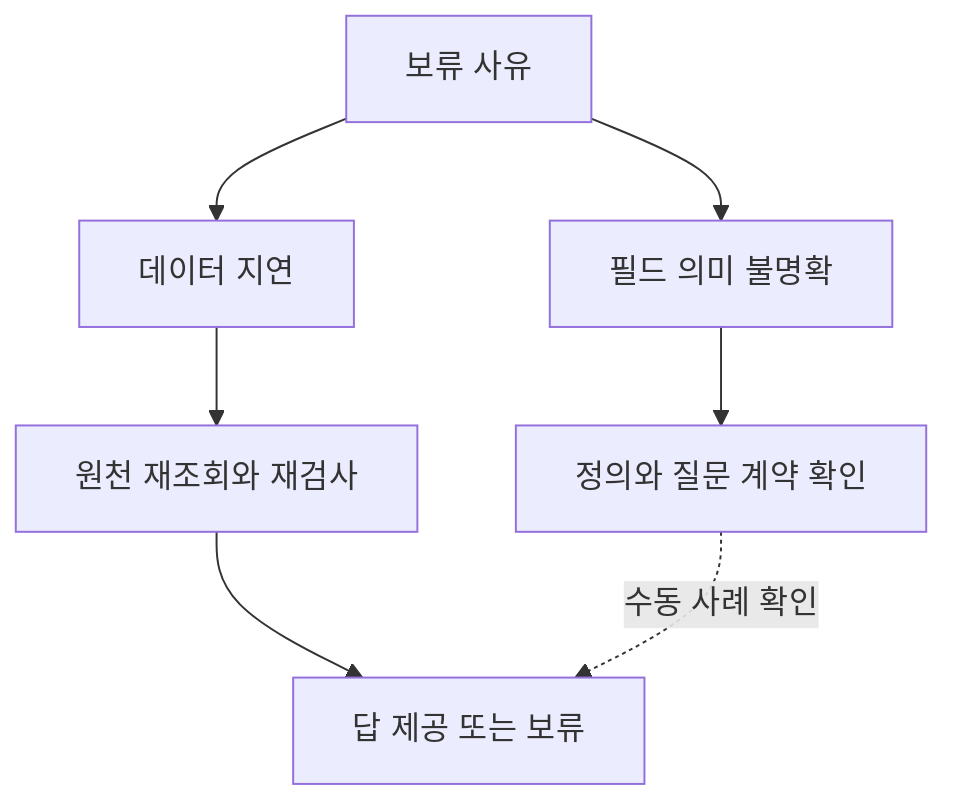

# 2026-10-14 — 원천 재조회와 의미 확인의 분리

[이번 후속 비교](../experiments/records/20261014-bounded-refresh.md)에서는 이전 검사에서 보류한 답에 한 번의 추가조회를 허용했다. 데이터가 늦게 반영된 문제와 필드 의미를 잘못 연결한 문제를 같은 방법으로 처리하지 않도록 나눴다.

정상 응답 조건에서는 선택 조회 592회로 매번 조회 3,072회와 같은 정답 9,216개를 제공했다. 추가조회 실패가 기존 답까지 막는 문제를 발견해 보완했고 파생 평가에서는 잃었던 정답 284개를 유지했다.

## 오래된 근거의 복구

비용 변경이 추출본에 반영되지 않은 추천은 현재 원천을 다시 읽어 답을 계산할 수 있다. 이때 새 답은 평가 정답을 복사하는 대신 반환된 원천과 발행된 업무 설정에서 나온다. 현재 원천에 필요한 값이 없다면 조회를 반복해도 채워지지 않으므로 확인 불가로 남긴다.

조회했다는 사실만으로 최신 근거가 되지는 않는다. 오래된 원천을 반환하는 서비스를 넣고 응답을 받기 전에 확보한 최신 지문과 다시 비교했다. 현재 기준을 응답 기준으로 덮어쓰지 않는 절차가 필요하다. 이 비교에서는 지문 발행 경로가 정상이라는 가정을 두었다.

실선의 원천 재조회는 이번에 실행했다. 점선의 정의 확인은 아래 GLEIF 자료를 수동으로 대조한 사례이며 자동 문서 해석 실험은 아니다.

## GLEIF 주소의 실제 의미 구분

GLEIF 공식 CDF 3.1 명세는 `LegalAddress`를 법적 관할에서 등록된 주소로, `HeadquartersAddress`를 본사 주소로 구분한다. 두 주소는 같은 `AddressType`을 쓰므로 국가 코드의 형식 검사만으로 주소 역할을 구분하기 어렵다. [GLEIF 공식 명세](https://www.gleif.org/en/lei-data/access-and-use-lei-data/level-1-data-lei-cdf-3-1-format)와 [XML Schema](https://www.gleif.org/lei-data/access-and-use-lei-data/level-1-data-lei-cdf-3-1-format/2021-03-04_lei-cdf-v3-1.xsd)에서 정의와 타입을 확인했다.

보관 중인 2026-10-12 08:00:00 배치에서 `GOLD COAST CAPITAL SUBSIDIARY I LIMITED`의 등록 주소 국가는 KY, 본사 주소 국가는 US였다. 데이터 값을 바꾸지 않아도 어떤 필드로 답하느냐에 따라 답이 달라진다. 현재 기업의 소재지를 별도로 실사한 결과가 아니라 이 배치의 기록이다.

| 질문 계약 | 사용할 필드 | 배치의 값 |
| --- | --- | --- |
| 등록 주소의 국가 | `Entity.LegalAddress.Country` | KY |
| 본사 주소의 국가 | `Entity.HeadquartersAddress.Country` | US |
| 어느 나라 기업인지, 기준 미지정 | 주소 역할 확인 필요 | 하나로 단정하지 않음 |

형식이 같은 두 국가 필드 중 하나를 고르는 일은 데이터 재조회만으로 해결되지 않는다. 질문의 주소 역할을 명시하고 공식 정의에 맞는 필드에 연결해야 한다. 모호한 질문을 임의로 본사나 등록 주소 질문으로 바꾸지 않는 규칙도 필요하다.

이 구분은 사람이 작성한 질문 계약으로 저장했다. 합성 실험의 매핑을 이 사례로 자동 복구하지 않았고 LLM이 문서에서 계약을 추출한 성능으로도 집계하지 않는다. [실제 세 기업의 발췌와 출처](../experiments/records/20261014-gleif-address-examples.json)는 아카이브 순서상 주소 국가가 다른 첫 세 건으로, 16개 행을 읽어 얻었다. 대표 표본이나 새로운 별도 평가 집합은 아니다.

## 다음 연구의 우선순위

온톨로지 개입 위치를 고르려면 근거가 오래된 경우와 질문의 개념이 불명확한 경우를 먼저 나눌 필요가 있다. 전자는 조회·버전 대조로 처리할 여지가 있고 후자는 업무 개념과 원천 정의의 연결을 검증해야 한다.

이번 결과 다음에는 주소 역할처럼 정의가 공개된 개념에서 질문 계약 선택의 오류를 측정하는 것이 적절하다. 값이 다른 사례와 우연히 같은 사례를 함께 두고 잘못 고른 필드가 단순 답 일치 평가에서 숨는지도 확인해야 한다. 카탈로그와 검사기가 같은 오류를 공유하는 조건은 계속 유지한다.
