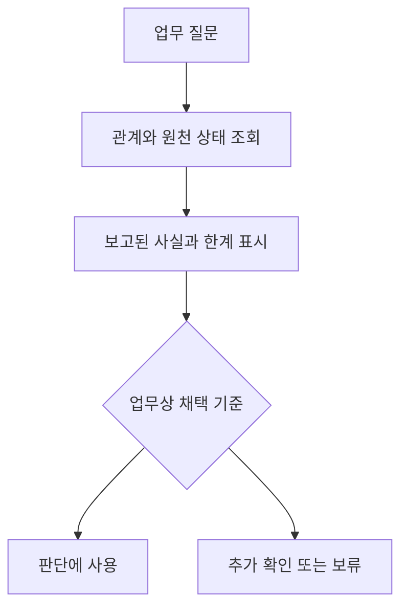

# 2026-10-14 — 업무 질문과 자료 채택 기준

금융과 제조업에 각각 세 질문을 고정하니 어떤 의미 정보가 필요한지 구체적으로 드러났다. 제조업에서는 구성 관계의 방향·단위·검사 의존성이, 금융에서는 회계 연결과 운용 관계의 구분·관계 기간·등록 상태가 필요했다. [첫 실행 기록](../experiments/records/20261014-business-questions.md)에 실제 입력과 출력을 남겼다.

이번 합성 사례에서 JSON·RDF의 결과는 같았다. 같은 판단 규칙을 공유하므로 자연스러운 결과다. 이 비교는 RDF의 필요성을 입증하지 않는다. 같은 업무 규칙을 어디에 명시하고 어떤 근거와 함께 유지할지를 정하는 출발점으로 사용한다.

실제 GLEIF 예시에서는 ACTIVE 관계의 등록 상태가 LAPSED인 경우가 나왔다. 현재 정책은 이를 보류하지만 “보고된 관계를 알려 달라”는 질문에는 관계와 등록 상태를 함께 제시하는 편이 더 유용할 수 있다. “이 자료로 검토를 끝내도 되나”는 별도의 판단이다. 기록된 사실의 조회와 의사결정에 사용할 자료의 채택 기준을 분리해야 한다.

다음 비교는 여섯 질문을 유지하면서 보류만 반환하는 정책과 상태를 붙여 사실을 반환하는 정책을 나눈다. 제조업에는 실제 BOM·규격 문서, 금융에는 보고 관계와 내부 검토 정책의 독립적인 평가 기준이 필요하다. 후속 비교는 아직 실행 전이며 SHACL·RDF가 반드시 우수하다는 가정 없이 진행한다.
