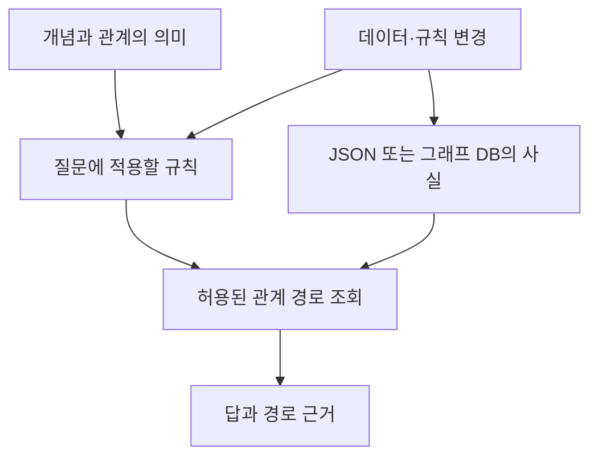

# 2026-10-14 — 그래프 저장과 의미 규칙의 분리

이번 후속 실험은 “JSON으로 같은 답을 얻을 수 있다면 그래프 DB는 관리 편의 때문에 쓰는 것인가”라는 질문에서 시작했다. 이전 추론 실험에서는 같은 의미 규칙을 구현한 JSON과 OWL-RL이 지정된 질의에서 같은 답을 냈다. 그래서 이번에는 데이터를 바꾼 뒤 답과 근거가 제대로 갱신되는지 실제 Neo4j까지 포함해 확인했다.

## 저장 방식과 의미 모델

JSON은 표현 형식이고 LPG는 노드·관계·속성으로 구성하는 그래프 모델이다. JSON에도 관계 목록을 담을 수 있다. Neo4j 같은 그래프 DB를 쓰면 관계를 저장하고 질의하며 변경을 반영하는 실행 시스템이 추가된다. 온톨로지는 이와 별도로 개념·관계의 의미와 추론 규칙을 명시하는 층이다.

이번 공급망의 예비 공급자를 허용하는 규칙은 모든 비교군이 같은 설정으로 처리했다. 그래프 DB가 자동으로 규칙을 알아내거나 사실의 진위를 판별한 것은 아니다. 또한 이번에는 OWL 추론을 실행하지 않았다. 저장 엔진과 온톨로지 효과를 섞어 해석하지 않기 위해 비교 대상을 좁혔다.

## 이번 관측과 해석

세 비교군 모두 960개 질의 결과에서 국가 집합과 경로 근거가 일치했다. 제한된 그래프의 조회는 메모리 JSON 인덱스가 가장 빨랐다. 반면 JSON 파일 전체를 다시 쓰는 구현과 비교하면 Neo4j의 일부 작은 관계 변경은 더 짧은 시간에 반영됐다. 정해진 규칙 변경에는 세 조건 모두 코드 수정이 필요하지 않았다. 구체적인 값은 [실행 기록](../experiments/records/20261014-graph-lifecycle.md)에 남겼다.

이번 결과만으로 그래프 DB가 관리하기 더 쉽다고 판단할 수는 없다. 같은 의미 규칙을 서로 다른 저장·조회 경로로 구현해도 답이 유지됐고 그 비용은 작업 종류에 따라 달랐다.

## 관리 비용의 측정 범위

변경 적용과 조회 시간, 갱신 후 답의 일치는 측정할 수 있다. 다만 코드가 짧거나 결과가 같다고 해서 사람의 유지보수 시간이 줄었다고 결론 내릴 수는 없다. 이번 작업은 한 번 구현된 세 경로가 정해진 변경을 수행하는지 확인했다. 새로운 정책을 구현하는 시간, 여러 팀이 스키마를 공유할 때의 오류, 동시 수정과 장애 복구 비용은 아직 측정하지 않았다.

## 후속 연구의 범위

다음 확장은 단순히 데이터 행 수를 늘리는 것보다 같은 변경을 여러 질의가 공유하는 상황이 적합하다. 예를 들어 공급자의 지역 변경이 제품별 공급 국가 조회, 제재 지역 점검, 대체 공급자 추천에 동시에 영향을 줄 때 필요한 수정 범위와 회귀 오류를 확인할 수 있다. 공통 의미 정의가 있는 조건과 각 질의가 규칙을 따로 구현한 조건을 비교하되 두 조건 모두 충분히 구현하고 테스트해야 한다.

하이브리드 구성에서는 원문과 단순 속성을 JSON으로 보관하고 여러 판단이 공유하는 엔터티 식별·관계·규칙만 그래프나 RDF로 관리하는 방식을 비교할 수 있다. 이때는 중복 규칙과 불일치가 얼마나 줄고 그 대가로 동기화 비용이 얼마나 생기는지 측정한다. RDF 자체의 우월함을 측정하는 비교는 아니다. 이는 후속 제안이며 이번에 측정한 결과가 아니다.
