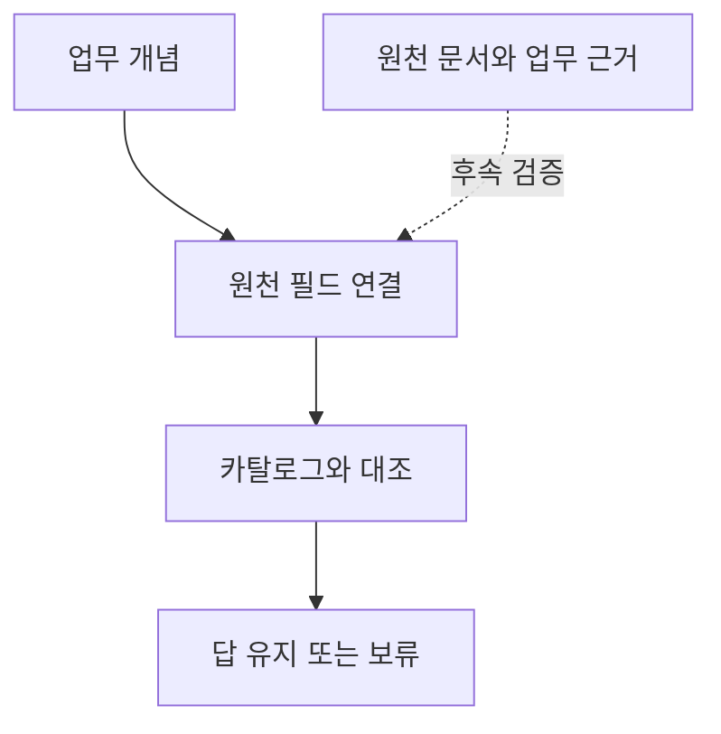

# 2026-10-14 — 의미 계약의 효용과 근거의 신뢰

[이번 검사 비교](../experiments/records/20261014-semantic-guards.md)에서는 검사를 모두 적용하는 방식과 질문의 의존성에 따라 적용하는 방식을 구현했다. 올바른 필드 설명이 주어진 조건에서 두 방식 모두 기존 오답 1,416개를 보류했다. 선택 적용은 결정 가능한 정답을 불필요하게 보류한 수를 2,480개에서 2,044개로 줄였다.

## 의미 연결과 사실 확인의 경계

공급 국가라는 개념과 원천의 어느 필드를 연결하는지 명시하면 잘못된 연결을 검사할 수 있었다. 국가 값의 형식이 같아도 세금 관련 국가와 공급 국가는 다르다. 여기서 온톨로지와 관련된 역할은 업무 개념·원천 필드·판단 규칙의 관계를 드러내는 것이다. 이번에는 이 작은 계약을 JSON으로 구현했고 RDF 고유의 효과는 측정하지 않았다.

필드 카탈로그까지 같은 오류를 갖게 하자 선택 적용에서도 오답 1,040개가 통과했다. 의미 계약을 만들었다는 사실만으로 그 내용이 맞아지지는 않았다. 설명이 아예 없을 때는 모든 답을 막았으므로 오답 통과율만으로 검사 정책을 평가할 수도 없었다.

실선은 이번에 구현한 계약 대조다. 점선은 원천 문서와 업무 근거로 연결 자체를 검증하는 후속 작업이다. 카탈로그를 제공한 것과 실제 문서를 통해 그 카탈로그의 타당성을 알아낸 것을 구분한다.

## 선택적 검사에 남은 과잉 보류

비용만 바뀐 경우 국가 조회는 유지하고 추천만 보류할 수 있었다. 그러나 역할 허용 설정이 바뀌면 해당 질문의 답이 그대로여도 보류했다. 모순이 한 곳에서 발견되면 세 업무를 함께 보류하는 정책도 맞는 답을 막았다. 이번 의존성 계약은 전체 버전보다 범위를 줄였지만 출력에 꼭 필요한 검사만 선택하는 최적 정책은 아니다.

따라서 후속 연구는 검사 종류를 계속 늘리는 것보다 보류 사유에 맞는 제한된 조치를 비교하는 쪽이 적절하다. 의존성만 오래됐으면 관련 원천을 다시 조회하고, 필드 의미가 충돌하면 자동으로 다른 필드로 바꾸지 않고 설명 근거를 확인하는 식이다. 추가조회로 해결 가능한 문제와 사람의 의미 확인이 필요한 문제를 구분해야 한다.

## 후속 실험의 고정 범위

다음 개발에서는 현재 검사 결과와 같은 예산 아래 세 정책을 비교할 수 있다. 보류만 유지하는 조건, 관련 원천을 한 번 다시 조회하는 조건, 원천 문서의 필드 설명까지 확인하는 조건이다. 평가 정답을 조회·복구에 사용하지 않고 답을 바꾸기 전후의 근거를 남긴다.

이 비교를 새 데이터에서 실행하기 전에 카탈로그의 근거 문서, 업무 개념의 정의, 둘이 충돌할 때의 처리 기준을 고정해야 한다. 이번 합성 카탈로그 결과는 그 실험 설계의 출발점이며 의료·금융의 사실 검증 성능을 입증한 결과로 확대하지 않는다.
