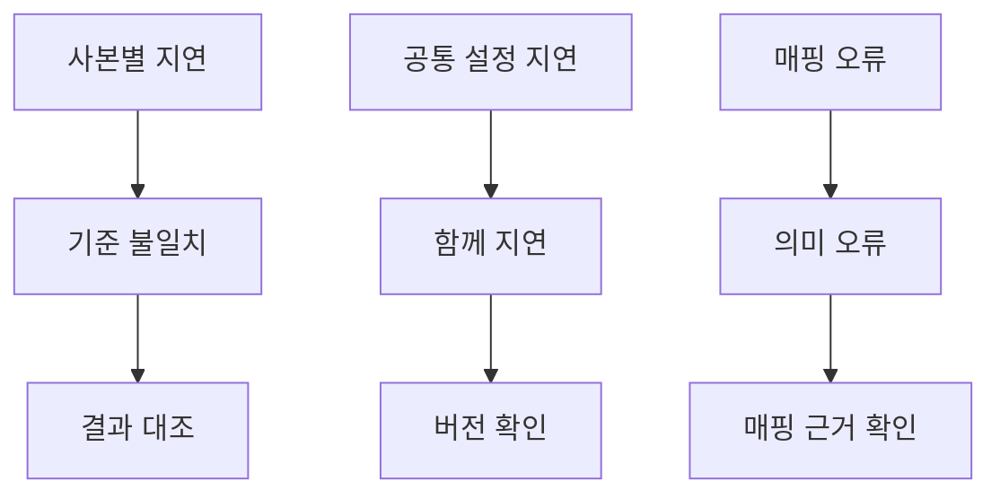

# 2026-10-14 — 공통 의미 규칙의 변경 범위와 오류 전파

공통 의미 정의를 두면 여러 업무의 수정 누락을 줄일 수 있는지 확인하려고 공급 국가 조회·지역 제한 점검·대체 공급자 추천을 함께 실행했다. [이번 결과](../experiments/records/20261014-shared-semantics.md)는 공통화의 장점만으로 연구를 진행하면 안 된다는 근거를 남겼다.

## 공통화와 올바른 기준

정상 갱신에서는 업무별 JSON, 공통 JSON, JSON 추출본, RDF 하이브리드가 모두 같은 답을 냈다. 업무별로 규칙을 복사해도 제대로 갱신하면 맞는다. 공통 규칙을 쓴다고 자동으로 더 정확해지지는 않았다.

예비 공급자 허용 뒤 국가 조회의 사본만 늦게 갱신하면, 추천 업무는 C1 공급자를 선택하는데 국가 조회는 C0만 보고하는 차이가 생겼다. 반대로 공통 설정이 지연되면 여러 업무가 같은 이전 기준을 사용했다. 서로 모순되지 않더라도 최신 업무 기준에는 틀릴 수 있었다.

텍스트로는 사본별 차이, 공통 설정의 지연, 잘못된 의미 매핑을 각각 결과 대조·버전 확인·매핑 근거 확인으로 나눠 살피는 구조다. 도식의 확인 절차는 후속 제안이며 이번 실행에서 자동 복구 정책을 시험한 것은 아니다.

## RDF 효과와 추출본 동기화

같은 필드를 쓰는 JSON 추출본과 RDF 추출본은 정상 상태뿐 아니라 오류 주입에서도 같은 결과를 냈다. RDF만의 정확도 이득은 이번에도 확인하지 못했다. 두 조건이 같았다는 사실과 두 조건이 맞았다는 사실은 다르다.

공급자가 제한 국가로 이동했는데 추출본이 갱신되지 않으면 JSON과 RDF 모두 이전 국가로 판단했다. 이는 RDF라는 표현 때문에 생긴 문제가 아니라 별도 추출본을 유지하는 구조의 문제였다. 반대로 별도 저장 없이 현재 원천을 읽는 조건은 이번에 주입한 추출본 지연의 영향을 받지 않았다. 원천 자체가 늦게 갱신되는 경우까지 안전하다는 결과는 아니다.

## 형식·버전 검사 밖의 의미 오류

공급 국가 대신 세금 관련 국가 필드를 읽도록 매핑하면 국가 값의 형식과 버전이 모두 맞아도 잘못된 판단이 나왔다. 이번 실험에서는 평가자가 의도한 필드를 알고 있었기 때문에 오류를 점수화할 수 있었다. 실제 운영에서는 그 의도를 정의한 업무 계약과 원천 필드의 의미를 확인할 별도 근거가 필요하다.

따라서 연구의 초점을 단순히 규칙 사본 수를 줄이는 데 두기는 어렵다. 여러 업무가 참조하는 정의의 의미, 적용 버전, 원천과의 연결을 함께 확인해야 한다. RDF·SHACL·JSON 중 어떤 표현을 선택하든 이 책임은 남는다.

## 다음 비교의 구체화

후속 비교에서는 업무별 규칙 사본, 공통 JSON 규칙, RDF 하이브리드를 유지하고 세 확인 절차의 효과를 분리할 수 있다. 업무 간 결과 대조는 모순된 출력을 찾는 범위, 버전 검사는 오래된 입력을 차단하는 범위, 의미 매핑 검사는 같은 형식의 다른 필드를 잘못 연결하는 범위를 맡는다.

버전이 다르다는 이유만으로 모든 답을 차단하면 이번 필드명 변경처럼 답은 같은 경우에도 불필요하게 보류할 수 있다. 질문에 실제로 쓰이는 필드의 변경인지 구분하는 조건이 필요하다. 의미 매핑 검사는 정답 필드명을 숨겨 놓고 검사기에게 다시 알려 주는 방식으로 설계해서는 안 된다. 원천 문서와 독립적인 업무 예시만으로 오류를 발견할 수 있는지를 따로 평가해야 한다.

이번 실행은 통제된 오류의 영향 범위를 확인한 오프라인 실험이다. 실제 팀의 유지보수 시간, 자연 발생 오류의 빈도, LLM 환각 감소나 의료·금융 감사 성능을 입증한 결과로 확대하지 않는다.
