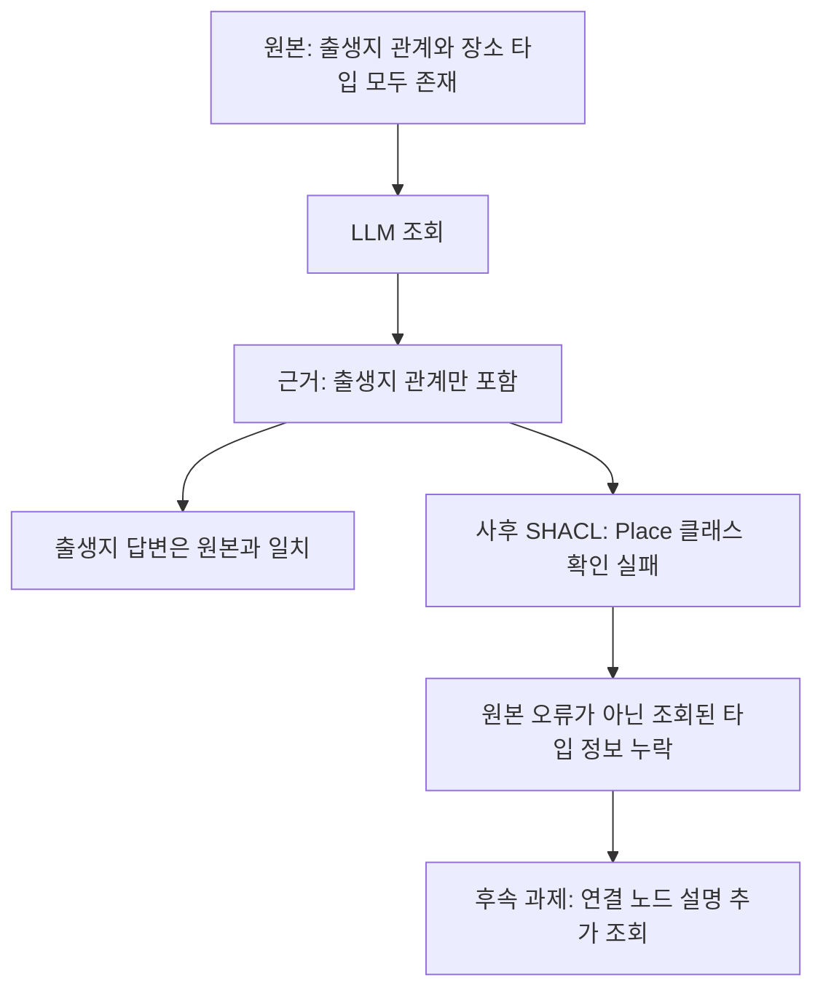

# YAGO 조회 실패와 검증에 필요한 주변 정보

[실행 결과와 전체 기록](../experiments/records/20261015-yago-native-tools.md)

## 원본과 조회 근거의 사후 검사

모델 실행이 끝난 뒤 연구자가 같은 도구로 원본과 저장된 근거를 직접 검사했다. 이 사후 분석은 LLM의 도구 사용 횟수에 포함하지 않는다.

| 검사 대상 | 건수 | 결과 |
|---|---:|---|
| 기존 원본 부분집합, 인물별 검사 | 4 | 모두 통과 |
| 정답을 낸 LLM의 누적 조회 근거 | 3 | 모두 출생지 클래스 제약 위반 |

예를 들어 모델은 `Abu_Nuwas → birthPlace → Ahvaz`를 찾아 정답과 인용을 냈다. 그러나 조회 근거에 Ahvaz의 타입 설명이 없어서 SHACL은 Ahvaz가 Place인지 확인하지 못했다. 원본에는 해당 타입 정보가 있었다. 이 위반을 출생지가 틀렸다는 뜻으로 해석하면 안 된다.

## 다음 수정 범위

쿼리의 미연결 변수를 구체적으로 알려주는 오류 메시지와, 근거 부족을 표시하고 종료하는 경로가 필요하다. 연결 노드의 타입 설명을 요청할 수 있는 도구도 준비한다. LLM이 대상 IRI와 필요한 정보를 선택하고 도구가 문법을 처리하는 방식은 자유 SPARQL 작성과 별도 조건으로 비교한다. 자동으로 정답을 조회하거나 모든 위반을 사실 오류로 처리하지 않는다.

현재까지 원본 YAGO 데이터·taxonomy·SHACL 해시와 기존 캠페인 비용 장부는 변하지 않았다. 첫 실행 전 테스트 251개, 별도 진단 전 테스트 253개를 통과했다. 독립 검토는 각각 두 건씩 받았으며 생략된 내부 코드와 실제 메모리 사용량은 검토자가 확인하지 못한 범위로 남겼다.

