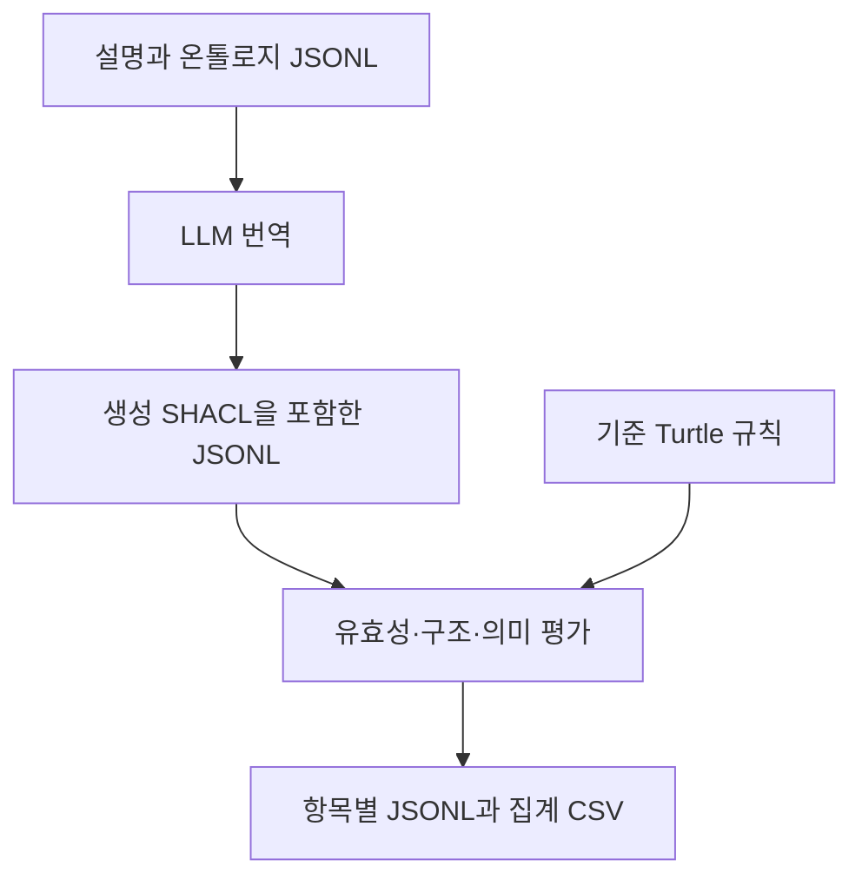

# NL2SHACL-Bench 리뷰 — 자연어로 만든 검증 규칙을 평가하는 전체 과정

‘상품에는 식별자가 하나 있어야 하고 가격은 숫자여야 한다’는 요구사항을 SHACL로 옮긴다고 하자. LLM은 실행 가능한 코드를 쉽게 만들 수 있지만 식별자를 선택 항목으로 바꾸거나 가격 조건을 빠뜨릴 수도 있다. 코드가 실행된다는 사실과 요구사항을 정확히 옮겼다는 사실은 다르다.

*NL2SHACL-Bench: A Benchmark Suite for Natural Language to SHACL Translation*은 이 번역을 평가하는 데이터셋과 방법을 제안한다. ISWC 2026 채택 논문의 arXiv v2 및 공개 프레임워크를 함께 살펴본다. 연구 질문은 자연어로부터 생성한 SHACL의 정확성을 어떤 기준으로 측정하며 모델이 어떤 종류의 제약에서 틀리는가이다.

## 입력과 정답의 관계

SHACL은 RDF 데이터가 지켜야 할 조건이다. Turtle은 RDF를 사람이 읽을 수 있게 적는 파일 형식 중 하나다. 같은 규칙을 여러 Turtle 표현으로 작성할 수 있으므로 정답 문자열과의 일치만으로 채점하면 의미가 같은 답도 오답으로 처리할 수 있다. [W3C SHACL](https://www.w3.org/TR/shacl/)

이 벤치마크의 한 항목은 자연어 설명, 관련 온톨로지 조각, 기준 SHACL로 구성된다. 모델에는 설명과 용어 정보를 주고 기준 SHACL은 평가에 사용한다. 실제 거래나 환자의 상태를 맞히는 QA 데이터셋이 아니라, 제약을 다른 표현으로 옮기는 번역 데이터셋이다. [논문 §3–4](https://arxiv.org/html/2608.07530v2)

## 데이터셋을 만든 절차

기존 shape를 추출하고 용어 정보를 연결한 다음, 기존 설명을 다듬거나 LLM으로 자연어 설명을 작성한다. SHACL 경험이 있는 두 검토자가 두 차례 검토한다. 따라서 실제 현장의 모호한 요구사항을 그대로 수집한 자료와는 성격이 다르다. [논문 §4.1](https://arxiv.org/html/2608.07530v2)

| 하위 데이터셋 | 다루는 대상 | 항목 수 |
|---|---|---:|
| CHEMROF | 화학 개체와 관계 | 74 |
| DCAT | 데이터 카탈로그 메타데이터 | 20 |
| ePO | 공공 조달 | 50 |
| Invoice | 송장 데이터 | 78 |
| SNIK | 의료 정보관리 개념 | 8 |
| DBpedia | 여러 분야의 개체 | 10 |

전체 240개 중 하위 집합별 예시 한 개씩을 제외한 234개가 평가에 쓰인다. [데이터셋 표와 실험 설정](https://arxiv.org/html/2608.07530v2)

## 파일에 들어가는 실제 내용

공개 프레임워크는 Python으로 작성됐다. 데이터셋의 설명과 온톨로지 조각은 JSONL, 기준 shape는 `.ttl` 파일로 관리한다. JSONL은 한 줄마다 독립된 JSON 객체가 있는 형식이다. 설명 하나가 몇 줄의 Turtle 코드와 연결되는 식이다. [데이터 배치 안내](https://github.com/DE-TUM/NL2SHACL-Framework/blob/328bc5071c9c6ca00c707db99e416762f1e2eb90/dataset/README.md) · [공개 예시 JSONL](https://github.com/DE-TUM/NL2SHACL-Framework/blob/328bc5071c9c6ca00c707db99e416762f1e2eb90/examples/example-nl2shacl-dataset/example-nl2shacl-descriptions.jsonl)

```text
설명 JSONL: 항목 ID, 라벨, 자연어 요구사항
온톨로지 조각 JSONL: 항목과 관련된 용어 정보
shacl/*.ttl: 항목별 기준 규칙
모델 출력 JSONL: 생성된 SHACL과 실행 기록
평가 JSONL: 항목별 검사 결과
metrics_summary.csv: 집계 결과
```

위 목록은 파일들의 역할을 정리한 것이다. 모든 파일의 필드가 같다는 의미는 아니다. JSON 안에 Turtle 문자열을 넣을 수도 있다. 이때 바깥쪽 기록 형식은 JSONL이고 그 안의 규칙은 SHACL이며 JSON Schema와는 구별된다.

## Python 파이프라인과 저장 방식

| 기술 | 역할 |
|---|---|
| RDFLib | Turtle 파싱과 RDF 그래프 처리 |
| pySHACL | SHACL 검증 |
| RDFGraphGen | 기준 shape를 바탕으로 테스트 RDF 생성 |
| requests | HTTP 요청 |
| google-genai | 설명 생성 모듈의 Gemini 호출 |
| OpenRouter API | 공개 LLM 번역 실행 경로 |

패키지 목록과 번역 모듈 문서에서 확인한 구성이다. [의존성](https://github.com/DE-TUM/NL2SHACL-Framework/blob/328bc5071c9c6ca00c707db99e416762f1e2eb90/requirements.txt) · [번역 모듈](https://github.com/DE-TUM/NL2SHACL-Framework/blob/328bc5071c9c6ca00c707db99e416762f1e2eb90/NL2SHACL-Translator/README.md)

평가 코드에서는 RDFLib `Graph()`를 만들어 Turtle을 읽고 임시 디렉터리에 생성 그래프를 둔다. 항목별 결과는 JSONL, 집계는 CSV로 기록한다. 확인한 평가 경로는 로컬 파일과 메모리 그래프를 사용하며 별도 그래프 DB 서버를 전제로 하지 않는다. [평가 구현](https://github.com/DE-TUM/NL2SHACL-Framework/blob/328bc5071c9c6ca00c707db99e416762f1e2eb90/Shapes-Evaluation/evaluators.py) · [평가 입출력](https://github.com/DE-TUM/NL2SHACL-Framework/blob/328bc5071c9c6ca00c707db99e416762f1e2eb90/Shapes-Evaluation/README.md)



## 서로 다른 세 층위의 평가

유효성은 RDF로 파싱되는지, SHACL 규격에 맞는지, 존재하는 어휘를 사용하는지 확인한다. 구조 평가는 그래프의 일치와 트리플 겹침을 본다. 의미 평가는 ASER와 LER를 사용한다. ASER는 샘플 RDF에서 검증한 결과를 비교한다. LER는 SHACL2FOL을 통해 양방향 포함관계를 검사한다. 지원 범위나 시간 제한에 걸리면 논리 판정이 미정으로 남는다. [논문 §4.3](https://arxiv.org/html/2608.07530v2)

예를 들어 이메일이 있으면 문자열이어야 한다는 요구사항에 ‘이메일 필수’를 추가하면, 이메일이 있는 샘플에서는 두 규칙이 똑같이 통과한다. 이메일 없는 데이터를 넣어야 의미 차이가 드러난다. 이 예시는 채점 방식의 차이를 설명하기 위한 것이다.

논문의 방법과 공개 코드의 범위도 구분해야 한다. 검토한 커밋의 `Shapes-Evaluation` 문서와 `evaluators.py`는 RDFGraphGen을 이용한 SER를 설명·구현한다. 이 경로에서 논문의 LER 실행 연결은 확인되지 않았다. 저장소를 실행하는 것만으로 논문의 모든 지표가 재현된다고 안내할 수는 없다. [검토한 평가 문서](https://github.com/DE-TUM/NL2SHACL-Framework/blob/328bc5071c9c6ca00c707db99e416762f1e2eb90/Shapes-Evaluation/README.md) · [코드](https://github.com/DE-TUM/NL2SHACL-Framework/blob/328bc5071c9c6ca00c707db99e416762f1e2eb90/Shapes-Evaluation/evaluators.py)

## 실험 결과와 읽을 때의 주의점

실험 모델은 Gemini 3.1 Pro Preview, Claude Opus 4.7, GLM-5.1, Qwen3.5-397B-A17B이며 OpenRouter로 호출했다. 네 모델에서 936개 번역을 평가했다. 모델들은 문법적으로 유효한 출력을 잘 만들지만 경로·논리 조합에서 의미 오류를 보였다. 보고된 오류에는 역방향 경로 누락, 연속 경로 축소, 조건 누락, 존재하지 않는 SHACL 어휘 생성이 있다. [논문 §5](https://arxiv.org/html/2608.07530v2)

v2에는 ASER·LER의 정의와 Figure 7 설명에서 평가 불가 항목의 분모 처리 서술이 다르다. 이 글에서는 하나의 의미 정확도 비율을 옮기지 않는다. 미정 결과를 오답이나 정답과 섞지 않고 평가 가능한 비율까지 확인해야 한다.

이 연구는 생성 결과의 오류를 여러 층위로 분해했다는 점에서 유용하다. 다만 정확한 용어와 비교적 완성된 설명을 제공하는 설정이므로 조직의 불완전한 문서에서 요구사항을 발견하고 협의하는 능력까지 측정하지는 않는다. 평가 코드의 버전과 논문 버전을 함께 고정해야 재현 범위를 판단할 수 있다.
