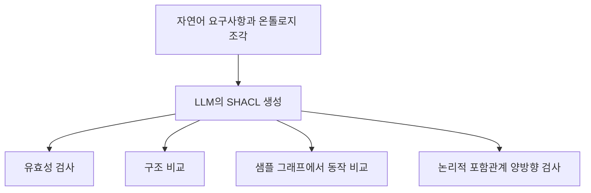

# NL2SHACL-Bench 리뷰 — 문법을 통과한 규칙의 의미 평가

LLM이 만든 SHACL을 파싱하고 실행하는 데 성공해도 요구사항을 정확히 옮겼다고 말할 수는 없다. *NL2SHACL-Bench: A Benchmark Suite for Natural Language to SHACL Translation*은 이 간격을 평가 대상으로 삼는다. ISWC 2026 채택 논문의 arXiv v2를 기준으로, 생성 결과를 어떤 층위에서 검사하는지 살펴본다.

## 번역과 평가의 분리

모델은 자연어 설명과 관련 온톨로지 조각, 출력 형식을 보여주는 예시를 받는다. 평가는 유효성, 구조, 의미를 나누어 본다. 문자열이나 그래프 구조가 달라도 같은 제약을 표현할 수 있기 때문에 구조 일치만으로 번역의 정확성을 판단하지 않는다. 논문은 234개 항목에 네 모델을 적용한 936개 번역 결과를 보고한다. [논문 §4–5](https://arxiv.org/html/2608.07530v2)

같은 생성 결과를 유효성, 구조, 샘플 그래프의 동작, 논리적 포함관계로 나누어 평가하므로 어느 한 점수만으로 전체 정확도를 대신하기 어렵다.

## 두 가지 의미 평가

ASER는 생성한 데이터 그래프에서 두 규칙의 검증 동작을 비교한다. LER는 SHACL2FOL과 정리 증명기를 이용해 양방향 포함관계를 검사한다. 지원하지 않는 표현이나 시간 제한 때문에 논리 판정이 미정으로 남을 수 있다. 논문은 잘못된 target이나 추가 제약을 샘플 평가가 놓치는 사례도 보고한다. [논문 §4.3–5.2](https://arxiv.org/html/2608.07530v2)

v2의 지표 정의와 Figure 7 설명은 평가 불가 항목을 분모에 처리하는 서술이 다르다. 따라서 여기서는 그래프의 비율을 재인용하지 않는다. 논리 판정의 성공률과 판정 가능한 범위는 함께 확인해야 한다.

## 통과 사례만으로 놓치는 조건

다음은 설명을 위한 자체 예시다. 요구사항은 이메일 값이 있으면 문자열이어야 한다고만 정했다고 하자. 생성 모델이 이메일을 반드시 하나 이상 요구하면 더 엄격한 규칙이 된다.

| 데이터 | 원래 조건 | 추가 필수 조건 |
|---|---|---|
| 문자열 이메일 있음 | 통과 | 통과 |
| 이메일 없음 | 통과 | 실패 |

이메일이 있는 사례만 검사하면 차이가 드러나지 않는다. 같은 방식으로 잘못된 검사 대상 선언 때문에 아무 노드도 검사하지 않은 결과를 정상 통과로 오인할 수 있다.

## 우리 실험의 평가 단위

이 논문은 정확한 온톨로지 용어와 예시를 제공하는 번역 설정을 사용한다. 현장 문서에서 용어를 찾고 모호한 요구사항을 사용자와 협의하는 전체 과정을 측정한 것은 아니다. [논문 §6](https://arxiv.org/html/2608.07530v2)

우리 도구에서는 규칙의 문법, 검사 대상의 선택, 판정 차이, 사용자의 의도 확인을 따로 기록할 필요가 있다. 특히 ‘차이를 못 찾음’과 ‘동등함을 확인함’을 같은 성공으로 묶지 않아야 한다. 이 구분을 보고서에 드러내는 기능부터 만들면 기존 벤치마크의 문제의식을 실제 검토 작업에 연결할 수 있다.

원문: [arXiv v2](https://arxiv.org/abs/2608.07530v2) · [평가 프레임워크](https://github.com/DE-TUM/NL2SHACL-Framework)
