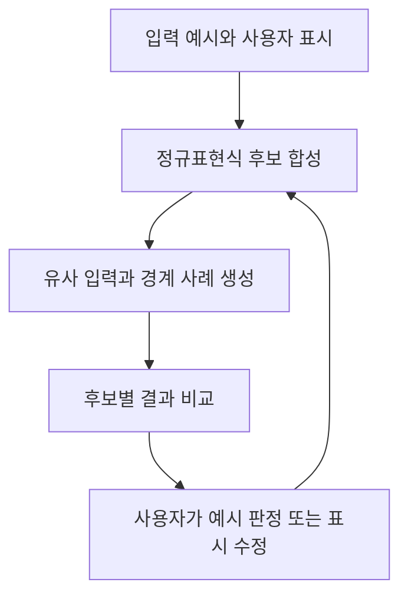

# REGAE 리뷰 — 예시로 프로그램의 해석 차이를 확인하는 방법

자연어 요구사항을 규칙으로 옮기다 보면 문법보다 의도가 어렵다. 생성한 코드가 실행돼도 사용자가 기대한 범위까지 맞았는지는 별도로 확인해야 한다. UIST 2020 논문 *Interactive Program Synthesis by Augmented Examples*는 이 확인을 사용자의 코드 독해 능력에만 맡기지 않는다. 후보 프로그램이 처리하는 예시를 보여주고 사용자가 예시를 수정하거나 표시하면서 의도를 전달하도록 한다.

## 예시를 통한 두 가지 개입

논문의 도구 REGAE는 정규표현식을 합성한다. 사용자는 입력의 일부를 그대로 보존하거나 일반화하도록 표시할 수 있다. 논문은 이를 semantic augmentation이라 부른다. 도구가 비슷한 입력과 경계 사례를 만들어 보여주는 data augmentation도 제공한다. 후보가 여럿이면 결과가 갈리는 입력을 생성한다. [논문 본문 §3–5](https://glassmanlab.seas.harvard.edu/papers/ips_augex_uist20.pdf)

예시를 제시해 후보의 동작을 확인하고 사용자 피드백을 받아 다시 합성한다.

## 전화번호 예시의 해석 차이

다음은 방식을 설명하기 위해 만든 예시이며 논문의 실험 결과가 아니다. 사용자가 `+82`, `010`을 허용한다고만 알려주면 여러 규칙이 이 두 사례를 만족한다.

| 추가 입력 | 맨 앞의 선택적 +와 숫자를 허용 | +와 숫자를 위치 제한 없이 허용 |
|---|---|---|
| `82+` | 거부 | 허용 |
| `++82` | 거부 | 허용 |
| `82` | 허용 | 허용 |

사용자는 복잡한 정규표현식 두 개를 읽는 대신 `82+`를 허용할지 판단할 수 있다. 구분에 도움이 되는 사례가 좋은 인터페이스가 되는 셈이다.

## 사용자 실험의 결과와 범위

논문은 컴퓨터과학 전공 학생 12명을 대상으로 조건을 바꾸어 수행하는 사용자 실험을 진행했다. 비교 조건에도 정규표현식 주석과 사용자가 직접 제공하는 반례가 있었다. 여기에 두 가지 augmentation을 함께 추가한 조건에서는 12명 모두 과제를 완료했고 비교 조건에서는 4명이 완료했다. 따라서 결과를 자동 예시 생성 하나의 효과로 분리해 해석할 수는 없다. [논문 §6](https://glassmanlab.seas.harvard.edu/papers/ips_augex_uist20.pdf)

정규표현식 과제와 이 참가자 집단의 결과를 금융 승인 규칙이나 온톨로지 설계에 그대로 적용할 수도 없다. 그래도 사용자가 추상적인 규칙보다 구체적인 사례를 검토하도록 돕는 설계에는 참고할 만하다.

## SHACL 연구에 가져올 부분

우리 연구에서 새로 확인할 대상은 그래프의 관계와 누락 정보다. 정규표현식 입력은 하나의 문자열이지만 승인 판단은 작업·버전·검토자·증빙의 연결을 함께 읽어야 한다. 사례가 너무 커지면 사람이 다시 이해하기 어려워진다.

그래프 사례를 작게 줄여도 판정 차이가 유지되는지, 실제 위반과 검사 대상 제외를 구분해 보여줄 수 있는지가 구체적인 도구 과제가 될 수 있다. 다만 ‘판정이 갈리는 예시로 의도를 확인한다’는 발상 자체는 이 연구와 겹친다. 새로움을 주장하려면 그래프에서 생기는 어려움을 별도로 해결하고 평가해야 한다.

원문: [UIST 2020 논문](https://glassmanlab.seas.harvard.edu/papers/ips_augex_uist20.pdf) · [공개 구현](https://github.com/tianyi-zhang/interactive-program-synthesis)
