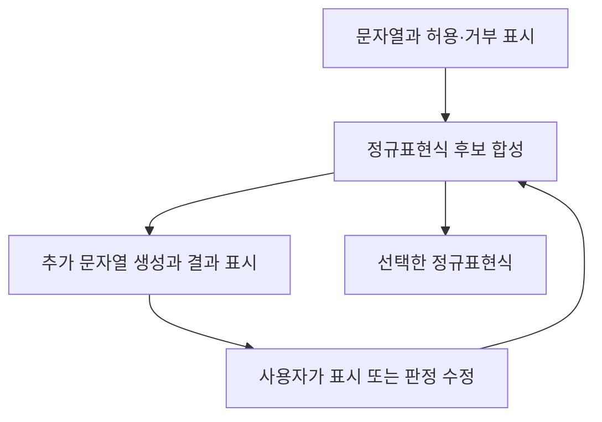

# REGAE 리뷰 — 예시를 주고받으며 정규표현식을 만드는 도구

전화번호에서 숫자만 추출하거나 특정 형식의 상품 코드를 찾을 때 정규표현식(regex)을 쓴다. 짧은 문자열로 조건을 표현할 수 있지만 읽고 수정하기는 쉽지 않다. 예시 몇 개를 주고 프로그램이 알아서 규칙을 만들어주면 편할 것이다. 그런데 그 예시들에 맞는 규칙이 여러 개라면 어떻게 골라야 할까.

*Interactive Program Synthesis by Augmented Examples*는 이 문제를 다룬 UIST 2020 논문이다. 저자들은 REGAE라는 대화형 합성 도구를 만들었다. 여기서 대화형이란 LLM과 채팅한다는 뜻이 아니다. 사용자가 문자열의 일부를 표시하고 도구가 추가 문자열을 보여주면 허용 여부를 판단하면서 원하는 정규표현식을 좁혀가는 방식이다.

## 연구 질문과 기존 방식의 부담

논문의 연구 질문은 예시를 보강하는 상호작용이 사용자의 의도를 더 빠르게 구체화하고 생성 프로그램을 검토하는 인지 부담을 줄이는가이다. 단순히 정규표현식 생성 정확도만 비교하지 않는다. 사용자가 어떤 정보를 제공하고 결과를 어떻게 확인하는지도 연구 대상이다. [논문 §6](https://glassmanlab.seas.harvard.edu/papers/ips_augex_uist20.pdf)

예시 기반 프로그래밍에서는 통과 예시와 실패 예시가 요구사항 역할을 한다. 하지만 잘못된 후보를 반박할 문자열을 사용자가 직접 떠올리기는 어렵다. 코드에 조건을 표시하는 방식도 정규표현식을 읽을 수 있어야 유용하다.

## 입력부터 결과까지의 한 장면

아래는 논문의 전화번호 과제를 설명하기 위해 단순화한 예시다. 원하는 규칙은 맨 앞에 선택적으로 `+`가 오고 그 뒤에는 숫자가 이어지는 형태다.

```text
사용자가 준 통과 예시: +91, 91

후보 A: 맨 앞에 +가 한 번까지 올 수 있고, 이후는 숫자
후보 B: 숫자와 +라면 위치와 개수에 상관없이 허용

추가 확인 사례: 91+, ++91
사용자 판정: 둘 다 거부
```

처음 두 예시에서는 A와 B가 모두 맞는다. 마지막 두 사례를 확인하고 나서야 의도가 구분된다. 사용자는 후보 B의 코드를 고치는 대신 자신이 아는 입력의 허용 여부를 판단한다.

REGAE는 semantic augmentation과 data augmentation을 제공한다. semantic augmentation에서는 입력 일부를 그대로 유지하거나 숫자 같은 문자 범주로 일반화하도록 표시한다. data augmentation은 유사 입력·경계 사례·후보 간 결과가 갈리는 입력을 생성한다. [논문 §3–5](https://glassmanlab.seas.harvard.edu/papers/ips_augex_uist20.pdf)



위 흐름은 예시를 주고 후보를 만든 뒤, 새 예시를 확인하면서 다시 합성하는 반복이다. 자연어 문장을 곧바로 코드로 번역하는 파이프라인과는 입력 방식부터 다르다.

## 실제 프로그램의 구성

공개 구현은 브라우저 화면과 로컬 Java 서버로 나뉜다. README는 Java 1.8 이상, Maven 프로젝트, `localhost:8080` 접속을 안내한다. 합성기는 Z3에 의존하며 문서는 Z3 4.8.9 이하와의 호환성을 명시한다. 현재 환경에서 그대로 실행된다고 보장하는 안내로 읽어서는 안 된다. [공식 실행 안내](https://github.com/tianyi-zhang/interactive-program-synthesis)

| 구성 | 공개 소스에서 확인한 기술 | 맡은 일 |
|---|---|---|
| 브라우저 화면 | HTML, CSS, JavaScript, jQuery, Bootstrap | 예시 입력과 문자 범위 표시, 후보 표시 |
| 서버 | Java, Jetty HTTP/WebSocket | 화면 요청과 합성 처리 연결 |
| 메시지 변환 | Jackson | JSON을 Java 객체로 읽기 |
| 합성기 연결 | ResnaxRunner, Resnax, Z3 | 조건을 만족하는 후보 탐색 |
| 정규표현식 처리 | dk.brics.automaton | 문자열 언어를 오토마톤으로 다루기 |

의존성 목록은 라이브러리의 역할을 이해하기 위한 것이다. 실제 논문 실험 당시의 모든 버전과 현재 공개 저장소의 버전이 같다고 단정하지 않는다. [서버 의존성](https://github.com/tianyi-zhang/interactive-program-synthesis/blob/f5b737837a7f8e114b04fba89ec19d2b97fecc13/back-end/pom.xml) · [화면 소스](https://github.com/tianyi-zhang/interactive-program-synthesis/blob/f5b737837a7f8e114b04fba89ec19d2b97fecc13/front-end/index.html) · [합성기 호출 코드](https://github.com/tianyi-zhang/interactive-program-synthesis/blob/f5b737837a7f8e114b04fba89ec19d2b97fecc13/back-end/src/main/java/edu/harvard/seas/synthesis/ResnaxRunner.java)

## 데이터 형식과 저장 위치

이 도구의 데이터는 문자열 예시, 허용 여부, 사용자가 붙인 표시, 정규표현식 후보다. 지식그래프를 구축하거나 RDF로 변환하는 작업은 없다.

서버의 `SynthesisServerHandler`는 WebSocket 메시지에서 JSON 부분을 읽어 `Example[]`과 `Regex[]` 객체로 변환한다. JSON은 브라우저와 서버 사이의 전달 형식이다. `ResnaxRunner`는 합성기에 전달할 예시를 로컬 파일에 쓰고 결과 파일을 읽으며 `resnax_temp`와 `resnax_log` 경로를 사용한다. 확인한 경로는 메모리 객체와 로컬 파일을 이용하며 별도 그래프 DB 적재를 요구하지 않는다. [메시지 처리](https://github.com/tianyi-zhang/interactive-program-synthesis/blob/f5b737837a7f8e114b04fba89ec19d2b97fecc13/back-end/src/main/java/edu/harvard/seas/synthesis/SynthesisServerHandler.java) · [파일 입출력](https://github.com/tianyi-zhang/interactive-program-synthesis/blob/f5b737837a7f8e114b04fba89ec19d2b97fecc13/back-end/src/main/java/edu/harvard/seas/synthesis/ResnaxRunner.java)

```text
브라우저의 문자열·표시
  → WebSocket 메시지 안의 JSON
  → Java의 예시 객체
  → 합성기 입력 파일
  → 후보 결과 파일
  → JSON 응답과 화면 표시
```

## 실험 데이터와 비교 조건

저자들은 Stack Overflow의 문자열 매칭 과제 122개를 모으고 추가 의도 확인이 필요한 과제 중 세 개를 사용자 실험에 선택했다. 참가자는 컴퓨터과학 전공 학생 12명이다. 각 참가자는 서로 다른 상호작용 조건으로 두 과제를 수행했으며 과제당 제한 시간은 15분이었다. 비교 조건에도 사용자가 직접 반례를 추가하거나 정규표현식에 주석을 다는 기능이 있었다. [논문 §6](https://glassmanlab.seas.harvard.edu/papers/ips_augex_uist20.pdf)

## 결과의 의미와 해석 범위

| 측정 항목 | 보강된 상호작용 | 비교 조건 |
|---|---|---|
| 과제 완료 참가자 | 12명 | 4명 |
| 평균 합성 반복 | 3.3회 | 7.7회 |
| 평균 과제 시간 | 7.3분 | 12.5분 |

시간 초과 사례의 시간은 15분으로 처리한 결과다. 두 augmentation을 함께 제공했으므로 차이를 자동 예시 생성 하나의 효과로 분리할 수 없다. 참가자 수와 과제 범위도 제한적이다. [논문 §6 결과](https://glassmanlab.seas.harvard.edu/papers/ips_augex_uist20.pdf)

이 논문은 사용자가 생성된 코드를 읽는 대신 입력과 출력의 차이를 판단하도록 인터페이스를 구성했다. 도구의 효과를 평가할 때도 생성 결과와 함께 사람이 정답에 도달하는 시간과 반복 횟수를 측정했다. 정규표현식 이외의 복잡한 프로그램에서도 같은 효과가 나는지는 별도 검증이 필요하다.
