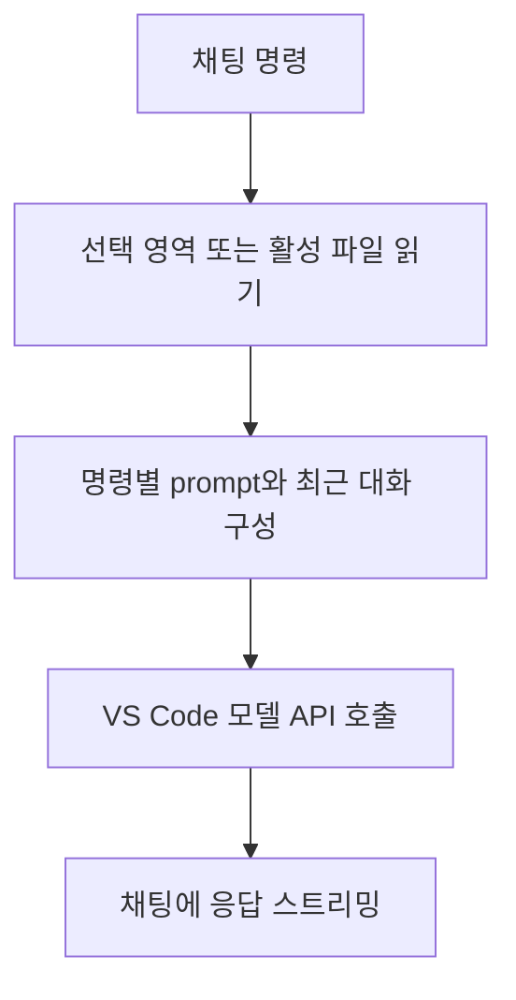

# SHACL Guru 도구 리뷰 — VS Code에서 규칙을 생성하고 설명받는 과정

SHACL을 처음 쓰면 어떤 제약 이름을 골라야 하는지, Turtle 괄호를 어디에 닫아야 하는지부터 막힌다. 기존 코드를 읽고 수정하는 일도 익숙하지 않다. SHACL Guru는 이런 작성 작업을 VS Code 채팅 안에서 지원하는 공개 확장이다.

이 대상은 연구 질문과 실험 결과를 제시한 학술논문이 아니다. 논문처럼 정확도나 사용자 실험 결과를 만들어 붙일 수 없다. 이 글은 공식 문서와 고정된 커밋의 소스를 읽고 무엇을 입력하면 어떤 처리를 거쳐 무엇이 나오는지 설명하는 도구 리뷰다. 설치 후 실행 성능은 측정하지 않았다.

## 해결하려는 작업

README는 자연어에서 SHACL 생성, 선택한 코드 설명, RDF에서 shape 추정, 제약 추가, 통과·위반 데이터 생성 기능을 소개한다. 사용자는 편집기에서 코드를 선택하거나 파일을 연 상태로 질문할 수 있다. 채팅 참여자 이름은 `@shacl`이다. [공식 기능 소개](https://github.com/simonstey/vscode-shacl-guru)

RDF는 데이터 표현이고 SHACL은 그 데이터의 검사 규칙이다. 예를 들어 `Person`에게 이름을 요구하는 shape와 실제 사람의 이름을 담은 RDF는 서로 다른 파일이다. 이 도구는 둘 모두를 텍스트 문맥으로 받아 작성이나 설명을 돕는다. [SHACL 기본 모델](https://www.w3.org/TR/shacl/)

## 사용 장면과 출력의 의미

다음은 기능을 이해하기 위해 만든 요청 예시로, 실제 실행 결과와는 구분된다.

```text
1. person-shape.ttl을 열고 Person shape를 선택한다.
2. @shacl /explain 이름 제약이 어떤 뜻인지 설명해줘.
3. @shacl /add-constraint 이름은 하나만 허용하도록 수정해줘.
4. @shacl /generate-violating 조건을 위반하는 RDF 예시를 만들어줘.
```

사용자는 shape의 설명, 수정된 Turtle 코드, 예시 RDF와 해설을 채팅으로 받도록 설계돼 있다. 이때 채팅에 나온 코드는 생성 제안이다. 실제 파일에 저장된 상태나 검증 엔진에서 실행한 결과와 동일하게 취급하면 안 된다.

## 구현 언어와 의존성

검토한 `package.json`의 버전은 0.0.4이고 VS Code 요구 범위는 `^1.100.0`이다. 구현 언어는 TypeScript이며 컴파일한 `out/extension.js`를 확장 진입점으로 사용한다. 개발 의존성에는 TypeScript, ESLint, VS Code 및 Node 타입 정의, VS Code 테스트 도구가 있다. [고정 버전의 package.json](https://github.com/simonstey/vscode-shacl-guru/blob/2cce4bed082e1dc720a715277dc1aca3b50337ae/package.json)

| 계층 | 사용 기술 | 하는 일 |
|---|---|---|
| 편집기 | VS Code 확장 API | 선택 영역과 활성 문서 읽기 |
| 명령 처리 | TypeScript 함수 | 명령에 맞는 prompt 구성 |
| 모델 호출 | `request.model.sendRequest` | 현재 요청의 언어 모델에 메시지 전송 |
| 출력 | 채팅 응답 스트림 | 모델이 보내는 텍스트를 화면에 표시 |

코드는 별도의 모델 서버를 띄우기보다 VS Code가 제공하는 모델 객체를 사용한다. 이 호출만으로 특정 모델명이나 과금 방식을 고정했다고 볼 수 없다. [extension.ts](https://github.com/simonstey/vscode-shacl-guru/blob/2cce4bed082e1dc720a715277dc1aca3b50337ae/src/extension.ts)

## 실제 호출 흐름



`getEditorContext`가 편집기 문맥을 읽고 `buildPrompt`가 명령에 따른 요청을 구성한다. 처리 함수는 최근 대화 중 일부와 현재 요청을 메시지로 만들어 모델에 전달한다. 반환된 텍스트 조각은 채팅에 차례로 출력된다. 확인한 처리 함수에는 RDF 파서나 SHACL 검증 엔진을 실행하는 단계가 없다. [호출 경로 소스](https://github.com/simonstey/vscode-shacl-guru/blob/2cce4bed082e1dc720a715277dc1aca3b50337ae/src/extension.ts)

이 도구의 설명은 모델이 생성한 설명이고 위반 예시도 모델이 위반한다고 제안한 데이터다. 실제 위반 여부를 확인하려면 별도의 검증 실행이 필요하다.

## 파일 형식과 저장소

| 대상 | 형태와 처리 |
|---|---|
| 원본 규칙 | 보통 Turtle 텍스트를 편집기에서 선택 |
| 원본 데이터 | RDF 텍스트를 문맥으로 제공 가능 |
| 내부 문맥 | 파일 내용·선택 내용·대화를 문자열 메시지로 구성 |
| 결과 | 채팅의 설명과 코드 블록 |
| JSON | package.json 등 확장 설정에 사용 |
| RDF DB | 확인한 호출 경로에 적재·질의 단계 없음 |

RDF를 입력한다고 자동으로 그래프 DB가 생기지는 않는다. 이 구현에서 파일 내용은 먼저 텍스트로 읽힌다. 공개된 주 처리 경로에는 그래프를 저장해 SPARQL을 실행하는 코드도, 생성 결과를 자동으로 파일에 쓰는 단계도 나타나지 않는다. 이는 그 처리 경로를 읽은 범위의 관찰이다. [구현](https://github.com/simonstey/vscode-shacl-guru/blob/2cce4bed082e1dc720a715277dc1aca3b50337ae/src/extension.ts)

## 소스에서 확인한 주의점

`generate-conforming`과 `generate-violating`은 같은 분기로 들어간다. 그런데 conforming과 violating 중 무엇을 요청할지는 명령 이름이 아니라 `request.prompt`에 영문 `violate`가 포함됐는지로 정한다. 명령만 위반 생성으로 선택하고 본문에는 그 단어가 없으면 코드상 conforming으로 구성될 수 있다. 이 지점은 정적 소스 관찰에 한정된다. VS Code에서 오류를 재현해 보고한 결과와는 구분해야 한다. [명령 분기](https://github.com/simonstey/vscode-shacl-guru/blob/2cce4bed082e1dc720a715277dc1aca3b50337ae/src/extension.ts)

또한 선택한 파일 내용이 모델 요청에 들어가므로 로컬 파일을 보고 있다는 이유만으로 모델 처리가 전부 로컬에서 수행된다고 생각하면 안 된다. 실제 전송 범위는 코드의 문맥 구성과 사용하는 VS Code 모델 환경을 함께 확인해야 한다.

## 효과를 판단할 근거

공개 문서를 확인했지만 검증 정확도 벤치마크나 대조군을 둔 사용자 실험 결과는 제시돼 있지 않았다. 효용을 수치로 평가하기보다 제공 기능과 실행 경계를 판단하는 편이 맞다.

SHACL Guru는 편집기 문맥을 활용해 규칙을 읽고 초안을 만드는 과정을 짧게 묶었다. 다만 생성한 코드가 요구사항을 정확히 반영했는지, 예시가 실제로 통과하거나 실패하는지는 별도 검증 문제로 남는다. 작성 지원 도구로 이해하면 기능이 선명해지고 검증기와 혼동하면 기대가 어긋난다.
